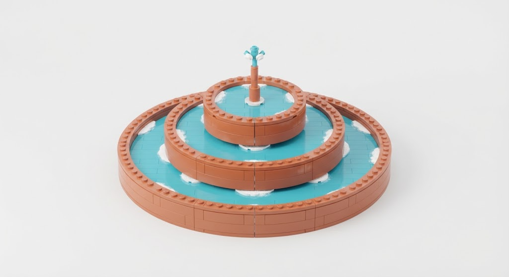
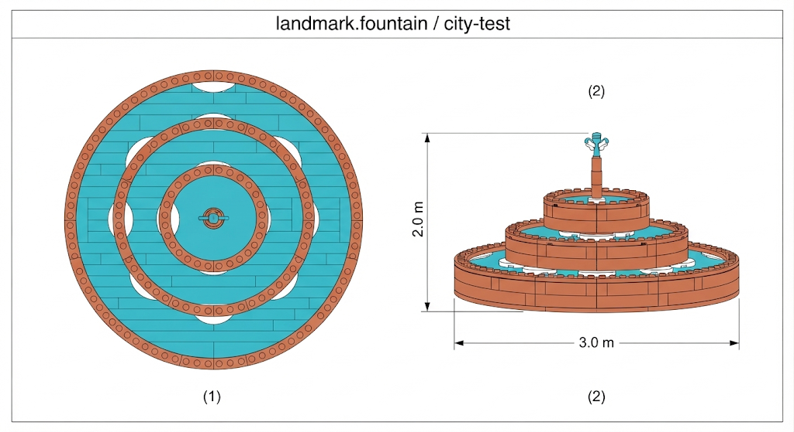

# Prompt Gemini — mode d’emploi brick (Brick-Racer)

Deux usages :

1. **Artwork structure seule** (§ ci-dessous) — image de référence isolée (fontaine / landmark), sans plaza.
2. **Mode d’emploi JSON** (§ Prompt manuel) — notice d’assemblage pour le runtime.

Pipeline runtime : artwork (optionnel) → prompt manuel → JSON → `validateManual` → `assembleManual` → `bakeShell` → `InstancedMesh`.  
Gemini **ne code pas** pour le manuel ; il ne rend que le JSON.

Réf. plaza complète (contexte) : [a1-hub-plaza.png](art/a1-hub-plaza.png).  
Plan cotes : [test-slice-plans.md](test-slice-plans.md) § city-test — fontaine Ø base **3,00 m**, sommet Y **2,00 m**, centre `(20, 0, 20)`.

### Canons structure fontaine (validés)

| Vue | Fichier |
| --- | ------- |
| Hero 3/4 studio |  · [ref-fountain-hero.png](art/ref-fountain-hero.png) |
| Ortho plan + élévation |  · [ref-fountain-ortho.png](art/ref-fountain-ortho.png) |

Joindre **ces deux images** (ou au moins le hero) au prompt manuel JSON — plus A1 plaza si besoin de contexte hub.

---

## Artwork — structure seule (fontaine)

Objectif : générer un **hero shot de la fontaine uniquement** (fond neutre), assez précis pour guider le manuel JSON. Pas de bâtiments, pas de minifig, pas de pad, pas de gate.

### Spec structure (à respecter dans l’image)

| Élément | Description |
| ------- | ----------- |
| Forme | **3 paliers circulaires** (bassins empilés), pas une pyramide de cubes / voxel Minecraft |
| Emprise | Diamètre bassin bas ≈ **3 m** (~9 studs) ; hauteur totale ≈ **2 m** (~6 briques) |
| Matériau bassins | Briques **terracotta / rouge-brun** studs visibles, joints lisibles, plastique jouet |
| Eau | Surfaces **cyan** plates (tiles) dans chaque bassin + reflets blancs / écume |
| Jet | Colonne centrale fine + goutte / spray blanc-cyan au sommet |
| Style | Concept art jeu brick pastel, lumière douce studio, outlines nets |
| Interdits | Plaza, tour, garage, panneau texte, personnages, route, ciel city, logos marques |

### Prompt artwork (copier-coller)

```text
Product-style concept art of a SINGLE LEGO-like brick fountain as a standalone prop, isolated on a seamless light grey / soft white studio backdrop, no city, no buildings, no characters, no road, no signs.

Structure (exact):
- three concentric circular basins stacked like a classic plaza fountain (NOT a square pyramid of cubes, NOT Minecraft voxels)
- bottom basin diameter about 3 meters (~9 studs across), overall height about 2 meters
- basin rims built from reddish-brown terracotta studded bricks with visible studs and brick seams
- each basin holds flat cyan water tiles with white foam highlights at the edges
- thin central terracotta spout column with a small cyan-white water spray tip on top
- soft daylight studio lighting, plastic toy sheen, clear silhouette, game concept art, candy-pastel palette limited to terracotta + cyan + white

Composition: three-quarter isometric view, fountain centered, slight ground shadow only, generous empty margin around the prop.

Negative: city plaza, clock tower, garage, billboard text, minifigures, yellow race pad, seashell gate, asphalt road, cluttered background, purple haze, photorealistic wet stone fountain, logos, licensed brands
```


### Variante — orthographique (notice / cotes)

Utile si tu veux une vue « plan + élévation » avant le JSON :

```text
Technical orthographic concept sheet of one LEGO-style brick fountain only, white background, two views side by side: (1) top plan showing three concentric circular basin rings, (2) front elevation showing three stacked basin heights totaling 2.0 m with diameter callout 3.0 m at the base, terracotta brick rims, cyan water discs, central spout, meter dimension lines, title "landmark.fountain / city-test", no city scenery, no characters, toy brick aesthetic, clean blueprint-like presentation
```

Enchaînement recommandé : artwork structure (canons ci-dessus) → joindre les PNG au **Prompt manuel** ci-dessous.

**Note catalogue runtime** : les artworks montrent des briques **courbes** et un jet multi-buses ; le catalogue BW1 n’a que des pièces orthogonales (`1x1`…`tile`). Le manuel approxime le cercle par des `ring` / `disc` — silhouette A1, pas pièce-à-pièce identique à l’image.

---


## Catalogue (autorisé uniquement)


### Pièces (`part`)


| Id      | Emprise (studs × plates × studs) à rot 0 | Notes                   |
| ------- | ---------------------------------------- | ----------------------- |
| `1x1`   | 1 × 3 × 1                                | Brique standard         |
| `1x2`   | 1 × 3 × 2                                |                         |
| `2x2`   | 2 × 3 × 2                                |                         |
| `2x4`   | 2 × 3 × 4                                |                         |
| `plate` | 2 × 1 × 4                                | Fine (1 plate)          |
| `tile`  | 2 × 1 × 2                                | Fine carrée — eau / sol |


`rot` ∈ `{0, 90, 180, 270}` (yaw degrés, autour de Y). À 90°/270°, X et Z de l’emprise s’échangent.

### Couleurs (`color`)

`cyan` · `white` · `lime` · `sand` · `terracotta` · `yellow` · `black`

### Unités

- **1 stud (S)** = 0,33 m — axes X / Z  
- **1 plate (P)** = 0,11 m — axe Y  
- **1 brick (B)** = 3 plates = 0,33 m  
- Coordonnées manuelles = **entiers** (studs / plates), relatives à `origin`  
- `at: [sx, py, sz]` = coin **min** de la pièce (pas le centre), en studs / plates


### Enveloppe fontaine (plan)

- `id`: `"landmark.fountain"`  
- `origin`: `[20, 0, 20]` (mètres monde)  
- `envelope.size`: `[3, 2, 3]` (mètres, plein) → Ø base 3 m, sommet Y ≤ 2 m  
- Réf. visuelle : [a1-hub-plaza.png](art/a1-hub-plaza.png) — bassins **circulaires terracotta**, eau **cyan**, jet central, 3 paliers

---


## Format JSON (sortie obligatoire)

```json
{
  "id": "landmark.fountain",
  "version": 1,
  "title": "Fontaine plaza A1",
  "origin": [20, 0, 20],
  "envelope": { "size": [3, 2, 3] },
  "partsList": [
    { "part": "1x2", "color": "terracotta", "qty": 32 },
    { "part": "tile", "color": "cyan", "qty": 12 }
  ],
  "steps": [
    {
      "title": "1 — Bassin bas",
      "ops": [
        { "op": "ring", "part": "1x2", "color": "terracotta", "radius": 4, "y": 0, "courses": 2 },
        { "op": "disc", "part": "tile", "color": "cyan", "radius": 3, "y": 0 }
      ]
    },
    {
      "title": "2 — Jet",
      "ops": [
        { "op": "brick", "part": "1x1", "color": "terracotta", "at": [0, 12, 0] },
        { "op": "brick", "part": "1x1", "color": "cyan", "at": [0, 15, 0] }
      ]
    }
  ]
}
```


### Macros `ops`


| `op`    | Champs                                                                           | Effet                                                                             |
| ------- | -------------------------------------------------------------------------------- | --------------------------------------------------------------------------------- |
| `brick` | `part`, `color`, `at`, `rot?`                                                    | Une pièce                                                                         |
| `ring`  | `part`, `color`, `radius` (studs), `y` (plates), `courses?` (défaut 1), `count?` | Anneau horizontal ; `courses` empile en hauteur (×3 plates / course pour briques) |
| `disc`  | `part`, `color`, `radius`, `y`, `filled?` (défaut true)                          | Disque / anneau plat (tiles / plates)                                             |
| `wall`  | `part`, `color`, `from`, `to`, `y`, `heightCourses?`                             | Mur entre deux points grille                                                      |
| `box`   | `part`, `color`, `min`, `max`                                                    | Remplissage AABB grille (le bake retire l’intérieur)                              |


`partsList` = nomenclature récap (quantités approximatives OK) ; les `steps` font foi pour l’assemblage.

---


## Prompt manuel JSON (copier-coller)

Joindre de préférence l’**artwork structure seule** (ou crop fontaine de A1).

```text
Tu es un designer LEGO pour le jeu Brick-Racer. Tu produis UNIQUEMENT un JSON valide (pas de markdown, pas de commentaire) au format « mode d'emploi brick » ci-dessous.

Contraintes dures :
- Catalogue pièces UNIQUEMENT : 1x1, 1x2, 2x2, 2x4, plate, tile
- Couleurs UNIQUEMENT : cyan, white, lime, sand, terracotta, yellow, black
- Coordonnées entières : X/Z en studs, Y en plates ; `at` = coin min de la pièce
- rot ∈ {0, 90, 180, 270}
- Tout doit tenir dans envelope.size [3, 2, 3] mètres autour de origin [20, 0, 20] (soit environ ±4,5 studs en XZ et Y plates 0..18)
- Style structure : fontaine circulaire 3 paliers, bassins terracotta, eau cyan (tiles), jet central blanc/cyan, pas de pyramide de cubes verts
- Utilise des macros ring / disc / brick (évite de lister 200 briques une par une)
- Inclus partsList (nomenclature) + steps numérotés avec titres clairs (notice LEGO)
- Pas de chevauchement ; pas de pièce hors catalogue

Format exact :
{
  "id": "landmark.fountain",
  "version": 1,
  "title": "...",
  "origin": [20, 0, 20],
  "envelope": { "size": [3, 2, 3] },
  "partsList": [ { "part": "...", "color": "...", "qty": N } ],
  "steps": [
    { "title": "1 — ...", "ops": [ { "op": "ring"|"disc"|"brick"|"wall"|"box", ... } ] }
  ]
}

Références visuelles jointes : ref-fountain-hero.png + ref-fountain-ortho.png (fontaine seule, Ø 3.0 m × h 2.0 m).
Suis la silhouette 3 paliers terracotta + eau cyan + jet central.
Approxime le cercle avec les macros ring/disc du catalogue orthogonal (pas de pièce courbe au runtime).
Génère le mode d'emploi complet de la fontaine.
```


### Boucle d’erreurs

Si `validateManual` / tests échouent, recoller à Gemini :

```text
Ce JSON a été rejeté. Corrige UNIQUEMENT le JSON (même format), sans explication.

Erreurs :
<coller le message d'erreur>
```

---

