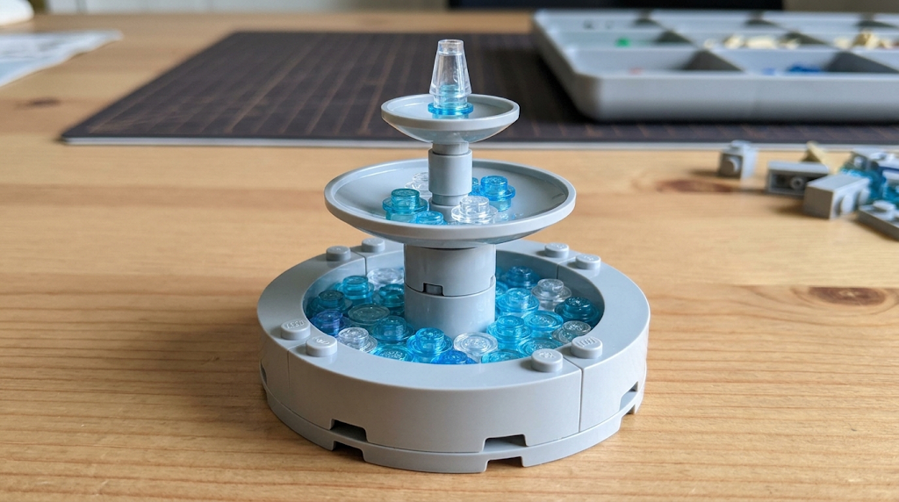

# Prompt Gemini — mode d’emploi brick (Brick-Racer)

Deux usages :

1. **Artwork / photo structure** (§ ci-dessous) — image de référence isolée (fontaine / landmark), sans plaza.
2. **Mode d’emploi JSON** (§ Prompt manuel) — notice d’assemblage pour le runtime.

Pipeline runtime : réf. visuelle → prompt manuel → JSON → `validateManual` → `assembleManual` → `bakeShell` → `InstancedMesh`.  
Gemini **ne code pas** pour le manuel ; il ne rend que le JSON.

Réf. plaza complète (contexte hub) : [a1-hub-plaza.png](art/a1-hub-plaza.png).  
Plan cotes : [test-slice-plans.md](test-slice-plans.md) § city-test — fontaine Ø base **3,00 m**, sommet Y **2,00 m**, centre `(20, 0, 20)`.

### Canons structure fontaine (validés)

| Vue | Fichier |
| --- | ------- |
| **BOM photo (canon matière)** |  · [ref-fountain-bom.png](art/ref-fountain-bom.png) |
| Hero 3/4 studio (legacy A1) | [ref-fountain-hero.png](art/ref-fountain-hero.png) |
| Ortho plan + élévation | [ref-fountain-ortho.png](art/ref-fountain-ortho.png) |

**Canon runtime** : photo BOM — pierre **Light Bluish Gray**, eau **Trans-Light Blue / Trans-Clear**, 3 paliers circulaires. Joindre `ref-fountain-bom.png` au prompt manuel (hero/ortho en appoint).

### BOM physique → catalogue (design IDs)

| Pièce réelle | Qty | Id catalogue | mesh |
| ------------ | --- | ------------ | ---- |
| #3128 / #41539 plaque ronde 8×8 | 1 | `41539` (alias `3128`) | missing |
| #85080 macaroni 4×4 | 4 | `85080` | missing |
| #3941 brique ronde 2×2 | 2 | `3941` | missing |
| #3960 dish 4×4 | 1 | `3960` | missing |
| #3062b brique ronde 1×1 | 1 | `3062` | missing |
| #4740 dish 2×2 | 1 | `4740` | missing |
| #6141 plaque ronde 1×1 TLBlue / Clear | 16+15 | `6141` | box |
| #4589b cône 1×1 | 1 | `4589` | missing |

Le manuel runtime actuel peut encore utiliser des alias box ; la **cible authoring** est d’écrire ces design IDs dès que le catalogue les connaît.  
Manuel versionné : [`fountain.manual.json`](../../src/racer/hub/brick/manuals/fountain.manual.json).

---

## Artwork — structure seule (fontaine)

Objectif : hero shot de la fontaine uniquement (fond neutre), aligné sur la BOM photo. Pas de plaza.

### Spec structure

| Élément | Description |
| ------- | ----------- |
| Forme | **3 paliers circulaires** (bassins empilés), pas une pyramide de cubes |
| Emprise | Diamètre bassin bas ≈ **3 m** (~9 studs) ; hauteur totale ≈ **2 m** |
| Matériau bassins | **Gris clair / Light Bluish Gray**, studs visibles |
| Eau | Plaques rondes **cyan translucide** + accents **blanc / clear** |
| Jet | Plaque cyan + cône / spray blanc au sommet |
| Interdits | Plaza, tour, garage, personnages, logos marques |

### Prompt artwork (copier-coller)

```text
Product-style photo or concept art of a SINGLE LEGO brick fountain as a standalone prop on a light wooden table or seamless light grey studio backdrop, no city, no buildings, no characters.

Structure (exact, match BOM):
- three concentric circular basins stacked (NOT a square pyramid of cubes)
- bottom: Light Bluish Gray 8x8 round plate + four 4x4 macaroni bricks forming the outer ring
- middle: Light Bluish Gray 4x4 inverted dish on two stacked 2x2 round bricks
- top: Light Bluish Gray 2x2 inverted dish on a 1x1 round brick
- water: Trans-Light Blue and Trans-Clear 1x1 round plates in each basin
- jet: Trans-Light Blue 1x1 round plate + Trans-Clear 1x1 cone on top
- soft daylight, plastic toy sheen, clear silhouette

Negative: terracotta / reddish-brown bricks, city plaza, minifigures, yellow race pad, logos, licensed brands, Minecraft voxels
```

**Note catalogue runtime** : pas de macaroni / dish / cône mesh — approximation orthogonale via `ring` / `disc` / `brick` + `plate_1x1`. Silhouette BOM, pas pièce-à-pièce identique.

---

## Catalogue (autorisé uniquement)

Source de vérité : [`parts.json`](../../src/racer/hub/brick/catalog/data/parts.json) + [`colors.json`](../../src/racer/hub/brick/catalog/data/colors.json) (plan [brick-part-catalog.md](../plans/brick-part-catalog.md)).

- Préférer les **design IDs** LEGO (`3005`, `85080`, `6141`, …).
- Alias courts legacy toujours OK (`1x1` → `3005`, `plate_1x1` → `6141`, …).
- Une pièce absente du JSON = **refus** `validateManual` — l’ajouter au catalogue **avant** de l’utiliser dans un manuel (même si `mesh.status: missing`).
- Rendu actuel : proxy box tant que `mesh.status !== ready`.

### Pièces (extrait — seed BC1)

| Id | Alias | Emprise | Notes |
| -- | ----- | ------- | ----- |
| `3005` | `1x1` | 1×3×1 | Brick 1×1 (`box`) |
| `3004` | `1x2` | 1×3×2 | |
| `3003` | `2x2` | 2×3×2 | |
| `3001` | `2x4` | 2×3×4 | |
| `3020` | `plate` | 2×1×4 | |
| `3068` | `tile` | 2×1×2 | |
| `6141` | `plate_1x1` | 1×1×1 | Round plate — eau BOM |
| `85080` | — | 4×3×4 | Macaroni (`missing`) |
| `3960` / `4740` | — | dish | Bassins (`missing`) |
| `4589` | `4589b` | 1×3×1 | Cône jet (`missing`) |

Liste complète = fichier JSON (70+ pièces seed, extensible).

`rot` ∈ `{0, 90, 180, 270}` (yaw degrés, autour de Y). À 90°/270°, X et Z de l’emprise s’échangent.

### Couleurs (`color`)

`white` · `black` · `yellow` · `lime` · `sand` · `gray` · `dark_gray` · `terracotta` · `cyan` · `clear`  
(+ aliases `lbg`, `trans_light_blue`, …)

Fontaine canon : **`gray` + `cyan` + `clear`/`white`**.

### Unités

- **1 stud (S)** = 0,33 m — axes X / Z  
- **1 plate (P)** = 0,11 m — axe Y  
- **1 brick (B)** = 3 plates = 0,33 m  
- Coordonnées manuelles = **entiers** (studs / plates), relatives à `origin`  
- `at: [sx, py, sz]` = coin **min** de la pièce (pas le centre), en studs / plates  
- **Pas** de champ `center` sur `ring` / `disc` : le centre est `origin` ; `radius` et `y` suffisent

### Enveloppe fontaine (plan)

- `id`: `"landmark.fountain"`  
- `origin`: `[20, 0, 20]` (mètres monde)  
- `envelope.size`: `[3, 2, 3]` (mètres, plein) → Ø base 3 m, sommet Y ≤ 2 m  
- Réf. visuelle : [ref-fountain-bom.png](art/ref-fountain-bom.png)

---

## Format JSON (sortie obligatoire)

```json
{
  "id": "landmark.fountain",
  "version": 1,
  "title": "Fontaine circulaire 3 paliers (BOM gris + eau)",
  "origin": [20, 0, 20],
  "envelope": { "size": [3, 2, 3] },
  "partsList": [
    { "part": "tile", "color": "gray", "qty": 16 },
    { "part": "2x2", "color": "gray", "qty": 11 },
    { "part": "plate_1x1", "color": "cyan", "qty": 28 }
  ],
  "steps": [
    {
      "title": "1 — Plaque ronde 8×8 (base)",
      "ops": [
        { "op": "disc", "part": "tile", "color": "gray", "radius": 3.6, "y": 0 }
      ]
    },
    {
      "title": "2 — Anneau macaroni",
      "ops": [
        { "op": "ring", "part": "2x2", "color": "gray", "radius": 3, "y": 1, "courses": 1, "count": 8 }
      ]
    }
  ]
}
```

### Macros `ops`

| `op` | Champs | Effet |
| ---- | ------ | ----- |
| `brick` | `part`, `color`, `at`, `rot?` | Une pièce |
| `ring` | `part`, `color`, `radius` (studs), `y` (plates), `courses?`, `count?` | Anneau horizontal autour de `origin` |
| `disc` | `part`, `color`, `radius`, `y`, `filled?`, `innerRadius?` | Disque / anneau plat |
| `wall` | `part`, `color`, `from`, `to`, `y`, `heightCourses?` | Mur entre deux points grille |
| `box` | `part`, `color`, `min`, `max` | Remplissage AABB grille (bake retire l’intérieur) |

`partsList` = nomenclature récap (quantités approximatives OK) ; les `steps` font foi pour l’assemblage.

---

## Prompt manuel JSON (copier-coller)

Joindre **`ref-fountain-bom.png`** (+ hero/ortho si besoin).

```text
Tu es un designer LEGO pour le jeu Brick-Racer. Tu produis UNIQUEMENT un JSON valide (pas de markdown, pas de commentaire) au format « mode d'emploi brick » ci-dessous.

Contraintes dures :
- Catalogue pièces = design IDs LEGO présents dans parts.json (ex. 3005, 85080, 6141, 3960, 4740, 4589) ou leurs aliases documentés — N’INVENTE PAS de pièce hors catalogue
- Couleurs = ids colors.json (gray, cyan, clear, white, …)
- Fontaine : structure gray, eau cyan/clear — PAS terracotta
- Coordonnées entières : X/Z en studs, Y en plates ; `at` = coin min de la pièce
- rot ∈ {0, 90, 180, 270}
- ring / disc : champs `radius` + `y` (PAS de `center` — le centre est origin)
- Tout doit tenir dans envelope.size [3, 2, 3] mètres autour de origin [20, 0, 20] (± ~5 studs XZ, Y plates 0..18)
- Style : fontaine circulaire 3 paliers selon photo BOM (base 8x8 #41539/3128, macaroni #85080, dish #3960/#4740, jet #4589)
- Préfère les vraies design IDs BOM ; le runtime peut proxy-box tant que le mesh manque
- Utilise des macros ring / disc / brick ; inclus partsList + steps numérotés type notice LEGO
- Pas de chevauchement ; pas de pièce hors catalogue

Format exact :
{
  "id": "landmark.fountain",
  "version": 1,
  "title": "...",
  "origin": [20, 0, 20],
  "envelope": { "size": [3, 2, 3] },
  "partsList": [ { "part": "...", "color": "...", "qty": N } ],
  "steps": [
    { "title": "1 — ...", "ops": [ { "op": "ring"|"disc"|"brick"|"wall"|"box", ... } ] }
  ]
}

Référence visuelle jointe : ref-fountain-bom.png (Light Bluish Gray + Trans-Light Blue water).
Génère le mode d'emploi complet de la fontaine.
```

### Boucle d’erreurs

Si `validateManual` / tests échouent, recoller à Gemini :

```text
Ce JSON a été rejeté. Corrige UNIQUEMENT le JSON (même format), sans explication.

Erreurs :
<coller le message d'erreur>
```

---
