# Authoring décors brick — prompts Gemini v2

Pipeline : [brick-decor-pipeline.md](../plans/brick-decor-pipeline.md) · sprint [BRICK-DC1](../sprints/BRICK-DC1.md) (runtime) · [BRICK-DC2](../sprints/BRICK-DC2.md) (ces prompts).

```mermaid
flowchart LR
  p0[Prompt0 image ortho] --> img[Planche face cote dessus]
  img --> pA[PromptA fiche cotes]
  pA --> fiche[Fiche validee a l oeil]
  fiche --> pB[PromptB couches ASCII]
  pB --> layers["*.layers.json"]
  layers --> cli["pnpm brick:layers"]
  cli --> manual["*.manual.json"]
  manual --> lab[brick-lab ortho + overlay]
```



Gemini **ne code pas**. Il produit du texte / JSON. Le convertisseur déterministe `brickifyLayers` choisit les pièces catalogue.

Catalogue : [`parts.json`](../../src/racer/hub/brick/catalog/data/parts.json) · [`colors.json`](../../src/racer/hub/brick/catalog/data/colors.json).  
Couleurs ids brique (legacy, toujours valides) : `white` · `black` · `yellow` · `red` · `green` · `lime` · `sand` · `gray` · `dark_gray` · `terracotta` · `cyan` · `clear`.  
Palette officielle LDraw + matériaux + stickers (decals) : plan [brick-materials.md](../plans/brick-materials.md) · sprint [BRICK-MT](../sprints/BRICK-MT.md) (les slugs ci-dessus deviennent des aliases).  
Unités : 1 stud = 0,33 m (X/Z) · 1 plate = 0,11 m (Y) · 1 brick = 3 plates.  
Orange garage / magenta billboard = **imprimé sur tuile**, pas une couleur de brique catalogue.

Cotes city-test : [cityTestSpec.ts](../../src/racer/levels/cityTest/cityTestSpec.ts) · [test-slice-plans.md](test-slice-plans.md).  
Index artworks : [art/README.md](art/README.md). A1/A2 = place entière, **pas** overlay brick-lab.

---

## Prompt 0 — Image de référence exploitable

Usage : générateur d’image (Gemini / autre). **Pas** de perspective. Modèle de composition : [elev-scale-sheet.png](art/elev-scale-sheet.png).

Cadre commun (à coller tel quel ; le sujet est dans la section suivante) :

```text
Planche technique LEGO / brick, fond gris neutre uni, sans perspective.
Trois vues orthographiques alignées de LA MÊME construction :
1) dessus (plan)  2) face  3) côté
Grille de studs visible (lignes fines) sur chaque vue, échelle lisible en studs et plates.
Palette plastique limitée aux couleurs catalogue (jaune, noir, blanc, gris, gris foncé, terracotta, sable, rouge, cyan translucide, transparent…).
Pas de texte hors cotes optionnelles en studs / plates et enseignes listées dans le sujet.
Pas de décor de fond, pas d’ombre portée complexe, pas de minifig à côté de la construction.
Sujet : <coller un des blocs « Sujets Prompt 0 — city-test » ci-dessous>
```

Livrable : `docs/design/art/ref-<stem>-ortho.png` (+ copie `public/brick-refs/<stem>-ortho.*` pour overlay).

**Fontaine** (`landmark.fountain`) : planches déjà canon ([ref-fountain-ortho.png](art/ref-fountain-ortho.png), hero, BOM) — **ne pas regénérer**.

Hors lot city-test : Canopée / Mirage / Cime Gate (GDD) — uniquement Riviera Gate ici.

---

## Sujets Prompt 0 — city-test

Chaque bloc = **prompt collable complet** (cadre + sujet). Fichier cible = livrable ortho. Les stubs layers / SVG actuels (pad 8×6 studs, gate 10×4, tour 4×4) **ne sont pas** la cible visuelle ; ils restent jusqu’à rebuild après artwork.

### pad — `ref-pad-ortho.png`

Collider city-test : 8×6×0,22 m → **24×18 studs × 2 plates**. Remplace l’ancien exemple « 8×6 studs ».  
**Planche livrée** : [art/ref-pad-ortho.png](art/ref-pad-ortho.png) · overlay `/brick-refs/pad-ortho.png`.

```text
Planche technique LEGO / brick, fond gris neutre uni, sans perspective.
Trois vues orthographiques alignées de LA MÊME construction :
1) dessus (plan)  2) face  3) côté
Grille de studs visible (lignes fines) sur chaque vue, échelle lisible en studs et plates.
Palette plastique limitée (jaune, noir, blanc, gris).
Pas de décor de fond, pas d’ombre portée complexe, pas de minifig.
Sujet : landmark.pad — dalle de départ tutoriel Brick Proving Grounds.
Emprise au sol 24 studs (largeur) × 18 studs (profondeur), hauteur totale 2 plates (0,22 m).
Dalle plate : bordure noire d’1 stud, champ jaune, deux chevrons noirs en V pointant vers le nord (haut de la vue dessus).
Panneau vertical au bord nord de la dalle : poteau gris, plaque blanche, lettres noires imprimées « CIRCUIT D'ESSAI — PAS DE GLORY ».
Cotes optionnelles : 24×18 studs, H=2P. Pas d’autre enseigne.
```

### gate — `ref-gate-ortho.png`

Cible plan : hauteur 5,0 m, ouverture ~3,5×4,0 m. Stub layers 10×4 hors cible.  
**Planche livrée** : [art/ref-gate-ortho.png](art/ref-gate-ortho.png) · overlay `/brick-refs/gate-ortho.png`.

```text
Planche technique LEGO / brick, fond gris neutre uni, sans perspective.
Trois vues orthographiques alignées de LA MÊME construction :
1) dessus (plan)  2) face  3) côté
Grille de studs visible (lignes fines) sur chaque vue, échelle lisible en studs et plates.
Palette plastique limitée (terracotta, sable, noir, gris).
Pas de décor de fond, pas d’ombre portée complexe, pas de minifig.
Sujet : landmark.gate — Riviera Gate, arche coquillage verrouillée (stub city-test).
Hors-tout 18 studs (largeur) × 4 studs (profondeur), hauteur 45 plates (5,0 m).
Ouverture centrale 10 studs de large × 36 plates de haut (~3,3×4,0 m).
Deux piliers terracotta ; couronne haute en forme de coquillage en briques / pentes sable (pas un linteau droit).
Chaînes noires en travers de l’ouverture, petit cadenas noir au centre, petite tuile « SÉCURITÉ » en lettres noires.
Cotes optionnelles : ouverture 10S×36P, H=45P. Pas de plage ni d’eau en fond.
```

### tower — `ref-tower-ortho.png`

Blockout : 4×6×8 m → **12×18 studs**, H **72 plates**.  
**Planche livrée** : [art/ref-tower-ortho.png](art/ref-tower-ortho.png) · overlay `/brick-refs/tower-ortho.png`.

```text
Planche technique LEGO / brick, fond gris neutre uni, sans perspective.
Trois vues orthographiques alignées de LA MÊME construction :
1) dessus (plan)  2) face  3) côté
Grille de studs visible (lignes fines) sur chaque vue, échelle lisible en studs et plates.
Palette plastique limitée (gris, gris foncé, terracotta, blanc, noir).
Pas de décor de fond, pas d’ombre portée complexe, pas de minifig.
Sujet : landmark.tower — tour d’horloge penchée de la plaza.
Socle 12 studs × 18 studs ; fût creux gris ; toit / lanterne terracotta ; cadran d’horloge blanc et noir sur la face sud.
Hauteur totale 72 plates (8,0 m). Penchant lisible : sommet décalé d’environ 2 studs vers l’ouest (±5°) — les trois vues montrent le même décalage.
Cotes optionnelles : footprint 12×18, H=72P, lean ~2S. Pas de ciel ni de place autour.
```

### billboard — `ref-billboard-ortho.png`

Blockout : 8×2×5,5 m ; panneau plan 3,0×1,5 m.  
**Planche livrée** : [art/ref-billboard-ortho.png](art/ref-billboard-ortho.png) · overlay `/brick-refs/billboard-ortho.png`.

```text
Planche technique LEGO / brick, fond gris neutre uni, sans perspective.
Trois vues orthographiques alignées de LA MÊME construction :
1) dessus (plan)  2) face  3) côté
Grille de studs visible (lignes fines) sur chaque vue, échelle lisible en studs et plates.
Palette plastique limitée (gris foncé, gris, noir, blanc) ; magenta uniquement comme imprimé d’enseigne, pas comme brique pleine.
Pas de décor de fond, pas d’ombre portée complexe, pas de minifig.
Sujet : landmark.billboard — panneau classements cynique « TU N'ES PERSONNE ».
Structure 24 studs (largeur) × 6 studs (profondeur), hauteur 50 plates (5,5 m).
Poteaux / ossature gris foncé ; panneau face sud environ 9 studs × 14 plates (3,0×1,5 m) : tuile à fond magenta imprimé, lettres noires « TU N'ES PERSONNE ».
Cotes optionnelles : footprint 24×6, panneau 9S×14P, H=50P.
```

### garage — `ref-garage-ortho.png`

Blockout : 8×8×4,5 m → **24×24 studs**, H **42 plates** (~4,6 m).  
**Planche livrée** : [art/ref-garage-ortho.png](art/ref-garage-ortho.png) · overlay `/brick-refs/garage-ortho.png`.

```text
Planche technique LEGO / brick, fond gris neutre uni, sans perspective.
Trois vues orthographiques alignées de LA MÊME construction :
1) dessus (plan)  2) face  3) côté
Grille de studs visible (lignes fines) sur chaque vue, échelle lisible en studs et plates.
Palette plastique limitée (terracotta, gris foncé, jaune, noir, blanc). Pas d’orange brique.
Pas de décor de fond, pas d’ombre portée complexe, pas de minifig.
Sujet : landmark.garage — Garage Bolt, façade atelier vers la place.
Volume 24×24 studs, hauteur 42 plates (~4,6 m).
Façade ouest : mur terracotta et gris foncé, grande porte atelier 8 studs × 20 plates, linteau jaune, enseigne tuile blanche lettres noires « ON JUGERA TON BUILD ».
Taches / plaques gris foncé en bas de mur (huile). Toit plat gris.
Cotes optionnelles : footprint 24×24, porte 8S×20P, H=42P.
```

### vinyle — `ref-vinyle-ortho.png`

Blockout : 6×6×4 m → **18×18 studs**, H **36 plates** (l’axono « 8×8 » est en retard).  
**Planche livrée** : [art/ref-vinyle-ortho.png](art/ref-vinyle-ortho.png) · overlay `/brick-refs/vinyle-ortho.png`.

```text
Planche technique LEGO / brick, fond gris neutre uni, sans perspective.
Trois vues orthographiques alignées de LA MÊME construction :
1) dessus (plan)  2) face  3) côté
Grille de studs visible (lignes fines) sur chaque vue, échelle lisible en studs et plates.
Palette plastique limitée (rouge, noir, jaune, transparent, cyan translucide, blanc, gris).
Pas de décor de fond, pas d’ombre portée complexe, pas de minifig.
Sujet : landmark.vinyle — boutique Vinyle, vitrine louche fermée / « bientôt ».
Volume 18×18 studs, hauteur 36 plates (4,0 m).
Façade est : vitrine en transparent / cyan, volet mi-baissé noir, enseigne rouge « VINYLE », petite tuile « BIENTÔT ».
Intérieur suggéré seulement par des tuiles vêtement (noir, jaune, rouge) derrière la vitre — pas de personnage.
Cotes optionnelles : footprint 18×18, H=36P.
```

### mairie — `ref-mairie-ortho.png`

Blockout : 8×4×2,5 m → **24×12 studs**, H **24 plates** (~2,6 m).  
**Planche livrée** : [art/ref-mairie-ortho.png](art/ref-mairie-ortho.png) · overlay `/brick-refs/mairie-ortho.png`.

```text
Planche technique LEGO / brick, fond gris neutre uni, sans perspective.
Trois vues orthographiques alignées de LA MÊME construction :
1) dessus (plan)  2) face  3) côté
Grille de studs visible (lignes fines) sur chaque vue, échelle lisible en studs et plates.
Palette plastique limitée (sable, blanc, jaune, noir, rouge, gris foncé). Pas de bleu catalogue.
Pas de décor de fond, pas d’ombre portée complexe, pas de minifig séparée à côté.
Sujet : landmark.mairie — socle mairie + statue minifig cassée (construction en briques).
Socle / fronton bas 24 studs × 12 studs, hauteur totale 24 plates (~2,6 m), plaque « MAIRIE ».
Au centre du socle : statue construite en briques (jaune / noir / rouge), tête fendue ou manquante ; rappel d’écharpe en rouge / blanc / gris foncé (pas de bleu).
Cotes optionnelles : footprint 24×12, H=24P.
```

---

## Prompt A — Fiche de cotes

Joindre l’image ortho. Gemini rend **uniquement** le JSON fiche (pas de markdown).

```text
Tu es un designer LEGO pour Brick-Racer. À partir de l’IMAGE ORTHO jointe, produis UNIQUEMENT un JSON fiche de cotes (pas de markdown).

{
  "id": "landmark.<nom>",
  "title": "titre court",
  "footprintStuds": [W, D],
  "heightPlates": H,
  "colors": ["yellow", "black"],
  "volumes": [
    { "name": "base", "kind": "plate|brick|tile", "notes": "une phrase" }
  ],
  "specials": [
    { "name": "optionnel dish/macaroni", "partHint": "3960", "notes": "…" }
  ]
}

Règles :
- footprintStuds = emprise au sol en studs entiers, lue sur la vue dessus
- heightPlates = hauteur totale en plates (1 brick = 3)
- colors = ids colors.json présents sur l’image
- Ne pas inventer de pièces hors silhouette ; specials seulement si formes rondes / pentes évidentes
- Pas de coordonnées at[] ici
```

Valider à l’œil (W×D, hauteur, couleurs) avant le Prompt B.

---

## Prompt B — Couches ASCII

Joindre l’image ortho **et** la fiche validée. Gemini rend **uniquement** le `.layers.json`.

```text
Tu es un designer LEGO pour Brick-Racer. Produis UNIQUEMENT un JSON au format couches (pas de markdown).

Format exact :
{
  "id": "landmark.<nom>",
  "version": 1,
  "title": "...",
  "footprint": [W, D],
  "legend": { "Y": "yellow", "K": "black" },
  "layers": [
    { "kind": "plate", "rows": ["KKKK…", "KYYY…"] }
  ],
  "ops": []
}

Règles dures :
- footprint = footprintStuds de la fiche ; rows.length = D ; chaque row.length = W
- Caractère = 1 stud ; "." = vide ; lettres de legend uniquement
- kind ∈ { plate, brick, tile } ; empilement bas → haut ; plate/tile = 1P, brick = 3P
- legend → ids colors.json d’après l’image
- Modificateurs (sans légende) : `/` et `\` = pentes slope catalogue (`options.slopeColor`, défaut sand)
- options optionnel : `{ "runningBond": true, "capTiles": false, "slopeColor": "sand" }`
- ops[] : uniquement des ops "brick" pour pièces spéciales (dish, macaroni, cone…) avec at [sx,py,sz] entiers relatifs au centre footprint — PAS de ring/disc/wall/box
- Ne pas inventer d’IDs part hors catalogue ; pour le remplissage grille, brickify choisira les pièces — tu mets des lettres couleurs (et `/` `\`) dans rows
- Fidélité silhouette / couleurs à l’image ; pas de sujet substitué
```


Enregistrer sous `src/racer/hub/brick/layers/<stem>.layers.json`, puis :

```bash
pnpm brick:layers src/racer/hub/brick/layers/<stem>.layers.json
```

Contrôle : brick-lab · vues Face / Côté / Dessus · overlay.

---

## Boucle d’erreurs

**Validation schema / brickify** — recoller :

```text
Ce JSON couches a été rejeté. Corrige UNIQUEMENT le JSON (même format), sans explication.

Erreurs :
<coller le message validateLayers / BrickifyError>
```

**Fidélité visuelle** (après overlay brick-lab) — recoller :

```text
Le rendu brick-lab ne correspond pas à l’image ortho. Corrige UNIQUEMENT le JSON couches.

Écart observé :
- <ex. couche 0 trop large de 2 studs sur X>
- <ex. jaune manquant au centre>
- <ex. hauteur 1 plate au lieu de 2>

Image et fiche de cotes inchangées sauf si tu dois ajuster footprint/height.
```

---

## Annexe — format manuel runtime (généré, ne pas demander à Gemini)

Sortie de `brickifyLayers` : [`manualSchema`](../../src/racer/hub/brick/manual/manualSchema.ts) → `assembleManual` → `bakeShell` → LDraw.  
Legacy v1 (Gemini → `at[]` / macros) : abandonné pour les nouveaux décors ; fichier historique conservé uniquement comme référence d’échec.
