# Cast candidats — 40 personnages

Pool de **40** candidats. Le roster jouable hub / peloton (**~20**) se **fige après playtests**, selon l’équilibrage (archétypes conduite, lisibilité, redondance de gags, courbe histoire). En course **mode histoire** : grille de **8** = joueur + **7 NPC** tirés du roster alors retenu.

Aligné [gdd.md](gdd.md), [tone.md](tone.md). **Brick Racer n’est pas affilié à The LEGO Group ni à Nintendo.**

| Statut | Contenu |
| ------ | ------- |
| **C01–C08** | PNJ arcs GDD — noyau provisoire (révisable au playtest) |
| **C09–C40** | Candidats hub / peloton |
| **Après playtests** | Retenir ~20, ajuster tags conduite si besoin, mettre à jour GDD §7 + `characters.md` final |

## Règles peloton

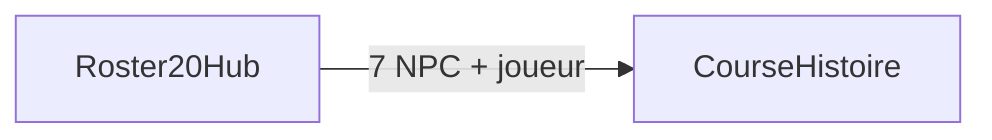

- Les 20 retenus peuplent le hub (stands, cafés, pads) et alimentent l’IA course.
- Tirage v1 d’une course biome : **1 face locale** si présente dans le roster + mix d’archétypes conduite + remplissage jusqu’à 7.
- **Hex** : annonceur hors grille par défaut ; entre en piste seulement quand le design d’acte le prescrit.
- Boss **1v1** : hors règle 7 NPC ([gdd.md](gdd.md) / [levels.md](levels.md)).

### Tags conduite (IA)

| Tag | Valeurs |
| --- | ------- |
| **Aggression** | Low / Mid / High |
| **ItemBias** | Offensive / Defensive / Chaos / Balanced |
| **LineStyle** | Clean / RiskShortcuts / DriftHeavy / AirHungry |
| **Consistency** | Steady / HotCold / Choker |
| **PreferredClass** | Kart / Moto / Plane / Any |

### Prompt artwork — préfixe commun

Tous les prompts EN ci-dessous sont préfixés mentalement par :

`LEGO-style minifigure character design, plastic brick aesthetic, C-shaped hands, stud connectors implied, saturated toy colors, clean studio lighting, white seamless backdrop, game concept art turnaround, no realistic skin pores, no copyrighted logos, no trademarked brands`

---

## Tableau récap

| ID | Nom | Hub / ancrage | Aggression | ItemBias | LineStyle | Consistency | Class |
| -- | ---- | ------------- | ---------- | -------- | --------- | ------------ | ----- |
| C01 | Bolt | Garage | Mid | Defensive | Clean | Steady | Kart |
| C02 | Vinyle | Boutique | Low | Chaos | RiskShortcuts | HotCold | Any |
| C03 | Maire Brique-Dur | Mairie | Mid | Defensive | Clean | Steady | Kart |
| C04 | Hex | Plaza / pads | High | Offensive | DriftHeavy | HotCold | Any |
| C05 | Capitaine Glisse | Plage / quai hub | Mid | Offensive | RiskShortcuts | HotCold | Kart |
| C06 | Dame Mousse | Forêt / parc hub | Low | Defensive | Clean | Steady | Moto |
| C07 | Mirage Max | Désert / douane hub | Mid | Chaos | RiskShortcuts | HotCold | Kart |
| C08 | Coach Cime | Montagne / lodge hub | High | Offensive | AirHungry | Steady | Plane |
| C09 | Flash Stud | Media plaza | High | Offensive | DriftHeavy | HotCold | Kart |
| C10 | Caméra Clac | Media plaza | Low | Defensive | Clean | Steady | Kart |
| C11 | Sponsor Or | Stands GP | Mid | Balanced | Clean | Steady | Kart |
| C12 | Agent Négatif | Mairie | Mid | Defensive | Clean | Choker | Kart |
| C13 | Flic Brique | Ring urbain | High | Defensive | Clean | Steady | Kart |
| C14 | Douanier Sable | Mirage Gate | Mid | Chaos | RiskShortcuts | HotCold | Kart |
| C15 | Pompier Mousse | Quai chantier | Mid | Defensive | Clean | Steady | Kart |
| C16 | Bookie Zoom | Ruelle néon | Low | Chaos | RiskShortcuts | HotCold | Any |
| C17 | DJ Overclock | Ruelle néon | High | Chaos | DriftHeavy | HotCold | Moto |
| C18 | Livreur Turbo | Plaza | High | Offensive | RiskShortcuts | Choker | Moto |
| C19 | Foodtruck Grease | Plaza | Low | Defensive | Clean | Steady | Kart |
| C20 | Immo Brick | Devant mairie | Mid | Balanced | Clean | Choker | Kart |
| C21 | Influenceuse Lag | Boutique | Mid | Chaos | AirHungry | HotCold | Plane |
| C22 | Surfeur Concrete | Riviera Gate | Mid | Balanced | DriftHeavy | HotCold | Kart |
| C23 | Scout Épine | Canopée Gate | Low | Defensive | Clean | Steady | Moto |
| C24 | Prospecteur Rouille | Mirage Gate | Mid | Offensive | RiskShortcuts | Steady | Kart |
| C25 | Moniteur Flocon | Cime Gate | High | Offensive | AirHungry | Steady | Plane |
| C26 | Mascotte Studdy | Pads coupe | Mid | Chaos | RiskShortcuts | HotCold | Any |
| C27 | Statue Vivante | Plaza fontaine | Low | Defensive | Clean | Steady | Kart |
| C28 | Stagiaire Mairie | Mairie | Low | Balanced | Clean | Choker | Kart |
| C29 | Pilote Retraité | Garage Bolt | Mid | Defensive | Clean | Steady | Kart |
| C30 | Chimiste Pneu | Garage | Mid | Chaos | DriftHeavy | HotCold | Kart |
| C31 | Voleuse Stud | Ruelle | High | Offensive | RiskShortcuts | HotCold | Moto |
| C32 | Curé Circuit | Chapel brick | Low | Defensive | Clean | Steady | Kart |
| C33 | Banquier Abs | Tour finance | Mid | Offensive | Clean | Steady | Kart |
| C34 | Nurse Drift | Clinique hub | Mid | Defensive | Clean | Steady | Kart |
| C35 | Squatteur Rooftop | Toits plaza | High | Chaos | AirHungry | HotCold | Plane |
| C36 | Gamin Contrefaçon | Boutique Vinyle | High | Offensive | RiskShortcuts | HotCold | Kart |
| C37 | Astronaute Fake | Aéroport jouet | Mid | Balanced | AirHungry | Steady | Plane |
| C38 | Pirate Parking | Quais | High | Offensive | DriftHeavy | HotCold | Kart |
| C39 | Oracle GPS | Pads | Low | Chaos | RiskShortcuts | Choker | Any |
| C40 | Rival Fantôme | Débloque tardif | High | Offensive | DriftHeavy | Steady | Any |

---

## C01 — Bolt

**Rôle hub :** Mécano, District Garage.  
**Personnalité :** Sec, juge ton build, fond attachant. Parle en couples de couples de boulons.  
**Punchline :** « C’est pas un bolide, c’est un crime empilé. »

| Aggression | ItemBias | LineStyle | Consistency | PreferredClass |
| ---------- | -------- | --------- | ------------ | -------------- |
| Mid | Defensive | Clean | Steady | Kart |

**Artwork (ref validée) :**

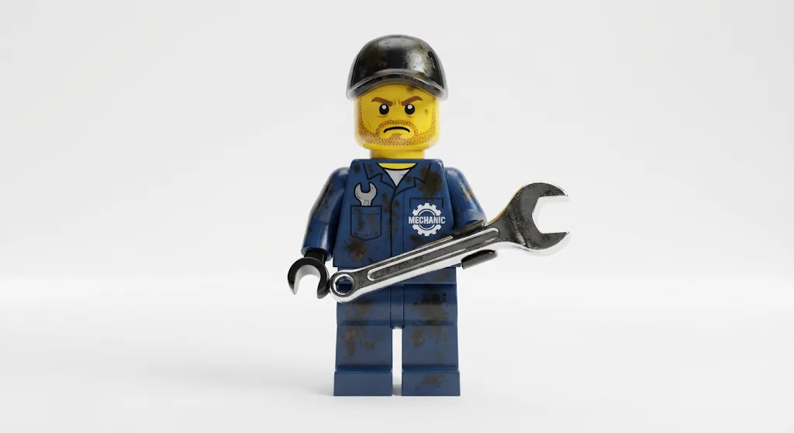

**Minifig (d’après ref) :** Tête jaune, sourcils noirs froncés, bouche pincée, barbe / moustache rousse orange (print stubbly). Coiffe : casquette baseball noire / gris foncé tachée d’huile. Combinaison bleu pétrole (torse + bras + jambes) couverte de taches d’huile ; print torse = clé dans poche droite + logo engrenage blanc « MECHANIC » poitrine gauche. Mains noires (gants). Accessoire : grande clé plate chrome (taches) tenue en travers du corps.

**Prompt (reproductible) :** `LEGO-style minifigure mechanic named Bolt, classic yellow head with furrowed black eyebrows, frowning mouth, scruffy orange beard and mustache print, dark grease smudges on face, dirty black baseball cap, dark blue grease-splattered coveralls jumpsuit, silver wrench in chest pocket print and white gear MECHANIC logo, black glove hands holding oversized chrome open-end wrench diagonally across body, studio lighting, white seamless backdrop, plastic toy sheen, game character concept art, no real brand logos`

---

## C02 — Vinyle

**Rôle hub :** Vendeur, District Boutique.  
**Personnalité :** Sourire commercial permanent, stock douteux, vend du rêve et du plastique.  
**Punchline :** « Si ça brille, c’est légal *ici*. »

| Aggression | ItemBias | LineStyle | Consistency | PreferredClass |
| ---------- | -------- | --------- | ------------ | -------------- |
| Low | Chaos | RiskShortcuts | HotCold | Any |

**Artwork (ref validée) :**

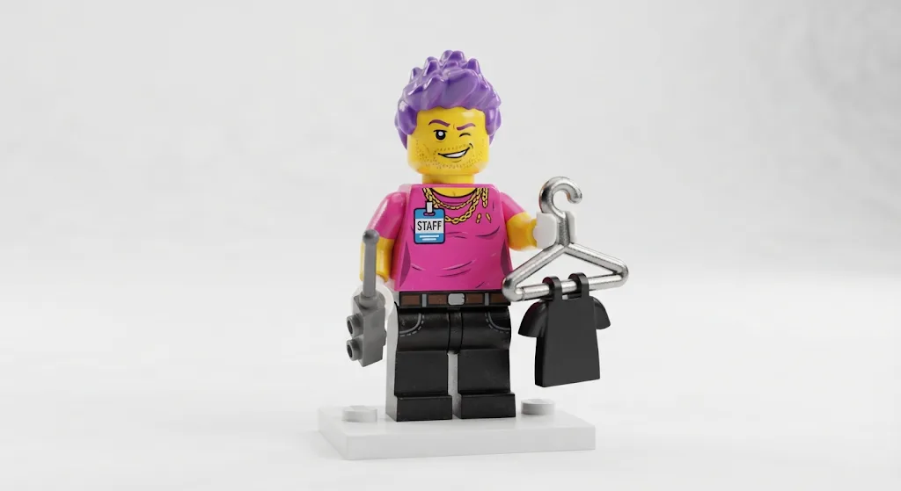

**Minifig (d’après ref) :** Tête jaune, clin d’œil + sourire en coin, barbe de 3 jours légère. Coiffe : cheveux violet vif volumineux / hérissés. Torse t-shirt rose flashy, print chaînes dorées + badge / lanyard bleu « STAFF ». Bras rose, mains jaunes. Jambes noires, print ceinture marron boucle argent. Accessoires : talkie-walkie gris (main droite) + cintre argent avec mini t-shirt noir (main gauche). Base présentation 2×4 blanche (ref studio uniquement).

**Prompt (reproductible) :** `LEGO-style minifigure shopkeeper named Vinyle, classic yellow head winking cocky smirk with light stubble, voluminous spiky bright purple hair, hot pink t-shirt torso with gold chain necklaces and blue STAFF lanyard badge print, pink arms yellow hands, black legs with brown belt silver buckle print, holding grey walkie-talkie and silver clothes hanger with small black shirt, standing on white 2x4 plate, studio lighting, white seamless backdrop, plastic toy sheen, game character concept art, no real brand logos`

---

## C03 — Maire Brique-Dur

**Rôle hub :** Mairie / ring urbain.  
**Personnalité :** Politicien brick, langue de bois trash, sourit pour les caméras.  
**Punchline :** « Pour votre sécurité, restez pauvres et en ville. »

| Aggression | ItemBias | LineStyle | Consistency | PreferredClass |
| ---------- | -------- | --------- | ------------ | -------------- |
| Mid | Defensive | Clean | Steady | Kart |

**Artwork (ref validée) :**

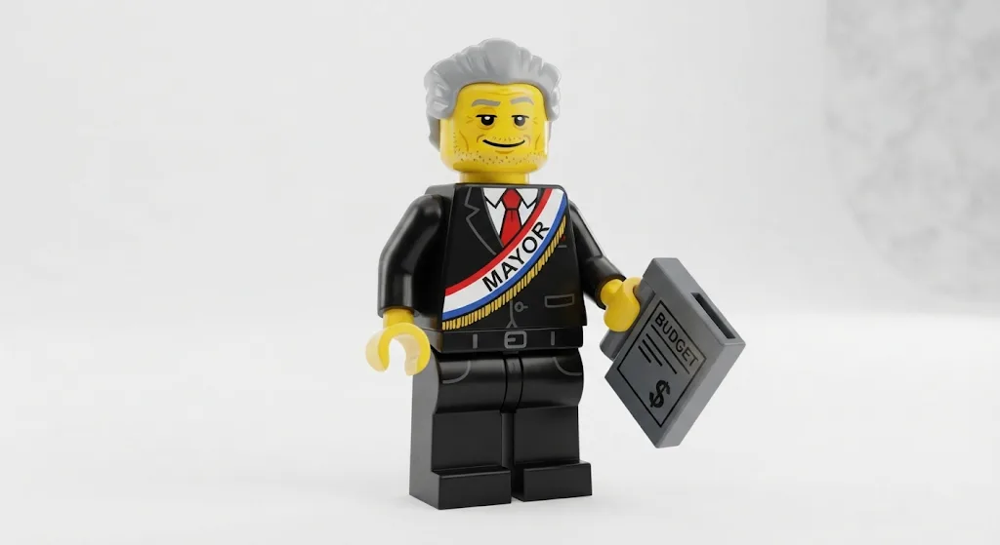

**Minifig (d’après ref) :** Tête jaune, sourire suffisant, rides légères, barbe de 3 jours. Coiffe : cheveux gris ondulés / peignés. Torse costume noir, chemise blanche, cravate rouge ; écharpe tricolore (bleu-blanc-rouge) en bandoulière avec texte « MAYOR » et franges dorées. Bras noirs, mains jaunes. Jambes noires (ceinture / poches print). Accessoire : tuile grise « BUDGET » avec lignes de texte et symbole « $ ».

**Prompt (reproductible) :** `LEGO-style minifigure corrupt mayor named Maire Brique-Dur, classic yellow head smug smile with grey stubble and eye wrinkles, wavy grey hair, black suit jacket white shirt red tie torso, tricolor blue-white-red mayoral sash with MAYOR text and gold fringe, black arms yellow hands, black legs with belt print, holding grey BUDGET document tile with dollar sign, studio lighting, white seamless backdrop, plastic toy sheen, game character concept art, no real brand logos`

---

## C04 — Hex

**Rôle hub :** Plaza / pads — rival + annonceur.  
**Personnalité :** Showman cynique, quatrième mur, vend l’audience avant la course.  
**Punchline :** « Souris, l’outsider — les pubs paient mieux si tu perds. »

| Aggression | ItemBias | LineStyle | Consistency | PreferredClass |
| ---------- | -------- | --------- | ------------ | -------------- |
| High | Offensive | DriftHeavy | HotCold | Any |

**Artwork (ref validée) :**

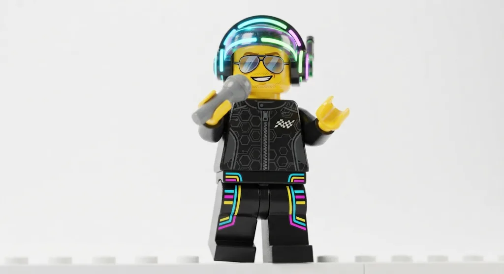

**Minifig (d’après ref) :** Tête jaune, sourire en coin, barbe de 3 jours, lunettes aviateur argentées. Coiffe : gros casque-écouteurs noirs + visière bleue translucide, bandes néon cyan / vert / magenta, petite antenne / micro sur le côté. Torse blouson noir zippé, motif nid d’abeille hexagonal gris, petit print damier poitrine, liserés gris. Bras noirs, mains jaunes. Jambes noires avec barres néon cyan / jaune / magenta sur les côtés. Accessoire : micro gris clair (main droite). Base 2×4 blanche (ref studio).

**Prompt (reproductible) :** `LEGO-style minifigure race announcer rival named Hex, classic yellow head smirking with stubble and silver aviator sunglasses, bulky black headphones with translucent blue visor and cyan lime magenta neon light strips and antenna mic, black zip jacket torso with dark hexagonal honeycomb pattern and small checkered flag chest print, black arms yellow hands, black legs with cyan yellow magenta neon side bars, holding light grey handheld microphone, standing on white 2x4 plate, studio lighting, white seamless backdrop, plastic toy sheen, game character concept art, no real brand logos`

---

## C05 — Capitaine Glisse

**Rôle hub :** Quai / Riviera Gate (face Plage).  
**Personnalité :** Touriste-escroc, amendes inventées, bronzette permanente.  
**Punchline :** « Amende maritime : t’exister. »

| Aggression | ItemBias | LineStyle | Consistency | PreferredClass |
| ---------- | -------- | --------- | ------------ | -------------- |
| Mid | Offensive | RiskShortcuts | HotCold | Kart |

**Artwork (ref validée) :**

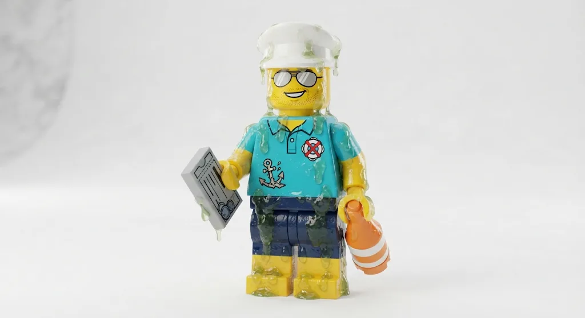

**Minifig (d’après ref) :** Tête jaune, sourire canaille, barbe de 3 jours, lunettes aviateur argentées. Coiffe : casquette capitaine blanche (bord noir). Torse polo cyan clair, print ancre noire (droite) + badge bouée barrée d’un « X » rouge (gauche). Bras cyan, mains jaunes. Short bleu marine, jambes/pieds jaunes nus. Accessoires : tuile grise amende / ticket (main droite) + bouée / cône rayé orange-blanc (main gauche). **Gag signature ref :** slime / gel vert translucide qui dégouline du chapeau aux pieds (nom « Glisse »).

**Prompt (reproductible) :** `LEGO-style minifigure beach captain named Capitaine Glisse, classic yellow head smiling with stubble and silver aviator sunglasses, white captain hat with black brim, light cyan polo torso with black anchor print and lifebuoy badge crossed by red X, cyan arms yellow hands, dark blue shorts with bare yellow lower legs, holding grey ticket tile and orange-white striped buoy, covered in dripping translucent bubbly light-green slime from hat to feet, studio lighting, white seamless backdrop, plastic toy sheen, game character concept art, no real brand logos`

---

## C06 — Dame Mousse

**Rôle hub :** Parc / Canopée Gate (face Forêt).  
**Personnalité :** Écolo passive-agressive, chuchote des menaces biodégradables.  
**Punchline :** « Chut. Même ta défaite doit être biodégradable. »

| Aggression | ItemBias | LineStyle | Consistency | PreferredClass |
| ---------- | -------- | --------- | ------------ | -------------- |
| Low | Defensive | Clean | Steady | Moto |

**Artwork (ref validée) :**

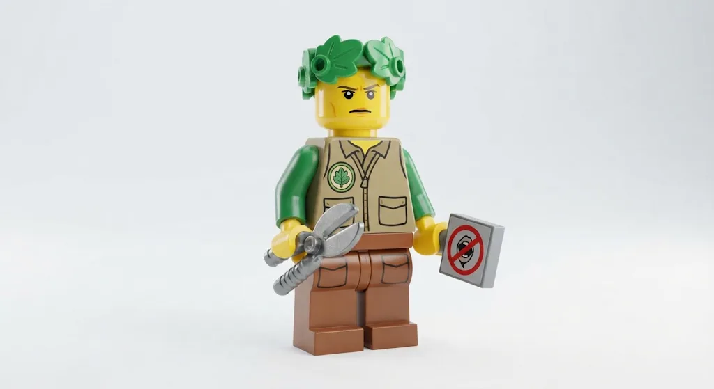

**Minifig (d’après ref) :** Tête jaune, expression sévère / froide, sourcils noirs arqués. Coiffe : couronne / guirlande de feuilles vertes. Torse gilet beige / tan sur manches longues vertes, poches poitrine, badge circulaire feuille verte sur fond blanc. Bras verts, mains jaunes. Jambes marron avec poches print. Accessoires : grands sécateurs argent (main droite) + tuile grise « silence » (bouche barrée cercle rouge, main gauche).

**Prompt (reproductible) :** `LEGO-style minifigure forest ranger named Dame Mousse, classic yellow head stern grumpy expression with arched black eyebrows, green plastic leaf wreath crown, tan beige vest over green long sleeves with chest pockets and circular white badge with green leaf, green arms yellow hands, brown legs with thigh pocket prints, holding large silver pruning shears and grey 2x2 silence sign tile with mouth crossed out in red circle, studio lighting, white seamless backdrop, plastic toy sheen, game character concept art, no real brand logos`

---

## C07 — Mirage Max

**Rôle hub :** Douane / Mirage Gate (face Désert).  
**Personnalité :** Illusionniste arnaqueur, vend des mirages comme des facts.  
**Punchline :** « Ce boost ? Un mirage. Celui-là aussi. »

| Aggression | ItemBias | LineStyle | Consistency | PreferredClass |
| ---------- | -------- | --------- | ------------ | -------------- |
| Mid | Chaos | RiskShortcuts | HotCold | Kart |

**Artwork (ref validée) :**

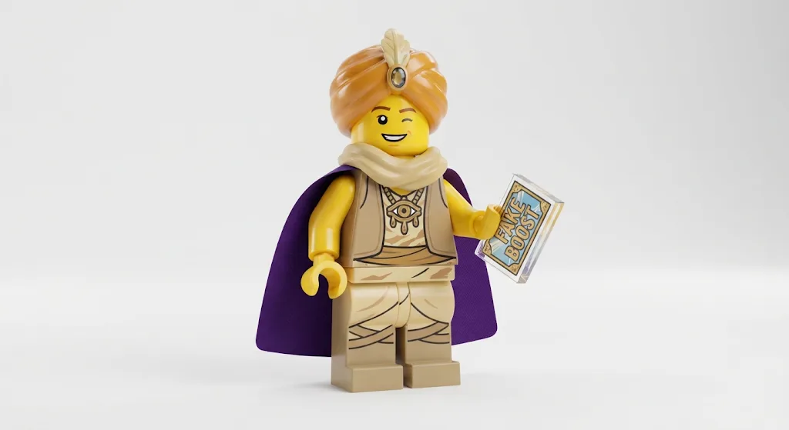

**Minifig (d’après ref) :** Tête jaune, clin d’œil (œil gauche fermé), sourire en coin, petite marque rouge joue. Coiffe : turban beige / tan avec plume dorée et gemme ambre. Cape violette vive sur gilet / wrap tan, foulard tan au cou, print collier œil (œil qui voit tout). Bras tan, mains jaunes. Jambes tan style wrap désert. Accessoire : tuile transparente « FAKE BOOST » (texte bleu/orange, bordure or).

**Prompt (reproductible) :** `LEGO-style minifigure desert illusionist named Mirage Max, classic yellow head winking smirk with tiny red cheek mark, large tan turban with gold feather and amber gem, bright purple cape over tan vest and scarf, all-seeing eye necklace print on chest, tan arms yellow hands, tan wrapped desert legs, holding translucent clear tile card labeled FAKE BOOST in blue and orange with gold border, studio lighting, white seamless backdrop, plastic toy sheen, game character concept art, no real brand logos`

---

## C08 — Coach Cime

**Rôle hub :** Lodge / Cime Gate (face Montagne).  
**Personnalité :** Coach toxique motivationnel, crie « lore » sur la douleur.  
**Punchline :** « La douleur c’est du lore, champion. »

| Aggression | ItemBias | LineStyle | Consistency | PreferredClass |
| ---------- | -------- | --------- | ------------ | -------------- |
| High | Offensive | AirHungry | Steady | Plane |

**Artwork (ref validée) :**

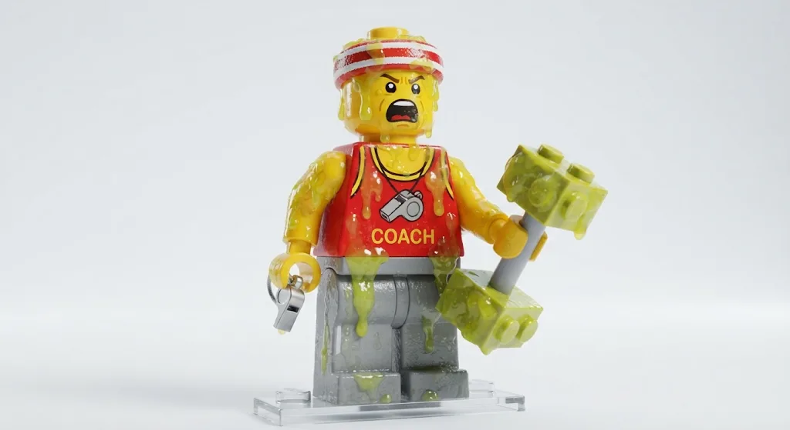

**Minifig (d’après ref) :** Tête jaune, bouche grande ouverte (cri), dents / langue visibles. Coiffe : bandeau sport rayé rouge-blanc. Torse débardeur rouge, print jaune « COACH » + icône sifflet argent. Bras jaunes, mains jaunes. Jambes / pantalon gris. Accessoires : sifflet argent (main droite) + haltère vert clair brick (main gauche). **Gag signature ref :** slime / gel jaune-vert translucide qui dégouline (tête, corps, haltère) — base transparente studio.

**Prompt (reproductible) :** `LEGO-style minifigure toxic mountain coach named Coach Cime, classic yellow head shouting mouth open showing teeth and tongue, red and white striped sweatband, red tank top with yellow COACH lettering and silver whistle icon print, yellow arms and hands, grey pants, holding small silver whistle and light green brick dumbbell, covered in dripping translucent yellowish-green slime, standing on clear base, studio lighting, white seamless backdrop, plastic toy sheen, game character concept art, no real brand logos`

---

## C09 — Flash Stud

**Rôle hub :** Media plaza — journaliste sensation.  
**Personnalité :** Chasse le crash, ignore la vérité si le titre claque.  
**Punchline :** « Souris pour la une — ou pleure, on croppera. »

| Aggression | ItemBias | LineStyle | Consistency | PreferredClass |
| ---------- | -------- | --------- | ------------ | -------------- |
| High | Offensive | DriftHeavy | HotCold | Kart |

**Artwork (ref validée) :**

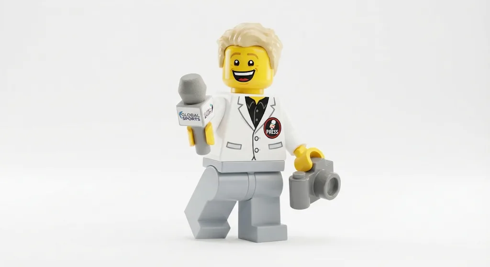

**Minifig (d’après ref) :** Tête jaune, grand sourire dents visibles. Coiffe : cheveux blonds / châtains clairs texturés. Torse blazer blanc sur chemise noire, badge circulaire rouge/noir avec icône micro + « PRESS ». Bras blancs, mains jaunes. Jambes gris clair (pose marche). Accessoires : micro gris cube « GLOBAL SPORTS » (main droite) + caméra grise (main gauche). Base transparente studio.

**Prompt (reproductible) :** `LEGO-style minifigure sports journalist named Flash Stud, classic yellow head wide open-mouth smile showing teeth, light blond textured hair, white blazer over black shirt with red-black PRESS badge microphone icon, white arms yellow hands, light grey legs walking pose, holding grey microphone with GLOBAL SPORTS cube flag and grey camera, clear base, studio lighting, white seamless backdrop, plastic toy sheen, game character concept art, no real brand logos`

---

## C10 — Caméra Clac

**Rôle hub :** Media plaza — cadreur fataliste.  
**Personnalité :** A déjà filmé trop de DNFs ; parle en focale.  
**Punchline :** « Si ça flou, c’est artistique. Si tu flou, c’est ta faute. »

| Aggression | ItemBias | LineStyle | Consistency | PreferredClass |
| ---------- | -------- | --------- | ------------ | -------------- |
| Low | Defensive | Clean | Steady | Kart |

**Artwork (ref validée) :**

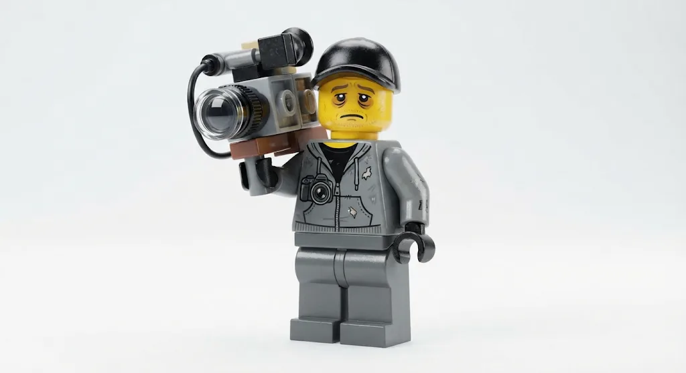

**Minifig (d’après ref) :** Tête jaune, expression fatiguée / stressée, cernes sous les yeux. Coiffe : casquette noire. Torse hoodie gris, print icône caméra. Bras gris, mains jaunes. Jambes / pantalon gris. Accessoire : grosse caméra vidéo brick gris/noir sur l’épaule (objectif, viseur, poignée, câble).

**Prompt (reproductible) :** `LEGO-style minifigure jaded cameraman named Camera Clac, classic yellow head tired stressed face with under-eye bags, black baseball cap, grey hoodie with camera icon print, grey arms yellow hands, grey pants, holding large grey-black brick video camera on right shoulder with black lens viewfinder handle and cable, studio lighting, white seamless backdrop, plastic toy sheen, game character concept art, no real brand logos`

---

## C11 — Sponsor Or

**Rôle hub :** Stands GP — corporel humain.  
**Personnalité :** Sourit, contracte, menace poliment.  
**Punchline :** « On aime les gagnants. Les autres, on les rebrand. »

| Aggression | ItemBias | LineStyle | Consistency | PreferredClass |
| ---------- | -------- | --------- | ------------ | -------------- |
| Mid | Balanced | Clean | Steady | Kart |

**Artwork (ref validée) :**

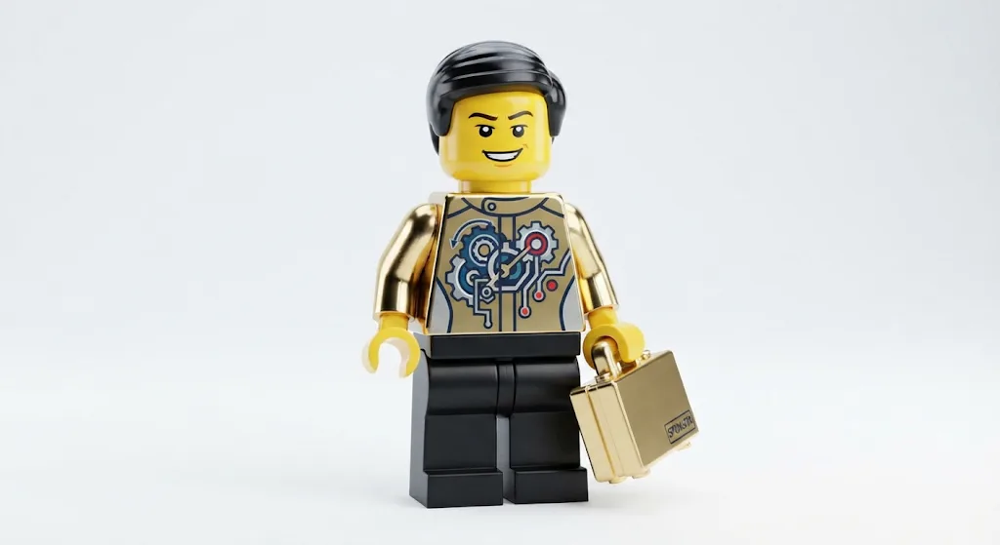

**Minifig (d’après ref) :** Tête jaune, sourire confiant / sourcils relevés. Coiffe : cheveux noirs raie sur le côté. Torse + bras chrome or métallique, print mécanique central (engrenages, circuits, cercle rouge). Mains jaunes. Jambes noires mates. Accessoire : mallette or chrome avec étiquette noire « SPONSOR ».

**Prompt (reproductible) :** `LEGO-style minifigure corporate race sponsor named Sponsor Or, classic yellow head confident smirk raised eyebrows, black side-parted hair, reflective metallic gold torso and arms with clockwork gears circuitry and red circle chest print, yellow hands, matte black legs, holding metallic gold briefcase with black SPONSOR label, studio lighting, white seamless backdrop, plastic toy sheen, game character concept art, no real brand logos`

---

## C12 — Agent Négatif

**Rôle hub :** Couloir mairie — PR de crise.  
**Personnalité :** Spin doctor ; chaque défaite est une « opportunité narrative ».  
**Punchline :** « On ne perd pas. On pivote. »

| Aggression | ItemBias | LineStyle | Consistency | PreferredClass |
| ---------- | -------- | --------- | ------------ | -------------- |
| Mid | Defensive | Clean | Choker | Kart |

**Artwork (ref validée) :**

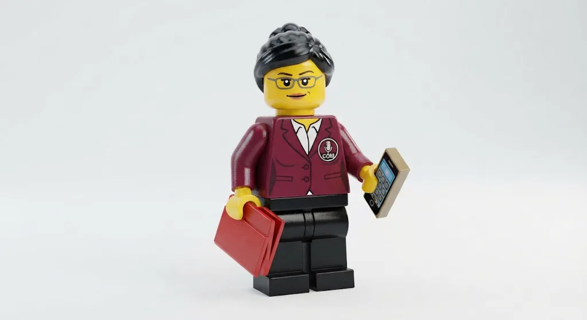

**Minifig (d’après ref) :** Tête jaune, sourire en coin, lunettes monture noire. Coiffe : cheveux noirs en chignon soigné. Torse blazer bordeaux / magenta foncé sur chemise blanche col, badge argent circulaire micro + « COM ». Bras bordeaux, mains jaunes. Jambes noires. Accessoires : dossier / carnet rouge (main droite) + smartphone brick tan/or écran bleu apps (main gauche).

**Prompt (reproductible) :** `LEGO-style minifigure crisis PR spin doctor named Agent Negatif, classic yellow head smirking with black-rimmed glasses, neat black hair in bun, dark magenta maroon blazer over white collared shirt with silver circular COM badge microphone icon, maroon arms yellow hands, black legs, holding solid red folder and tan smartphone with blue app screen, studio lighting, white seamless backdrop, plastic toy sheen, game character concept art, no real brand logos`

---

## C13 — Flic Brique

**Rôle hub :** Ring urbain — « sécurité » sélective.  
**Personnalité :** Amendes pour les outsiders, tape amicale pour les VIP.  
**Punchline :** « Limitation ? C’est toi la limitation. »

| Aggression | ItemBias | LineStyle | Consistency | PreferredClass |
| ---------- | -------- | --------- | ------------ | -------------- |
| High | Defensive | Clean | Steady | Kart |

**Artwork (ref validée) :**

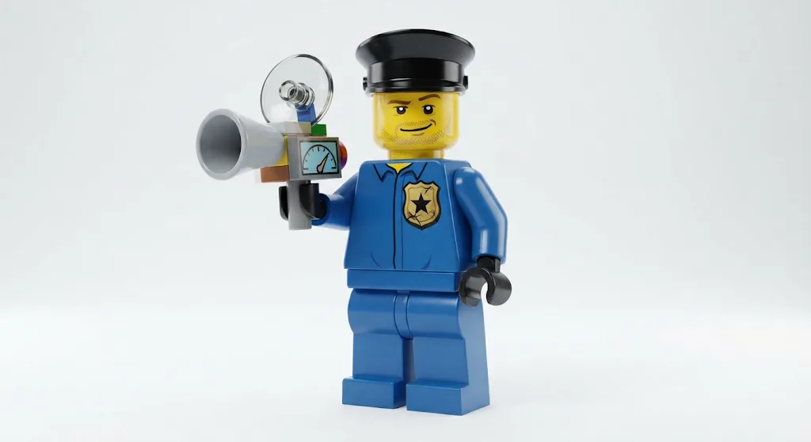

**Minifig (d’après ref) :** Tête jaune, barbe de 3 jours, sourcil levé, sourire suffisant. Coiffe : casquette police noire à visière. Torse uniforme bleu, badge étoile dorée en écusson (aspect usé / fissuré). Bras bleus, mains noires (gants). Jambes bleues. Accessoire : radar / mégaphone brick absurde (cône gris, coupelle translucide, jauge, clous verts/oranges).

**Prompt (reproductible) :** `LEGO-style minifigure corrupt city cop named Flic Brique, classic yellow head smug smirk raised eyebrow with stubble, black peaked police cap, blue uniform jacket with weathered cracked gold star shield badge, blue arms black glove hands, blue legs, holding absurd brick radar gun with grey cone nozzle clear dish gauge and colored studs, studio lighting, white seamless backdrop, plastic toy sheen, game character concept art, no real brand logos`

---

## C14 — Douanier Sable

**Rôle hub :** Mirage Gate — taxes soleil.  
**Personnalité :** Invente des taxes ; garde un tampon comme une arme.  
**Punchline :** « Droits de passage : un rein. Ou un tour. »

| Aggression | ItemBias | LineStyle | Consistency | PreferredClass |
| ---------- | -------- | --------- | ------------ | -------------- |
| Mid | Chaos | RiskShortcuts | HotCold | Kart |

**Artwork (ref validée) :**

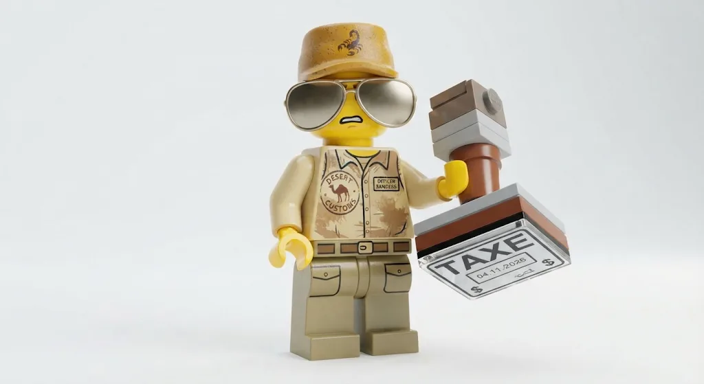

**Minifig (d’après ref) :** Tête jaune, bouche pincée / sévère, lunettes aviateur argentées oversize verres miroir. Coiffe : casquette patrol tan avec emblème scorpion noir. Torse chemise tan manches courtes, taches sable ; badge circulaire « DESERT CUSTOMS » (chameau) + badge « OFFICER SANDLESS ». Bras tan, mains jaunes. Jambes cargo tan, ceinture marron + poches. Accessoire : grand tampon brick, face « TAXE » + date absurde + « $ ».

**Prompt (reproductible) :** `LEGO-style minifigure desert customs officer named Douanier Sable, classic yellow head stern frown, oversized silver aviator sunglasses reflective lenses, tan patrol cap with black scorpion emblem, tan short-sleeve shirt with sand smudges DESERT CUSTOMS camel badge and OFFICER SANDLESS name tag, tan arms yellow hands, tan cargo pants brown belt pocket prints, holding large brick rubber stamp with TAXE face date and dollar signs, studio lighting, white seamless backdrop, plastic toy sheen, game character concept art, no real brand logos`

---

## C15 — Pompier Mousse

**Rôle hub :** Quai chantier — héros fatigué.  
**Personnalité :** Éteint des feux et des egos ; soupire beaucoup.  
**Punchline :** « Encore un drift en flammes. Classique. »

| Aggression | ItemBias | LineStyle | Consistency | PreferredClass |
| ---------- | -------- | --------- | ------------ | -------------- |
| Mid | Defensive | Clean | Steady | Kart |

**Artwork (ref validée) :**

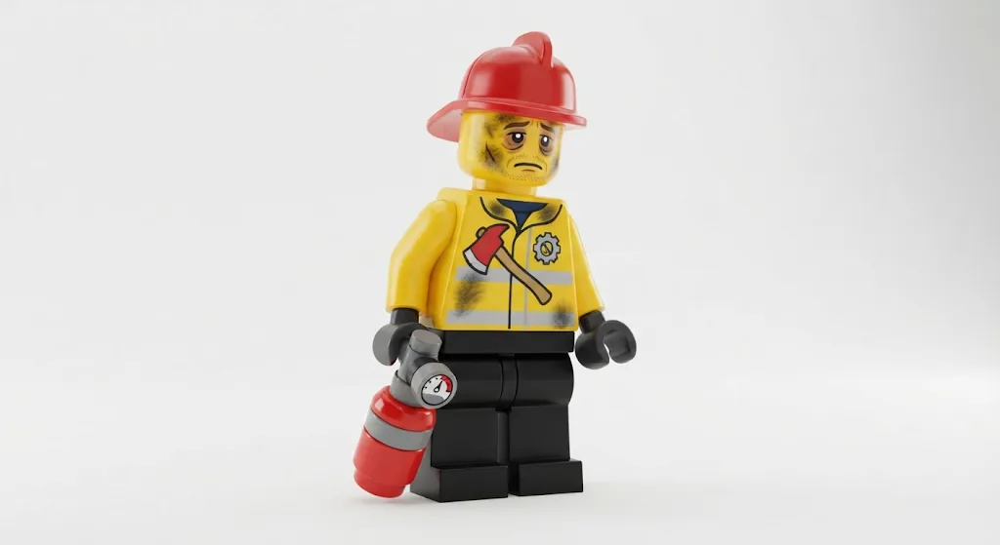

**Minifig (d’après ref) :** Tête jaune, visage las, cernes, suie / cendre sur joues et front, bouche pincée. Coiffe : casque pompier rouge vif (crête). Torse veste jaune hi-vis, deux bandes réfléchissantes argent, taches de suie ; badge circulaire engrenage + print hache rouge/argent ; col bleu foncé visible. Bras jaunes, mains gris foncé. Jambes noires. Accessoire : extincteur rouge (bande argent, jauge).

**Prompt (reproductible) :** `LEGO-style minifigure weary firefighter named Pompier Mousse, classic yellow head frowning with under-eye bags and black soot smudges on face, bright red firefighter helmet with crest, hi-vis yellow jacket with silver reflective stripes soot stains gear badge and fire axe print, yellow arms dark grey hands, black legs, holding small red fire extinguisher with silver band and gauge, studio lighting, white seamless backdrop, plastic toy sheen, game character concept art, no real brand logos`

---

## C16 — Bookie Zoom

**Rôle hub :** Ruelle néon — cotes vivantes.  
**Personnalité :** Parie contre toi à voix haute pour te tilt.  
**Punchline :** « Cote 12:1 que tu rates le pad. Je suis généreux. »

| Aggression | ItemBias | LineStyle | Consistency | PreferredClass |
| ---------- | -------- | --------- | ------------ | -------------- |
| Low | Chaos | RiskShortcuts | HotCold | Any |

**Artwork (ref validée) :**

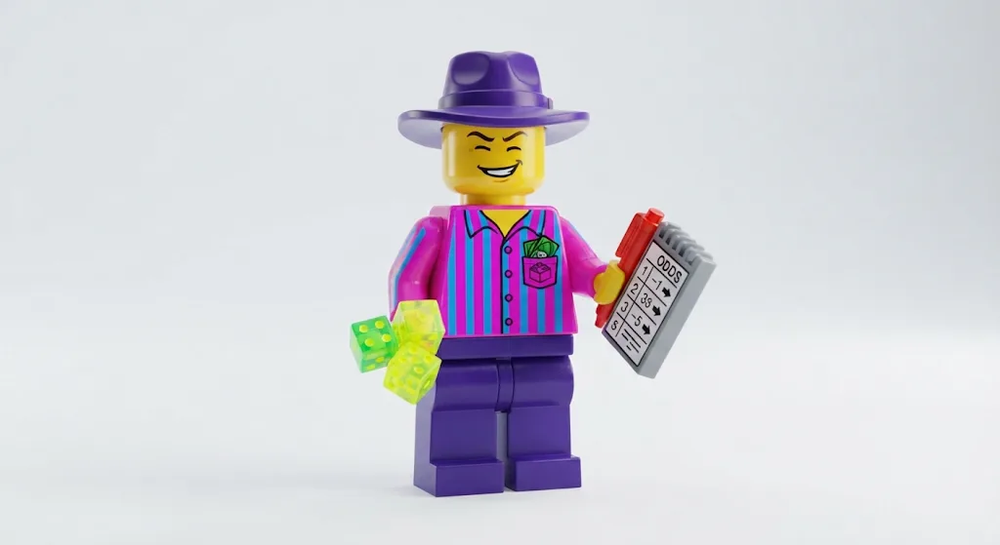

**Minifig (d’après ref) :** Tête jaune, grand sourire malicieux dents visibles, yeux plissés. Coiffe : feutre violet large bord. Torse chemise rose vif rayures bleues verticales, poche avec billets verts + icône. Bras rose, mains jaunes. Jambes violet foncé. Accessoires : pile de 3 dés translucides vert lime (main droite) + carnet gris « ODDS » + stylo rouge (main gauche).

**Prompt (reproductible) :** `LEGO-style minifigure street bookie named Bookie Zoom, classic yellow head wide mischievous toothy grin squinted eyes, purple fedora wide brim, bright pink shirt with blue vertical stripes and green cash bills in pocket print, pink arms yellow hands, dark purple legs, holding three stacked translucent lime dice and grey ODDS notepad with red pen, studio lighting, white seamless backdrop, plastic toy sheen, game character concept art, no real brand logos`

---

## C17 — DJ Overclock

**Rôle hub :** Ruelle néon — drop et drift.  
**Personnalité :** La piste est une tracklist ; les rivals sont des samples.  
**Punchline :** « Drop dans trois… deux… crash. »

| Aggression | ItemBias | LineStyle | Consistency | PreferredClass |
| ---------- | -------- | --------- | ------------ | -------------- |
| High | Chaos | DriftHeavy | HotCold | Moto |

**Artwork (ref validée) :**

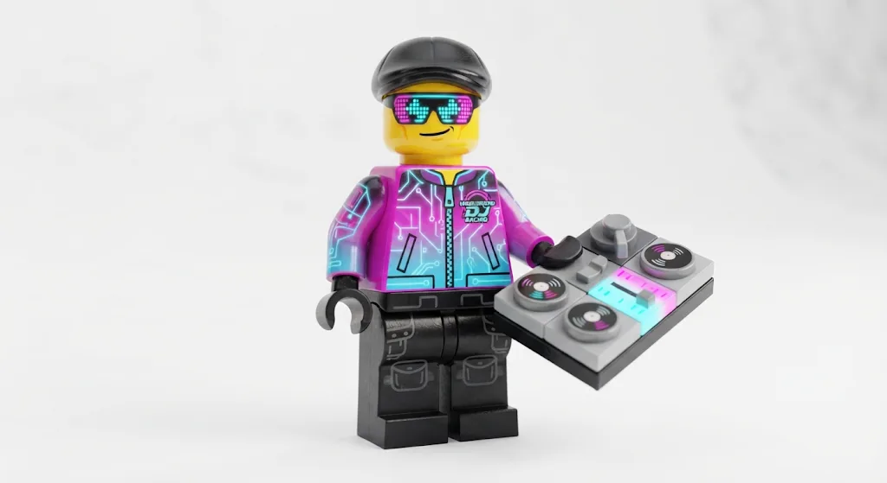

**Minifig (d’après ref) :** Tête jaune, sourire confiant. Coiffe : casquette plate noire (newsboy). Lunettes / visière futuriste, verres motif pixel rose-cyan. Torse veste dégradé magenta/cyan, traces circuit, zip central, badge circulaire « DJ / RADIO ». Bras assortis, mains jaunes. Jambes noires cargo (poches / coutures). Accessoire : contrôleur DJ brick gris/noir (platines, molette, interface cyan/rose).

**Prompt (reproductible) :** `LEGO-style minifigure underground DJ named DJ Overclock, classic yellow head confident smirk, black newsboy cap, futuristic visor sunglasses with pink cyan pixel digital lenses, vibrant pink-cyan gradient jacket with circuit board traces zipper and DJ RADIO circular badge, yellow hands, black cargo pants pocket prints, holding grey-black brick DJ controller with dual jog wheels knob and glowing cyan pink mixer, studio lighting, white seamless backdrop, plastic toy sheen, game character concept art, no real brand logos`

---

## C18 — Livreur Turbo

**Rôle hub :** Plaza — scooters et jurons.  
**Personnalité :** Timer toujours rouge ; te traite comme un client 1 étoile.  
**Punchline :** « 5 minutes ou c’est gratuit. Toi, t’es en retard. »

| Aggression | ItemBias | LineStyle | Consistency | PreferredClass |
| ---------- | -------- | --------- | ------------ | -------------- |
| High | Offensive | RiskShortcuts | Choker | Moto |

**Artwork (ref validée) :**

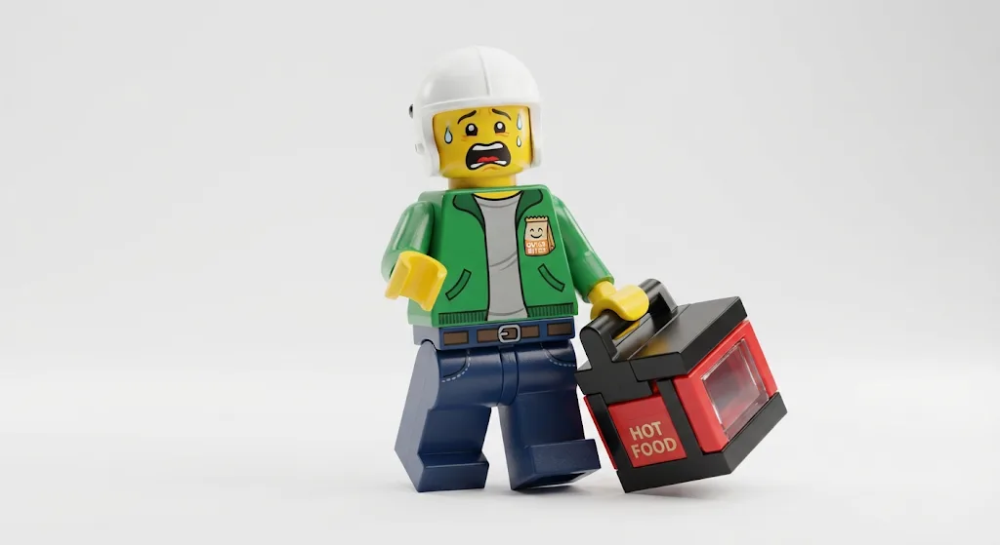

**Minifig (d’après ref) :** Tête jaune, panique extrême (sourcils relevés, bouche ouverte), gouttes de sueur bleu clair. Coiffe : casque moto blanc ouvert. Torse hoodie vert zip sur t-shirt gris, logo sac papier sourire « QUICK BITE ». Bras verts, mains jaunes. Jambes jean bleu foncé, ceinture marron boucle argent (pose marche). Accessoire : sac isotherme noir/rouge « HOT FOOD » avec fenêtre transparente.

**Prompt (reproductible) :** `LEGO-style minifigure stressed delivery rider named Livreur Turbo, classic yellow head panicked shouting face with sweat droplets, white open-face motorcycle helmet, green zip hoodie over grey shirt with QUICK BITE paper bag smiley logo, green arms yellow hands, dark blue jeans brown belt mid-stride pose, holding large black-red thermal delivery bag HOT FOOD with clear window, studio lighting, white seamless backdrop, plastic toy sheen, game character concept art, no real brand logos`

---

## C19 — Foodtruck Grease

**Rôle hub :** Plaza — fritures et potins.  
**Personnalité :** Nourrit le paddock ; sait tous les secrets via les sauces.  
**Punchline :** « Extra fromage ? Extra karma. »

| Aggression | ItemBias | LineStyle | Consistency | PreferredClass |
| ---------- | -------- | --------- | ------------ | -------------- |
| Low | Defensive | Clean | Steady | Kart |

**Artwork (ref validée) :**

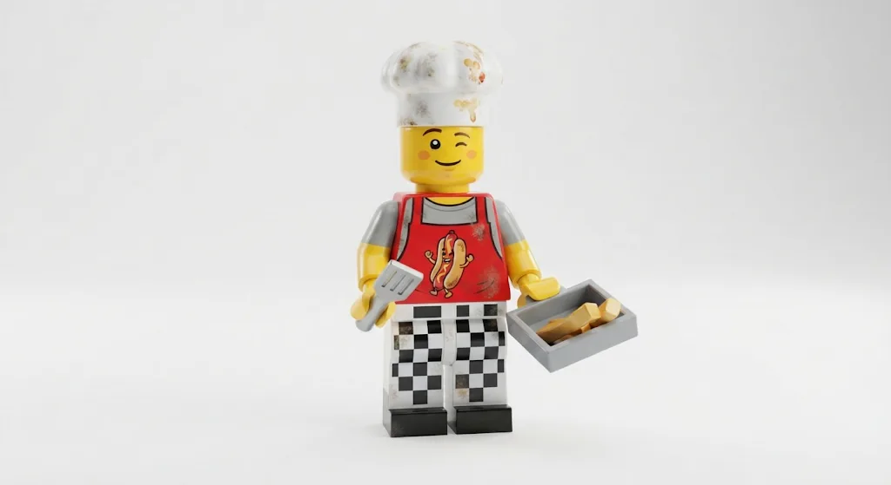

**Minifig (d’après ref) :** Tête jaune, clin d’œil, joues roses. Coiffe : toque blanche haute tachée de graisse brune/orange. Torse chemise grise + tablier rouge (taches), print hot-dog souriant bras levés. Bras gris, mains jaunes. Jambes damier noir/blanc tachées. Accessoires : spatule argent (main droite) + barquette grise de frites jaunes (main gauche).

**Prompt (reproductible) :** `LEGO-style minifigure food truck cook named Foodtruck Grease, classic yellow head winking smile with rosy cheeks, tall white chef toque with brown orange grease stains, grey shirt under red apron with smiling hot dog graphic and grease stains, grey arms yellow hands, black-white checkered pants with grease spots, holding silver spatula and grey tray of yellow fries, studio lighting, white seamless backdrop, plastic toy sheen, game character concept art, no real brand logos`

---

## C20 — Immo Brick

**Rôle hub :** Devant mairie — vend des plots.  
**Personnalité :** Tout est « loft stud avec vue sur crash ».  
**Punchline :** « Emplacement premium : pile sur la ligne de départ. »

| Aggression | ItemBias | LineStyle | Consistency | PreferredClass |
| ---------- | -------- | --------- | ------------ | -------------- |
| Mid | Balanced | Clean | Choker | Kart |

**Artwork (ref validée) :**

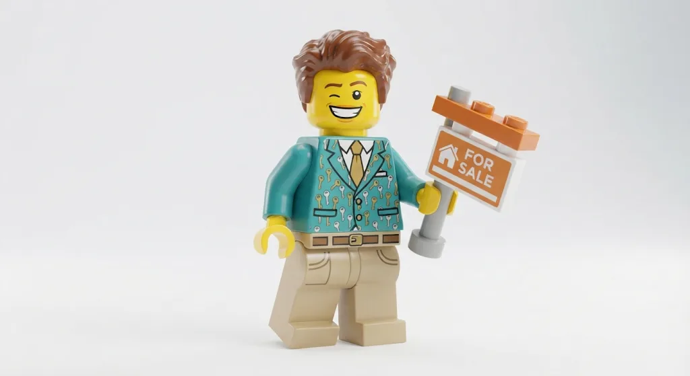

**Minifig (d’après ref) :** Tête jaune, clin d’œil, grand sourire dents visibles. Coiffe : cheveux bruns ondulés volumineux. Torse blazer teal / bleu clair motif petites clés or, chemise blanche, cravate or/tan. Bras teal, mains jaunes. Jambes khaki / beige, ceinture marron boucle or. Accessoire : pancarte brick « FOR SALE » (bordure orange, icône maison) sur mât gris.

**Prompt (reproductible) :** `LEGO-style minifigure real-estate agent named Immo Brick, classic yellow head winking wide toothy grin, voluminous wavy brown hair, teal blazer patterned with small gold skeleton keys over white shirt and gold tie, teal arms yellow hands, khaki legs brown belt gold buckle, holding brick FOR SALE sign with orange border house icon on grey pole, studio lighting, white seamless backdrop, plastic toy sheen, game character concept art, no real brand logos`

---

## C21 — Influenceuse Lag

**Rôle hub :** Boutique / selfies pads.  
**Personnalité :** Stream la course ; le lag est toujours la faute des autres.  
**Punchline :** « Like si tu crash. Subscribe si c’est moi. »

| Aggression | ItemBias | LineStyle | Consistency | PreferredClass |
| ---------- | -------- | --------- | ------------ | -------------- |
| Mid | Chaos | AirHungry | HotCold | Plane |

**Artwork (ref validée) :**

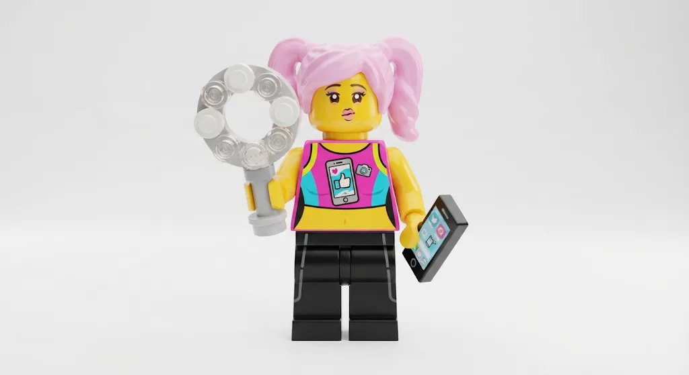

**Minifig (d’après ref) :** Tête jaune, maquillage, pout / lèvres roses, cils. Coiffe : twin-tails rose vif ondulés. Torse crop rose avec panneaux cyan et liserés noirs, print smartphone (like / cœur) + icône caméra. Bras jaunes, mains jaunes. Jambes noires, lignes grises latérales. Accessoires : ring light gris (studs blancs/translucides) + smartphone noir grille d’apps.

**Prompt (reproductible) :** `LEGO-style minifigure influencer named Influenceuse Lag, classic yellow head pink pout lips eyelashes makeup, bright pink high twin-tail pigtails wavy, pink sports crop top with cyan side panels black piping smartphone thumbs-up heart and camera print, yellow arms and hands, black pants with light grey side stripes, holding grey ring light with white clear studs and black smartphone with colorful app icons, studio lighting, white seamless backdrop, plastic toy sheen, game character concept art, no real brand logos`

---

## C22 — Surfeur Concrete

**Rôle hub :** Riviera Gate — résident plage en ville.  
**Personnalité :** Zen toxique ; « laisse couler » pendant qu’il te bloque.  
**Punchline :** « Waves before egos, bro. Surtout le tien. »

| Aggression | ItemBias | LineStyle | Consistency | PreferredClass |
| ---------- | -------- | --------- | ------------ | -------------- |
| Mid | Balanced | DriftHeavy | HotCold | Kart |

**Artwork (ref validée) :**

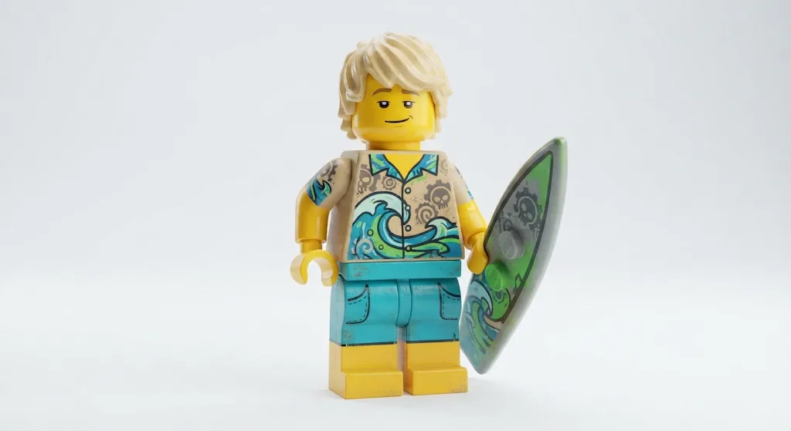

**Minifig (d’après ref) :** Tête jaune, regard mi-clos, sourire suffisant. Coiffe : cheveux blonds balayés en arrière. Torse chemise tan ouverte (style hawaïen) : vague bleue/verte en bas + engrenages gris / tête de mort en haut. Bras jaunes avec tatouages print (vague / gears). Short turquoise usé / sale, jambes jaunes nues en bas. Accessoire : planche grise (vague + crâne dans engrenage, stud vert).

**Prompt (reproductible) :** `LEGO-style minifigure concrete surfer named Surfeur Concrete, classic yellow head smug half-lidded eyes, swept-back blond hair, tan open Hawaiian shirt with blue-green ocean wave and dark grey gears skull motif, yellow arms with matching tattoo prints, turquoise distressed board shorts bare yellow lower legs, holding grey surfboard with wave and skull-in-gear design green center stud, studio lighting, white seamless backdrop, plastic toy sheen, game character concept art, no real brand logos`

---

## C23 — Scout Épine

**Rôle hub :** Canopée Gate — badges et jugement.  
**Personnalité :** Check-lists morales ; te retire des points invisibles.  
**Punchline :** « Badge “fair-play” : refusé. »

| Aggression | ItemBias | LineStyle | Consistency | PreferredClass |
| ---------- | -------- | --------- | ------------ | -------------- |
| Low | Defensive | Clean | Steady | Moto |

**Artwork (ref validée) :**

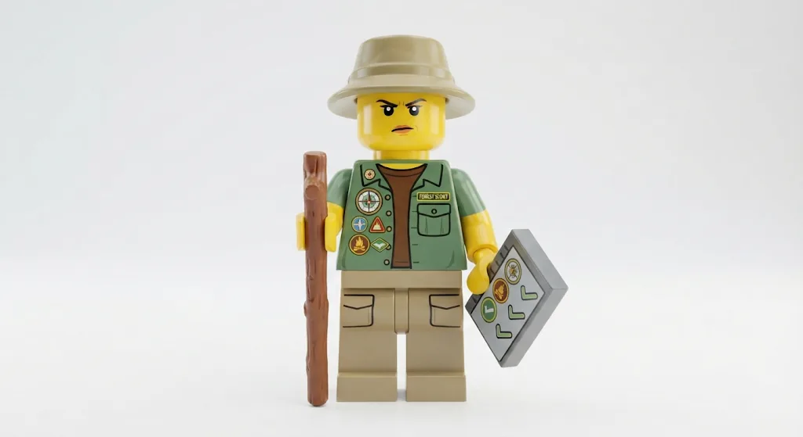

**Minifig (d’après ref) :** Tête jaune, expression déterminée / agacée, bouche pincée. Coiffe : chapeau scout / safari kaki large bord. Torse chemise olive ouverte sur undershirt marron ; badges (boussole, étoile, feu, oiseau) + patch jaune « FOREST SCOUT ». Bras olive, mains jaunes. Jambes khaki / tan (poches). Accessoires : bâton bois marron + tablette grise checklist (insecte, feu, coches vertes).

**Prompt (reproductible) :** `LEGO-style minifigure judgemental forest scout named Scout Epine, classic yellow head determined annoyed frown, tan khaki wide-brim safari scout hat, olive green open scout shirt over brown undershirt with merit badges compass star campfire bird and yellow FOREST SCOUT name patch, olive arms yellow hands, khaki pants pocket prints, holding brown wooden walking stick and grey tablet checklist with bug campfire green checkmarks, studio lighting, white seamless backdrop, plastic toy sheen, game character concept art, no real brand logos`

---

## C24 — Prospecteur Rouille

**Rôle hub :** Mirage Gate — cherche studs dans le bitume.  
**Personnalité :** Parano des mirages ; fait confiance aux aimants.  
**Punchline :** « Si ça brille, c’est un piège. Ou un jackpot. »

| Aggression | ItemBias | LineStyle | Consistency | PreferredClass |
| ---------- | -------- | --------- | ------------ | -------------- |
| Mid | Offensive | RiskShortcuts | Steady | Kart |

**Artwork (ref validée) :**

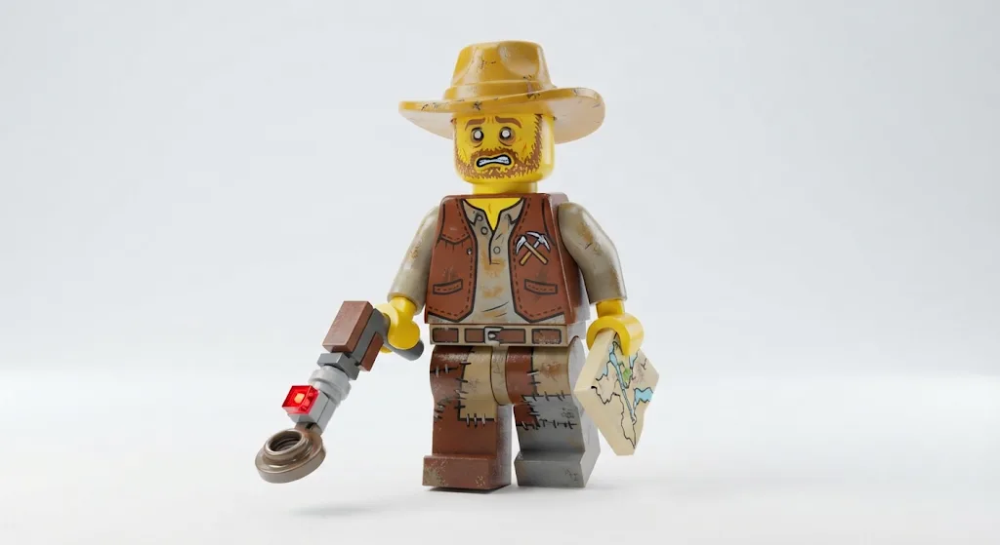

**Minifig (d’après ref) :** Tête jaune, expression inquiète / grimace dents, barbe et moustache brunes. Coiffe : fedora / chapeau prospecteur tan usé, taches. Torse chemise tan sous gilet brun, print pioches croisées, saleté / rouille partout. Bras tan tachés, mains jaunes. Jambes patchwork (marron + gris, coutures / taches). Accessoires : détecteur de métaux brick (poignée marron, LED rouge translucide, disque gris) + carte / map (vert, bleu, chemins).

**Prompt (reproductible) :** `LEGO-style minifigure paranoid rust prospector named Prospecteur Rouille, classic yellow head worried grimacing face brown scruffy beard, dirty tan wide-brim fedora, tan shirt under dark brown vest with crossed pickaxe logo covered in dirt rust smudges, tan stained arms yellow hands, mismatched patchwork legs brown and grey with dirt, holding brick metal detector with red translucent stud light and grey map tile, studio lighting, white seamless backdrop, plastic toy sheen, game character concept art, no real brand logos`

---

## C25 — Moniteur Flocon

**Rôle hub :** Cime Gate — forfaits et cris.  
**Personnalité :** Ski-bro toxique ; « piste noire ou rien ».  
**Punchline :** « Si t’as peur du vide, reste au hub. »

| Aggression | ItemBias | LineStyle | Consistency | PreferredClass |
| ---------- | -------- | --------- | ------------ | -------------- |
| High | Offensive | AirHungry | Steady | Plane |

**Artwork (ref validée) :**

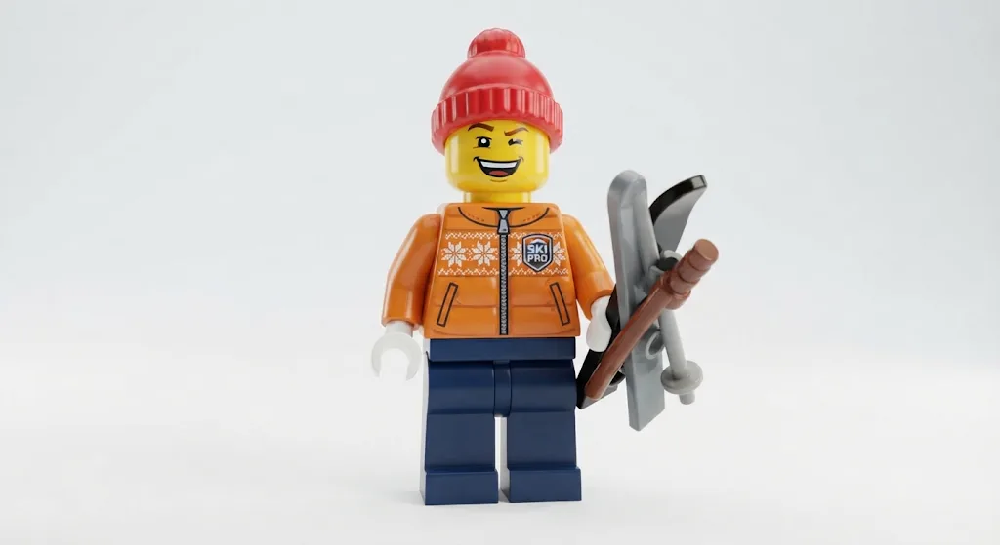

**Minifig (d’après ref) :** Tête jaune, clin d’œil, grand sourire. Coiffe : bonnet rouge à pompon. Torse doudoune orange zip, print flocons blancs + badge bleu « SKI PRO ». Bras orange, mains jaunes. Jambes bleu foncé. Accessoires : paire de skis gris clair + bâton ski marron.

**Prompt (reproductible) :** `LEGO-style minifigure cocky ski instructor named Moniteur Flocon, classic yellow head winking wide smile, red beanie with pom-pom, orange puffer jacket with zipper white snowflake pattern and blue SKI PRO shield badge, orange arms yellow hands, dark blue ski pants, holding light grey skis and brown ski pole, studio lighting, white seamless backdrop, plastic toy sheen, game character concept art, no real brand logos`

---

## C26 — Mascotte Studdy

**Rôle hub :** Pads coupe — costume GP officiel.  
**Personnalité :** Trop joyeux ; voix aiguë ; cache une rage pure.  
**Punchline :** « Studdy aime tout le monde ! (Surtout pas toi.) »

| Aggression | ItemBias | LineStyle | Consistency | PreferredClass |
| ---------- | -------- | --------- | ------------ | -------------- |
| Mid | Chaos | RiskShortcuts | HotCold | Any |

**Artwork (ref validée) :**

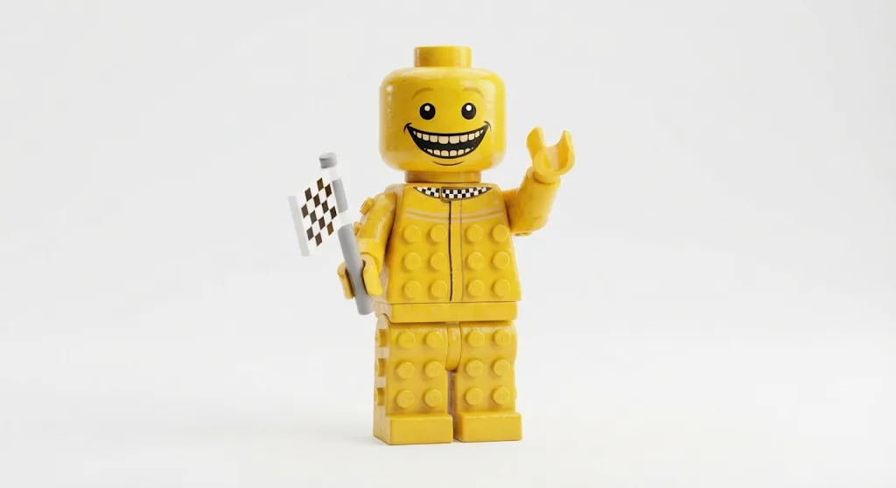

**Minifig (d’après ref) :** Corps entier jaune brillant, torse + jambes couverts de studs en relief (look brique). Tête jaune, grand sourire dents excessif, yeux points. Col damier noir/blanc ; deux rayures blanches horizontales poitrine / bras (style combinaison course). Pose : un bras levé (salut). Accessoire : drapeau damier course sur mât gris.

**Prompt (reproductible) :** `LEGO-style minifigure race mascot named Studdy, uncanny cheerful yellow head oversized toothy grin, full yellow body covered in raised circular brick studs, black-white checkered collar, thin white racing stripes on chest and arms, one arm waving, holding small checkered racing flag on grey pole, studio lighting, white seamless backdrop, plastic toy sheen with wear, game character concept art, no trademarked logos`

---

## C27 — Statue Vivante

**Rôle hub :** Plaza fontaine — mime doré.  
**Personnalité :** Ne parle qu’en poses ; insultes en tableau vivant.  
**Punchline :** « … » (panneau : « SILENCE IS MY INSULT »).

| Aggression | ItemBias | LineStyle | Consistency | PreferredClass |
| ---------- | -------- | --------- | ------------ | -------------- |
| Low | Defensive | Clean | Steady | Kart |

**Artwork (ref validée) :**

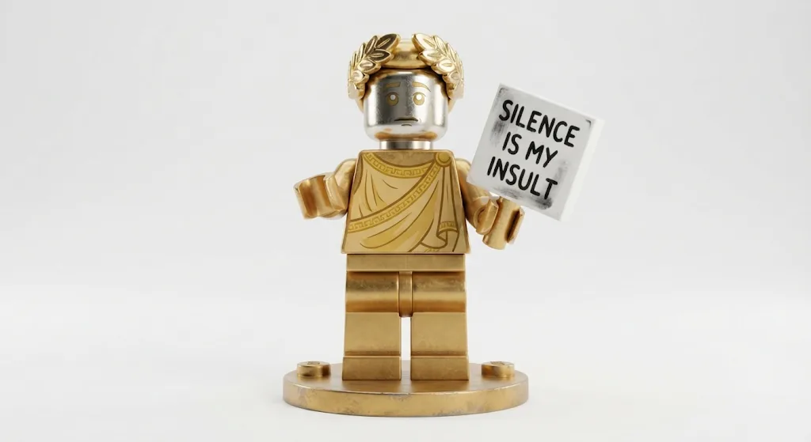

**Minifig (d’après ref) :** Tête chrome argent, expression minimale (yeux points, petite bouche). Coiffe : couronne de laurier or. Corps or : toge drapée épaule gauche (bordure or), bras et jambes or, mains or. Socle rond or (ref studio). Accessoire : panneau blanc « SILENCE IS MY INSULT ».

**Prompt (reproductible) :** `LEGO-style minifigure living golden statue mime named Statue Vivante, silver chrome head minimal face dots eyes curved mouth, gold laurel wreath, gold toga draped over left shoulder gold border, full gold arms hands and legs, standing on small round gold platform, holding white sign reading SILENCE IS MY INSULT, studio lighting, white seamless backdrop, plastic toy sheen, game character concept art, no real brand logos`

---

## C28 — Stagiaire Mairie

**Rôle hub :** Mairie — café et burnout.  
**Personnalité :** Fait tout le travail du Maire ; rêve de DNF pour lui.  
**Punchline :** « J’ai imprimé tes excuses. En triple. »

| Aggression | ItemBias | LineStyle | Consistency | PreferredClass |
| ---------- | -------- | --------- | ------------ | -------------- |
| Low | Balanced | Clean | Choker | Kart |

**Artwork (ref validée) :**

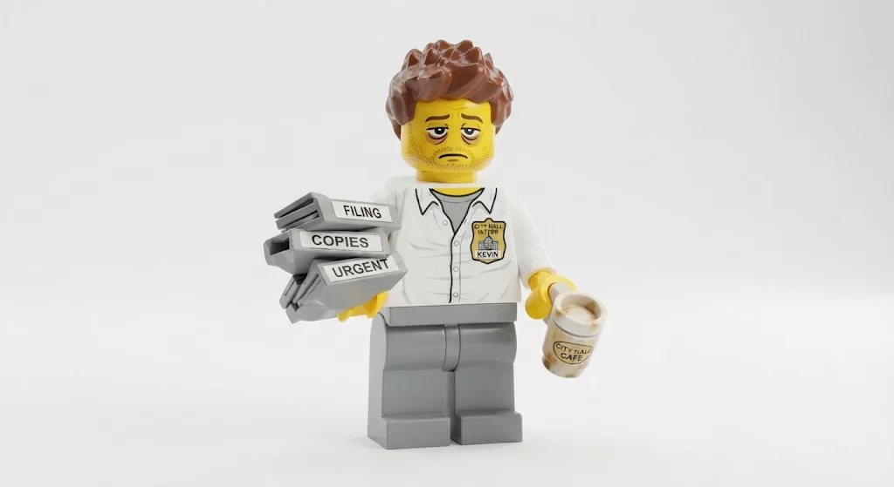

**Minifig (d’après ref) :** Tête jaune, burnout (cernes lourdes, paupières tombantes, bouche basse), barbe de 3 jours claire. Coiffe : cheveux bruns décoiffés. Torse chemise blanche manches courtes sur t-shirt gris, badge or « CITY HALL INTERN / KEVIN » (bâtiment). Bras blancs, mains jaunes. Jambes gris. Accessoires : pile de 3 plateaux/dossiers « FILING / COPIES / URGENT » + gobelet café taché « CITY HALL CAFE ».

**Prompt (reproductible) :** `LEGO-style minifigure burned-out city hall intern named Stagiaire Mairie, classic yellow head weary drooping eyelids heavy under-eye bags downturned mouth light brown stubble, messy medium-brown hair, white short-sleeve button shirt over grey undershirt with gold CITY HALL INTERN KEVIN badge, white arms yellow hands, plain grey pants, holding precarious stack of grey trays labeled FILING COPIES URGENT and stained CITY HALL CAFE coffee cup, studio lighting, white seamless backdrop, plastic toy sheen, game character concept art, no real brand logos`

---

## C29 — Pilote Retraité

**Rôle hub :** Garage Bolt — légende cynique.  
**Personnalité :** « De mon temps » ; lignes parfaites, ego intact.  
**Punchline :** « Les items, c’est pour ceux qui savent pas tourner. »

| Aggression | ItemBias | LineStyle | Consistency | PreferredClass |
| ---------- | -------- | --------- | ------------ | -------------- |
| Mid | Defensive | Clean | Steady | Kart |

**Artwork (ref validée) :**

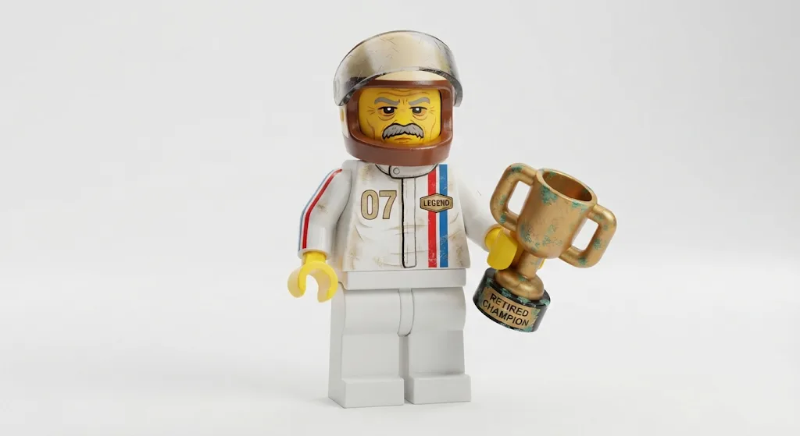

**Minifig (d’après ref) :** Tête jaune, expression usée / grincheuse, sourcils gris, cernes, moustache grise épaisse. Coiffe : casque course marron, visière transparente rayée baissée. Torse combinaison blanche sale (taches), n°07, badge or « LEGEND », bandes rouge/bleu. Bras blancs (bande sur bras), mains jaunes. Jambes blanches. Accessoire : trophée or terni (patine verte) socle « RETIRED CHAMPION ».

**Prompt (reproductible) :** `LEGO-style minifigure cynical retired racing legend named Pilote Retraite, classic yellow head grumpy weathered face grey bushy eyebrows under-eye bags thick grey mustache, brown racing helmet with scratched clear visor down, dirty white racing suit with tan 07 outline gold LEGEND badge red-blue racing stripes, white arms yellow hands, white legs, holding tarnished gold trophy with green patina black marble base RETIRED CHAMPION plaque, studio lighting, white seamless backdrop, plastic toy sheen, game character concept art, no real brand logos`

---

## C30 — Chimiste Pneu

**Rôle hub :** Arrière-garage — gommes illégales.  
**Personnalité :** Scientifique fou du grip ; parle en composés.  
**Punchline :** « J’ai inventé un pneu qui ment. »

| Aggression | ItemBias | LineStyle | Consistency | PreferredClass |
| ---------- | -------- | --------- | ------------ | -------------- |
| Mid | Chaos | DriftHeavy | HotCold | Kart |

**Artwork (ref validée) :**

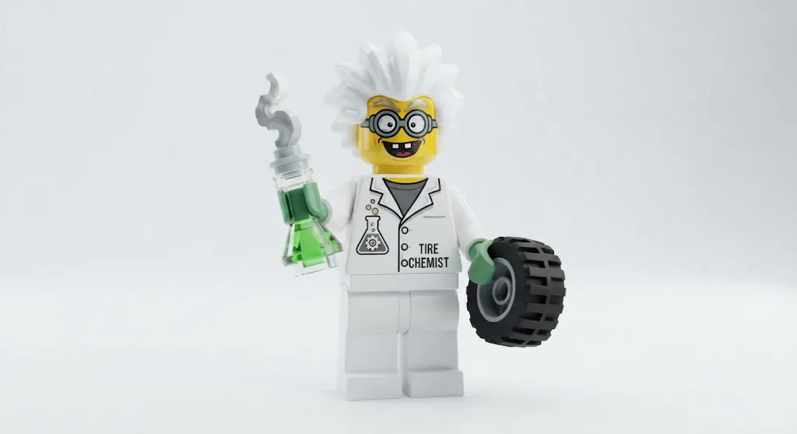

**Minifig (d’après ref) :** Tête jaune, grand sourire dents manquantes, sourcils gris buissonants, grosses lunettes rondes noires. Coiffe : cheveux blancs hérissés « Einstein ». Torse blouse labo blanche sur t-shirt gris foncé, print flacon+engrenage + texte « TIRE CHEMIST ». Bras blancs, mains vertes (gants). Jambes blanches. Accessoires : erlenmeyer vert translucide fumant + pneu noir jante grise.

**Prompt (reproductible) :** `LEGO-style minifigure mad tire chemist named Chimiste Pneu, classic yellow head wide toothy grin missing teeth bushy grey eyebrows large round black goggles, wild spiky white Einstein hair, white lab coat over dark grey shirt with flask-and-gear graphic and TIRE CHEMIST text, white arms green glove hands, white legs, holding transparent green flask with bright green liquid grey smoke and black tire with grey rim, studio lighting, white seamless backdrop, plastic toy sheen, game character concept art, no real brand logos`

---

## C31 — Voleuse Stud

**Rôle hub :** Ruelle — pickpocket du paddock.  
**Personnalité :** Charmeuse ; te pique un item « pour la science ».  
**Punchline :** « C’était déjà à moi. Spirituellement. »

| Aggression | ItemBias | LineStyle | Consistency | PreferredClass |
| ---------- | -------- | --------- | ------------ | -------------- |
| High | Offensive | RiskShortcuts | HotCold | Moto |

**Artwork (ref validée) :**

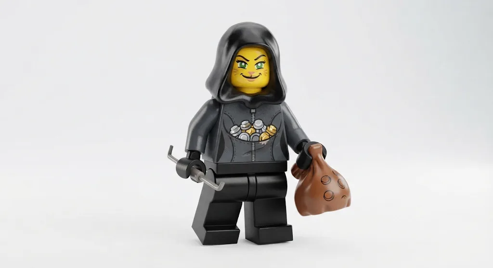

**Minifig (d’après ref) :** Tête jaune, yeux verts, sourire malicieux, trois « moustaches » / traits bruns par joue. Coiffe : capuche noire encadrant le visage. Torse hoodie gris foncé zip, poche avant débordante de studs argent/or/gris. Bras gris foncé, mains noires. Jambes noires. Accessoires : pied-de-biche gris clair + sacoche marron (anneaux / butin).

**Prompt (reproductible) :** `LEGO-style minifigure charming paddock thief named Voleuse Stud, classic yellow head green eyes mischievous smirk brown whisker face paint, black hood framing face, dark grey zip hoodie with pocket overflowing silver gold grey brick studs, dark grey arms black hands, black legs, holding light grey crowbar and brown loot sack, studio lighting, white seamless backdrop, plastic toy sheen, game character concept art, no trademarked logos`

---

## C32 — Curé Circuit

**Rôle hub :** Petite chapelle brick — bénédictions payantes.  
**Personnalité :** Absout les coupures de trajectoire contre un don.  
**Punchline :** « Que le checkpoint soit avec toi. Amen. Ou pas. »

| Aggression | ItemBias | LineStyle | Consistency | PreferredClass |
| ---------- | -------- | --------- | ------------ | -------------- |
| Low | Defensive | Clean | Steady | Kart |

**Artwork (ref validée) :**

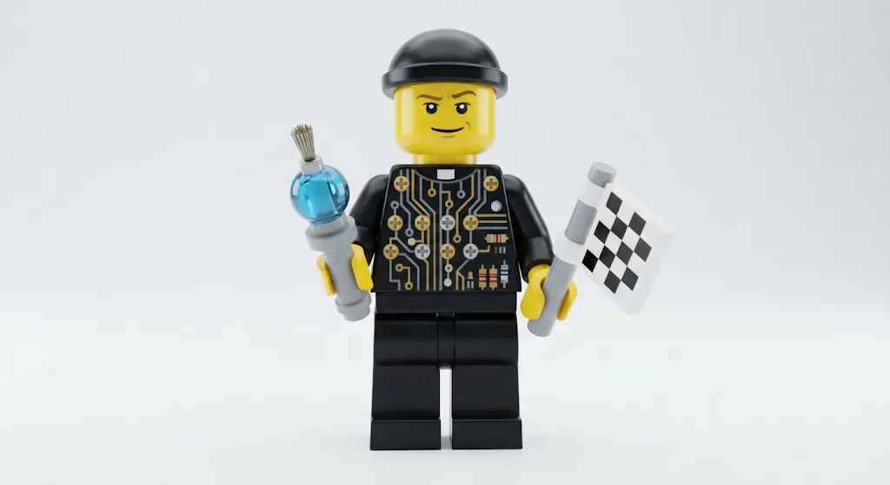

**Minifig (d’après ref) :** Tête jaune, sourire en coin, sourcils déterminés. Coiffe : barrette / toque prêtre noire ronde. Torse chemise cléricale noire, col blanc, print circuit imprimé (pistes cuivre, soudures, résistances colorées). Bras noirs, mains jaunes. Jambes noires. Accessoires : goupillon (poignée grise, boule bleue translucide, fibres argent) + petit drapeau damier course.

**Prompt (reproductible) :** `LEGO-style minifigure ironic circuit priest named Cure Circuit, classic yellow head determined smirk, black round biretta priest hat, black clerical shirt white collar with copper circuit board traces solder points colorful resistors print, black arms yellow hands, black legs, holding aspergillum with translucent blue sphere silver brush tip and small checkered racing flag, studio lighting, white seamless backdrop, plastic toy sheen, game character concept art, no real brand logos`

---

## C33 — Banquier Abs

**Rôle hub :** Tour finance — crédit crash.  
**Personnalité :** Calcule ton DNF en taux d’intérêt.  
**Punchline :** « Tu dois trois tours à la banque. »

| Aggression | ItemBias | LineStyle | Consistency | PreferredClass |
| ---------- | -------- | --------- | ------------ | -------------- |
| Mid | Offensive | Clean | Steady | Kart |

**Artwork (ref validée) :**

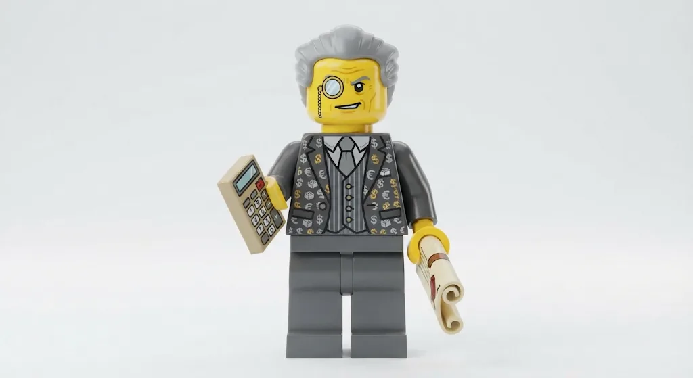

**Minifig (d’après ref) :** Tête jaune, sourire confiant, sourcils gris, monocle or œil droit. Coiffe : cheveux gris peignés en arrière. Torse costume trois pièces gris, motif $ / € / lingots or, cravate gris clair. Bras gris, mains jaunes. Jambes gris moyen. Accessoires : grosse calculatrice tan (écran bleu) + parchemin / contrat tan sceau rouge.

**Prompt (reproductible) :** `LEGO-style minifigure ruthless crash banker named Banquier Abs, classic yellow head confident smirk grey eyebrows gold monocle on right eye, swept-back grey hair, grey three-piece suit patterned with gold silver dollar euro signs and gold bar stacks light grey tie, grey arms yellow hands, medium grey legs, holding oversized tan calculator with light blue screen and rolled tan contract scroll with red wax seal, studio lighting, white seamless backdrop, plastic toy sheen, game character concept art, no real brand logos`

---

## C34 — Nurse Drift

**Rôle hub :** Clinique paddock — premiers secours sarcasm.  
**Personnalité :** Pansements et verdicts ; adore les beaux crashes.  
**Punchline :** « Respire. Ou pas. J’ai des photos. »

| Aggression | ItemBias | LineStyle | Consistency | PreferredClass |
| ---------- | -------- | --------- | ------------ | -------------- |
| Mid | Defensive | Clean | Steady | Kart |

**Artwork (ref validée) :**

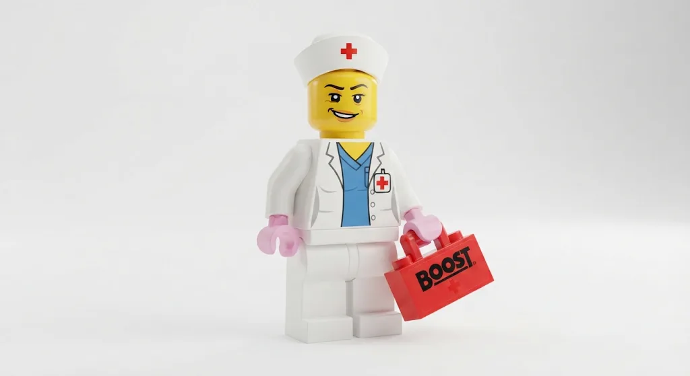

**Minifig (d’après ref) :** Tête jaune, sourire malicieux de côté, cils. Coiffe : calot blanc avec petite croix rouge générique. Torse blouse blanche sur scrub bleu clair, badge ID croix rouge. Bras blancs, mains rose clair (gants). Jambes blanches. Accessoire : mallette / kit rouge « BOOST » + croix.

**Prompt (reproductible) :** `LEGO-style minifigure sarcastic paddock nurse named Nurse Drift, classic yellow head mischievous side smirk eyelashes, white nurse cap with generic red cross, white medical jacket over light blue scrub top with ID badge red cross, white arms light pink glove hands, white legs, holding red medical kit briefcase labeled BOOST with red cross, studio lighting, white seamless backdrop, plastic toy sheen, game character concept art, no real brand logos`

---

## C35 — Squatteur Rooftop

**Rôle hub :** Toits plaza — accès illégal aux pads air.  
**Personnalité :** Anti-maire ; graffs et lignes aériennes.  
**Punchline :** « La skyline est à ceux qui grimpent. »

| Aggression | ItemBias | LineStyle | Consistency | PreferredClass |
| ---------- | -------- | --------- | ------------ | -------------- |
| High | Chaos | AirHungry | HotCold | Plane |

**Artwork (ref validée) :**

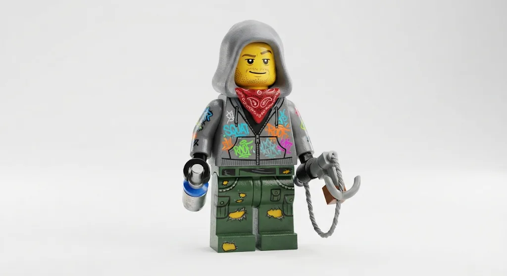

**Minifig (d’après ref) :** Tête jaune, sourire en coin, barbe de 3 jours. Coiffe : capuche gris clair ; bandana rouge paisley au cou. Torse hoodie gris zip couvert de tags (« SQUAT », « ROOF », graffs colorés). Bras gris tagués, mains jaunes. Jambes cargo olive trouées (jaune sous les déchirures). Accessoires : bombe spray argent/bleu + grappin gris + corde enroulée.

**Prompt (reproductible) :** `LEGO-style minifigure rebellious rooftop squatter named Squatteur Rooftop, classic yellow head smirk light brown stubble, light grey fabric hood over head, red white paisley bandana around neck, grey zip hoodie covered in colorful graffiti tags SQUAT ROOF, grey tagged arms yellow hands, dark olive cargo pants with tears holes yellow underlayer pocket prints, holding silver spray can blue band and grey grappling hook with coiled rope, studio lighting, white seamless backdrop, plastic toy sheen, game character concept art, no real brand logos`

---

## C36 — Gamin Contrefaçon

**Rôle hub :** Devant boutique Vinyle — merch fake.  
**Personnalité :** Gamin insolent (adulte voice acting OK) ; revend des stickers « officiels ».  
**Punchline :** « C’est du vrai faux. Différence ? Le prix. »

| Aggression | ItemBias | LineStyle | Consistency | PreferredClass |
| ---------- | -------- | --------- | ------------ | -------------- |
| High | Offensive | RiskShortcuts | HotCold | Kart |

**Artwork (ref validée) :**

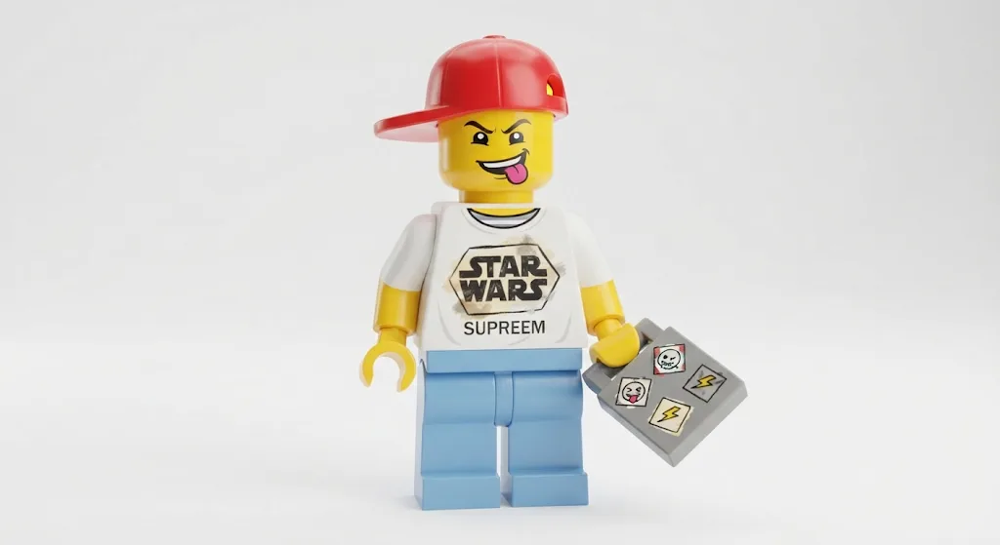

**Minifig (d’après ref) :** Tête jaune, sourcil levé, yeux plissés, langue tirée sur le côté. Coiffe : casquette baseball rouge de travers. Torse t-shirt blanc manches courtes (bras bleu clair), print contrefaçon volontairement bâclé : hexagone + texte « SUPREEM » mal orthographié, taches. Jambes bleu clair. Accessoire : mallette / plateau stickers gris (visage langue, crâne, éclairs).

**Prompt (reproductible) :** `LEGO-style minifigure bratty counterfeit merch kid named Gamin Contrefacon, classic yellow head raised eyebrow squinted eyes tongue sticking out sideways, bright red baseball cap worn sideways, white short-sleeve tee over light blue arms with dirty botched hexagonal fake streetwear logo and misspelled SUPREEM text, light blue legs, holding grey sticker suitcase with tongue-out face skull and lightning stickers, studio lighting, white seamless backdrop, plastic toy sheen, game character concept art, no real brand logos`

---

## C37 — Astronaute Fake

**Rôle hub :** Aéroport jouet hub — « missions » GP.  
**Personnalité :** Cosplay spatial ; n’a jamais quitté le sol.  
**Punchline :** « Un petit pas pour moi, un DNF pour toi. »

| Aggression | ItemBias | LineStyle | Consistency | PreferredClass |
| ---------- | -------- | --------- | ------------ | -------------- |
| Mid | Balanced | AirHungry | Steady | Plane |

**Artwork (ref validée) :**

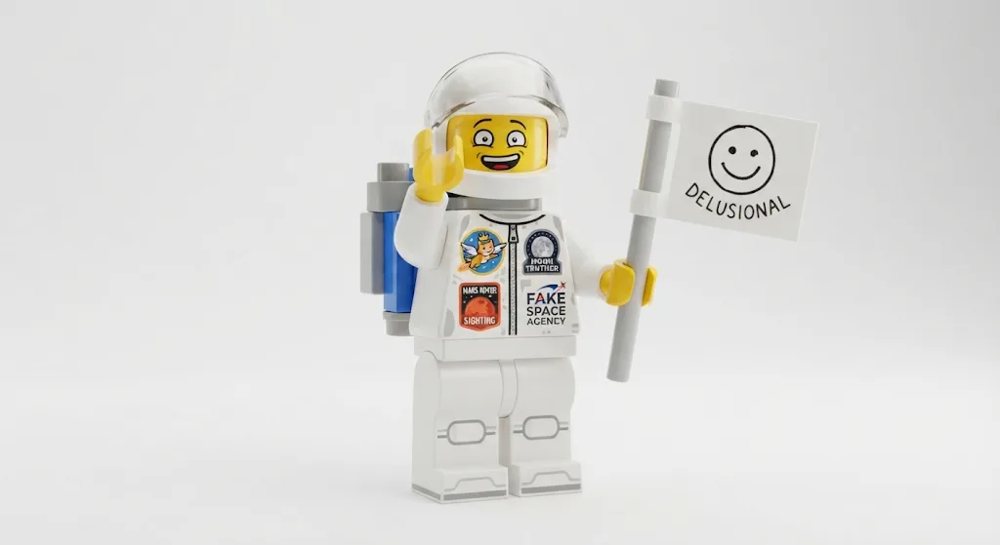

**Minifig (d’après ref) :** Tête jaune, expression enthousiaste / un peu folle (yeux écarquillés, grand sourire). Coiffe : casque spatial blanc, visière transparente relevée. Combinaison blanche ; sac à dos bleu/gris. Patches absurdes : chien ailé, « MARS ROVER SIGHTING », « MOON TRUTHER », « FAKE SPACE AGENCY ». Pose : main droite qui salue. Accessoire : drapeau blanc smiley + texte « DELUSIONAL ».

**Prompt (reproductible) :** `LEGO-style minifigure delusional fake astronaut named Astronaute Fake, classic yellow head wide crazy enthusiastic smile, white space helmet clear raised visor, white astronaut suit with blue grey backpack, absurd mission patches winged dog MARS ROVER SIGHTING MOON TRUTHER FAKE SPACE AGENCY, white arms and legs, waving right hand, holding grey flagpole white flag with hand-drawn smiley and DELUSIONAL text, studio lighting, white seamless backdrop, plastic toy sheen, game character concept art, no real agency logos`

---

## C38 — Pirate Parking

**Rôle hub :** Quais — rançon de places.  
**Personnalité :** « Droit d’ancrage » sur les pads ; œil de verre.  
**Punchline :** « Ta place ? C’était la mienne. Toujours. »

| Aggression | ItemBias | LineStyle | Consistency | PreferredClass |
| ---------- | -------- | --------- | ------------ | -------------- |
| High | Offensive | DriftHeavy | HotCold | Kart |

**Artwork (ref validée) :**

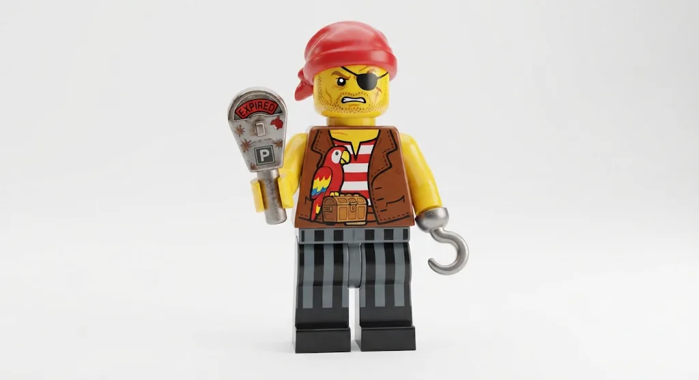

**Minifig (d’après ref) :** Tête jaune, colère (sourcils froncés, dents serrées), cache-œil gauche, cicatrice œil droit, barbe rousse. Coiffe : bandana rouge. Torse gilet brun sur marinière rouge/blanche, print perroquet sur coffre. Bras jaunes ; main droite jaune, main gauche crochet argent. Jambes rayures verticales noir/gris. Accessoire : tête de parcmètre rouillée « EXPIRED » + « P ».

**Prompt (reproductible) :** `LEGO-style minifigure menacing parking pirate named Pirate Parking, classic yellow head angry clenched teeth black eyepatch left scar right orange stubble, bright red bandana, brown vest over red-white striped shirt with parrot on treasure chest print, yellow right hand silver hook left hand, black dark-grey vertically striped pirate pants, holding rusty grey parking meter head showing EXPIRED and P symbol, studio lighting, white seamless backdrop, plastic toy sheen, game character concept art, no real brand logos`

---

## C39 — Oracle GPS

**Rôle hub :** Pads — voix off vivante.  
**Personnalité :** Recalcule en boucle ; gaslight directionnel.  
**Punchline :** « Dans 200 mètres, tourne… non, reviens. Non. »

| Aggression | ItemBias | LineStyle | Consistency | PreferredClass |
| ---------- | -------- | --------- | ------------ | -------------- |
| Low | Chaos | RiskShortcuts | Choker | Any |

**Artwork (ref validée) :**

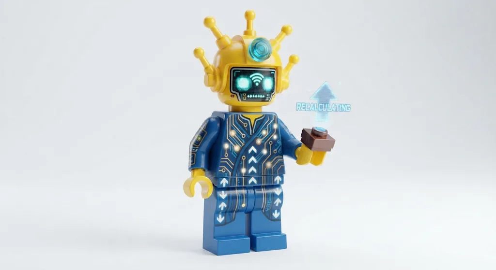

**Minifig (d’après ref) :** Casque / tête jaune avec antennes + lentille bleue frontale ; « visage » écran noir (yeux pixel cyan, Wi‑Fi, bouche points). Corps bleu foncé, print circuit / carte (lignes or, flèches GPS blanches, nœuds). Bras bleus, mains jaunes. Accessoire : brique marron + hologramme cyan flèche « RECALCULATING ».

**Prompt (reproductible) :** `LEGO-style minifigure uncanny GPS oracle named Oracle GPS, yellow tech helmet with antenna spheres and glowing blue forehead lens, black digital face screen with cyan pixel eyes wifi symbol, dark blue body with glowing gold circuit map patterns white GPS arrows, yellow hands, holding brown brick projecting cyan hologram upward arrow and RECALCULATING text, studio lighting, white seamless backdrop, plastic toy sheen, game character concept art, no real brand logos`

---

## C40 — Rival Fantôme

**Rôle hub :** Apparition tardive (post-acte 2+) — rumeur paddock.  
**Personnalité :** Silhouette du « vrai » champion disparu ; parle peu, roule juste.  
**Punchline :** « …Tu prends ma place. Rends-la. »

| Aggression | ItemBias | LineStyle | Consistency | PreferredClass |
| ---------- | -------- | --------- | ------------ | -------------- |
| High | Offensive | DriftHeavy | Steady | Any |

**Artwork (ref validée) :**

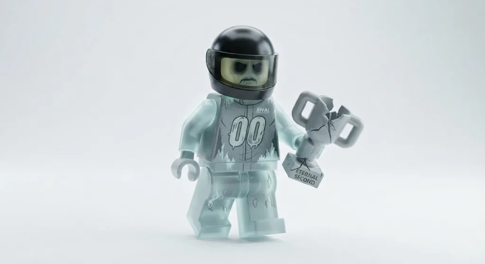

**Minifig (d’après ref) :** Corps entier plastique translucide bleu pâle givré (effet fantôme). Casque moto noir, visière claire ; visage pâle / spectral (yeux creux, grimace). Torse gilet / combinaison gris mate sur corps translucide, n°00 blanc « fondu », label « RIVAL », motifs vapeur / flammes bas. Accessoire : trophée pierre gris fendu, plaque « ETERNAL SECOND » (orthographe volontairement bancale sur la ref OK).

**Prompt (reproductible) :** `LEGO-style minifigure haunting ghost rival racer named Rival Fantome, translucent frosted pale-blue ghost plastic body, black motorcycle helmet clear visor pale gaunt skeletal face print, matte grey racing vest over translucent limbs with dripping white number 00 and RIVAL text vapor flame patterns, holding cracked broken grey stone trophy base labeled ETERNAL SECOND, studio lighting, white seamless backdrop, eerie plastic toy sheen, game character concept art, no real brand logos`

---

## Sélection (post-playtest)

**Pas de cut définitif avant playtests.** Critères de rétention attendus :

- Couverture des tags conduite (pas 10× Chaos / RiskShortcuts).
- Lisibilité silhouette minifig en course.
- Utilité hub (quête / gag / face biome) vs purement décoratif.
- Équilibrage ressenti du peloton 7 NPC (aggression, items, chokers).

Noyau provisoire conseillé pour les premiers tests : **C01–C08** + un sous-ensemble tournant de C09–C40.  
Quand le roster ~20 est figé : mettre à jour [gdd.md](gdd.md) §7 et créer `characters.md` (roster final + règles de tirage 7 NPC).

## Historique

| Version | Date | Note |
| ------- | ---- | ---- |
| 1.0 | 2026-10-23 | 40 candidats + tags conduite + descriptions minifig + prompts artwork |
| 1.1 | 2026-10-23 | Roster ~20 figé **après playtests** (équilibrage), pas avant |
| 1.2 | 2026-10-23 | C01 Bolt : artwork ref validée (`art/characters/c01-bolt-*.webp`), minifig + prompt alignés |
| 1.3 | 2026-10-23 | Règle assets : images repo en WebP uniquement ([CONTRIBUTING.md](../../CONTRIBUTING.md)) |
| 1.4 | 2026-10-23 | C02 Vinyle : artwork ref (`art/characters/c02-vinyle.webp`), minifig + prompt alignés |
| 1.5 | 2026-10-23 | C03 Maire Brique-Dur : artwork ref (`art/characters/c03-maire-brique-dur.webp`) |
| 1.6 | 2026-10-23 | C04 Hex : artwork ref (`art/characters/c04-hex.webp`) |
| 1.7 | 2026-10-23 | C05 Capitaine Glisse : artwork ref (`art/characters/c05-capitaine-glisse.webp`) |
| 1.8 | 2026-10-23 | C06 Dame Mousse : artwork ref (`art/characters/c06-dame-mousse.webp`) |
| 1.9 | 2026-10-23 | C07 Mirage Max : artwork ref (`art/characters/c07-mirage-max.webp`) |
| 1.10 | 2026-10-23 | C01 Bolt : **remplace** refs A/B → `art/characters/c01-bolt.webp` (barbe rousse) |
| 1.11 | 2026-10-23 | C08 Coach Cime : artwork ref (`art/characters/c08-coach-cime.webp`) |
| 1.12 | 2026-10-23 | C09 Flash Stud : artwork ref (`art/characters/c09-flash-stud.webp`) |
| 1.13 | 2026-10-23 | C10 Caméra Clac : artwork ref (`art/characters/c10-camera-clac.webp`) |
| 1.14 | 2026-10-23 | C11 Sponsor Or : artwork ref (`art/characters/c11-sponsor-or.webp`) |
| 1.15 | 2026-10-23 | C12 Agent Négatif : artwork ref (`art/characters/c12-agent-negatif.webp`) |
| 1.16 | 2026-10-23 | C13 Flic Brique : artwork ref (`art/characters/c13-flic-brique.webp`) |
| 1.17 | 2026-10-23 | C14 Douanier Sable : artwork ref (`art/characters/c14-douanier-sable.webp`) |
| 1.18 | 2026-10-23 | C15 Pompier Mousse : artwork ref (`art/characters/c15-pompier-mousse.webp`) |
| 1.19 | 2026-10-23 | C16 Bookie Zoom : artwork ref (`art/characters/c16-bookie-zoom.webp`) |
| 1.20 | 2026-10-23 | C17 DJ Overclock + C18 Livreur Turbo : artwork refs |
| 1.21 | 2026-10-23 | C19 Foodtruck Grease : artwork ref (`art/characters/c19-foodtruck-grease.webp`) |
| 1.22 | 2026-10-23 | C20 Immo Brick : artwork ref (`art/characters/c20-immo-brick.webp`) |
| 1.23 | 2026-10-23 | C21 Influenceuse Lag : artwork ref (`art/characters/c21-influenceuse-lag.webp`) |
| 1.24 | 2026-10-23 | C22 Surfeur Concrete : artwork ref (`art/characters/c22-surfeur-concrete.webp`) |
| 1.25 | 2026-10-23 | C23 Scout Épine : artwork ref (`art/characters/c23-scout-epine.webp`) |
| 1.26 | 2026-10-23 | C24 Prospecteur Rouille : artwork ref (`art/characters/c24-prospecteur-rouille.webp`) |
| 1.27 | 2026-10-23 | C25 Moniteur Flocon + C26 Mascotte Studdy : artwork refs |
| 1.28 | 2026-10-23 | C27 Statue Vivante : artwork ref (`art/characters/c27-statue-vivante.webp`) |
| 1.29 | 2026-10-23 | C28 Stagiaire Mairie : artwork ref (`art/characters/c28-stagiaire-mairie.webp`) |
| 1.30 | 2026-10-23 | C29 Pilote Retraité + C30 Chimiste Pneu : artwork refs |
| 1.31 | 2026-10-23 | C31 Voleuse Stud + C32 Curé Circuit : artwork refs |
| 1.32 | 2026-10-23 | C33 Banquier Abs : artwork ref (`art/characters/c33-banquier-abs.webp`) |
| 1.33 | 2026-10-23 | C34 Nurse Drift + C35 Squatteur Rooftop : artwork refs |
| 1.34 | 2026-10-23 | C36 Gamin Contrefaçon : artwork ref (`art/characters/c36-gamin-contrefacon.webp`) |
| 1.35 | 2026-10-23 | C37 Astronaute Fake : artwork ref (`art/characters/c37-astronaute-fake.webp`) |
| 1.36 | 2026-10-23 | C38 Pirate Parking : artwork ref (`art/characters/c38-pirate-parking.webp`) |
| 1.37 | 2026-10-23 | C39 Oracle GPS + C40 Rival Fantôme : artwork refs — **40/40 refs complètes** |
