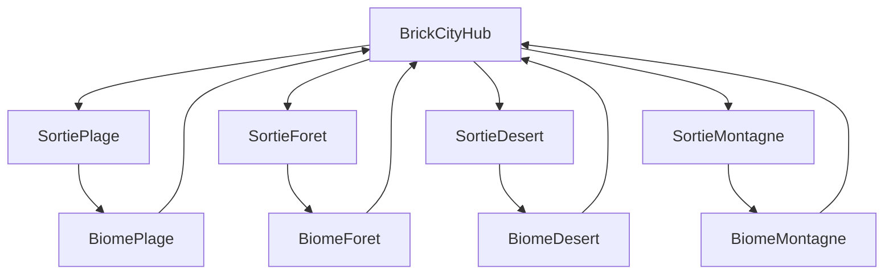

# Game Design Document — Brick Racer

**Working title :** Brick Racer (renommage produit ultérieur).  
**Version doc :** 1.0 · bible gameplay + lore aventure.  
**Moteur :** [W3DTS](https://github.com/naanouff/w3dts).

**Brick Racer n’est pas affilié à The LEGO Group ni à Nintendo.** LEGO®, Mario Kart™ et toute marque citée comme référence d’intention appartiennent à leurs détenteurs.

| Doc | Rôle |
| --- | ---- |
| [vision.md](vision.md) | Piliers produit, non-objectifs |
| [tone.md](tone.md) | Garde-fous 16+ |
| [ui-ux.md](ui-ux.md) | Maquette UI/UX écrans MVP |
| [levels.md](levels.md) | Circuits, boosts, items, specs SceneDD piste |
| [test-slice.md](test-slice.md) | Slice hub+course « Brick Proving Grounds » + prompts art |
| [test-slice-plans.md](test-slice-plans.md) | Plans cotés W3DTS (échelle minifig, AABB, piste) |
| [minifig-gproc.md](minifig-gproc.md) | Pipeline avatar GPROC + recipes |
| [../plans/roadmap.md](../plans/roadmap.md) | Séquence d’implémentation P0–P5 |

Ce GDD **fixe** la structure monde (hub + 4 biomes), le mode aventure, le cast PNJ et les boucles. Les tables de pistes / items détaillées restent dans [levels.md](levels.md) ; en cas d’écart sur les **noms de biomes**, ce GDD fait foi pour le mode histoire.

---

## 1. Identité

| | |
| - | - |
| **Pitch** | Course / aventure full brick : tu arrives dans Brick City, tu customises ton bolide absurde, tu ouvres quatre routes hors city, et tu gagnes un Grand Prix pourri jusqu’à l’os. |
| **Fantasy joueur** | Outsider qui devient le pilote dont toute la city se moque — jusqu’à ce qu’il gagne. |
| **Public** | 16+ (humour absurde / trash contrôlé, pas family LEGO officiel). |
| **Plateforme** | Desktop Electron, **WebGPU** requis. |
| **Réfs d’intention** | Hub-monde : *Diddy Kong Racing*. Course arcade : *Mario Kart*. Ton : *Conker’s Bad Fur Day*. |

---

## 2. Piliers de sensation

| Pilier | Implication concrète |
| ------ | -------------------- |
| **Lisibilité** | Silhouettes brick, caméra chase qui ne perd jamais le véhicule, checkpoints verticaux (sol → air). |
| **Punch** | Collisions soft comiques, items à punchline courte, boosts sol/air jumelés ([levels.md](levels.md)). |
| **Comédie physique** | Resets, sauts ratés, PNJ qui commentent — le gag sert le rythme, pas l’inverse. |
| **Custom lisible** | Garage / boutique : le look se lit en course (cosmétiques d’abord). |
| **Hub = métagame** | Brick City *est* le menu : sorties, PNJ, garage, boutique. Pas de liste froide au long terme. |

---

## 3. Lore & fantasy monde

### Pitch monde

**Brick City** : skyline pastel saturé, façades nickel, coulisses pourries. Les panneaux te souhaitent la bienvenue et te jugent dans la même phrase. La city vit pour le **Grand Prix des Studs** — spectacle officiel, bakchich non officiel.

### Conflit central (v1)

Le **Maire Brique-Dur** et le consortium du Grand Prix ont **verrouillé les quatre routes** hors city (plage, forêt, désert, montagne). Officiellement : « sécurité ». En vrai : monops sur les circuits, tourisme forcé, et un rival médiatique qui a besoin d’un outsider pour faire de l’audience.

Chaque biome révèle un pan du deal (permis, fric, frayeur, prestige). Tu n’as pas de lore-dump : tu **ouvres des portes**, tu **parles à des gens cyniques**, tu **gagnes des courses**.

### Rôle du joueur

Pilote sans pedigree. Les PNJ te traitent comme un accessoire — jusqu’à ce que tu casses leurs arcs. Tu es le pivot comique, pas le sauveur moralisateur.

### Ton narratif

Punchlines, quatrième mur, arcs courts. Pas de cutscene de 10 minutes. Voicelines / textes longs : relecture 16+ ([tone.md](tone.md)).

---

## 4. Mode aventure / histoire

Structure type **Diddy Kong Racing** : hub central → débloquer une **sortie** → biome → quêtes PNJ → courses / défis → **boss de biome** → retour hub (nouvelle sortie, véhicule, cosmétique).

### Actes MVP

| Acte | Lieu | Objectif | Récompense type |
| ---- | ---- | -------- | --------------- |
| **0 — Prologue** | Brick City | Garage, premier pad tutoriel, rencontrer Riv / Bolt — slice validation : [test-slice.md](test-slice.md) | Kart fiable, sortie **Plage** ouverte |
| **1 — Plage** | Biome Plage | Arc Capitaine Glisse + 2–3 courses + boss | Sortie **Forêt**, monnaies, pièce cosmétique |
| **2 — Forêt** | Biome Forêt | Arc Dame Mousse + boss | Sortie **Désert**, hints moto |
| **3 — Désert** | Biome Désert | Arc Mirage Max + boss | Sortie **Montagne**, unlock moto (si P4) |
| **4 — Montagne** | Biome Montagne | Arc Cime + boss | Retour hub, piste finale / rival |
| **5 — Épilogue** | Hub | Rival Hex / Maire — set-piece city | Free play complet, pad Cup Free |

Ordre d’ouverture **figé v1** : Plage → Forêt → Désert → Montagne (courbe douce → technique → chaleur/lisibilité → dénivelé / air).

### Aventure vs libre

| Mode | Accès |
| ---- | ----- |
| **Aventure** | Sorties et pads **story-gated** ; quêtes PNJ actives. |
| **Libre** | Biomes / pistes déjà débloqués ; pad **Cup Free** + Versus (voir hub). |
| **Multi** | Hors histoire (lobby → course). |

### Quêtes

| Type | Exemple | Durée cible |
| ---- | ------- | ----------- |
| Course | Gagner une coupe / un défi temps | 1 run |
| Livraison absurde | Porter un « colis » brick sans le casser (timer + gag) | Court |
| Collectible | Studs / panneaux dans le biome hub-lite | Exploration |
| Défi véhicule | Section moto / air obligatoire annoncée | 1 run |

États : `disponible` → `active` → `done`. UI : **bulle PNJ** + marqueur discret sur sortie / pad — pas de journal MMO.

---

## 5. Hub — Brick City (style Lego City)

**Une scène SceneDD `city`** (MVP). Pas de streaming open-world. Landmarks = volumes + façades lisibles. POI = triggers → UI atelier / load biome / load course.

### Layout

| Zone | Rôle | Landmark |
| ---- | ---- | -------- |
| **Plaza Centrale** | Spawn, fontaine, panneau classements cynique | Tour horloge décalée |
| **District Garage** | Atelier véhicules (Bolt) | Enseigne « On jugera ton build » |
| **District Boutique** | Custom minifig (Vinyle) | Vitrine louche |
| **Mairie / ring** | Autorité absurde (Maire) ; pad prologue city | Statue minifig cassée |
| **Sortie Est — Riviera Gate** | → **Plage** | Arche coquillage brick |
| **Sortie Nord — Canopée Gate** | → **Forêt** | Portail racines / panneaux « défense de cueillir » |
| **Sortie Ouest — Mirage Gate** | → **Désert** | Arche cactus / douane absurde |
| **Sortie Sud — Cime Gate** | → **Montagne** | Tunnel téléphérique brick |

Pads additionnels : **Cup Free** (post-déblocages), **Versus / Lobby** (multi).

### Circulation hub

Pied + « scooter city » léger (pas les 3 classes course). Après chaque boss biome : **feedback cosmétique** hub (skyline, PNJ, enseigne) — sans chunk streaming.

### Les 4 sorties

| Sortie | Biome | Déblocage | Look |
| ------ | ----- | --------- | ---- |
| Riviera Gate | Plage | Fin prologue (Bolt + Riv) | Pastel mer, pub touristique mensongère |
| Canopée Gate | Forêt | Boss Plage | Vert saturé, panneaux passifs-agressifs |
| Mirage Gate | Désert | Boss Forêt | Ocre, douane « taxes soleil » |
| Cime Gate | Montagne | Boss Désert | Gris/bleu froid, file d’attente téléphérique |

Chaque sortie = **load scène biome** séparée (retour hub = reload city).

---

## 6. Les 4 biomes

Chaque biome = scène / load dédié. Contenu MVP : **2–3 courses** + **1–2 défis** + **1 boss**. Feeling **distinct** (pas quatre reskins). Roster Cup Free : **4 circuits par biome** (16 total) dans [levels.md](levels.md).

### 6.1 Plage — « Stud Coast »

| | |
| - | - |
| **Fantasy** | Station balnéaire brick trop chère, vagues items, marina pourrie. |
| **Feeling** | Sol large + dunes ; marée / bords d’eau ; air = surf aérien. |
| **Véhicule favorisé** | Kart (ouverture) ; avion sur falaises. |
| **PNJ d’arc** | Capitaine Glisse |
| **Ton 16+** | Trash-touristique, amendes absurdes, hustle bord de mer. |
| **Boss** | « Amende Maritime » — 1v1 vs Capitaine (hybride lent, items lourds). |
| **Débloque** | Sortie Forêt + monnaies / cosmétique plage. |

Pistes : [levels.md](levels.md) § Plage (Promenade Bikini, Marina Yacht, Falaise Stud, Phare à Contresens).

### 6.2 Forêt — « Canopy Cup »

| | |
| - | - |
| **Fantasy** | Parc « naturel » géré par une association passive-agressive ; racines, cabanes, scierie abandonnée. |
| **Feeling** | Virages serrés, splits sous-bois, whoops racines (moto) ; couloir air entre cimes. |
| **Véhicule favorisé** | Moto (lean) ; kart OK sur sentiers larges. |
| **PNJ d’arc** | Dame Mousse |
| **Ton 16+** | Écolo cynique, amendes feuilles, « respectez le silence » crié. |
| **Boss** | « Coupe Claire » — 1v1 vs Dame Mousse (kart-broyeur / hazards branches). |
| **Débloque** | Sortie Désert + hints / unlock moto. |

Pistes : [levels.md](levels.md) § Forêt (Sentier Amendé, Cabanes Empilées, Scierie Abandonnée, Racine Vertige).

### 6.3 Désert — « Mirage Grand Prix »

| | |
| - | - |
| **Fantasy** | Dunes brick, station-service fantôme, mirages qui insultent le joueur. |
| **Feeling** | Grandes droites, dérapages, oasis shortcut, chaleur visuelle (pas sim thermo). |
| **Véhicule favorisé** | Kart top speed ; avion sur canyons. |
| **PNJ d’arc** | Mirage Max |
| **Ton 16+** | Arnaques eau, taxes soleil, mirages quatrième mur. |
| **Boss** | « Fata Morgana » — 1v1 vs Max (fantômes de piste / faux boosts). |
| **Débloque** | Sortie Montagne + monnaies. |

Pistes : [levels.md](levels.md) § Désert (Dune Fiscale, Station Fantôme, Canyon Mirage, Douane Soleil).

### 6.4 Montagne — « Peak Stud »

| | |
| - | - |
| **Fantasy** | Station de ski brick hors saison, téléphérique, pics, tempête de confettis. |
| **Feeling** | Switchbacks, dénivelé, sauts ; **air** très présent (anneaux crêtes). |
| **Véhicule favorisé** | Avion + moto ; kart sur routes lacets. |
| **PNJ d’arc** | Coach Cime |
| **Ton 16+** | Coaching toxique, altitude qui « justifie » les jurons, lodge pourri. |
| **Boss** | « Sommet Obligatoire » — 1v1 vs Cime (phases sol → air annoncées). |
| **Débloque** | Épilogue hub / rival Hex. |

Pistes : [levels.md](levels.md) § Montagne (Lacets Lodge, Téléphérique Stud, Pic Confetti, Sommet File d’Attente).

### Boucle biome (commune)

1. Entrée via sortie hub → rencontre PNJ d’arc.  
2. 2–3 courses + défis (ordre libre dans le biome une fois ouverts).  
3. Pad boss s’allume.  
4. Victoire → trophy + retour hub + déblocage sortie suivante / rewards.

---

## 7. Cast PNJ charismatiques

Candidats élargis (40 → retenus ~20 ; peloton histoire = joueur + **7 NPC**) : [characters-candidates.md](characters-candidates.md).  
Ce §7 reste le **noyau arcs** (8). Le roster hub ~20 se **fige après playtests**, selon l’équilibrage — pas de cut définitif avant.

Chaque PNJ = **porte d’entrée d’un arc** (débloque quelque chose de tangible), pas un distributeur de fetch anonymes.

| PNJ | Lieu | Rôle | Voix / ton | Arc / quêtes | Débloque | Punchline signature |
| --- | ---- | ---- | ---------- | ------------ | -------- | ------------------- |
| **Bolt** | Hub — Garage | Mécano | Sec, juge ton kart, fond attachant | Tutoriel garage, 1 défi build | Fiabilité kart, cosmétique châssis | « C’est pas un bolide, c’est un crime empilé. » |
| **Vinyle** | Hub — Boutique | Vendeur louche | Sourire commercial, stock douteux | Custom minifig, quête « look qui choque Hex » | Slots boutique, pièces tenue | « Si ça brille, c’est légal *ici*. » |
| **Maire Brique-Dur** | Hub — Mairie | Antagoniste soft / autorité | Politicien brick, langue de bois trash | Verrouille sorties ; épilogue | Conflit central | « Pour votre sécurité, restez pauvres et en ville. » |
| **Hex** | Hub — Plaza / pads | Rival + annonceur | Showman cynique, quatrième mur | Prologue, commentaires course, finale | Audience / free play | « Souris, l’outsider — les pubs paient mieux si tu perds. » |
| **Capitaine Glisse** | Plage | Face biome | Touriste-escroc, amendes | Arc Plage + boss | Sortie Forêt | « Amende maritime : t’exister. » |
| **Dame Mousse** | Forêt | Face biome | Écolo passive-agressive | Arc Forêt + boss | Sortie Désert / moto | « Chut. Même ta défaite doit être biodégradable. » |
| **Mirage Max** | Désert | Face biome | Illusionniste arnaqueur | Arc Désert + boss | Sortie Montagne | « Ce boost ? Un mirage. Celui-là aussi. » |
| **Coach Cime** | Montagne | Face biome | Coach toxique motivationnel | Arc Montagne + boss | Épilogue | « La douleur c’est du lore, champion. » |

Roster arcs v1 = **8**. Objectif hub = **~20** rencontrables (voir candidats). Pas d’arbres de dialogue de 3 h : 2–4 répliques par état de quête + gag vainqueur/perdant.

---

## 8. Boucles de jeu

| Échelle | Boucle |
| ------- | ------ |
| **Micro** | Accélérer → trajectoire → item / collision → punchline → reset mental. |
| **Meso** | Hub → PNJ / sortie → biome → course ou défi → retour hub (reward + dialogue court). |
| **Macro** | Prologue → 4 biomes → épilogue → custom / free play / multi. |

---

## 9. Modes

| Mode | Contenu |
| ---- | ------- |
| **Aventure** | Hub + quêtes + 4 biomes + bosses (solo story). |
| **Libre / Cup Free** | Pistes débloquées, cc, miroir selon règles [levels.md](levels.md). |
| **Multi 2–4** | Lobby → course partagée (P5) ; intention tech P2P ; pas de ranked MVP. |

---

## 10. Véhicules

| Véhicule | Fantasy | Notes |
| -------- | ------- | ----- |
| **Kart** | Fondation (P0 / BRICK-B2) | Sol large, drifts ; preset `KART_PHYSICS_PRESET`. |
| **Moto** | Lean, whoops (P4, patterns Motocross) | Forêt / montagne. |
| **Avion** | Mode vol distinct (P4) | Couloirs air parallèles au sol — pas un kart collé au ciel. |

Custom **garage** : cosmétiques + **au plus 1–2 soft stats** (éviter meta hard dès le MVP). Parité multi-véhicule sur piste : [levels.md](levels.md) § principes.

---

## 11. Avatar minifig

Boutique (Vinyle) : tête, torse, jambes, coiffe, accessoire. **Cosmétiques only** en course MVP (pas d’avantage stats).

**Pipeline canon :** génération **GPROC** + recettes JSON — [minifig-gproc.md](minifig-gproc.md) · sprint [BRICK-MF1](../sprints/BRICK-MF1.md). Les GLB Meshy éventuels sont moodboard uniquement.

---

## 12. Course — règles MVP

Détail boosts / items / cc / miroir : [levels.md](levels.md).

| Règle | MVP |
| ----- | --- |
| Grille | Jusqu’à 8 (IA) ; boss = 1v1 |
| Tours | 3 standard ; boss 2–3 selon script |
| Checkpoints | Volumes verticaux sol→air |
| IA | Soft rubber-band ; table items selon rang |
| Caméra | Chase ; ne jamais perdre le véhicule brick ; anticiper virage |
| Reset | Session (ex. touche X sur host kart) |

---

## 13. Items (renvoi)

Catalogue v1, rubber-band, clusters sol/air : **[levels.md](levels.md) § Items**.  
Surfaces ton course : annonces + punchlines courtes ([tone.md](tone.md)). Items boss thématiques OK (Maire, faces biome).

---

## 14. Feeling conduite

| Cible | Intention |
| ----- | --------- |
| Arcade lisible | Pas sim ; lecture 0,5 s des virages brick |
| Accroche sol | Drift / lean satisfaisants sans sandbox chaotique |
| Air | Couloirs annoncés, pas « perdre le sol » sans feedback |
| Collisions | Soft comiques ; pas de ragdoll gore |
| Tune | Playtests P0–P1 sur `KART_PHYSICS_PRESET` ; valeurs finales hors GDD |

---

## 15. Progression (squelette v1)

| Élément | Règle |
| ------- | ----- |
| **Monnaie hub** | Une devise (nom TBD, ex. « Studs sales ») — courses, défis, boss |
| **Déblocages** | Sorties biomes, pads, pièces garage / boutique, véhicules (P4) |
| **Pas de** | F2P agressif, battle pass, microtransactions |

Économie chiffrée = doc ultérieur ; catégories et rythme (prologue → 4 biomes → épilogue) sont figés ici.

---

## 16. Audio / UI / feedback

Canon écrans / HUD / tokens : **[ui-ux.md](ui-ux.md)** · maquettes HTML [../mocup/](../mocup/) ([BRICK-UIM1](../sprints/BRICK-UIM1.md)) · coque React [BRICK-UI1](../sprints/BRICK-UI1.md).

- Annonces course (Hex) + one-liners items.  
- Tooltips / titres d’écran avec clin d’œil ([tone.md](tone.md)).  
- Marqueurs quête / sorties **discrets** (pas de flèches MMO).  
- Feedback hub post-boss (enseigne, PNJ, skyline).  
- Hit-stop léger sur gros hits items (option).

---

## 17. Accessibilité & contrôles

| | |
| - | - |
| Intention input | WASD + gamepad ; remap ultérieur |
| Contrainte | WebGPU obligatoire |
| Lisibilité | Contrastes brick saturés ; éviter gags UI illisibles |

---

## 18. Hors scope / non-objectifs

- Ranked / ELO.  
- Open-world streaming multi-chunks.  
- Affiliation ou licence LEGO / Nintendo.  
- RPG dialogue-lourd.  
- F2P / MTX agressives.  
- Contenu hors garde-fous [tone.md](tone.md).

---

## 19. Matrice roadmap ↔ design

| Phase roadmap | Contenu design validé |
| ------------- | --------------------- |
| **P0** | Feeling kart, caméra, reset ([BRICK-B2](../sprints/BRICK-B2.md)) |
| **P1** | Boucle course solo, règles de base, 1 piste |
| **P2** | Hub Brick City + **premiers PNJ** + **1ère sortie (Plage)** |
| **P3** | Garage + boutique (Bolt / Vinyle) |
| **P4** | Moto + avion ; exploitation Forêt / Montagne |
| **P5** | Multi lobby 2–4 |
| **Post-P2 (écart roadmap)** | Biomes 2–4, bosses, épilogue — à découper en sprints quand P2 est stable |

La [roadmap](../plans/roadmap.md) P0–P5 n’est pas réécrite ici ; les biomes 2–4 sont un **écart documenté** à amender côté plans quand l’équipe le décide.

---

## 20. Open questions

| Sujet | Statut |
| ----- | ------ |
| Nom produit final | Ouvert (working title Brick Racer) |
| Nom monnaie hub | Ouvert |
| Sous-ensemble aventure (2–3 pistes / biome) vs roster Cup Free (4) | Ouvert — inventaire [levels.md](levels.md) |
| Longueur / budget voicelines | Ouvert (process tone) |
| Split `lore.md` si cast grossit | Pas nécessaire en v1 |

---

## Historique

| Version | Date | Note |
| ------- | ---- | ---- |
| 1.0 | 2026-10-23 | Création : identité, lore, aventure, hub, 4 biomes, cast, boucles, renvois levels/vision/tone |
| 1.1 | 2026-10-23 | levels.md réaligné Plage / Forêt / Désert / Montagne ; renvois pistes § 6 |
| 1.2 | 2026-10-23 | Renvoi Acte 0 → test-slice (Brick Proving Grounds) |
