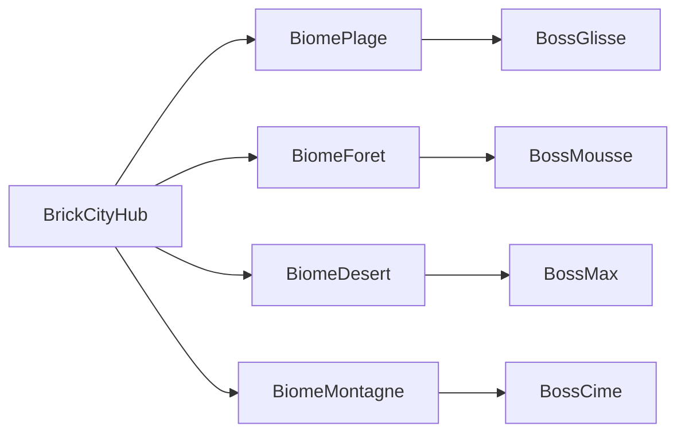

# Bible level design — Hub, circuits, boosts, items

Course / aventure **full brick**, non officiel. Aligné [gdd.md](gdd.md) (structure monde / biomes), [vision.md](vision.md) et [tone.md](tone.md).

**Brick Racer n’est pas affilié à The LEGO Group ni à Nintendo.** LEGO® et Mario Kart™ sont des marques de leurs détenteurs. Les mécaniques citées (coupes, cc, miroir, items rubber-band, hub Diddy Kong) sont des **références d’intention**, pas une licence.

En cas d’écart sur les **noms de biomes / arcs / boss**, le [GDD](gdd.md) fait foi. Ce doc détaille pistes, boosts, items et specs SceneDD. Slice validation hub+course (avant roster 16) : [test-slice.md](test-slice.md).

Hors scope de ce doc : implémentation 3D / gameplay items, économie hub chiffrée, valeurs numériques finales AI (placeholders OK).

## Principes d’équilibre (kart / moto / avion)

Aucun véhicule n’est « le bon » choix sur une piste. Chaque circuit est un **triple corridor** :

| Couche | Véhicule | Règle |
| ------ | -------- | ----- |
| Sol large | Kart | Virages lisibles, murs, drifts |
| Sol technique | Moto | Relief, whoops, sauts, lean |
| Air | Avion | Anneaux / couloirs aériens **parallèles** au tracé sol, pas un second circuit déconnecté |

- **Shortcut multi-véhicule** : 2–3 raccourcis par piste, chacun favorisant *un* véhicule mais jamais exclusif (ex. tunnel bas = kart, rampe whoop = moto, plongée aérienne = avion ; les autres peuvent le prendre moins bien).
- **Boosts + items** : chaque piste a des **boost pads sol et air** + des **boîtes d’items** sur les deux couches ; les items font le rubber-band (comme Mario Kart) pour rattraper sans favoriser un véhicule.
- **Largeurs** : 50 cc = corridor confortable ; 100 = même géométrie, IA + items plus agressifs ; 150 = mêmes murs, hitbox / draft / turbulence avion plus punitifs (pas de resserrement géométrique qui tue l’avion).
- **Miroir** : géométrie asymétrique volontaire (un côté « drift », un côté « jump ») pour que le miroir change le meta sans casser les 3 couches ; boosts et item boxes suivent le flip.
- **Checkpoints** : volume vertical unique (sol → plafond vol) pour ne pas forcer l’avion à atterrir.

Ordre d’ouverture aventure **figé** ([gdd.md](gdd.md)) : Plage → Forêt → Désert → Montagne.

## Boosts piste (sol + air)

Chaque circuit place des **Stud Boost** (pads) en miroir sol/air pour que kart, moto et avion aient les mêmes opportunités de vitesse pure.

| Type | Où | Effet | Placement type |
| ---- | --- | ----- | -------------- |
| **Boost sol** | Bande au sol (droites, sorties de virage, entrée shortcut) | Burst vitesse + léger glide moto | 4–8 par tour |
| **Boost air** | Anneau / plaque verticale dans le couloir avion | Burst + maintien altitude | 1:1 avec un boost sol « jumelé » quand possible |
| **Boost dual** | Zone où sol et air se croisent (rampe, gap) | Même pad déclenchable au sol *ou* en vol | 1–2 par piste (moments « wow ») |
| **Mini-turbo drift / lean** | Skill joueur (pas prop piste) | Kart drift ; moto lean ; avion barrel-close anneau | Indépendant des pads |

### Règles de level design boost

- **Parité sol/air** : si une droite a 2 boosts sol, le corridor avion au-dessus a 2 boosts air (même timing tour).
- **Pas de boost exclusif** : un shortcut ultra-boosté pour un seul véhicule est interdit ; bias OK, lock non.
- **50 / 100 / 150** : même layout de pads ; durée / magnitude du burst scale avec le cc (150 = boost plus fort mais plus facile à rater le timing).
- **Boss** : pads actifs ; certains boss scripts **coupent** 1–2 pads pendant une phase (gag + difficulté) — ex. faux boosts Mirage Max.

## Items (équilibre type Mario Kart)

Système **1 slot** (MVP), boîtes d’items sur **sol et air** (mêmes règles de respawn). Table de loot **selon le rang** (rubber-band) — pas selon le véhicule. Les items ont une **réponse cross-layer** (sol touche air et inversement) pour que l’avion ne soit pas intouchable.

### Boîtes d’items

- Rangées en **clusters** après lignes de départ / mi-parcours / pré-shortcut (comme MK).
- Cluster **sol** + cluster **air** alignés en X/Z (l’avion ne farm pas une autre économie).
- Respawn ~5–8 s ; en 150 cc un peu plus lent pour le leader.

### Catalogue items (noms brick / ton 16+)

| Item | Rangs typiques | Effet | Note multi-véhicule |
| ---- | -------------- | ----- | ------------------- |
| **Stud Dash** | 1–4 | Mini boost court | Identique 3 véhicules |
| **Triple Stud** | 2–6 | 3 dashes | Combo skill |
| **Brique Rouge** | 1–5 | Projectile avant ; bounce sol | Suit le raycast / peigne léger vers cibles air proches |
| **Brique Traînée** | 1–3 | Drop derrière | Zone 3D basse (avion bas peut la prendre) |
| **Clou Rouillé** | 4–8 | Homing soft sur le leader | Priorité même couche, puis cross-layer si proche |
| **Bouclier ABS** | 1–6 | Bloc 1 hit | Marche en vol |
| **Fumigène** | 3–8 | Écran local | Turbulence avion dans le nuage |
| **Aimant Shortcut** | 5–8 | Tire vers le prochain boost / anneau | Aide comeback sans téléport |
| **Grue Volée** | 6–8 | Freeze court du peloton avant | Équivalent Lightning ; touche sol + air |
| **Bill Brick** | 7–8 | Auto-pilot boost long | Suit waypoints sol *ou* air selon véhicule actuel |
| **Star Stud** | 7–8 | Invuln + speed | Même durée toutes classes |

### Rubber-band & cc

| | 50 cc | 100 cc | 150 cc |
| - | ----- | ------ | ------ |
| Offensif leader | Rare | Normal | Fréquent si pack serré |
| Comeback (7–8) | Soft (Dash, Aimant) | Full table | Full + Grue/Bill plus fréquents |
| Boss 1v1 | Table réduite (pas Bill/Grue) | Items scriptés boss + joueur | Idem + hazards |

### Équilibre véhicule via items (pas via géométrie seule)

- Avion plus vite en ligne droite → **plus exposé** aux Clous / Briques (hitbox volume un peu plus large en vol).
- Moto plus agile en whoops → **Fumigène / Traînée** plus punitifs si mal placés.
- Kart plus stable → **meilleur usage** Bouclier + Triple Stud en peloton.

Items **thématiques boss** (drop rate boss only, alignés cast GDD) :

| Boss | Item thématique |
| ---- | --------------- |
| Capitaine Glisse | Bouée explosive |
| Dame Mousse | Branchage / plaque broyeur |
| Mirage Max | Faux Stud Boost (leurre) |
| Coach Cime | Onde « motivation » (knockback) |
| Maire / Hex (épilogue hub) | Fumée fiscale / flash caméra |

## Hub — Brick City

Structure, sorties et POI : **[gdd.md](gdd.md) § Hub**. Une scène SceneDD `city` ; quatre **gates** vers biomes (pas des pads « coupe menu »).

| Sortie | Biome | Landmark |
| ------ | ----- | -------- |
| Riviera Gate (Est) | Plage | Arche coquillage brick |
| Canopée Gate (Nord) | Forêt | Portail racines |
| Mirage Gate (Ouest) | Désert | Arche cactus / douane |
| Cime Gate (Sud) | Montagne | Tunnel téléphérique |

Pads hub : **Cup Free**, **Versus / Lobby**, pad prologue mairie. Circulation : pied + scooter city. Feedback cosmétique post-boss sans streaming.

### Boucle histoire (par biome)

Voir [gdd.md](gdd.md) § Mode aventure. Résumé level design :

1. Entrée via gate → PNJ d’arc.
2. Courses + défis du biome (aventure : **2–3 courses** parmi les 4 listées ; Cup Free : les 4).
3. Pad boss s’allume.
4. Victoire → retour hub + sortie suivante / rewards.

## Les 4 biomes — 16 circuits

Ordre : Plage → Forêt → Désert → Montagne. Feeling distinct ([gdd.md](gdd.md) § 6). Chaque piste : **3 tours** standard, **longueur sol ~45–90 s** en 100 cc kart. Cup Free = 4 pistes × biome ; aventure MVP = sous-ensemble 2–3 + défis.

### Plage — « Stud Coast »

Fantasy / feeling / PNJ : [gdd.md](gdd.md) § 6.1. Face : **Capitaine Glisse**.

| # | Circuit | Hook | Kart | Moto | Avion |
| - | ------- | ---- | ---- | ---- | ----- |
| 1 | **Promenade Bikini** | Bord de mer, vagues items | Ligne d’eau | Dunes | Surf aérien vague |
| 2 | **Marina Yacht** | Pontons étroits + parking bateaux | Précision | Saut ponton→quai | Anneaux mats |
| 3 | **Falaise Stud** | Switchback falaise + tunnel | Tunnel sûr | Crête technique | Plongeon falaise |
| 4 | **Phare à Contresens** | Phare spiral + jetée | Spiral sol | Jetée whoops | Orbit phare |

**Boss — « Amende Maritime »** : 1v1 vs Capitaine (hybride lent, items lourds) sur **Falaise Stud** mirroir + marée qui monte. Débloque sortie Forêt.

### Forêt — « Canopy Cup »

Fantasy / feeling / PNJ : [gdd.md](gdd.md) § 6.2. Face : **Dame Mousse**.

| # | Circuit | Hook | Kart | Moto | Avion |
| - | ------- | ---- | ---- | ---- | ----- |
| 5 | **Sentier Amendé** | Virages serrés, panneaux passifs-agressifs | Sentier large | Racines whoops | Couloir bas branches |
| 6 | **Cabanes Empilées** | Splits sous-bois / passerelles | Voie sol | Sauts cabane | Slalom cimes |
| 7 | **Scierie Abandonnée** | Couloirs planches + scies décor | Timing portes | Lean whoops | Dive entre hangars |
| 8 | **Racine Vertige** | Spirale autour d’un arbre-stud | Spiral sol | Remontée racines | Montée hélicoïdale canopée |

**Boss — « Coupe Claire »** : 1v1 vs Dame Mousse (kart-broyeur, hazards branches) sur **Racine Vertige**. Débloque sortie Désert (+ hints / unlock moto selon phase).

### Désert — « Mirage Grand Prix »

Fantasy / feeling / PNJ : [gdd.md](gdd.md) § 6.3. Face : **Mirage Max**.

| # | Circuit | Hook | Kart | Moto | Avion |
| - | ------- | ---- | ---- | ---- | ----- |
| 9 | **Dune Fiscale** | Grandes droites, chaleur visuelle | Top speed | Dérapages dune | Surf thermique |
| 10 | **Station Fantôme** | Station-service, virages en U | Draft pompe | Saut auvent | Anneaux panneau |
| 11 | **Canyon Mirage** | Oasis shortcut + parois | Fond canyon | Crêtes latérales | Plongeon canyon |
| 12 | **Douane Soleil** | Labyrinthe guichets / taxes | Couloirs | Jump guichets | Survol file d’attente |

**Boss — « Fata Morgana »** : 1v1 vs Max (fantômes de piste / **faux boosts**) sur **Canyon Mirage**. Débloque sortie Montagne.

### Montagne — « Peak Stud »

Fantasy / feeling / PNJ : [gdd.md](gdd.md) § 6.4. Face : **Coach Cime**.

| # | Circuit | Hook | Kart | Moto | Avion |
| - | ------- | ---- | ---- | ---- | ----- |
| 13 | **Lacets Lodge** | Switchbacks station hors saison | Lacets | Whoops neige brick | Couloir pylônes |
| 14 | **Téléphérique Stud** | Sections sous/sur cabines | Sol timing | Saut cable | Orbit cabines |
| 15 | **Pic Confetti** | Tempête confettis, gaps | Route crête | Gaps lean | Anneaux pics |
| 16 | **Sommet File d’Attente** | Finale dénivelé + air dominant | Mix lacets | Mix gaps | Full sky lane crêtes |

**Boss — « Sommet Obligatoire »** : 1v1 vs Cime sur **Sommet File d’Attente** ; phases **sol → air** annoncées (exception narrative courte, comme GDD). Débloque épilogue hub (Hex / Maire).

**Épilogue hub** (hors biome) : set-piece city vs Hex / Maire — pistes city éventuelles en free play / cup spéciale, pas un 5ᵉ biome ([gdd.md](gdd.md) acte 5).

## Classes 50 / 100 / 150 cc + miroir

| Paramètre | 50 cc | 100 cc | 150 cc |
| --------- | ----- | ------ | ------ |
| Vitesse / accel | Apprentissage | Standard | Meta compétitif |
| IA | Lâche, peu d’items offensifs | Équilibrée | Rubber-band + items sales |
| Boost pads | Burst soft | Standard | Burst fort, fenêtre plus courte |
| Item boxes | Table soft | Table standard | Comeback durci, respawn un peu plus lent en tête |
| Hazards | Visuels / soft | Actifs | Timing serré (marée, scie, mirage, tempête) |
| Avion turbulence | Faible | Moyenne | Forte (canyon / crêtes / canopée dense) |
| Tours | 3 | 3 | 3 (boss : 2–3 selon script) |

**Miroir** : flip X de la géométrie + inversion spawn ; anneaux avion et whoops moto restent valides. Boss histoire : miroir si le script le prescrit (Plage : oui sur Falaise Stud ; Désert/Forêt/Montagne : tracé boss dédié ou même sens selon gag).

**Cup Free / Versus** : chaque piste × 3 cc × 2 sens = **96 configs** ; unlock miroir après médaille or 150 sur la piste normale (à figer en design progression).

## Spec technique minimale par piste (SceneDD)

Chaque circuit livre un paquet :

1. Mesh sol + collisions + murs
2. Spline / waypoints IA **sol** + **air** (2 graphs)
3. Volumes checkpoints verticaux
4. 2–3 shortcuts taggés (`kart` / `moto` / `plane` bias, pas lock)
5. **Boost pads** sol + air (+ dual si applicable), IDs stables pour mirroir
6. **Item box clusters** sol + air alignés ; points de respawn
7. Spawn grille 8 + spawn boss 1v1
8. Hazard triggers paramétrés par cc
9. Variante mirroir = transform scène (pads + boxes inclus), pas re-authorship

Biomes = **loads scène séparés** (retour hub = reload city) — [gdd.md](gdd.md).
