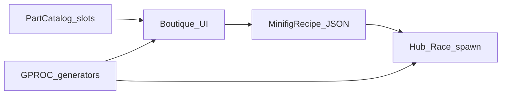

# Minifig GPROC — décision & architecture

**Canon in-game :** génération procédurale **W3DTS GPROC** + recettes JSON.  
**Pas** de meshes Meshy / GLB uniques comme base personnage.

Aligné [vision.md](vision.md) (boutique, pièces swappables), [gdd.md](gdd.md) §11, [characters-candidates.md](characters-candidates.md).  
Réfs GPROC kart : [w3dts-demos.md](../references/w3dts-demos.md).  
Plan / sprint : [minifig-gproc.md](../plans/minifig-gproc.md) · [BRICK-MF1](../sprints/BRICK-MF1.md).

**Brick Racer n’est pas affilié à The LEGO Group.** Look « brick-like » maison.

---

## Décision

| | |
| - | - |
| **Oui** | Éditeur / runtime minifig basé sur **GPROC** + catalogue de slots. |
| **Non** | 20–40 GLB photoréalistes comme pipeline personnage. |
| **Meshy / GLB** | Moodboard optionnel (`docs/design/art/characters/*.glb`) — **jamais** chargé en jeu. |
| **Artwork WebP** | Refs art / marketing ; les PNJ en jeu = **recettes**. |

Pourquoi : même grammaire visuelle que le kart GPROC ; cast scalable ; boutique joueur = même outil que presets PNJ ; pas de pastiche mesh licence.

---

## Slots (v1)

| Slot | Rôle | Notes |
| ---- | ---- | ----- |
| `head` | Volume tête (cylindre / brick) | Teinte peau |
| `facePrint` | Atlas texture expression | Pas de sculpt procédural du visage |
| `hair` / `hat` | Coiffe | Mutuellement exclusifs ou stack soft |
| `torso` | Buste + print tenue | Teinte + print id |
| `arms` | Manches / couleur bras | |
| `hands` | Gants / C-hands | |
| `hipsLegs` | Hanches + jambes / short | |
| `accessoryL` / `accessoryR` | Props (clé, micro, …) | Optionnels |

Alignés sur les fiches candidats (tête / coiffe / torse / jambes / accessoire).

---

## Recipe JSON (intention)

```json
{
  "id": "c01-bolt",
  "displayName": "Bolt",
  "slots": {
    "head": { "part": "head.basic", "tint": "#F5D76E" },
    "facePrint": { "print": "face.frown_stubble_orange" },
    "hat": { "part": "hat.cap_mechanic", "tint": "#1a1a1a" },
    "torso": { "part": "torso.coverall", "tint": "#1B4F72", "print": "print.mechanic" },
    "arms": { "part": "arms.coverall", "tint": "#1B4F72" },
    "hands": { "part": "hands.glove", "tint": "#111111" },
    "hipsLegs": { "part": "legs.coverall", "tint": "#1B4F72" },
    "accessoryR": { "part": "prop.wrench_chrome" }
  }
}
```

C01–C40 (retenus post-playtest) = fichiers recipe sous `public/` ou `src/racer/minifig/recipes/` (chemin figé au sprint).

---

## Pipeline



1. **Catalogue** — ids de pièces + generators GPROC associés + métadonnées UI.  
2. **GPROC** — generators minifig (nouveau set ; distinct des `lego-*-generator` kart).  
3. **Éditeur** — React (coque Electron) → preview WebGPU, regen debounce à chaque swap.  
4. **Runtime** — spawn hub / grille course depuis recipe (cosmétiques only en course MVP).

---

## Risques & mitigations

| Risque | Mitigation |
| ------ | ---------- |
| GPROC kart ≠ corps articulé | Nouveau set generators + assemblage par sockets / slots |
| Visages | Atlas `facePrint` ; pas de morph procédural |
| Perf hub (~20 PNJ) | Mesh légers ; regen seulement à l’édition ; instance / LOD plus tard |
| Anim | Rig / sockets stables ; pièces attachées ou skinnées après coup |
| Drift Meshy réaliste | Doc + CONTRIBUTING : Meshy = moodboard only |

---

## Non-objectifs (MF1 / MVP boutique)

- Import GLB Meshy en runtime.  
- Meta stats liées aux pièces (cosmétiques only).  
- Éditeur de prints bitmap complet (atlas figé v1).  
- Soft-body / ragdoll minifig.

---

## Séquence produit

Spike technique **[BRICK-MF1](../sprints/BRICK-MF1.md)** (generators + recipe + preview sandbox) **avant / en amont de P3** boutique UI complète ([roadmap](../plans/roadmap.md)). P3 consomme MF1 + UI boutique (Vinyle).
