# Plans cotés — Brick Proving Grounds (W3DTS)

Plans techniques des scènes `city-test` et `race-test`. Intention / moodboard : [test-slice.md](test-slice.md). Art canons : [art/](art/).

**Brick Racer n’est pas affilié à The LEGO Group ni à Nintendo.**

Hors scope de ce doc : JSON SceneDD, meshes, tuning vitesse final. Les images de plans / élévations sont générées à part (prompts § Prompts plans).

## Bible d’échelle

| Constante | Valeur | Note |
| --------- | ------ | ---- |
| **1 world unit (wu)** | **1,00 m** | Convention W3DTS / physique kart (raycast, `KART_PHYSICS_PRESET`) |
| **Minifig canon `H`** | **1,65 m** | Milieu de la fourchette 1,50–1,80 m ; PNJ / joueur hub |
| **Plage visuelle PNJ** | 1,50–1,80 m | Variantes cosmétiques ±10 % max ; collision inchangée |

### Module brick (dérivé — pas stud LEGO réel)

Proportion type minifig brick ≈ **5 modules** de haut (jambes + torse + tête) :

| Module | Calcul | Valeur |
| ------ | ------ | ------ |
| **1 stud (S)** | `H / 5` | **0,33 m** |
| **1 plate (P)** | `S / 3` | **0,11 m** (épaisseur dalle) |
| **1 brick (B)** | `3P = S` | **0,33 m** (hauteur brique 1×) |

- Placement SceneDD = **wu (m)**.
- Cotations « en studs » = multiples de **0,33** pour snaper le grid (`round(x / 0,33) * 0,33`).

### Véhicules à l’échelle

| Élément | Cote cible (wu) | Relatif à H |
| ------- | --------------- | ----------- |
| Kart longueur | 2,00 | ~1,2 H |
| Kart largeur | 1,20 | ~0,7 H |
| Kart hauteur (sans antenne) | 0,90 | ~0,55 H |
| Empattement | 1,30 | — |
| Voie (track width roues) | 1,00 | — |
| Scooter hub | L 1,40 × l 0,55 × h 1,10 | — |

### Axes SceneDD

- **Y up**, XZ plan sol.
- Angles en degrés, yaw 0° = face **+Z** (nord).

---

## Scène A — `city-test`

**Emprise sol** : **40 × 40 wu** (≈ 121 × 121 S).  
**Origine** : coin SW `(0, 0, 0)`. Plaza centre ≈ `(20, 0, 20)`.

Réf. visuelle : [art/a1-hub-plaza.png](art/a1-hub-plaza.png), [art/a2-hub-pad.jpg](art/a2-hub-pad.jpg).

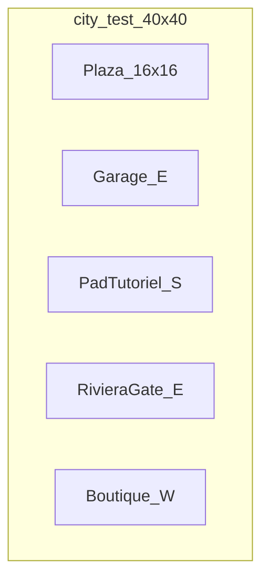

### Zones AABB (sol XZ)

| Zone | min (X,Z) | max (X,Z) | Hauteur max Y | Notes |
| ---- | --------- | --------- | ------------- | ----- |
| Plaza + fontaine | (12, 12) | (28, 28) | Fontaine **2,00** | Spawn `(20, 0, 14)` yaw 0° (sud fontaine ; centre plaza = fontaine) |
| Tour horloge | (8, 22) | (12, 28) | **8,00** | Emprise 4×6 ; penchée cosmétiques ±5° |
| Billboard YOU ARE NOBODY | (14, 26) | (22, 28) | Toit **5,50** ; panneau 3,00 × 1,50 | Lisibilité 30 wu |
| Garage Bolt | (28, 14) | (36, 22) | **4,50** | Porte 2,40 × 2,20 |
| Boutique Vinyle | (4, 14) | (10, 20) | **4,00** | Landmark ; collision façade only |
| Pad tutoriel | (16, 4) | (24, 10) | Dalle **0,22** (2P) | Surface 8 × 6 ; load `race-test` |
| Panneau TEST CIRCUIT | (14, 6) | (16, 8) | **2,20** | — |
| Hex (PNJ) | — | — | H = 1,65 | Spawn `(22, 0, 8)` |
| Riviera Gate | (34, 18) | (38, 26) | Arche **5,00** ; ouverture 3,50 × 4,00 | Chaînes ; **non traversable** |
| Mairie / statue (N) | (16, 34) | (24, 38) | Statue **2,50** | Collision soft |

### Circulations

| Règle | Valeur wu |
| ----- | --------- |
| Largeur allée | **4,00** |
| Hauteur libre sous porche | ≥ **2,40** |
| Props course (boost / items) | **0** dans le hub |

### Triggers

| ID | Centre (x, y, z) | Size (x, y, z) | Action |
| -- | ---------------- | -------------- | ------ |
| `poi.garage` | (30, 1,25, 18) | 3 × 2,5 × 3 | Stub UI garage |
| `pad.race_test` | (20, 0,5, 7) | 8 × 1 × 6 | Load `race-test` |

### Élévations clés (city)

| Élément | Base Y | Sommet Y | Largeur / profondeur |
| ------- | ------ | -------- | -------------------- |
| Minifig | 0 | 1,65 | ~0,50 × 0,30 |
| Fontaine (3 tiers) | 0 | 2,00 | Ø base 3,00 |
| Tour horloge | 0 | 8,00 | 4 × 6 |
| Garage porte | 0 | 2,20 | 2,40 |
| Gate ouverture | 0 | 4,00 | 3,50 |
| Pad dalle | 0 | 0,22 | 8 × 6 |

---

## Scène B — `race-test` (Promenade Test)

Réf. visuelle : [art/b1-track-overview.png](art/b1-track-overview.png), [art/b2-chase-cam.jpg](art/b2-chase-cam.jpg).

**Forme** : ovale asymétrique, sens **antihoraire**.  
**Médiane** ≈ **420 wu** → ~45 s à ~9,3 wu/s (cible 100 cc arcade).  
**AABB scène** ≈ **160 × 90 wu** (piste + plage + façades).  
**Origine** : grille départ `(0, 0, 0)`, sens course initial **+X**.

### Paramètres piste

| Paramètre | Valeur wu |
| --------- | --------- |
| Largeur courante | **12,00** |
| Largeur chicane | **8,00** |
| Hauteur mur / bordure | **0,66** (2S) |
| Whoops ×3 | h **0,45** ; espacement **4,00** |
| Boost sol | plaque **4,00 × 2,00** ; ép. **0,05** |
| Boost air (anneau) | Ø int. **3,50** ; centre Y **4,00** |
| Item box | cube **0,80** ; centre Y **0,60** (sol) / **4,00** (air) |
| Checkpoint volume | largeur piste × **8,00** haut × **2,00** prof. |
| Grille 4 slots | latéral **3,00** ; long. **4,00** |
| Rampe dune | L **10,00** × l **4,00** ; ~**18°** |

### Segments (médiane, antihoraire)

| # | Segment | Longueur | Largeur | Props |
| - | ------- | -------- | ------- | ----- |
| 1 | Droite départ | 90 | 12 | 2× boost sol ; cluster 4 items sol |
| 2 | Virage 1 (large) | 70 | 12 | Banque ~5° |
| 3 | Whoops | 40 | 12 | 3 bosses |
| 4 | Droite mer | 100 | 12 | 2× boost air Y=4 ; items air alignés XZ |
| 5 | Virage 2 / chicane | 50 | 8–12 | — |
| 6 | Approche arrivée + dune | 70 | 12 | Shortcut −~15 wu si clean |
| | **Total** | **~420** | | Médiane shortcut ~405 |

### Grille départ (slots)

Origine ligne : `(0, 0, 0)`, face +X. Espacement latéral sur **Z**, profond sur **−X**.

| Slot | Position (x, y, z) | Rôle |
| ---- | ------------------ | ---- |
| 0 | (0, 0, −4,5) | Joueur P1 |
| 1 | (0, 0, −1,5) | IA |
| 2 | (−4, 0, −4,5) | IA |
| 3 | (−4, 0, −1,5) | IA |

### Checkpoints (suggestion IDs)

Volumes verticaux sol → plafond vol (Y 0 → 8).

| ID | Placement | Size (approx) |
| -- | --------- | ------------- |
| `cp.start_finish` | Ligne arrivée / départ | 14 × 8 × 2 |
| `cp.after_turn1` | Fin virage 1 | 12 × 8 × 2 |
| `cp.after_whoops` | Fin whoops | 12 × 8 × 2 |
| `cp.seaside` | Mi-droite mer | 12 × 8 × 2 |
| `cp.after_chicane` | Sortie chicane | 10 × 8 × 2 |

### Arche PROVING

| Cote | wu |
| ---- | -- |
| Ouverture largeur | 14,00 |
| Ouverture hauteur | 6,00 |
| Profondeur | 2,00 |

### Élévations clés (race)

| Élément | Y centre / sommet | Note |
| ------- | ----------------- | ---- |
| Sol piste | 0 | — |
| Kart toit | ~0,90 | — |
| Bordure | 0,66 | — |
| Whoop sommet | 0,45 | — |
| Anneau air | centre 4,00 | Ø int 3,50 |
| Plafond CP / vol | 8,00 | Volume checkpoint |

---

## Checklist blockout TS (cotée)

Authoring : modules `src/racer/levels/cityTest/` + `raceTest/` (pas SceneDD).

### `city-test`

- [ ] Sol / collisions 40 × 40
- [ ] Zones AABB + landmarks (tableau ci-dessus)
- [ ] Spawn `(20, 0, 20)` ; Hex `(22, 0, 8)` ; Bolt près porte garage
- [ ] `poi.garage` + `pad.race_test` (sizes exactes)
- [ ] Gate non traversable
- [ ] Allées 4,00 wu

### `race-test`

- [ ] Mesh sol + murs 0,66
- [ ] Médiane ~420 ; largeurs 12 / 8
- [ ] Waypoints IA sol (+ air stub Y=4 droite mer)
- [ ] CP verticaux (5)
- [ ] Shortcut dune 10 × 4 @ ~18°
- [ ] Boosts sol ×2 + air ×2
- [ ] Item clusters sol + air alignés XZ
- [ ] Grille 4 slots (table)
- [ ] Arche PROVING 14 × 6 × 2
- [ ] Pas de mirroir / marée

---

## Prompts plans techniques (génération images — côté toi)

Style cible : **blueprint / plan technique de level design**, pas concept art. Cotations **lisibles en mètres**, fond clair, traits nets.

Chaque bloc ci-dessous est **autocontenu** (prompt + negative) : utilise le bouton **Copy** du fence `text` dans la preview Markdown, ou sélectionne tout le contenu du bloc.

### Fichiers cibles sous [art/](art/)

| ID | Fichier | Vue |
| -- | ------- | --- |
| P1 | [plan-city-top.png](art/plan-city-top.png) | Plan masse city-test (**canon**) |
| P2 | [plan-race-top.png](art/plan-race-top.png) | Plan masse race-test (**canon**) |
| P3 | [elev-scale-sheet.png](art/elev-scale-sheet.png) | Feuille échelle comparative (**canon**) |
| P4 | [elev-city-north.png](art/elev-city-north.png) | Élévation nord city (**canon**) |
| P5 | [section-race-air.png](art/section-race-air.png) | Coupe transversale piste + air (**canon**) |
| P6 | [detail-start-grid.png](art/detail-start-grid.png) | Détail grille 4 slots (**canon**) |
| P7 | [overlay-triggers-city.png](art/overlay-triggers-city.png) | Plan city + volumes triggers (**canon**) |
| P8 | [axon-city-dim-canon.png](art/axon-city-dim-canon.png) | Axonométrie cotée city (**canon**) · alt : [axon-city-dim-alt.png](art/axon-city-dim-alt.png) |
| P9 | [module-stud-grid.png](art/module-stud-grid.png) | Module stud 0,33 m / grid (**canon**) |
| P10 | [profile-race-centerline.png](art/profile-race-centerline.png) | Profil longitudinal médiane (**canon**) |

---

### P1 — Plan top `city-test` coté — CANON

Réf. validée : 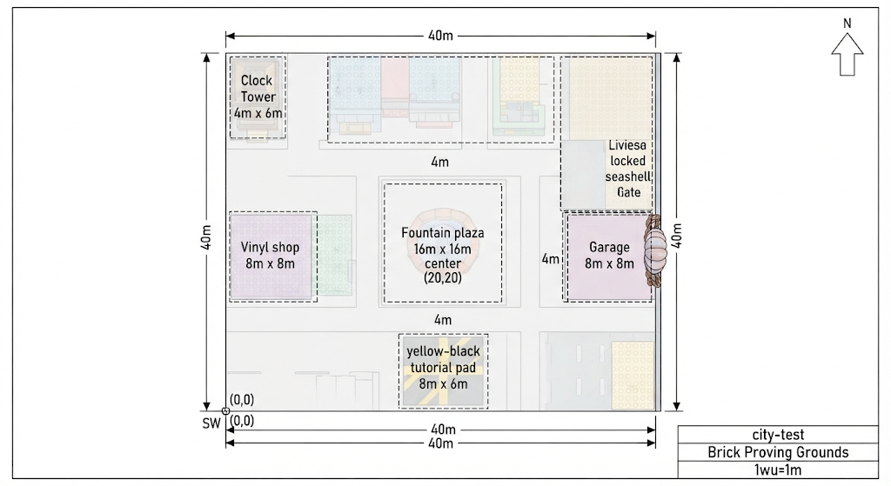

Emprise 40×40 wu, origine SW (0,0), plaza (20,20), allées 4 m, pad 8×6, garage / Vinyle 8×8, tour 4×6, gate NE.

Prompt (re-gen) :

```text
PROMPT:
Technical orthographic TOP SITE PLAN, architectural blueprint style, white background, black dimension lines with arrowheads, meters labeled clearly: 40m x 40m square footprint, origin mark SW corner (0,0), north arrow, plaza center labeled (20,20), zones with dashed AABB boxes: fountain plaza 16x16m, clock tower 4x6m NW, garage east 8x8m, Vinyle shop west, yellow-black tutorial pad south labeled 8m x 6m, locked seashell Riviera gate east, 4m wide circulation paths, toy-brick building footprints pastel fills low opacity, title block "city-test / Brick Proving Grounds / 1wu=1m", readable sans-serif labels, no perspective, no 3D shading

NEGATIVE:
official LEGO logo, LEGO packaging, Nintendo, Mario Kart, photorealistic, cinematic lighting, cluttered HUD UI, illegible tiny text, blurry dimensions, purple haze, dark grimdark, isometric toy diorama without measurements, watermark
```

### P2 — Plan top `race-test` coté — CANON

Réf. validée : 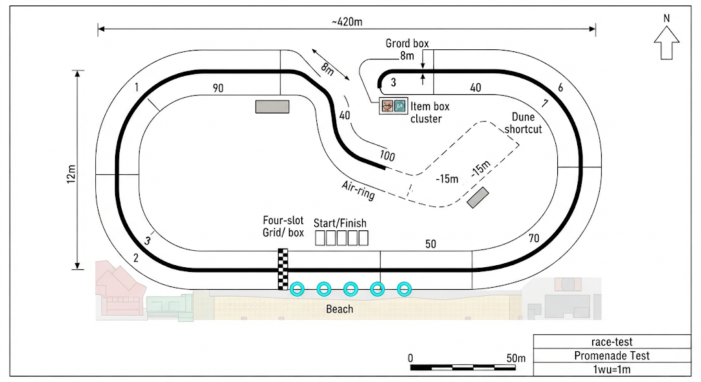

Médiane ~420 wu, largeurs 12 / 8, grille, boosts, anneaux air, dune −15 m, plage, échelle 1 wu = 1 m.

Prompt (re-gen) :

```text
PROMPT:
Technical orthographic TOP TRACK PLAN blueprint, white background, asymmetric counterclockwise kart oval, thick centerline path labeled total ~420m, track width callouts 12m (main) and 8m (chicane), numbered segments 1-6 with length labels 90 70 40 100 50 70, start/finish line, four-slot grid, two ground boost pads, item box cluster, cyan air-ring symbols on seaside straight, dune shortcut ramp dashed alternate path -15m, beach strip and building footprints off-track, north arrow, scale bar 0-50m, title "race-test / Promenade Test / 1wu=1m", clean dimension annotations, no cinematic art

NEGATIVE:
official LEGO logo, LEGO packaging, Nintendo, Mario Kart, photorealistic, cinematic lighting, cluttered HUD UI, illegible tiny text, blurry dimensions, purple haze, dark grimdark, isometric toy diorama without measurements, watermark
```

### P3 — Feuille échelle comparative — CANON

Réf. validée : 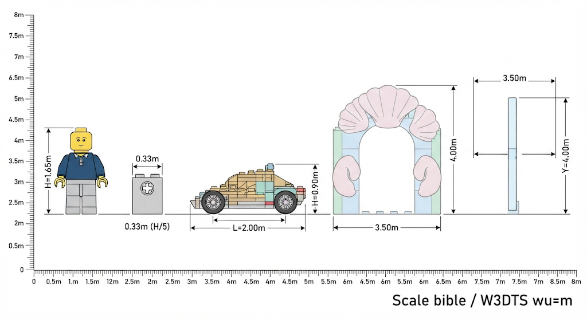

H = 1,65 m · stud 0,33 m · kart L 2,00 / h 0,90 · gate 3,50 × 4,00 · anneau Ø 3,50 @ Y 4,00 · 1 wu = 1 m.

Prompt (re-gen) :

```text
PROMPT:
Technical SCALE REFERENCE elevation sheet on white background: left-to-right standing brick minifigure labeled H=1.65m, stud module bracket 0.33m (H/5), brick kart side view L=2.00m H=0.90m wheelbase 1.30m, Riviera seashell gate opening 3.50m wide x 4.00m high, floating air boost ring inner diameter 3.50m center height Y=4.00m, vertical meter ruler 0 to 8m, horizontal meter ruler, flat linework, pastel brick fill optional, title "Scale bible / W3DTS wu=m", no logos

NEGATIVE:
official LEGO logo, LEGO packaging, Nintendo, Mario Kart, photorealistic, cinematic lighting, cluttered HUD UI, illegible tiny text, blurry dimensions, purple haze, dark grimdark, isometric toy diorama without measurements, watermark
```

### P4 — Élévation nord `city-test` (skyline) — CANON

Réf. validée : 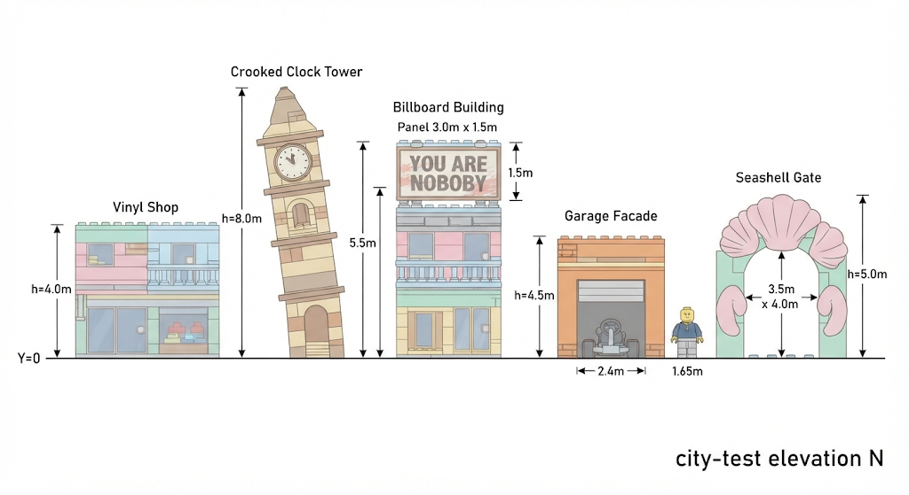

Vinyle 4,0 · tour 8,0 · billboard toit 5,5 / panneau 3,0×1,5 · garage 4,5 / porte 2,4 · minifig 1,65 · gate 5,0 / ouverture 3,5×4,0 · Y=0.

Prompt (re-gen) :

```text
PROMPT:
Technical orthographic NORTH ELEVATION of brick city hub plaza, white background, ground line Y=0, buildings left to right: Vinyle shop h=4.0m, crooked clock tower h=8.0m, billboard building roof 5.5m with panel 3.0x1.5m, garage facade h=4.5m door 2.4x2.2m, seashell gate silhouette h=5.0m opening 3.5x4.0m, minifigure 1.65m for scale at ground, dimension strings vertical, pastel brick line drawing, blueprint title "city-test elevation N", meters only, no perspective

NEGATIVE:
official LEGO logo, LEGO packaging, Nintendo, Mario Kart, photorealistic, cinematic lighting, cluttered HUD UI, illegible tiny text, blurry dimensions, purple haze, dark grimdark, isometric toy diorama without measurements, watermark
```

### P5 — Coupe transversale piste + couche air — CANON

Réf. validée : 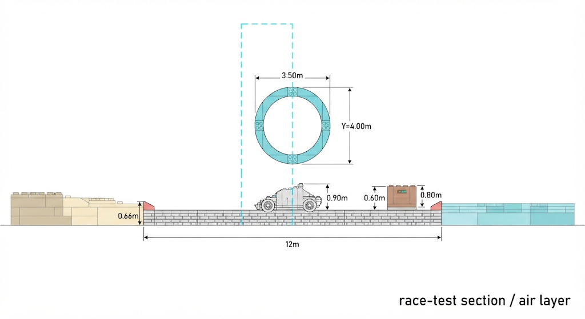

Piste 12 m · bordure 0,66 · kart 0,90 · caisse 0,80 @ 0,60 · anneau Ø 3,50 @ Y 4,00 · volume air pointillé.

Prompt (re-gen) :

```text
PROMPT:
Technical CROSS SECTION through kart track seaside straight, white background, ground plane Y=0, track slab width 12m, red-white curbs height 0.66m, kart silhouette on centerline height 0.90m, item crate 0.80m at Y=0.60, cyan air boost ring centered at Y=4.00 inner dia 3.50m, dashed vertical checkpoint volume from Y=0 to Y=8.0 spanning track width, dimension labels in meters, beach blocks left ocean right optional, blueprint section hatching, title "race-test section / air layer", orthographic side cut

NEGATIVE:
official LEGO logo, LEGO packaging, Nintendo, Mario Kart, photorealistic, cinematic lighting, cluttered HUD UI, illegible tiny text, blurry dimensions, purple haze, dark grimdark, isometric toy diorama without measurements, watermark
```

### P6 — Détail grille de départ — CANON

Réf. validée : 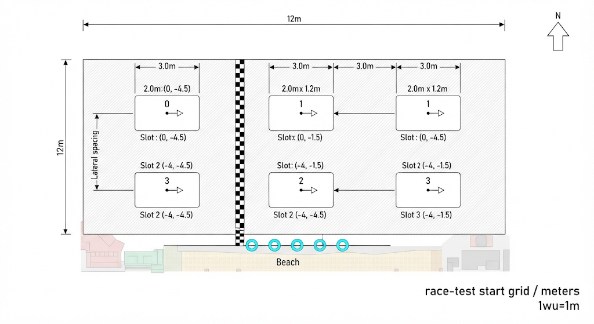

Slots 2,0 × 1,2 · face +X · piste 12 m · cotes doc : `(0,-4.5) (0,-1.5) (-4,-4.5) (-4,-1.5)` (la gen peut afficher des labels parasites — **les coordonnées du tableau Grille départ font foi**).

Prompt (re-gen) :

```text
PROMPT:
Technical DETAIL PLAN of 4-kart start grid, orthographic top view, white background, slots labeled 0-3 with coordinates: (0,-4.5) (0,-1.5) (-4,-4.5) (-4,-1.5), lateral spacing 3.0m, row spacing 4.0m, kart rectangles 2.0m x 1.2m, facing +X arrow, start/finish line, track width 12m shown, dimension arrows, title "race-test start grid / meters", blueprint style, no 3D

NEGATIVE:
official LEGO logo, LEGO packaging, Nintendo, Mario Kart, photorealistic, cinematic lighting, cluttered HUD UI, illegible tiny text, blurry dimensions, purple haze, dark grimdark, isometric toy diorama without measurements, watermark
```

### P7 — Overlay triggers `city-test` — CANON

Réf. validée : 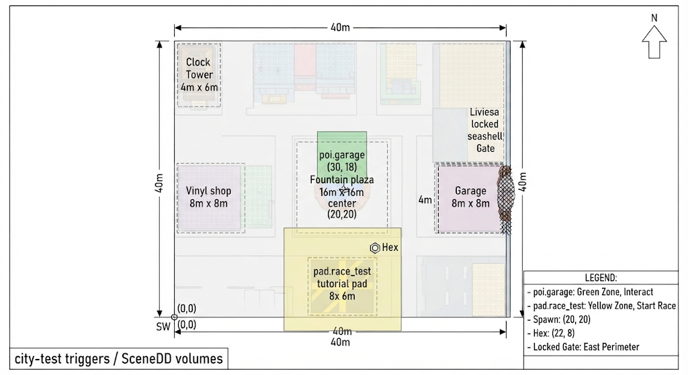

`poi.garage` (30,18) · `pad.race_test` 8×6 · spawn (20,20) · Hex (22,8) · gate E verrouillée — cotes exactes : tableau Triggers du doc.

Prompt (re-gen) :

```text
PROMPT:
Technical top plan overlay of city-test 40x40m with translucent trigger volumes: green box poi.garage center (30,18) size 3x3m, yellow box pad.race_test center (20,7) size 8x6m, spawn crosshair at (20,20), Hex marker at (22,8), locked gate hash marks east, thin building footprints underneath low opacity, legend for trigger IDs, dimensioned, white background blueprint, title "city-test triggers / SceneDD volumes"

NEGATIVE:
official LEGO logo, LEGO packaging, Nintendo, Mario Kart, photorealistic, cinematic lighting, cluttered HUD UI, illegible tiny text, blurry dimensions, purple haze, dark grimdark, isometric toy diorama without measurements, watermark
```

### P8 — Axonométrie cotée `city-test` — CANON

Réf. validée : 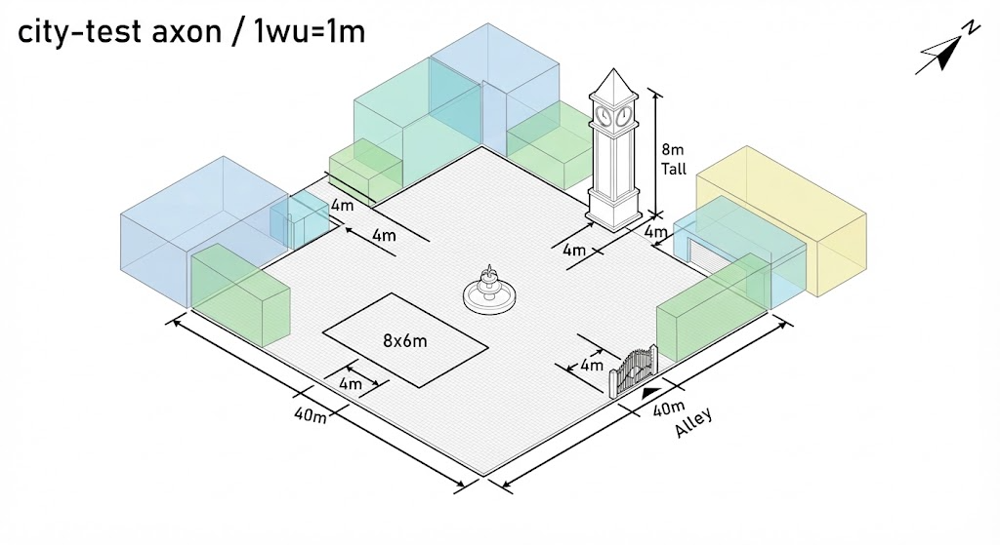

Blockout iso **aligné** sur cette vue :
- Emprise plaza **40 × 40 wu**, titre `city-test axon / 1wu=1m`, flèche nord
- Fontaine centrale ; dalle tutoriel **8 × 6** (décalage ~4 m du bord)
- Tour horloge **8 m** (angle NE, retrait 4 m)
- Gate coquillage / alley (angle SE, gaps **4 m**)
- Volumes pastel translucides (bleu / vert / jaune) en périphérie, allées **4 m**

Pour authoring SceneDD : **AABB du § city-test + P1** restent la source de vérité XZ ; P8 sert de lecture volume / hauteur. Variante non retenue : [axon-city-dim-alt.png](art/axon-city-dim-alt.png).

Prompt (re-gen) :

```text
PROMPT:
Technical ISOMETRIC axonometric diagram (NOT painterly concept art) of 40x40m brick plaza level, measurable edges with dimension callouts 40m, 4m alleys, pad 8x6m, fountain, clock tower 8m tall, garage, chained seashell gate, pastel translucent volumes, thick dimension lines, north indicator, white or light-gray background, CAD/game-level-blockout aesthetic, readable meter labels, title "city-test axon / 1wu=1m"

NEGATIVE:
official LEGO logo, LEGO packaging, Nintendo, Mario Kart, photorealistic, cinematic lighting, cluttered HUD UI, illegible tiny text, blurry dimensions, purple haze, dark grimdark, isometric toy diorama without measurements, watermark
```

### P9 — Module stud / grille — CANON

Réf. validée : 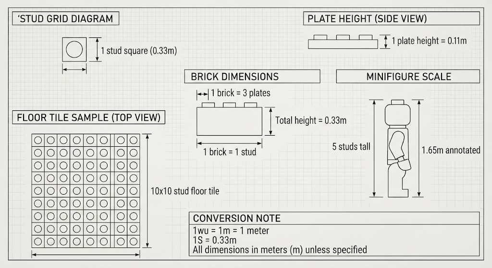

1S = 0,33 m · 1P = 0,11 m · 1B = 3P = 0,33 m · minifig 5S = 1,65 m · 1 wu = 1 m · sample 10×10 S.

Prompt (re-gen) :

```text
PROMPT:
Technical MODULE SHEET: 0.33m stud grid diagram, show 1 stud square, 1 plate height 0.11m side view, 1 brick = 3 plates = 0.33m, minifigure 5 studs tall = 1.65m annotated, 10x10 stud floor tile sample, conversion note "1wu = 1m = 1 meter", "1S = 0.33m", blueprint white background, clean typography, no brands

NEGATIVE:
official LEGO logo, LEGO packaging, Nintendo, Mario Kart, photorealistic, cinematic lighting, cluttered HUD UI, illegible tiny text, blurry dimensions, purple haze, dark grimdark, isometric toy diorama without measurements, watermark
```

### P10 — Profil longitudinal médiane `race-test` — CANON

Réf. validée : 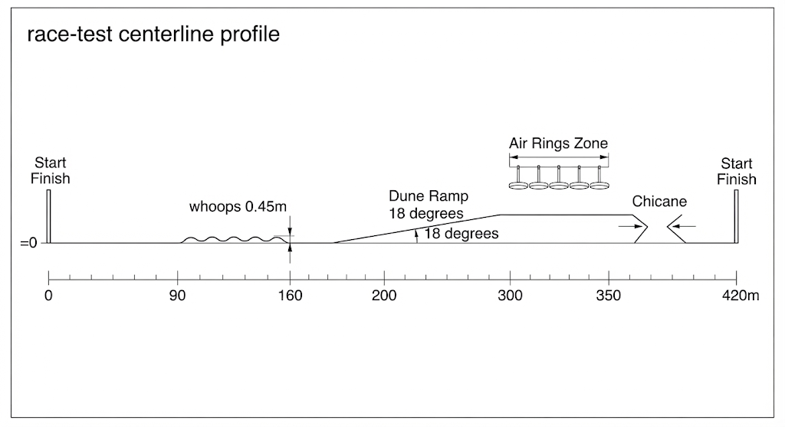

Axe 0→420 m · whoops 0,45 · dune ~18° · air rings · chicane — **ordre / longueurs des segments du tableau Segments font foi** si la gen décale les features.

Prompt (re-gen) :

```text
PROMPT:
Technical LONGITUDINAL PROFILE / unfolded centerline strip of race-test track, horizontal axis distance 0 to 420m with segment ticks at 90 160 200 300 350 420, vertical exaggeration mild for whoops 0.45m and dune ramp 18 degrees, labels boost pads, air rings zone, chicane, start finish, elevation mostly flat Y=0, blueprint strip diagram white background, meters, title "race-test centerline profile"

NEGATIVE:
official LEGO logo, LEGO packaging, Nintendo, Mario Kart, photorealistic, cinematic lighting, cluttered HUD UI, illegible tiny text, blurry dimensions, purple haze, dark grimdark, isometric toy diorama without measurements, watermark
```

### Variantes (à coller dans PROMPT avant NEGATIVE)

| Suffixe | Ligne à ajouter sous PROMPT |
| ------- | --------------------------- |
| `_fr` | `dimension labels and title block in French (metres, nord, echelle)` |
| `_dark` | `dark blueprint blue background, white lines, classic blueprint, keep dimensions readable` |
| `_grid` | `visible 1m major grid and 0.33m minor stud grid` |

---

## Suite

1. ~~Images P1–P10~~ — canons en [art/](art/).
2. Authoring SceneDD `city-test` + `race-test` aux cotes de ce doc.
3. Host : load hub → pad → race → retour.
