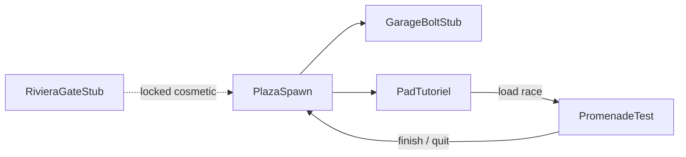
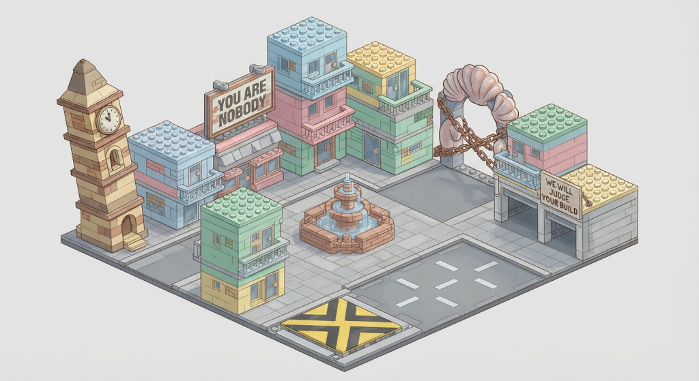
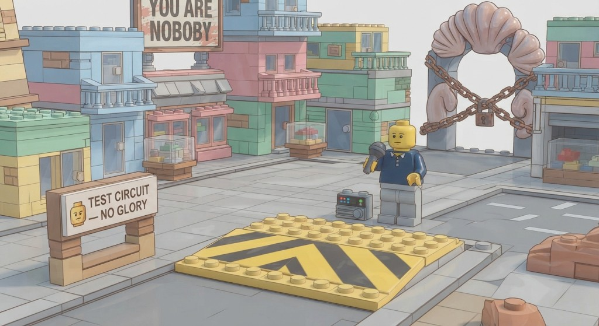
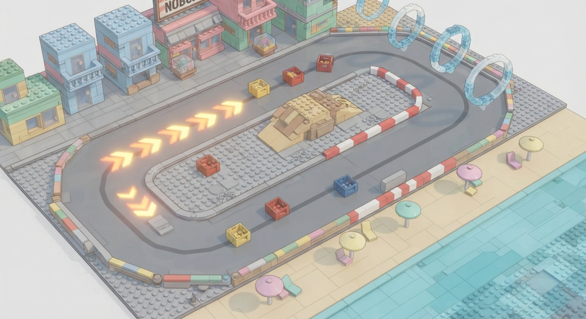
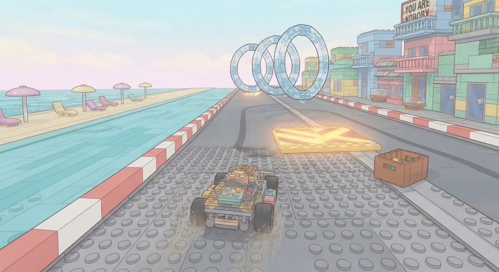
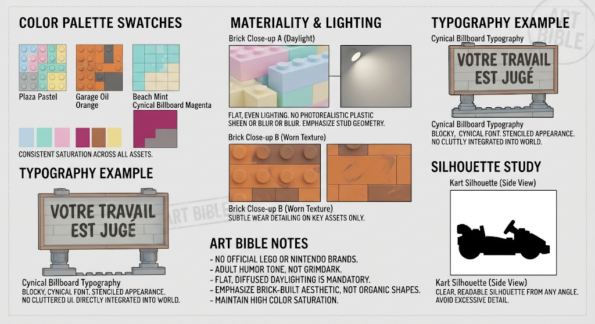

# Slice test — Brick Proving Grounds

Validation **hub + course** avant les 16 circuits. Aligné [gdd.md](gdd.md) Acte 0 (prologue) et feeling Plage ([levels.md](levels.md) § Promenade). Ton : [tone.md](tone.md).

**Aucun code / mesh dans ce doc** — description scène + prompts artwork pour moodboard. **Plans cotés W3DTS** : [test-slice-plans.md](test-slice-plans.md) (1 wu = 1 m, minifig H = 1,65 m). Implémentation SceneDD / host = sprints ultérieurs (P1 / P2).

**Brick Racer n’est pas affilié à The LEGO Group ni à Nintendo.**

## Architecture

Deux scènes SceneDD (comme le produit final : hub ≠ course), packagées « **Brick Proving Grounds** ».

| Scène | ID cible | Rôle |
| ----- | -------- | ---- |
| Mini Brick City | `city-test` | Hub jouable réduit |
| Circuit tutoriel | `race-test` | Course « Promenade Test » |



## Intention gameplay à valider

| Boucle | Critère de succès (playtest) |
| ------ | ---------------------------- |
| Hub | Spawn plaza, se déplacer (pied ou scooter), lire 3 landmarks, entrer garage (trigger UI stub OK) |
| Transition | Pad tutoriel → load scène course &lt; 3 s ressenti, pas de softlock |
| Course | 3 tours, checkpoints verticaux, 1 ligne boost sol + 1 boost air, 1 cluster items sol+air, grille 1 joueur + 3 IA soft |
| Retour | Finish / Quit → reload hub au pad, Hex one-liner stub acceptable |
| Lisibilité | Caméra chase ne perd jamais le kart brick ; silhouettes lisibles à 50 m |

**Hors scope slice** : 4 gates ouvertes, moto/avion jouables, boss, multi, custom stats.

## Scène A — `city-test` (mini Brick City)

**Emprise** : **40 × 40 wu** (mètres) — détail AABB / triggers : [test-slice-plans.md](test-slice-plans.md). Skyline bas en façade (billboards, pas de quartier ouvert). Palette pastel saturée + panneaux cyniques.

| Zone | Contenu | Validation |
| ---- | ------- | ---------- |
| **Plaza Centrale** | Fontaine brick, panneau classements (« Tu n’es personne »), spawn joueur | Orientation 360° |
| **Garage Bolt** | Façade atelier + enseigne « On jugera ton build », volume trigger | POI → stub UI |
| **Boutique Vinyle** | Vitrine louche (fermée / « bientôt ») | Landmark only |
| **Pad Tutoriel** | Dalle studs jaune/noir au sol + panneau « CIRCUIT D’ESSAI — PAS DE GLORY » | Load `race-test` |
| **Riviera Gate (stub)** | Arche coquillage **verrouillée** (chaînes brick, panneau « Sécurité ») | Tease Plage / GDD |
| **Mairie (fond)** | Statue minifig cassée visible au nord, hors collision | Silhouette hub |

- Circulation : allées larges kart-scooter ; pas de rue labyrinthique.
- Éclairage : jour doré, ombres douces.
- Props gameplay hub : 0 item, 0 boost course.
- PNJ placeholders : **Bolt** (porte garage), **Hex** (près du pad, bulle).

## Scène B — `race-test` (circuit tutoriel)

**Nom joueur** : « Promenade Test » — variante courte de Promenade Bikini (Plage), sans marina complexe.

**Forme** : ovale asymétrique ~40–50 s / tour en 100 cc kart (cible). Sens antihoraire.

| Segment | Géométrie | Couches |
| ------- | --------- | ------- |
| Droite départ | Large, 2× **Stud Boost sol** + cluster **item boxes** sol | Sol |
| Virage 1 (large) | Banque légère, mur extérieur brick | Kart drift |
| Whoops médiane | 3 bosses bas | Bias moto (kart OK) |
| Droite mer | Vue « plage » (eau plate + parasols brick hors piste) ; **boost air** ×2 au-dessus | Sol + air jumelés |
| Virage 2 (serré) | Chicane courte | Lisibilité |
| Shortcut dune | Rampe optionnelle (coupe ~1 s si clean) | Bias moto ; kart possible |
| Ligne arrivée | Arche « PROVING » + checkpoint vertical sol→plafond vol | Tous |

- **Air** : couloir bas (anneaux / plaques) parallèle à la droite mer uniquement — valide la couche avion plus tard ; playtest kart ignore l’air.
- **Grille** : 4 slots (P1 + 3 IA).
- **Items** : table soft 50 cc (Stud Dash, Brique Rouge, Bouclier ABS) — catalogue réduit.
- **Pas de miroir** sur le slice.
- **Hazards** : 0 (marée désactivée).

### Checklist SceneDD (race-test)

Voir aussi [levels.md](levels.md) § Spec technique.

1. Mesh sol + collisions + murs
2. Waypoints IA sol (+ air stub)
3. Checkpoints verticaux
4. 1 shortcut (dune)
5. Boost pads sol + air
6. Item box clusters sol + air alignés
7. Spawn grille 4
8. Pas de variante mirroir

## Moodboard / artworks

### Brief commun

Style : briques empilées stylisées (**pas** logo LEGO, **pas** minifig officielle), palettes saturées, ciel pastel, humour cynique dans la signalétique, rendu **concept art game** (léger 3/4, profondeur nette), pas photoréaliste, pas UI chrome générique.

**Negative commun** (à coller) :

```
official LEGO logo, LEGO packaging, Nintendo, Mario Kart, photorealistic plastic, blurry, cluttered UI, purple haze, dark grimdark
```

Moodboard → [art/](art/) (voir [art/README.md](art/README.md)). Canons complets : [a1](art/a1-hub-plaza.png), [a2](art/a2-hub-pad.jpg), [b1](art/b1-track-overview.png), [b2](art/b2-chase-cam.jpg), [b3](art/b3-style-frame.png).

### A1 — Hub plaza (hero establishing) — CANON

Réf. validée : 

Contenu figé pour `city-test` : tour horloge penchée (gauche), fontaine centrale, billboard « YOU ARE NOBODY », Riviera Gate coquillage **enchaîné** (fond), garage « WE WILL JUDGE YOUR BUILD » (droite), dalle route + marque X / grille, base diorama studs. Style iso 3/4, pastels, outlines nets.

Prompt (re-gen / variantes) :

```
Isometric three-quarter concept art of a compact pastel brick city plaza for an adult humor kart game, stacked studded brick buildings, crooked clock tower, central brick fountain, cynical billboard saying "YOU ARE NOBODY", yellow-black tutorial race pad on the ground, locked seashell arch gate with chains in the distance, garage storefront with sign "WE WILL JUDGE YOUR BUILD", saturated candy colors, clear silhouettes, soft daylight, game concept art, no logos, no licensed brands
```

### A2 — Hub pad + transition vibe — CANON

Réf. validée : 

Contenu figé pour pad tutoriel `city-test` : dalle jaune / chevrons noirs studs (avant-plan), panneau « TEST CIRCUIT — NO GLORY », Hex-like annonceur + micro + boombox brick, Riviera Gate coquillage **cadenas + chaînes** (droite), rue pastel boutiques, billboard « YOU ARE NOBODY » en fond. Transition vibe : pad → load `race-test`.

Prompt (re-gen / variantes) :

```
Close three-quarter view of a brick road race pad in a toy-brick city, yellow and black studded launch plate, sarcastic street sign "TEST CIRCUIT — NO GLORY", neon-pastel storefronts, distant locked Riviera seashell gate, waiting announcer minifigure-like brick character with mic (generic, not licensed), vibrant saturated palette, crisp game concept art
```

### B1 — Circuit overview (track map feel) — CANON

Réf. validée : 

Contenu figé pour `race-test` / Promenade Test : ovale asymétrique, boosts flèches orange (droite départ), caisses items colorées, anneaux air cyan (courbe mer), rampe dune infield, barrières brick multicolores, plage + parasols + eau brick, façade boutiques pastel. Vue iso / track map.

Prompt (re-gen / variantes) :

```
Top-down angled concept art of a short asymmetric brick kart oval by a fake brick beach, wide start straight with glowing boost arrows on the road, item boxes as stud crates on ground and floating air rings above the seaside straight, small dune shortcut ramp, chicane, brick barriers, pastel ocean and beach umbrellas off-track, readable racing line, Mario Kart-like clarity without copying, toy brick aesthetic, saturated colors, game concept art
```

### B2 — Driver chase eye-level — CANON

Réf. validée : 

*(Image fournie sous le label « circuit overview » — contenu = vue chase in-race, donc slot B2 ; B1 track map reste [b1-track-overview.png](art/b1-track-overview.png).)*

Contenu figé feeling course : kart brick 3/4 arrière, route studs + skids, boost pad flèches jaune devant, anneaux air cyan, caisse items, bordures rouge/blanc, mer + parasols à gauche, façades + « YOU ARE NOBODY » à droite. Réf. caméra chase + telegraphing boost/air.

Prompt (re-gen / variantes) :

```
In-race chase camera concept: brick kart speeding on studded asphalt toward a seaside straight, boost pad glowing ahead, floating air boost rings above, item crate nearby, brick barriers, pastel sky and fake ocean, motion readable, adult cartoon tone, toy brick world, no logos, game illustration
```

### B3 — Coupe couleurs / style frame — CANON

Réf. validée : 

Bible art figée : palettes **Plaza Pastel** / **Garage Oil Orange** / **Beach Mint** / **Cynical Billboard Magenta** ; lighting plat diffus (pas de sheen photoréaliste) ; usure subtile seulement sur assets clés ; typo cynique intégrée monde (ex. « VOTRE TRAVAIL EST JUGÉ ») ; silhouette kart lisible ; notes no LEGO/Nintendo officiels, ton 16+ pas grimdark.

Prompt (re-gen / variantes) :

```
Style frame sheet: four swatches labeled Plaza Pastel, Garage Oil Orange, Beach Mint, Cynical Billboard Magenta; brick material close-ups with studs; example cynical French billboard typography; kart silhouette side view; consistent saturated brick racing game art bible, flat lighting notes
```

## Suite (hors ce doc)

1. ~~Moodboard A1–B3~~ — canons en [art/](art/).
2. ~~Plans cotés + images P1–P10~~ — [test-slice-plans.md](test-slice-plans.md) · [art/](art/).
3. Modéliser / SceneDD `city-test` + `race-test` aux cotes plans.
4. Brancher host (load hub → pad → race → retour) — après P0 kart jouable.
