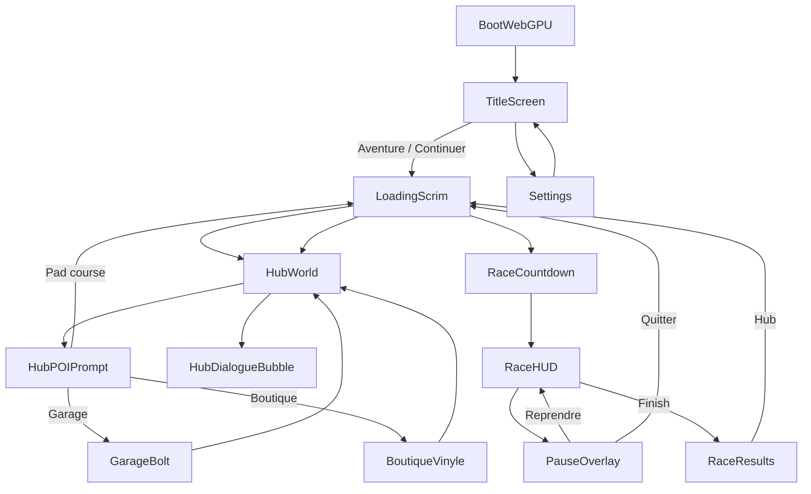

# UI / UX — Brick Racer (maquette écrans)

**Version doc :** 1.0 · bible écrans MVP.  
**Canon art :** [art/](art/) · [test-slice.md](test-slice.md) B3.  
**Ton :** [tone.md](tone.md). **Gameplay :** [gdd.md](gdd.md) §16–17.  
**Maquettes HTML (canon visuel) :** [../mocup/](../mocup/) · sprint [../sprints/BRICK-UIM1.md](../sprints/BRICK-UIM1.md).  
**Coque React (après maquettes) :** [../sprints/BRICK-UI1.md](../sprints/BRICK-UI1.md).

**Brick Racer n’est pas affilié à The LEGO Group ni à Nintendo.**

Périmètre figé ici : **MVP produit** (slice Proving Grounds + Garage Bolt + Boutique Vinyle + paramètres). Lobby multi = hors scope (P5).

---

## 1. Principes UX

| Principe | Règle concrète |
| -------- | -------------- |
| **Hub = menu** | Pas de liste froide permanente. Exploration 3D ; UI = overlays courts (prompt POI, bulle PNJ). |
| **Course = lisibilité** | HUD minimal, coins stables, jamais de carte plein écran pendant la course. |
| **Punch & ton** | Titres / tooltips avec clin d’œil 16+ ; **jamais** au détriment du contraste ou de la lecture à 0,5 s. |
| **Monde d’abord** | Overlays translucides / cadres brick ; pas de chrome SaaS, pas de dashboard. |
| **Une action primaire** | Un CTA évident par écran (Continuer / Départ / Équiper / Quitter). |
| **Desktop Electron** | Clavier + gamepad ; hotspots souris larges ; Esc = pause / retour. |

### Anti-patterns (refusés)

- Flèches quest MMO, journal quête lourd, minimap hub.
- HUD dense type sim (RPM, graphiques, chat).
- Cartes UI « glassmorphism » violet / glow générique.
- Parodie visuelle licence LEGO / Nintendo officielle.

---

## 2. Design tokens

Alignés style frame B3 ([art/b3-style-frame.png](art/b3-style-frame.png)).

| Token | Hex | Usage |
| ----- | --- | ----- |
| `--br-plaza-pastel` | `#F7B8C9` | Accents hub, titres soft |
| `--br-garage-oil` | `#E87A3A` | Garage, CTA primaire atelier |
| `--br-beach-mint` | `#5ECFBF` | Couche air, feedback positif |
| `--br-billboard-magenta` | `#D946A8` | Alertes, panneau cynique, accent rival |
| `--br-stud-yellow` | `#F5C518` | Pads, boosts, countdown |
| `--br-ink` | `#1A1520` | Texte sur fond clair |
| `--br-paper` | `#FFF6EC` | Panneaux UI « plaque brick » |
| `--br-asphalt` | `#2B3040` | Fond course / scrim |
| `--br-danger` | `#E23D3D` | Item offensif, abandon |
| `--br-safe` | `#3BB273` | Bouclier, confirm soft |

**Typo**

| Rôle | Intention | Fallback doc |
| ---- | --------- | ------------ |
| Display | Blocy / display « panneau city », uppercase léger tracking | `Fredoka` ou `Nunito` + fallback system |
| UI body | Sans lisible, 14–16 px | `Nunito Sans` / system-ui |
| Microcopy ton | Italique court sous titres | même famille, weight 500 |

**Surfaces**

- Panneau : plaque `--br-paper` + bordure stud 4 px `--br-ink` / accent biome.
- Scrim : `rgb(26 21 32 / 55%)` — monde visible derrière.
- Coin radius : **4–8 px** (brique), pas pill full.

**Motion**

| Moment | Motion |
| ------ | ------ |
| Entrée panneau | Slide 120 ms + fade (pas de bounce clown) |
| Countdown | Scale punch 80 ms sur le chiffre |
| Item pickup | Icône slot pop 100 ms |
| Victoire | Titre stagger 1 ligne ; pas de confetti spam |

---

## 3. Carte des écrans



États machine UI (noms stables pour le code) :

`boot` → `title` → `loading` → `hub` | `race_countdown` → `race` → `race_pause` | `race_results` → `hub` ; overlays `garage` | `shop` | `settings` | `hub_prompt` | `hub_dialogue`.

---

## 4. Maquettes par écran

Layouts en **safe zones** 1920×1080 (desktop). Marges HUD : **48 px** des bords. Zone centrale = monde / caméra — **interdit** d’y coller du chrome permanent.

### 4.1 Title (`title`)

```
┌────────────────────────────────────────────────────────────┐
│                                                            │
│              [logo brick]                                  │
│              BRICK RACER                                   │
│     « Tu n’es personne. Encore. »                          │
│                                                            │
│         [ JOUER ]     [ PARAMÈTRES ]                       │
│                                                            │
│  disclaimer non-officiel (bas, petit)           vX.Y.Z     │
└────────────────────────────────────────────────────────────┘
```

| Élément | Spec |
| ------- | ---- |
| Fond | Canvas / loop plaza pastel (A1) ou gradient asphalt + vignette — **pas** flat #fff |
| CTA primaire | `JOUER` → loading → hub (slice) ou course sandbox si hub pas prêt |
| Microcopy | Une punchline rotative (pool Hex) sous le titre |
| Accessibilité | Focus ring stud-yellow ; Entrée = Jouer |

### 4.2 Loading (`loading`)

Scrim plein écran, barre studs horizontale, one-liner cynique (ex. « Chargement de ta médiocrité… »). Cible ressenti &lt; 3 s ([test-slice.md](test-slice.md)). Pas de tip wall of text.

### 4.3 Hub — overlays (`hub` + `hub_prompt` + `hub_dialogue`)

Le monde **est** l’UI. Overlay max :

```
┌────────────────────────────────────────────────────────────┐
│  [Studs: 120]                              [Esc menu]      │  ← top bar fine, optionnelle MVP
│                                                            │
│                                                            │
│              (monde 3D libre)                              │
│                                                            │
│         ┌─────────────────────────┐                        │
│         │  E  Entrer — Garage Bolt│  ← hub_prompt          │
│         │  « On jugera ton build »│                        │
│         └─────────────────────────┘                        │
│                                                            │
│  ┌──────────────┐                                          │
│  │ Hex          │  ← hub_dialogue (coin bas-gauche)        │
│  │ « Souris… »  │                                          │
│  │ [Suite]      │                                          │
│  └──────────────┘                                          │
└────────────────────────────────────────────────────────────┘
```

| Règle | Détail |
| ----- | ------ |
| Prompt POI | Centre-bas, une ligne action + sous-titre enseigne ; touche `E` / A gamepad |
| Dialogue | Bulle plaque paper, portrait stub 64 px, 1–3 lignes, `Suite` / `Esc` skip |
| Marqueurs quête | Point stud discret au-dessus PNJ / sortie — **pas** de flèche GPS |
| Pas de | Minimap, journal, hotbar items hub |

### 4.4 Garage Bolt (`garage`)

Overlay modal 70 % largeur, monde flou derrière.

```
┌─ GARAGE — « Crime empilé » ──────────────────── [X] ─┐
│  [Aperçu 3D kart]     │  Slots : Châssis / Roues /    │
│                       │  Stickers / Couleur           │
│                       │  • pièce A   • pièce B        │
│                       │  Soft stats (1–2 barres)      │
│                       │  [ ÉQUIPER ]  [ SORTIR ]      │
│  Bolt (one-liner)     │                               │
└───────────────────────┴───────────────────────────────┘
```

Accent `--br-garage-oil`. Aperçu = viewport 3D ou placeholder silhouette. Custom **lisible en course** (GDD). Sortir = `Esc` / bouton.

### 4.5 Boutique Vinyle (`shop`)

Même squelette que garage ; slots minifig : Tête / Torse / Jambes / Coiffe / Accessoire. Accent `--br-billboard-magenta`. CTA `ACHETER` / `ÉQUIPER` selon état. One-liner Vinyle sous le titre.

### 4.6 Countdown (`race_countdown`)

Plein écran transparent : `3` → `2` → `1` → `GO` en display jaune stud. Nom piste en petit haut-centre (« Promenade Test — PAS DE GLORY »). Inputs gelés jusqu’à GO.

### 4.7 Race HUD (`race`)

```
┌────────────────────────────────────────────────────────────┐
│  P3/4          Tour 2/3                    01:24.08       │
│                                                            │
│                                                    ┌────┐  │
│                                                    │ITEM│  │
│                                                    │ ■■ │  │
│                                                    └────┘  │
│                                                            │
│  [annonce Hex — toast haut-centre, 2 s max]                │
│                                                            │
│  mini classement (option)     boost gauge (si besoin)      │
│  1. IA-A  2. Toi …                                         │
└────────────────────────────────────────────────────────────┘
```

| Slot | Contenu | Priorité MVP |
| ---- | ------- | ------------ |
| TL | Position `Pn/N` | P0 HUD |
| TC | Tour `k/m` | P0 |
| TR | Timer course | P0 |
| MR | Slot item 72×72 + touche tip | P0 |
| TC toast | Annonce Hex / item punchline | P1 |
| BL | Mini classement 4 lignes max | P1 |
| — | Vitesse numérique | **Non** (sauf debug) |
| — | Minimap | **Non** MVP |

Feedback items : couleur slot = type (danger / safe / mint air). Hit léger scale, pas de flash plein écran.

### 4.8 Pause (`race_pause`)

Scrim + plaque centrée :

- Titre : `PAUSE — même la médiocrité a droit à un break`
- `Reprendre` · `Recommencer` · `Options` · `Quitter vers le hub` (danger)

Esc / Start = Reprendre.

### 4.9 Résultats (`race_results`)

```
┌─ ARRIVÉE — Promenade Test ───────────────────────────────┐
│  Classement                                              │
│  1. …   2. Toi   3. …   4. …                             │
│  Temps 01:24.08 · Meilleur tour …                        │
│  Hex : « Pas mal pour un outsider. Pub demain. »         │
│  Récompense : +N Studs                                   │
│           [ RETOUR HUB ]                                 │
└──────────────────────────────────────────────────────────┘
```

Victoire / défaite : même layout ; teinte accent mint vs magenta. Pas de skip forcé &lt; 1 s (lisibilité).

### 4.10 Paramètres (`settings`)

Depuis title ou pause. Sections : Audio (master / SFX / annonces), Graphiques (placeholder), Contrôles (WASD + gamepad **affiche** remap ultérieur), Accessibilité (échelle UI 100/125 %, sous-titres annonces on/off). Disclaimer dans `À propos`.

---

## 5. Microcopy (pool v1)

| Surface | Exemples |
| ------- | -------- |
| Title tagline | « Tu n’es personne. Encore. » / « Souris, l’outsider. » |
| Loading | « Chargement de ta médiocrité… » / « Polissage des amendes… » |
| Prompt garage | « E — Entrer · On jugera ton build » |
| Prompt pad | « E — Circuit d’essai · Pas de glory » |
| Pause | « Même la médiocrité a droit à un break » |
| Results win | Hex : « Pas mal pour un outsider. Pub demain. » |
| Results lose | Hex : « Souris — les pubs paient mieux si tu perds. » |

Toute ligne longue : relecture [tone.md](tone.md).

---

## 6. Input map UI

| Action | Clavier | Gamepad |
| ------ | ------- | ------- |
| Confirmer / POI | `E` / Entrée | A |
| Annuler / Pause | `Esc` | B / Start |
| Naviguer listes | Flèches / stick | D-pad / stick |
| Utiliser item (course) | `Shift` ou `F` (figer à l’impl) | X / RB |

Focus visible obligatoire sur overlays (outline stud-yellow 2 px).

---

## 7. Accessibilité

- Contraste texte paper/ink ≥ AA sur plaques.
- Gags UI **jamais** seuls porteurs d’info critique (position, tour, item).
- Scale UI 100 / 125 % (settings).
- Annonces : texte toast + audio ultérieur ; mute annonces OK.
- Pas de flash épileptogène (pas de strobe countdown).

---

## 8. Mapping roadmap

| Écran | Phase gameplay | Ticket UI |
| ----- | -------------- | --------- |
| Title, loading, settings | Dès coque | UI1b |
| Countdown, HUD, pause, results | P1 boucle course | UI1c |
| Hub prompt / dialogue | P2 hub | UI1d |
| Garage / boutique | P3 | UI1e |
| Lobby multi | P5 | Hors UI1 |

Ordre livrables UI :

1. **[BRICK-UIM1](../sprints/BRICK-UIM1.md)** — HTML/CSS dans [`docs/mocup/`](../mocup/) (validation layout + ton).  
2. **[BRICK-UI1](../sprints/BRICK-UI1.md)** — coque React `src/renderer` calquée sur les maquettes.  
3. Binding data host — phases P1–P3.

---

## 9. Critères d’acceptation design

- Un playtester lit position + tour + item en &lt; 0,5 s sur capture HUD.
- Hub sans overlay : aucun chrome obligatoire pour se déplacer.
- Titres d’écran ont un clin d’œil **et** restent lisibles.
- Tokens B3 respectés ; pas de dérive purple-glow / cream-serif AI default.
- Disclaimer non officiel présent title + À propos.

---

## Historique

| Date | Note |
| ---- | ---- |
| 2026-10-23 | v1.0 — maquette MVP écrans + tokens ; sprint UI1 |
