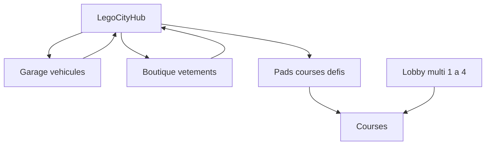

# Vision produit — Brick Racer

Course / aventure en univers **full brick**, non officiel. Moteur [W3DTS](https://github.com/naanouff/w3dts).

**Brick Racer n’est pas affilié à The LEGO Group ni à Nintendo.** LEGO®, Mario Kart™ et toute marque citée comme référence d’intention appartiennent à leurs détenteurs.

GDD (gameplay + lore aventure) : [gdd.md](gdd.md). Roadmap : [../plans/roadmap.md](../plans/roadmap.md). Ton : [tone.md](tone.md). Levels (hub, 16 circuits, items) : [levels.md](levels.md). Réfs techniques démos : [../references/w3dts-demos.md](../references/w3dts-demos.md).

## Piliers

| Pilier | Intention | Réfs d’intention |
| ------ | --------- | ---------------- |
| Structure solo | **Lego City hub** explorabile → garage, boutique, pads vers courses / défis | Diddy Kong Racing (hub-monde, pas menu) |
| Multi | Jusqu’à **4 joueurs en ligne** (lobby + course) | — |
| Ton | Humour adulte, absurde, trash contrôlé (16+) | Conker’s Bad Fur Day |
| Look | 100 % briques, palettes saturées, skyline brick | Démos Lego Kart / Motocross w3dts |
| Véhicules | Kart, moto, avion — custom **au garage** | Kart + Motocross monorepo ; avion à inventer |
| Avatar | Minifigure configurable **à la boutique** | GPROC Lego à étendre |

## Hub — Lego City

Le hub n’est **pas** un écran garage. C’est un **petit monde jouable** (quartier / ville briques), dans l’esprit du hub aventure de Diddy Kong Racing.

- Circulation dans la ville (à pied et/ou véhicule léger selon le MVP), landmarks colorés, PNJ et gags (voir [tone.md](tone.md)).
- **Garage** : atelier custom kart / moto / avion (pièces, couleurs, stickers).
- **Boutique de vêtements** : custom minifig (tête, torse, jambes, coiffe, accessoire).
- **Pads / portails / panneaux** : accès courses et défis dans l’espace ville (pas seulement une liste menu au long terme).

MVP technique : **une scène SceneDD « city »** (pas de streaming open-world). Les POI sont des volumes / triggers → UI atelier ou load scène course.

## Modes

### Solo

Explorer la city, customiser, enchaîner courses et défis via les pads. Mode histoire : 4 biomes (**Plage → Forêt → Désert → Montagne**) + boss par biome — [gdd.md](gdd.md) ; roster pistes / items : [levels.md](levels.md). Monnaie / trophées / unlocks chiffrés restent à préciser.

### Multi (jusqu’à 4)

Lobby puis course partagée. Intention technique MVP : P2P (approche ChessMaster / `@naanouff/w3dts-multiplayer-p2p` + relais), pas de serveur autoritatif dès le premier livrable multi.

## Véhicules et avatar

| Élément | Lieu | Notes |
| ------- | ---- | ----- |
| Kart | Garage | Fondation technique [BRICK-B2](../sprints/BRICK-B2.md) / host Lego Kart |
| Moto | Garage | Patterns Motocross Madness |
| Avion | Garage | Nouveau mode (vol) — pas de démo w3dts actuelle |
| Minifig | Boutique | Pièces swappables, palette saturated brick |

## Non-objectifs

- Free-to-play / microtransactions agressives.
- Affiliation ou licence LEGO / Nintendo.
- Open-world streaming multi-chunks au MVP hub.
- Contenu illégal ou hors garde-fous de [tone.md](tone.md).
