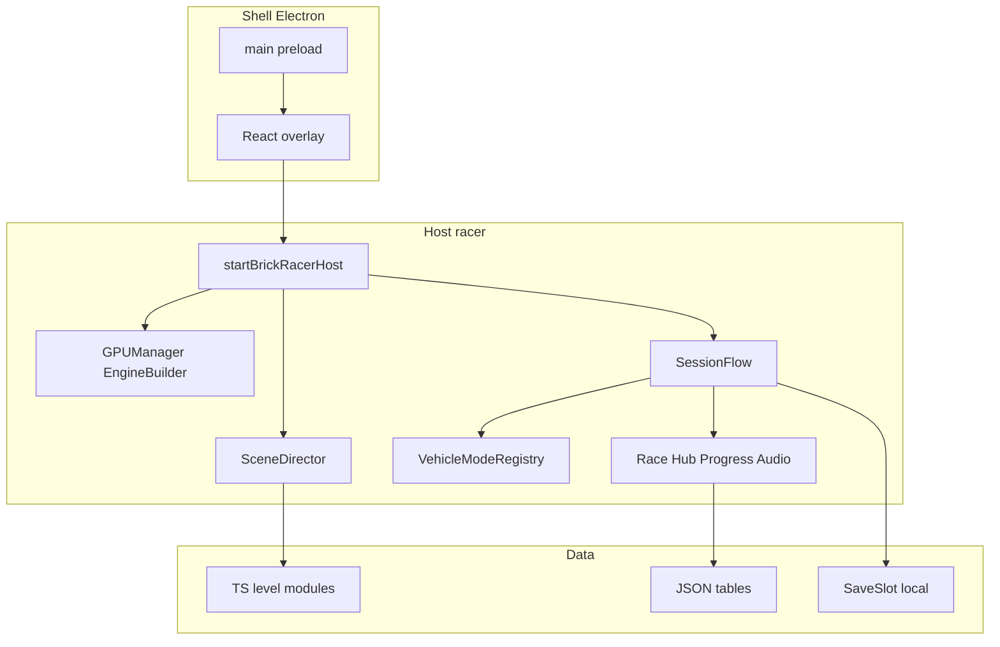
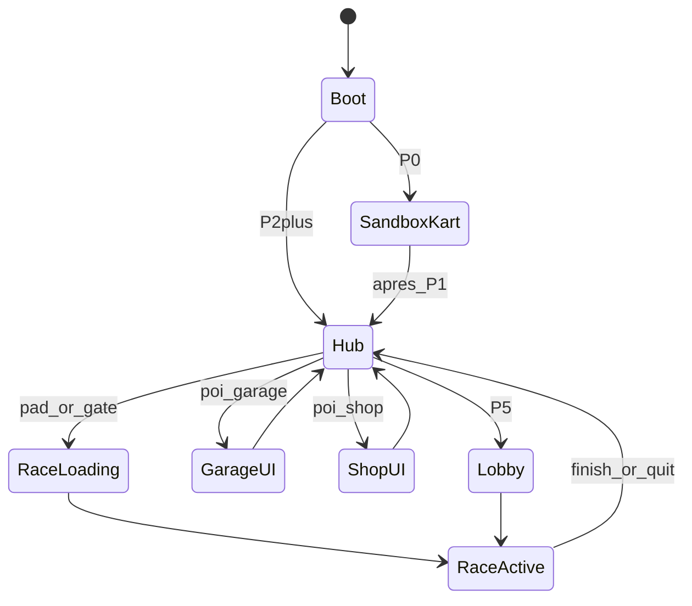

# Architecture — Brick Racer

Bible technique du client. Complète [roadmap.md](roadmap.md), [vehicle-prototypes.md](vehicle-prototypes.md), [lego-kart-host.md](lego-kart-host.md) — ne les remplace pas.

Design : [gdd.md](../design/gdd.md), [levels.md](../design/levels.md), [test-slice.md](../design/test-slice.md).  
Sprints d’implémentation : [BRICK-B2](../sprints/BRICK-B2.md) (P0) → [BRICK-B3](../sprints/BRICK-B3.md) (P1).

**Brick Racer n’est pas affilié à The LEGO Group ni à Nintendo.**

---

## Contexte

| | |
| - | - |
| **État** | Coque Electron + React + WebGPU (v0.1.0, BRICK-B1 ✅). Host stub : [`src/racer/host/startBrickRacerHost.ts`](../../src/racer/host/startBrickRacerHost.ts). Gameplay docs-only. |
| **Stack** | W3DTS (core, physics, input, audio, gproc, scripts…), desktop **WebGPU** obligatoire. **Pas de SceneDD** : levels TypeScript + tables JSON jeu. |
| **Non-objectif** | Streaming open-world, build web / Vercel, ranked, serveur autoritaire MVP. |

---

## Principes directeurs

1. **Une scène = un load** — hub `city`, biomes, courses : unload complet au changement. Retour hub = reload city.
2. **Host unique, modes plugables** — un `startBrickRacerHost` ; véhicules via `VehicleMode` ([vehicle-prototypes.md](vehicle-prototypes.md)).
3. **Gameplay data-driven** — levels TypeScript (spawn ECS) + tables JSON (items, loot, unlocks, quêtes). Pas de packs SceneDD.
4. **Course avant métagame** — P0 kart → P1 race loop → P2 hub ; pas d’ECS maison ni netcode avant besoin (P5).
5. **UI React = overlay** — canvas 3D = vérité monde ; React pour HUD / menus / garage / dialogues courts ([ui-ux.md](../design/ui-ux.md)).

---

## Couches



| Couche | Responsabilité | Ne fait pas |
| ------ | -------------- | ----------- |
| **Shell** | Fenêtre, protocol `app://`, gate WebGPU, IPC version | Physique / scènes |
| **Host** | Boot moteur, boucle frame, wiring W3DTS | Contenu lore |
| **SceneDirector** | `load` / `unload` level modules, transitions, fade stub | Règles de course |
| **SessionFlow** | États Adventure / Free / Versus / Sandbox ; transitions pad→race→hub | Mesh authoring |
| **VehicleMode** | `mount` / input / chase / reset | Items, tours, quêtes |
| **RaceSystem** | Laps, CP, grille, IA soft, items 1-slot, cc/mirror | Hub locomotion |
| **HubSystem** | Pied/scooter, triggers POI/pads/gates, bulles PNJ | Physique course |
| **Progression** | Unlocks, monnaie, quête `disponible→active→done` | Autorité serveur |
| **React UI** | HUD, stubs garage/boutique, dialogues 2–4 lignes | Simulation |

---

## SessionFlow



| État | Scène typique | Véhicule | Phase |
| ---- | ------------- | -------- | ----- |
| **SandboxKart** | `sandboxKart` (TS spawn) | Kart inline | P0 |
| **Hub** | `city` / `city-test` | Pied / scooter | P2+ |
| **RaceLoading** | — (transition) | — | P1+ |
| **RaceActive** | `race-*` / `race-test` | Kart (+ moto/avion P4) | P1+ |
| **GarageUI / ShopUI** | même hub + overlay | — | P3 |
| **Lobby** | lobby / hub pad | — | P5 |

- Transitions : fade + unload + load ; cible ressenti &lt; ~3 s ([test-slice.md](../design/test-slice.md)).
- Gates biomes : load scène biome → pads → race ; retour = reload city + unlocks.

### API host (progressive)

```ts
interface BrickRacerHost {
  ready: true;
  flow: SessionFlow;             // getState / requestTransition
  vehicles: VehicleModeRegistry; // dès VP1 ; kart peut rester inline en B2
  scene: SceneDirector;
}
```

En **P0 / B2** : `ready` + boot moteur + load scène kart suffisent ; `flow` / `scene` peuvent être des stubs minimes (`SandboxKart` figé, load unique).

---

## Levels (contrat données jeu)

**Pas de SceneDD / `@naanouff/w3dts-scenedd`.** Un level = module TypeScript sous `src/racer/levels/<id>/` (types + spec + `spawn*`) qui crée l’ECS W3DTS. Tables JSON séparées pour métagame (items, unlocks…). Pack JSON maison éventuel plus tard pour courses/hub — hors P0.

### P0 — `sandboxKart`

- Module : [`src/racer/levels/sandboxKart/`](../../src/racer/levels/sandboxKart/)
- Boot : [`LegoKartBootProject`](../../src/racer/vehicles/kart/LegoKartBootProject.ts) → `spawnSandboxKart` → `applyLegoKartSceneRuntime`
- Contenu : soleil, sol, ramps, chassis+vehicle, gprocs briques, chase cam, script `kart_drive`

### Slice test — blockout (BO1)

- Plan : [test-slice-blockout.md](test-slice-blockout.md) · sprint [BRICK-BO1](../sprints/BRICK-BO1.md)
- Modules : `src/racer/levels/raceTest/`, `src/racer/levels/cityTest/` (+ `levels/shared/`)
- Cotes : [test-slice-plans.md](../design/test-slice-plans.md)

### Circuits / hub (checklist contenu)

Chaque **circuit** — [levels.md](../design/levels.md) § Spec :

1. Sol + collisions + murs  
2. Waypoints IA sol + air  
3. Checkpoints verticaux (Y 0 → plafond vol)  
4. Shortcuts tagués bias (jamais lock)  
5. Boost pads sol/air/dual (IDs stables pour mirror)  
6. Item clusters sol+air alignés XZ  
7. Grille 8 (+ spawn boss 1v1)  
8. Hazards paramétrés par cc  
9. Mirror = transform scène, pas re-authoring  

**Hub** `city` : landmarks + triggers (`poi.*`, `pad.*`, `gate.*`) — 0 boost/item course.

**IDs** : slice `city-test` / `race-test` → produit `city` / biomes / 16 circuits Cup Free.

Assets runtime : `public/script-graphs/`, `graphs/`, `shader-graphs/`, `shaders/`, `gproc/`.  
Échelle : **1 wu = 1 m** ([test-slice-plans.md](../design/test-slice-plans.md)).

Pas de dépendance `@naanouff/w3dts-viewer`.

---

## Véhicules

Contrat commun (introduire au plus tard à **VP1** ; kart inline OK en B2) :

- `mount` / `unmount` / `bindInput` / `getChaseTarget` / `resetSession`
- Presets W3DTS (`KART_PHYSICS_PRESET` ; variantes scooter / moto / flight)

| Mode | Phase | Contexte |
| ---- | ----- | -------- |
| Kart | P0 | Race + sandbox |
| Scooter | P2 / VP1 | Hub only |
| Moto | P4 / VP2 | Whoops / lean |
| Avion | P4 / VP3 | Couloirs air |

Parité **triple corridor** = règle level design, pas trois games séparés. Détail ladder : [vehicle-prototypes.md](vehicle-prototypes.md).

---

## RaceSystem (P1+)

| Module | Contenu |
| ------ | ------- |
| Lap / Checkpoint | Volumes verticaux ; 3 tours ; finish → SessionFlow |
| Boost | Trigger pads ; magnitude scale cc |
| Items | 1 slot ; loot JSON par rang × cc ; comportements en code |
| AI | Dual graphs + soft rubber-band |
| Camera | Chase W3DTS ; ne jamais perdre le châssis |
| Rules | Grille ≤8 ; boss 1v1 ; reset session |

Tables : `public/data/items.json`, `loot-by-rank.json`, `cc-tuning.json` (chemins indicatifs). Formules rubber-band en code, valeurs en data.

Dès P1 : préférer des inputs / seed loot **déterministe-friendly** pour limiter la dette multi (P5) — sans implémenter le netcode.

---

## Progression & save (P2+)

- Save locale (Electron `userData` / JSON) : unlocks, cosmétiques, monnaie, quêtes.
- Quêtes : `disponible` → `active` → `done` ; UI = bulle PNJ + marqueur discret.
- Ordre aventure figé : Plage → Forêt → Désert → Montagne.
- Pas d’auth serveur / MTX ; économie chiffrée hors scope (placeholders OK).

---

## Multi (P5)

- Lobby → race, 2–4 joueurs.
- Pattern ChessMaster : **P2P** + relay ; pas d’autorité serveur MVP ; pas de ranked.
- Branche sur RaceSystem existant — pas de rewrite.

---

## Arborescence cible

```
src/racer/
  host/           startBrickRacerHost, EngineBoot
  scene/          SceneDirector, loaders SceneDD (port viewer)
  session/        SessionFlow, transition types
  vehicles/       kart/ scooter/ moto/ plane/ + registry
  race/           laps, checkpoints, boosts, items, ai
  hub/            triggers, poi handlers, npc bubbles
  progress/       save, unlocks, quests
  audio/          wrappers w3dts-audio (Hex stubs)
  ui-bridge/      events host → React (HUD, menus)
public/
  scenes/ script-graphs/ graphs/ shader-graphs/ gproc/
  data/           items, loot, unlocks
```

Shell inchangé : `src/main`, `src/preload`, `src/renderer` (overlay s’abonne à `ui-bridge`).

---

## Mapping roadmap

| Phase | Architecture activée | Sprint |
| ----- | -------------------- | ------ |
| **P0** | EngineBoot + SceneDirector minimal + Kart inline ; SandboxKart | [BRICK-B2](../sprints/BRICK-B2.md) |
| **UI** | Overlay React joueur (parallèle). Atelier dev = HTML hors app, pas cet overlay | [BRICK-UI1](../sprints/BRICK-UI1.md) · [BRICK-UIM2](../sprints/BRICK-UIM2.md) |
| **P1** | SessionFlow RaceActive ; RaceSystem minimal sur `race-test` | [BRICK-B3](../sprints/BRICK-B3.md) |
| **H1** | Possession pied / véhicule sur `city-test` (pas le HubSystem complet) | [BRICK-H1](../sprints/BRICK-H1.md) |
| **BW1** | Brick Module Kit + InstancedMesh landmarks hub | [BRICK-BW1](../sprints/BRICK-BW1.md) · [brick-world-rendering.md](brick-world-rendering.md) |
| **DC** | Authoring décors : couches ASCII → brickify → manuels (runtime BW1 inchangé) | [BRICK-DC1](../sprints/BRICK-DC1.md) · [brick-decor-pipeline.md](brick-decor-pipeline.md) |
| **P2** | HubSystem + city ; gates ; VP1 scooter ; Progress skeleton | Ultérieur · après H1 / BW / DC |
| **P3** | Garage / boutique POI + save cosmétiques | Ultérieur |
| **P4** | VehicleModeRegistry ; moto + avion | Ultérieur |
| **P5** | Lobby + P2P | Ultérieur |
| **Post-P2** | Biomes 2–4 / bosses = contenu + scripts, pas nouvelle couche | — |

---

## Décisions figées

- Scènes **load/unload** uniquement (rejet streaming).
- **Un host** Electron ; pas de build web dans le scope architecture.
- Pas de dep `@naanouff/w3dts-viewer` — code nécessaire **copié** dans `src/racer/`.
- React = UI only ; simulation 100 % host.
- Extraction `VehicleMode` au 2ᵉ véhicule (scooter), pas avant.
- Cette doc est la **bible tech** ; les plans / sprints restent les découpages d’exécution.

---

## Historique

| Version | Date | Note |
| ------- | ---- | ---- |
| 1.0 | 2026-10-23 | Création : couches, SessionFlow, Scene packs, véhicules, race, save, multi, arborescence, mapping P0–P5 |
| 1.1 | 2026-10-25 | H1 : possession pied / véhicule sur `city-test`, avant le HubSystem P2 |
| 1.2 | 2026-10-25 | BW1 : Brick Module Kit + InstancedMesh sur hub |
| 1.3 | 2026-10-30 | DC : pipeline décors couches → brickify (authoring) |
