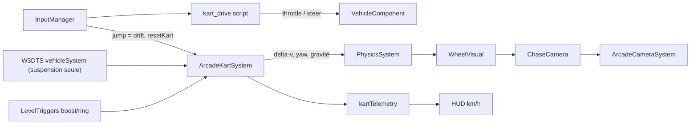

# Plan : kart blockout + couche arcade (BO1g)

Feeling type Mario Kart / Diddy Kong Racing sur `race-test` / `city-test`.  
Sprint : [BRICK-BO1](../sprints/BRICK-BO1.md) (ticket **BO1g**). Physique base : [blockout-physics.md](blockout-physics.md). Blockout : [test-slice-blockout.md](test-slice-blockout.md).

Branche : `feature/test-slice-blockout`. PR cible : `develop`.

## Objectif

Kart blockout natif ~2 m (plus de gproc × scale), roues posées sur la piste, vitesse / adhérence / drift arcade, plaques de boost + anneaux fonctionnels, caméra arcade, télémétrie HUD, texture debug (densité de texels).

## Diagnostic

**Vitesse lente.** Ce n’est pas `maxSpeed` qui limite : le modèle de pneus W3DTS plafonne la propulsion par l’adhérence (`driveBudget = 0.9 * mu * Fz`) tandis que les 4 roues freinent en continu (`-longitudinalStiffness * vLong`). Équilibre ≈ **10 m/s (36 km/h)** même avec `maxSpeed` high et `driveTorque × s²`. Mario Kart / DKR ≈ 10–12 longueurs / s → ~20–24 m/s pour un kart de 2 m.

**Roues dans le sol.** Rubans / plaques boost épais au-dessus de y=0 (physique) ; pneus gproc dont le rayon visuel ≠ physique ; raideur `/s` après scale.

**Autres.** Reset script figé `(0,0.2,0)` ; `camera.far` 120 trop court pour l’ovale ; chase rigide.

## Architecture

- W3DTS `vehicleSystem` : suspension / anti-roll / wheel visuals seulement (`driveTorque`/`brakeTorque` = 0, stiffness longi ≈ 0.02, yawAssist = 0).
- `ArcadeKartSystem` (entre vehicle et physics) : accélération `a = a0 * (1 - v/vmax)^0.6`, grip latéral, yaw rate direct, gravité air +1.2 g, drift + mini-turbo (Espace / `jump`), volumes boost/ring, reset au spawn.
- Cylindrées `?cc=` : 50 → 16 m/s, 100 → 20 m/s, 150 → 24 m/s (défaut 100).

## Étapes

1. Kart blockout natif 2 m (`createBlockoutKartEntities`) — race/city ; sandbox garde gproc.
2. Rubans / plaques au ras du sol (~0.01 ép.).
3. `levelTriggers.ts` + spawn reset exportés.
4. Couche `src/racer/vehicles/kart/arcade/` + script `kart-drive-arcade.json`.
5. `ArcadeCameraSystem` (yaw lag, FOV vitesse/boost).
6. HUD km/h + drift + boost + sélecteur cc.
7. Texture debug grille (voir § suivante).
8. Tests unitaires arcade + physics blockout ; docs playtest.

## Texture debug (densité de texels)

Convention : **1 wu = 1 m** ; cible **256 px/m** env (texture 1024 → tuile 4 m) ; **512 px/m** kart.

- Runtime `blockoutDebugTexture.ts` : grille 1024 (damier 1 m, lignes 25 cm / 1 m / 4 m, labels, flèche, badge `256 px/m`) → `TextureLoader` + `registerTexture('bo_debug_grid')`.
- Shaders : `BlockoutGridPBR` (world triplanar) pour décor ; `BlockoutGridObjectPBR` (object space) pour kart.
- Matériaux opaques `BO_*` → `bo_grid` + teinte `baseColor` ; `BO_Cp` / `BO_Trigger` restent unis ; kart `BK_*` → `bo_grid_obj`.
- Défaut unis ; `?debugTex=1` grille densités + HUD revue.

## Hors scope

Haptique, items / IA / laps, agrandissement piste (tour ovale ≈ 20 s @ 100 cc → ticket ultérieur), feeling dans w3dts-physics (couche arcade côté Brick Racer).

**Manette** : support HID désormais dans w3dts (`INP-G`) — [w3dts-input.md](../references/w3dts-input.md). Brick Racer consomme les mêmes actions `gameplay` ; brancher le npm/alias à jour pour activer stick + A en jeu.
