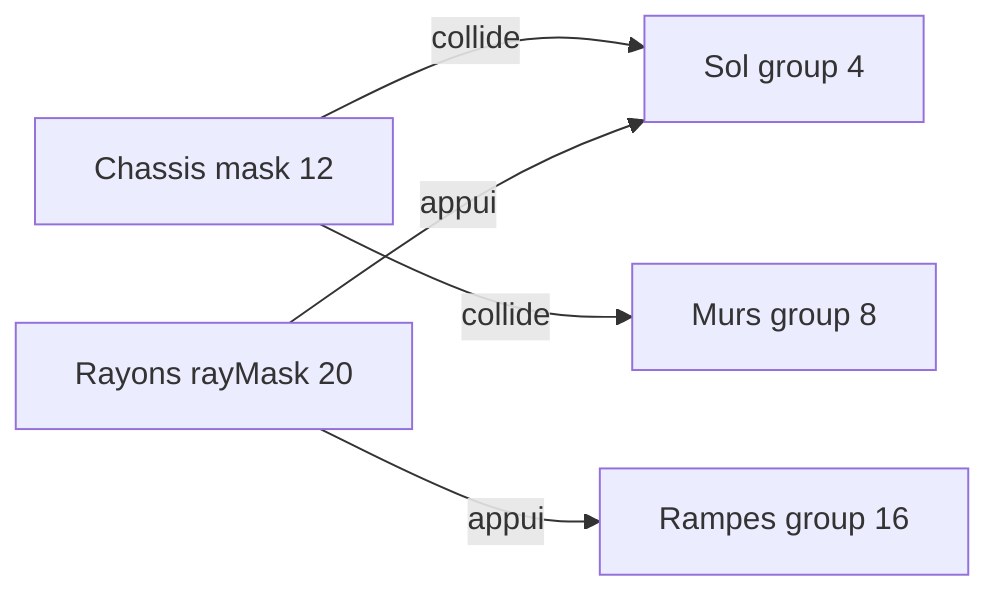

# Plan : physique & collisions blockout

Correctif conduite / collisions pour `race-test`, `city-test` et sandbox.  
Sprint : [BRICK-BO1](../sprints/BRICK-BO1.md) (ticket **BO1f**). Blockout authoring : [test-slice-blockout.md](test-slice-blockout.md).

Branche : `feature/test-slice-blockout`. PR cible : `develop`.

## Objectif

Kart stable (plus de flottement), murs / gate **bloquants**, props roulables (whoops, dune, pad), kart race/city à l’échelle plans (~2 m). Sandbox reste micro-kart (référence mono).

## Diagnostic

1. **Murs traversables** — blockout mettait murs / bâtiments / gate en `collisionGroup: 16` (rampe). Châssis `collisionMask: 12` (sol+mur) ne les voit pas ; les rayons (`rayMask: 20`) oui → le kart **monte** dessus.
2. **Physique npm trop vieille** — `@naanouff/w3dts-physics@0.0.28` ignore `yawAssist` / `uprightStiffness` / `antiWheelie` (présents seulement dans le monorepo). Cast silencieux dans `spawnLevel.ts`.
3. **Props pleins** — arche PROVING = bloc plein qui barre la piste ; dune hors piste / enterrée ; whoops = marches verticales vs débattement roue 0,1 m.
4. **Échelle** — micro-kart ~0,8 m vs plans 2 m (piste 12 m, whoops 0,45 m).
5. **Hot-swap** — `PhysicsSystem.initializedEntities` + recyclage d’IDs après `destroyEntity` corrompt l’inertie.

Conventions mono (`packages/physics/src/kart/legoKart.ts`) : `WORLD=4`, `WALL=8`, `RAMP=16`.

## Étapes

### 1. Physique monorepo

- Alias Vite [`w3dtsMonoAliases.ts`](../../w3dtsMonoAliases.ts) → `physics/src/index.ts` (comme gproc).
- [`bootEngine.ts`](../../src/racer/host/bootEngine.ts) : `applyKartPhysicsCollisionTuning()` ; `fixedTimeStep: 1/60`, `maxStepsPerFrame: 3` (marge fps ; re-monter à 120 si le contact se dégrade).
- Retirer casts `yawAssist` / etc. dans [`spawnLevel.ts`](../../src/racer/levels/shared/spawnLevel.ts).

### 2. Groupes de collision shared

- [`collisionGroups.ts`](../../src/racer/levels/shared/collisionGroups.ts) + `spawnStaticBox({ kind: 'ground'|'wall'|'ramp'|'none', colliderSize? })`.

### 3. race-test

- Murs `wall`, collider ép. 1,0 (visuel 0,4), décalés hors piste.
- Arche : 2 piliers + linteau sans collider (ouverture 14).
- Whoops : 2 OBB `ramp` (~12°) ; dune sur médiane, bord affleurant.
- Helper `placeOnTrack(t, lateral)`.

### 4. city-test

- Landmarks / gate / fontaine → `wall` ; pad → `ramp` + chanfreins.

### 5. Kart échelle plans

- `KART_SCALE ≈ 2.5` + `scaleKartEntities` (positions, wheels, collider, chase, torques / stiffness dérivés).
- Chase race/city : `× KART_SCALE × CHASE_FRAME_BOOST (1.55)` + FOV légèrement élargi (sinon collée au roll-bar).
- Appliqué **race-test + city-test** seulement.

### 6. Switch level

- HUD revue : reload `?level=` (pas hot-swap). `SceneDirector.load` conservé pour B3.

### 7. Tests

- Groupes de collision par rôle ; anti-traversée headless (mono) ; unitaire `scaleKartEntities`.

## Suite : plafonds pneus / feeling arcade

Après BO1f, la vitesse reste plafonnée ≈ 10 m/s par le modèle de pneus W3DTS (adhérence vs freinage longi des 4 roues) — `maxSpeed` / `driveTorque × s²` n’y changent rien. Suite feeling Mario Kart / DKR + kart blockout natif + texture debug → [blockout-arcade-kart.md](blockout-arcade-kart.md) (**BO1g**).

## Hors scope

Drift / boost gameplay, IA, laps, API reset physique moteur (hot-swap B3) — drift / boost arcade reportés à BO1g.
