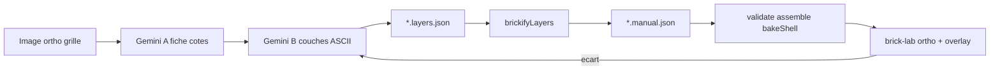

# Plan : pipeline décors brick (couches → brickify)

Sprints : [BRICK-DC1](../sprints/BRICK-DC1.md) (DC0 + DC1) · DC2–DC4 à ouvrir ensuite.  
Rendu / instancing : [brick-world-rendering.md](brick-world-rendering.md) · [BRICK-BW1](../sprints/BRICK-BW1.md).  
Authoring actuel (v1, à remplacer) : [brick-manual-prompt.md](../design/brick-manual-prompt.md).  
Catalogue pièces : [brick-part-catalog.md](brick-part-catalog.md) · [parts.json](../../src/racer/hub/brick/catalog/data/parts.json).

Branche prévue : `feature/brick-decor-layers` depuis `develop`. PR cible : `develop`.

## Problème

Le workflow v1 demande à Gemini de produire un `BrickManual` avec des `at: [sx, py, sz]`, des `radius` et des macros `ring` / `disc` / `wall` / `box`. Le JSON **passe** souvent `validateManual`, mais le résultat **n’est pas fidèle** à l’image :

| Cause | Effet |
| ----- | ----- |
| Raisonnement spatial LLM | Mauvais comptage de studs ; empreintes mal gérées avec `rot` |
| Macros arrondies | `ring` / `disc` + `innerRadius` divergent de la silhouette voulue |
| Image en perspective | Pas d’échelle ni de cotes ; Gemini invente les proportions |
| Pas de mesure | brick-lab sans vue ortho ni overlay → « fidèle » reste une impression |

Les couches runtime restent saines et **inchangées** : `validateManual` → `assembleManual` → `bakeShell` → instances LDraw ([`src/racer/hub/brick/manual/`](../../src/racer/hub/brick/manual/)).

## Décision

Gemini décrit **ce qu’il voit**, couche par couche (grilles ASCII, une lettre = un stud). Un convertisseur **déterministe** (`brickifyLayers`) choisit les pièces catalogue et émet le `BrickManual` existant.

| Choix | Décision |
| ----- | -------- |
| Entrée Gemini | `*.layers.json` (pixel-art par plate / brique / tile) |
| Sortie | `*.manual.json` (ops `brick` + ops libres pour pièces spéciales) |
| Placement pièces | Remplissage glouton rectangles (2×4 → 1×1) depuis `parts.json` |
| Coordonnées | Origine centrée sur `footprint` ; enveloppe **calculée**, jamais inventée |
| Images source | Planches **ortho** face / côté / dessus sur grille de studs |
| Boucle qualité | Overlay référence dans brick-lab + caméra ortho |
| Hors scope immédiat | API Gemini auto, Meshy→voxel, IoU silhouette auto |



## Format `*.layers.json` (v1)

```json
{
  "id": "landmark.pad",
  "footprint": [8, 6],
  "legend": { "Y": "yellow", "K": "black", "G": "gray" },
  "layers": [
    {
      "kind": "plate",
      "rows": [
        "KKKKKKKK",
        "KYYYYYYK",
        "KYKKKKYK",
        "KYKKKKYK",
        "KYYYYYYK",
        "KKKKKKKK"
      ]
    }
  ],
  "ops": []
}
```

| Champ | Règle |
| ----- | ----- |
| `rows` | Une chaîne par rangée Z ; un caractère par stud X ; `.` = vide ; longueur = `footprint[0]` ; nombre de rangées = `footprint[1]` |
| `kind` | `plate` (1P) · `brick` (3P) · `tile` (1P, lisse) — empilement bas → haut |
| `legend` | Lettre → id `colors.json` |
| `ops` | Ops `brick` manuelles (dish `3960`, macaroni `85080`, cone `4589`, …) après les couches |
| Enveloppe | Dérivée de footprint × hauteur des couches (+ ops) |

## Incréments

Chaque incrément : `pnpm test` + `pnpm check` + décor visible dans `brick-lab`. Aucun commit sans demande.

| Id | Contenu | Preuve |
| -- | ------- | ------ |
| **DC0** | Caméra ortho Face / Côté / Dessus ; overlay image référence ; registre manuels via `import.meta.glob` ; corpus + critères fidélité | Fontaine / pad / gate : checklist silhouette, ±1 stud, couleurs |
| **DC1** | `layersSchema` + `brickifyLayers` + `pnpm brick:layers` + tests ; fontaine refaite en couches | Overlay vs [ref-fountain-ortho.png](../design/art/ref-fountain-ortho.png) |
| **DC2** | Prompts v2 (image ortho, fiche cotes, couches) ; boucle d’erreurs visuelle | `landmark.pad` entièrement via workflow |
| **DC3** | Appareillage décalé, tiles auto, modificateurs pentes (`/` → slope catalogue) | `landmark.gate` dans brick-lab puis `city-test` |
| **DC4** | `*.assembly.json` multi-modules + checklist prod | Tour + façades (garage / vinyle / mairie) |

Ordre landmarks (aligné [brick-world-rendering.md](brick-world-rendering.md)) : fontaine (preuve) → **pad** → **gate** → **tower** → façades.

## Fichiers cibles

| Fichier | Rôle |
| ------- | ---- |
| [`layersSchema.ts`](../../src/racer/hub/brick/manual/layersSchema.ts) | Types + `validateLayers` |
| [`brickifyLayers.ts`](../../src/racer/hub/brick/manual/brickifyLayers.ts) | Couches → `BrickManual` (pur, déterministe) |
| `scripts/brick/layers-to-manual.ts` | CLI `pnpm brick:layers` |
| `src/racer/hub/brick/layers/<id>.layers.json` | Sources authoring |
| `src/racer/hub/brick/manuals/<id>.manual.json` | Sortie versionnée (consommée runtime) |
| [`registry.ts`](../../src/racer/hub/brick/manuals/registry.ts) | Glob de tous les `*.manual.json` |
| [`spawnBrickLab.ts`](../../src/racer/levels/brickLab/spawnBrickLab.ts) | Vues ortho |
| [`brick-manual-prompt.md`](../design/brick-manual-prompt.md) | Prompts v2 (DC2) |

## Hors scope (premier passage)

- CLI / clé API Gemini (copier-coller manuel conservé).
- Image → 3D (Meshy) → voxelisation (réévaluer si DC2 insuffisant pour formes organiques).
- Comparaison automatique de silhouettes (IoU) — overlay manuel suffit en DC0.
- Fusion 1×1 → 2×4 au bake (déjà hors BW1) ; impostors skyline.

## Critères de succès (plan)

- Un décor nouveau = image ortho + `.layers.json` + brickify + overlay OK, **sans** inventer des `at` à la main.
- Silhouette et proportions dans ±1 stud vs référence ; couleurs d’après l’image.
- Pipeline runtime BW1 inchangé (même `assembleManual` / `bakeShell` / LDraw).
- Perf `city-test` : `dc` / FPS stables vs landmarks BW1 existants.

## Historique

| Date | Note |
| ---- | ---- |
| 2026-10-30 | Consignation : diagnostic v1, format couches, incréments DC0–DC4, ouverture sprint DC1 |
