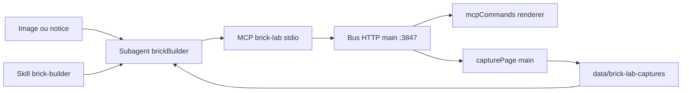

# Plan : agent constructeur LEGO (brick-lab)

Sprint : [BRICK-BA](../sprints/BRICK-BA.md).  
Prérequis MCP lot 1 : [brick-lab-mcp.md](brick-lab-mcp.md) · [BRICK-LT4](../sprints/BRICK-LT.md#brick-lt4--bus-local-dev) / [LT5](../sprints/BRICK-LT.md#brick-lt5--serveur-mcp--docs).  
Éditeur : [brick-lab-editor.md](brick-lab-editor.md) · outils : [brick-lab-tools.md](brick-lab-tools.md).

## Objectif

Un agent Cursor (**skill + subagent**) qui transforme une **image** ou une **notice d’assemblage** en construction dans la session brick-lab ouverte — via le MCP, avec boucle de validation visuelle (capture) et outils d’analyse / macros.

## Constat (lot 1)

Le MCP actuel ([`brickLabServer.mjs`](../../src/mcp/brickLabServer.mjs), dispatcher [`mcpCommands.ts`](../../src/racer/levels/brickLab/editor/mcpCommands.ts)) expose 12 commandes **à l’aveugle**. Lors d’essais (fontaine photo), l’agent :

- découvre les collisions **après** pose ;
- ne voit pas le rendu ;
- ne détecte pas les pièces flottantes ;
- a parfois dû contourner le MCP Cursor via le bus HTTP quand le serveur stdio n’était pas chargé.

Hors lot 1 (déjà noté dans [brick-lab-mcp.md](brick-lab-mcp.md)) : macros `ring` / `disc` / `wall` ; capture viewport.

## Architecture

Une seule source de vérité : `editorState` (comme LT4). L’agent **commande** ; il n’écrit pas les `.manual.json` à la main pendant une session ouverte.

## 1. Enrichir le MCP (lot 2)

### Commandes pures — [`mcpCommands.ts`](../../src/racer/levels/brickLab/editor/mcpCommands.ts)

| Outil | Rôle |
| ----- | ---- |
| `place_bricks` + `dryRun: true` | Même validation, **aucune** mutation ; `rejected[]` avec opId / cellule en conflit si collision |
| `query_region` `{min,max}` | Cellules occupées + ops touchées |
| `analyze` | BBox studs/plates, nomenclature (part × color × qty), pièces **flottantes** (via `stackHeightUnder`) |
| `remove_bricks` | Lot (opIds ou région) ; **un** undo |
| `set_view` | `orbit` \| `face` \| `side` \| `top` → [`applyBrickLabView`](../../src/racer/levels/brickLab/brickLabCamera.ts) |

Tests : [`tests/mcpCommands.test.ts`](../../tests/mcpCommands.test.ts).

### Macros — nouveau [`editor/mcpMacros.ts`](../../src/racer/levels/brickLab/editor/)

Produisent des `McpBrickSpec[]`, puis passent par `place_bricks` (option `dryRun`) :

| Macro | Comportement |
| ----- | ------------ |
| `fill_rect` | Remplissage glouton (grandes plaques/briques d’abord) |
| `wall` | Mur épaisseur 1, joints croisés |
| `ring` / `disc` | Anneau / disque rasterisés au stud, puis tuilage |
| `column` | Empilement d’une pièce sur N couches |

### Capture — [`brickLabMcpBus.ts`](../../src/main/brickLabMcpBus.ts)

| Outil | Rôle |
| ----- | ---- |
| `capture` `{view?}` | `set_view` optionnel → `webContents.capturePage()` → `data/brick-lab-captures/<stem>-<view>-<ts>.png` (chemin absolu) |
| `capture_set` | face + côté + dessus + orbite |

Captures gitignorées. L’agent lit le PNG avec Read pour comparer à la référence.

Déclarer chaque outil dans [`brickLabServer.mjs`](../../src/mcp/brickLabServer.mjs) (zod) ; mettre à jour [brick-lab-mcp.md](brick-lab-mcp.md).

## 2. Skill Cursor — `.cursor/skills/brick-builder/`

| Fichier | Contenu |
| ------- | ------- |
| `SKILL.md` | Protocole (voir ci-dessous) |
| `reference/coordinates.md` | Repère `[sx,py,sz]`, unités (1 stud = 0,33 m, 1 plate = 0,11 m, 1 brick = 3 plates), sémantique `rot` par famille |
| `reference/parts.md` | Catalogue BC1 commenté ; pièges (AABB pleine des macaronis 4×4 vs eau intérieure) |
| `reference/recipes.md` | Recettes (bassin circulaire, colonne paliers, cascade, toiture, façade) — base : fontaine photo ~83 pcs |

### Protocole agent

1. `status` — si non connecté : **stop** + message clair (pas de contournement HTTP silencieux).
2. Analyser l’entrée (image → emprise / hauteur / sous-ensembles / palette 12 couleurs ; notice → 1 étape = 1 lot).
3. Nomenclature vs `list_parts` + table de substitution.
4. Plan par couches bas → haut.
5. Par sous-ensemble : `dryRun` → corriger → poser → `analyze` (0 flottante) → `capture`.
6. Comparer capture / référence ; max **3** boucles par sous-ensemble.
7. `save` **uniquement sur demande** ; résumé BOM + écarts.

## 3. Subagent — `.cursor/agents/brick-builder.md`

Frontmatter (nom + description déclenchée par « construire en LEGO / image / notice »). Prompt court : lire le skill, suivre le protocole. Entrées : image ou chemin notice, `stem` cible, contraintes d’emprise.

## 4. Fiabilité connexion MCP

- Vérifier / corriger [`.cursor/mcp.json`](../../.cursor/mcp.json) sous Windows (`pnpm` vs `cmd /c pnpm` vs `node src/mcp/brickLabServer.mjs`).
- Checklist dans le skill : `pnpm dev` → ouvrir brick-lab → recharger MCP Cursor.

## 5. Validation

- Unitaires : `dryRun`, `analyze` (flottantes), chaque macro (pas de collision interne, couverture).
- Bout en bout : reconstruire la **fontaine photo** via le subagent ; livrer captures face / côté / dessus.

## Hors scope

- MCP packagé / hors localhost (inchangé vs LT).
- Promotion catalogue maître via MCP.
- Vision multimodale hors Cursor (pas d’agent CLI SDK dans ce sprint).
- Contenu city-test (spawn mesh landmarks) — orthogonal, voir FC suite.

## Critères de succès

| Critère | Succès |
| ------- | ------ |
| Dry-run | Collision listée sans mutation ; pose ensuite OK |
| Analyze | Flottante détectée ; BOM exacte |
| Macros | `ring`/`wall`/`fill_rect` sans collision interne |
| Capture | PNG lisible ; agent ajuste après lecture |
| Skill | Subagent suit le protocole sans inventer d’outils |
| E2E | Fontaine photo reconstruite ; captures cohérentes |
| MCP Cursor | `status` connecté sans contournement bus |

## Historique

| Date | Note |
| ---- | ---- |
| 2026-10-31 | Consignation après essais fontaine MCP + plan agent lot 2 |
