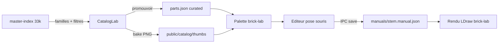

# Plan : éditeur brick-lab + catalogue (construction manuelle)

Sprint : [BRICK-ED](../sprints/BRICK-ED.md).  
Pipeline couches (conservé) : [brick-decor-pipeline.md](brick-decor-pipeline.md) · DC1–DC4.  
Checklist prod : [brick-decor-checklist.md](../design/brick-decor-checklist.md).  
Catalogue : [brick-part-catalog.md](brick-part-catalog.md) · [catalog-lab.md](catalog-lab.md) · [parts.json](../../src/racer/hub/brick/catalog/data/parts.json).  
Rendu : [brick-world-rendering.md](brick-world-rendering.md) · [BRICK-BW1](../sprints/BRICK-BW1.md).

Branche prévue : `feature/brick-lab-editor` depuis `develop` (ou train `feature/brick-decor-layers` si déjà ouvert). PR cible : `develop`.

## Problème

Le pipeline couches ASCII → `brickifyLayers` (DC) convient aux dalles et façades rectangulaires. Les landmarks **ronds multi-étages** (fontaine 3 paliers, dish / macaroni / cone) restent peu fidèles :

| Cause | Effet |
| ----- | ----- |
| Remplissage glouton rectangles | Silhouette ronde impossible sans ops pièce-à-pièce |
| Ops Gemini | `at` / axes / hauteurs souvent faux ; JSON « valide » mais faux |
| `spawnLandmarkLdraw` tout-ou-rien | Une pièce sans mesh → **tout** le décor en boîtes |
| Catalogue maître | 33k pièces, `category_id` numériques sans nom ; liste texte seule |
| Palette lab | Pas de pose souris ; authoring = JSON ou Gemini |

Décision : **construire à la main** dans brick-lab. Le format runtime reste `BrickManual` (`op: "brick"`). Les couches / brickify restent pour les formes en grille.

## Décision

| Choix | Décision |
| ----- | -------- |
| Pose | Éditeur brick-lab : palette → clic grille de studs → `.manual.json` |
| Catalogue | Miniatures PNG rendues depuis LDraw (hors ligne, même look jeu) |
| Familles | Mapping Rebrickable → familles FR + filtres taille / hauteur / BC1 |
| Promotion | Staging existant (`bc1-merge-parts`) pour enrichir `parts.json` |
| Rendu | Fallback LDraw **par pièce** (boîte locale), plus de null global |
| Couches DC | Conservées pour pad / gate / façades ; Gemini = esquisse optionnelle |

## Point de départ (code)

- Maître : [public/catalog/master-index.json](../../public/catalog/master-index.json) (~33 721 pièces, `ldraw_id` partout). Noms de catégories dans `part_categories.csv` ([fetch_sources.py](../../scripts/catalog/fetch_sources.py)).
- Construction : ~79 pièces dans `parts.json` ; seuls ces ids passent `validateManual`.
- Aperçu : [CatalogBrowserPanel.tsx](../../src/renderer/catalog/CatalogBrowserPanel.tsx) — liste virtualisée, preview mesh/boîte.
- Readback : `engine.readbackGameViewIntermediateToImageData()` (w3dts).
- Ops cibles : `ManualBrickOp` dans [manualSchema.ts](../../src/racer/hub/brick/manual/manualSchema.ts).

## Incréments

Chaque ticket : `pnpm test` + `pnpm check`. Aucun commit sans demande.

| Id | Contenu | Preuve |
| -- | ------- | ------ |
| **ED1** | `categories.json` + familles ; catégories `parts.json` étendues ; filtres / tri catalogue | Familles nommées ; filtre « dans BC1 » + taille |
| **ED2** | IPC thumbs + bake iso ortho + vue grille | 79 miniatures parts.json ; grille lazy |
| **ED3** | Fallback LDraw par pièce + `ldrawId` | Ronds / dish / cone en vraie forme dans brick-lab |
| **ED4** | `editorState` / `editorIo` + IPC `brick-manual-write` | Nouveau / ouvrir / enregistrer un manuel |
| **ED5** | Rayon, snap, fantôme, empilement, undo, rendu incrémental | Pose / retire / rotate en Face et Dessus |
| **ED6** | Mode Construire dans le tiroir Atelier | Palette miniatures + couleurs + récents |
| **ED7** | Docs + playtest fontaine reconstruite à la main | Overlay ±1 stud ; vues Orbit / Face / Côté / Dessus |

## Fichiers cibles

| Fichier | Rôle |
| ------- | ---- |
| [build_master_catalog.py](../../scripts/catalog/build_master_catalog.py) | Écrit `categories.json` + `family` sur le maître |
| `public/catalog/categories.json` | `{ id, name, family }` |
| `public/catalog/thumbs/<ldrawId>.png` | Miniatures 128 px |
| [types.ts](../../src/racer/hub/brick/catalog/types.ts) / `parts.json` | Catégories + `ldrawId` / `tags` |
| [CatalogBrowserPanel.tsx](../../src/renderer/catalog/CatalogBrowserPanel.tsx) | Filtres, grille, bake thumbs |
| [spawnLandmarkLdraw.ts](../../src/racer/hub/brick/spawnLandmarkLdraw.ts) | Fallback pièce par pièce |
| `src/racer/levels/brickLab/editor/*` | État, IO, pose |
| [src/main/index.ts](../../src/main/index.ts) | IPC `catalog-write-thumb`, `brick-manual-write` |
| [AtelierShell.tsx](../../src/renderer/atelier/AtelierShell.tsx) | Mode Construire |

## Contrôles éditeur (ED5)

| Action | Comportement |
| ------ | ------------ |
| Clic | Poser (snap studs, collision map) |
| Clic droit / Suppr | Retirer sous le curseur |
| R | Rotation 90° |
| PgUp / PgDn | Couche ±1 plaque (Maj = ±1 brique) |
| Ctrl+Z / Y | Annuler / rétablir |
| Alt+clic | Pipette pièce + couleur |

Rayon depuis l’inverse de `viewProjectionMatrix` (perspective + ortho). Empilement auto sur le dessus sous l’empreinte ; couche manuelle verrouille la hauteur. Fantôme vert / rouge. Overlay photo de référence conservé.

## Risques

- Readback miniature : 1 frame de retard → attendre 2 frames ; valider 3 pièces avant batch.
- Hot-reload Vite après écriture manuel → le registry ignore le stem en cours d’édition.

## Suite : volets + hiérarchie

Conservation des étapes / sous-étapes, arbre BOM et catalogue repliable : [brick-lab-hierarchy.md](brick-lab-hierarchy.md) · [BRICK-HV](../sprints/BRICK-HV.md).

## Hors scope (premier passage)

- Macros `ring` / `disc` / `wall` / `box` dans l’éditeur (ops `brick` seules).
- Édition multi-joueurs / cloud.
- Miniatures CDN Rebrickable (licence) — rendu local uniquement.
- Remplacement du pipeline DC pour les formes en grille.
- Arbre d’étapes / sous-BOM dans l’UI (→ HV).

## Critères de succès (plan)

- Fontaine 3 paliers reconstruite à la souris, fidèle ±1 stud vs photo de référence.
- Catalogue navigable par famille avec miniatures pour le sous-ensemble BC1.
- Nouveau décor rond = pose manuelle + enregistrement, sans inventer des `at` Gemini.
- Runtime BW1 inchangé (`assembleManual` / `bakeShell` / LDraw).

## Historique

| Date | Note |
| ---- | ---- |
| 2026-10-30 | Consignation : pivot construction manuelle après essais Gemini fontaine ; ouverture sprint ED |
| 2026-11-01 | Pointeur suite HV (volets + hiérarchie BOM / `substeps`) |
