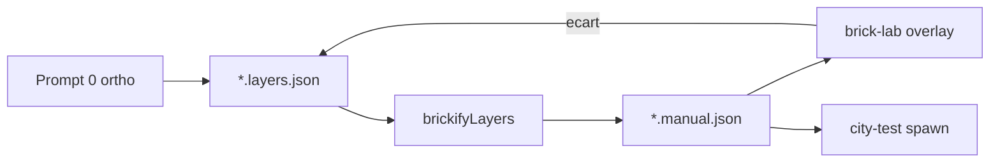

# Plan : façades city-test (garage / vinyle / mairie)

Sprint : [BRICK-FC](../sprints/BRICK-FC.md).  
Suite de : [BRICK-LT](../sprints/BRICK-LT.md) · [brick-lab-tools.md](brick-lab-tools.md) · Prompt 0 [brick-manual-prompt.md](../design/brick-manual-prompt.md).  
Checklist : [brick-decor-checklist.md](../design/brick-decor-checklist.md).  
Couches (grilles) : [brick-decor-pipeline.md](brick-decor-pipeline.md).

## Objectif

Livrer les landmarks **garage**, **vinyle**, **mairie** en `.manual.json` fidèles aux planches ortho (±1 stud), chargeables dans brick-lab (overlay) puis branchables sur `city-test`.

## Approche

| Landmark | Emprise | Hauteur | Voie |
| -------- | ------- | ------- | ---- |
| garage | 24×24 S | 42 P | Couches ASCII → `brickify` (volume + ouvertures) ; détails enseigne / linteau en éditeur ou `ops` |
| vinyle | 18×18 S | 36 P | Idem + vitrine (transparent / cyan si pièces BC1) |
| mairie | 24×12 S | 24 P | Socle couches ; statue = pose manuelle / MCP (pièce à pièce) |

Overlays déjà branchés dans [`registry.ts`](../../src/racer/hub/brick/manuals/registry.ts) (`/brick-refs/<stem>-ortho.png`).

## Hors scope

- Billboard / tower / gate (déjà stubs ou hors FC).
- Remplacement colliders `city-test` (AABB inchangés).
- Macros MCP `wall` / `box` (reste hors lot 1).
- Textures imprimées enseigne (tuiles unies + note ; print ultérieur).

## Critères

- Chaque stem a `manuals/<stem>.manual.json` + overlay playtest Face / Côté / Dessus ±1 stud.
- `pnpm brick:layers` reproductible depuis `layers/<stem>.layers.json`.
- `pnpm test` + `pnpm check` verts.

## Historique

| Date | Note |
| ---- | ---- |
| 2026-10-31 | Consignation après LT ; suite contenu city-test |
| 2026-10-31 | FC1–FC4 : gens `scripts/brick/gen-{garage,vinyle,mairie}-layers.mjs` + manuels |
