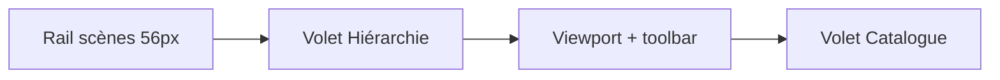

# Plan : brick-lab — volets repliables + hiérarchie BOM

Sprint : [BRICK-HV](../sprints/BRICK-HV.md).  
Suite de [brick-lab-editor.md](brick-lab-editor.md) (ED) · [brick-lab-tools.md](brick-lab-tools.md) (LT) · coque [dev-atelier.md](dev-atelier.md).  
Schéma : [manualSchema.ts](../../src/racer/hub/brick/manual/manualSchema.ts).  
Shell : [AtelierShell.tsx](../../src/renderer/atelier/AtelierShell.tsx).

Branche prévue : `feature/brick-lab-hierarchy` depuis `develop`. PR cible : `develop`.

## Problème

En brick-lab, le catalogue occupe le tiroir droit sans pouvoir le replier, et il n’y a **aucun arbre** pour lire la structure du manuel en cours. L’éditeur aplatit les étapes à l’IO (`editorStateToManual` écrit une seule étape « 1 — construction » ; `manualToEditorState` ignore les titres). Les notices LEGO, elles, s’organisent en **étapes** et **sous-étapes**, chacune avec sa BOM.

## Décisions

| Choix | Décision |
| ----- | -------- |
| Sous-BOM | = liste + structure d’une **sous-étape** du manuel (`ManualStep.substeps`) |
| Arbre | Lecture seule + sélection (sync `selectedOpId` ↔ 3D). Pas de DnD / rename |
| Layout brick-lab | Rail scènes (56 px) · volet Hiérarchie (repliable) · viewport · volet Catalogue (repliable) |
| Raccourcis | `[` hiérarchie · `]` catalogue (ignorés dans un champ). État `localStorage` `br.brickLab.panels` |
| Profondeur | Max 2 niveaux d’étapes (étape → sous-étape). Pas de sous-sous-étape |
| Nouvelles briques | Tombent dans la **dernière étape** de premier niveau (créée si besoin) |

## Layout cible

- Grille `.br-atelier.is-brick-lab` : `var(--rail-w) var(--tree-w) 1fr var(--drawer-w)`.
- Replié : `is-tree-collapsed` → `--tree-w: 2rem` ; `is-drawer-collapsed` → `--drawer-w: 2rem` (languette).
- Nœuds affichés : Manuel → Étape (« Étape 2 ») → Sous-étape (« 2.a ») → briques. Chaque nœud d’étape / sous-étape / manuel porte une **BOM agrégée** (pièce × couleur, qty).

## Incréments

Chaque ticket de code : `pnpm test` + `pnpm check`. Aucun commit sans demande. TDD : rouge → vert → refactor.

| Id | Contenu | Preuve |
| -- | ------- | ------ |
| **HV1** | `ManualStep.substeps` + validation récursive + `flattenManualOps` | Tests validation / flatten / place_assembly |
| **HV2** | `EditorState.steps` + `stepId` ; aller-retour IO ; `get_assembly` enrichi | Roundtrip conserve titres et sous-étapes |
| **HV3** | `buildBomHierarchy` (BOM agrégée, libellés) | Tests agrégation + numérotation |
| **HV4** | Maquette `atelier.html` vue brick-lab (2 volets repliables) | Checklist visuelle navigateur |
| **HV5** | Shell React : volets + CSS design system + raccourcis | Classes / grille 4 colonnes ; uiUx |
| **HV6** | `BrickHierarchyPanel` + portail + sélection sync | Arbre accessible ; sélection 3D |

## Fichiers cibles

| Fichier | Rôle |
| ------- | ---- |
| [manualSchema.ts](../../src/racer/hub/brick/manual/manualSchema.ts) | `substeps?` + validation récursive |
| `flattenManualOps` (même module ou voisin) | Ordre de construction en profondeur |
| [editorState.ts](../../src/racer/levels/brickLab/editor/editorState.ts) | `EditorStepNode`, `stepId` |
| [editorIo.ts](../../src/racer/levels/brickLab/editor/editorIo.ts) | Conserve l’arbre à l’IO |
| `bomHierarchy.ts` (nouveau) | Modèle pur pour l’UI |
| [mcpCommands.ts](../../src/racer/levels/brickLab/editor/mcpCommands.ts) | `place_assembly` via flatten ; `get_assembly` + steps |
| [AtelierShell.tsx](../../src/renderer/atelier/AtelierShell.tsx) / [atelier.css](../../src/renderer/atelier/atelier.css) | Volets + tokens |
| `BrickHierarchyPanel.tsx` (nouveau) | Arbre `role="tree"` |
| [BrickLabBuildPanel.tsx](../../src/renderer/brickLab/BrickLabBuildPanel.tsx) / [main.tsx](../../src/renderer/main.tsx) | Portail `hierarchyHost` |
| [docs/mocup/atelier.html](../mocup/atelier.html) | Canon visuel brick-lab |

## Hors de ce plan

- Réordonnancement / création / renommage d’étapes dans l’UI.
- Sous-assemblages = fichiers manuels séparés (`place_assembly` reste un flatten runtime).
- Coque joueur [BRICK-UI1](../sprints/BRICK-UI1.md).
- Édition multi-sélection ou masquage 3D des nœuds.
