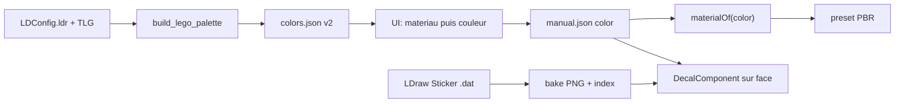

# Plan : matériaux LEGO, palette officielle et autocollants

Sprint : [BRICK-MT](../sprints/BRICK-MT.md).  
Suite de : [brick-part-catalog.md](brick-part-catalog.md) (BC1) · [catalog-lab.md](catalog-lab.md) (CL) · [brick-world-rendering.md](brick-world-rendering.md).  
Authoring : [brick-manual-prompt.md](../design/brick-manual-prompt.md).

## Objectif

1. Remplacer la palette maison (13 couleurs) par la **palette officielle LDraw** (`LDConfig.ldr`, ~355 couleurs avec finition).
2. Dans l’UI : choisir d’abord le **matériau**, puis affiner une **couleur officielle** de ce matériau.
3. Coller les **autocollants officiels** LDraw via des **decals** projetés.

## Constat

- Aujourd’hui le matériau est dérivé implicitement : tout est plastique 017B ([`catalogPlasticMaterials.ts`](../../src/racer/hub/brick/catalog/catalogPlasticMaterials.ts) · [`landmarkPlasticMaterial.ts`](../../src/racer/hub/brick/landmarkPlasticMaterial.ts)). `translucent` sur `cyan` / `clear` ne joue que sur la rugosité.
- La palette officielle est déjà locale : [`data/ldraw/ldraw/LDConfig.ldr`](../../data/ldraw/ldraw/LDConfig.ldr) (355 `!COLOUR`) + [`LDConfig_TLG.ldr`](../../data/ldraw/ldraw/LDConfig_TLG.ldr) (noms The LEGO Group). Répartition typique :
  - `ALPHA` (transparent) : ~58
  - `RUBBER` : ~62
  - `CHROME` : ~9
  - `PEARLESCENT` : ~25
  - `METAL` : ~1
  - `MATERIAL GLITTER` : ~25 (dont `Opal_Trans_*` → satin)
  - `MATERIAL SPECKLE` : ~6
  - `LUMINANCE` : ~13 (Glow in dark)
  - Exemple : `0 !COLOUR Rubber_Black CODE 256 VALUE #1B2A34 EDGE #808080 RUBBER`
- La finition est une **propriété de la couleur officielle**. Le manuel ne stocke que `color` ; le matériau s’en déduit. Pas d’axe `material` séparé → pas de combos impossibles (« chrome Tan »).
- Moteur : transmission / clearcoat / sheen / émissif déjà dans [`pbr_master_node.wgsl`](../../public/shaders/graph_templates/pbr_master_node.wgsl) ; `DecalComponent` + [`decal.wgsl`](../../public/shaders/core/decal.wgsl) existent. Le render graph Brick-Racer (`BrickRacerFast.json`) **n’a pas** encore de passe decal.
- Stickers LDraw : ~2786 pièces `0 Sticker …` (géométrie vectorielle colorée) + ~145 `TEXMAP` avec PNG sous `parts/textures`. Les `!KEYWORDS` donnent pièce hôte et set (`part 3846, set 375-2`).



## Décision UI / données

| Choix | Détail |
| ----- | ------ |
| Palette | Officielle LDraw, générée ; slugs legacy (`gray`, `cyan`, …) = aliases |
| Sélection | Matériau → couleurs de ce matériau (courantes / toutes / recherche) |
| Manuel | Champ `color` seul (pas de `material` séparé) |
| Contrainte pièce | `BrickPartDef.allowedMaterials?` (pneu = rubber, vitre = transparent) — filtre UI + warning schéma |
| Stickers | Champ optionnel `stickers[]` sur les pièces du manuel → decals runtime |

## Phase 1 — Palette et matériaux

### Génération

Script `scripts/catalog/build_lego_palette.ts` lit les deux LDConfig (`LDConfig_TLG.ldr` souvent UTF-16). Sortie : `colors.json` v2.

```ts
type BrickMaterialKind =
  | 'plastic' | 'transparent' | 'rubber' | 'chrome' | 'metallic'
  | 'pearl' | 'glow' | 'glitter' | 'satin' | 'speckle';

type BrickColorDef = {
  id: string;            // slug LDraw: "rubber_black", "trans_clear"
  ldrawCode: number;     // 256
  name: string;          // nom TLG officiel
  rgb: [number, number, number];
  alpha?: number;        // 0..1 si ALPHA
  material: BrickMaterialKind;
  glitter?: { rgb: [number, number, number]; fraction: number; size: number };
  luminance?: number;
  common?: boolean;      // ~40 couleurs mises en avant
  blId?: number;
  aliases?: string[];    // gray, cyan, clear, …
};
```

Mapping finition → matériau :

| LDraw | BrickMaterialKind |
| ----- | ----------------- |
| `RUBBER` | `rubber` |
| `CHROME` | `chrome` |
| `METAL` | `metallic` |
| `PEARLESCENT` | `pearl` |
| `GLITTER` + nom `Opal_*` | `satin` |
| `GLITTER` sinon | `glitter` |
| `SPECKLE` | `speckle` |
| `LUMINANCE` sans glitter | `glow` |
| `ALPHA` seul | `transparent` |
| sinon | `plastic` |

Compat : `resolveColorId` conserve les 13 slugs actuels. Liste `common` éditable à la main.

### Rendu

- `materialOf(colorId)` → `presetFor(kind, color)` dans `src/racer/hub/brick/materials/brickMaterialPresets.ts`.
- [`landmarkPlasticMaterial.ts`](../../src/racer/hub/brick/landmarkPlasticMaterial.ts) → `ensureBrickMaterial(engine, ldrawId, colorId)` : clone 017B + preset.
- Clé de lot inchangée : `part|color` (la couleur implique le matériau).
- Création **lazy** des mats (355 couleurs × presets : pas de pré-génération complète).
- Lots `transparent` / `glitter` / `satin` : `BLEND`, double face, sans ombre, après les opaques.

Presets :

| Kind | Réglages clés |
| ---- | ------------- |
| `plastic` | Existant 017B |
| `rubber` | roughness ~0.94, specular 0.04 ; réutilisé par [`kartWheelLook.ts`](../../src/racer/vehicles/kart/kartWheelLook.ts) |
| `transparent` | transmission 0.9, IOR 1.58, roughness 0.05, opacity ← `alpha` |
| `chrome` | metallic 1, roughness 0.08 |
| `metallic` | metallic 0.85, roughness 0.35 |
| `pearl` | metallic 0.5, roughness 0.25, clearcoat 0.6 |
| `glow` | émissif = rgb × `luminance` |
| `glitter` / `speckle` | procédural (`glitterAmount` / `Scale` / `Color` dans CatalogPlasticPBR) |
| `satin` | transparent + roughness 0.35 + sheen + paillettes fines |

### UI

[`LegoColorPicker.tsx`](../../src/renderer/atelier/LegoColorPicker.tsx) → `LegoMaterialColorPicker` : onglets matériau (compteurs) → grille filtrée ; onglets hors `allowedMaterials` grisés. Branché dans Brick Lab, Catalog Browser, fantômes, MCP (slug / alias / code LDraw).

## Phase 2 — Autocollants (decals)

### Catalogue + bake

- Index : scan des `.dat` `0 Sticker` → `public/catalog/stickers/index.json` (id, nom, emprise LDU, `hostParts`, `sets`, flag TEXMAP).
- Bake PNG à la demande (Canvas2D, ~512 px grand côté), écriture IPC comme les vignettes ([`thumbRaster.ts`](../../src/racer/hub/brick/catalog/thumbRaster.ts) · [`catalogThumbs.ts`](../../src/main/catalogThumbs.ts)). Couleurs via palette v2 ; TEXMAP compose le PNG source.

### Manuel

```json
"stickers": [{ "id": "003238a", "face": "front", "offset": [0, 0], "rotation": 0, "scale": 1 }]
```

`face` ∈ `front` | `back` | `left` | `right` | `top` (repère pièce, yaw 0). Taille physique : LDU → m via [`brickUnits.ts`](../../src/racer/hub/brick/brickUnits.ts).

### Runtime + UI

- Une entité `DecalComponent` par sticker (profondeur ~1,5 mm, `normalFade` serré, `blendMode: 'alpha'`).
- Ajouter la passe decal au render graph Brick-Racer (réf. `DecalTestGraph.json` / `StandardLitGraphKart.json`).
- Outil Brick Lab « Sticker » : navigateur filtré (hôte / set / recherche) → clic face ([`editorRay.ts`](../../src/racer/levels/brickLab/editor/editorRay.ts)). MCP : `sticker.place` / `sticker.remove`.

## Points d’attention

- `VALUE #RRGGBB` LDConfig = sRGB ; vérifier la convention `baseColor` du moteur (les teintes actuelles semblent sRGB).
- Le parseur LDraw ignore les couleurs internes : jante + pneu fusionnés (`…c01`) restent monochromes → pièces séparées.
- Pièces imprimées LDraw (`pXXX`) hors scope ; même bake que les stickers plus tard.

## Hors scope

- Import BrickLink / Rebrickable colors pour `blId` exhaustif.
- Pièces pattern / prints LDraw (`p` parts).
- Stickers multi-faces complexes (wrap around) — un decal par face plate.
- Macros MCP stickers en lot.

## Critères

- Manuels existants (aliases) inchangés et valides.
- Au moins plastic / transparent / rubber / chrome jouables en catalog-lab + brick-lab.
- Un sticker officiel collé sur une pièce test, visible sous HDR studio.
- `pnpm test` + `pnpm check` verts.

## Historique

| Date | Note |
| ---- | ---- |
| 2026-10-31 | Consignation : palette LDConfig, picker matériau→couleur, stickers decals |
