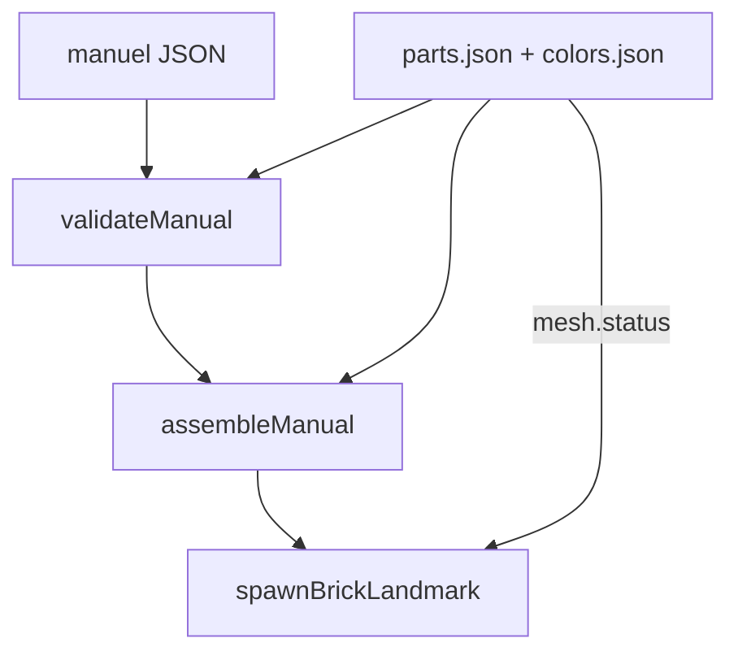

# Plan : catalogue de pièces LEGO (Brick Module Kit)

Sprint : [BRICK-BC1](../sprints/BRICK-BC1.md).  
Contexte : [brick-world-rendering.md](brick-world-rendering.md) · authoring [brick-manual-prompt.md](../design/brick-manual-prompt.md).

## Problème

Le runtime ne connaissait que ~6 formes orthogonal box (`1x1`…`tile`).  
Les notices réelles (BOM fontaine : macaroni #85080, dish #3960, cône #4589b, …) **ne peuvent pas s’exprimer** si le catalogue = « ce qu’on sait déjà mesher ».

## Décision

1. **Catalogue data-first** : IDs design LEGO (et alias courts), dimensions grille, catégorie, statut mesh.  
2. **Authoring ≠ rendu** : un manuel peut référencer toute pièce **présente au catalogue**, même sans mesh final.  
3. **Mesh plus tard** : `mesh.status` = `missing` | `box` | `ready`. Spawn : `box` / `missing` → proxy AABB ; `ready` → asset GPROC/LDraw.  
4. **Croissance** : seed hub + BOM ; import LDraw/Rebrickable hors BC1 (pas de dump 100k pièces dans le repo au jour 1).

## Identifiants

| Champ | Rôle |
| ----- | ---- |
| `id` | Clé stable Brick-Racer = **design LEGO** (ex. `3005`, `85080`) |
| `aliases` | Ids courts legacy (`1x1`, `plate_1x1`) pour manuels BW1 |
| `name` | Libellé anglais type BrickLink |
| `category` | `brick` \| `plate` \| `tile` \| `round` \| `slope` \| `dish` \| `cone` \| `other` |
| `footprint` | `[sx, py, sz]` studs × plates × studs à rot 0 |
| `mesh.status` | Voir ci-dessus |

Couleurs : `id` slug runtime (`gray`, `cyan`) + `blId` BrickLink optionnel + RGB plastique.

## Hors scope BC1

- Import bulk LDraw / API Rebrickable → suite [catalog-lab.md](catalog-lab.md) · sprint [BRICK-CL1](../sprints/BRICK-CL1.md)  
- Meshes courbes (macaroni, dish)  
- Translucidité PBR réelle  
- Éditeur UI catalogue → **CL1** (lab in-app, proxy box W3DTS)  

## Critères de succès

- BOM fontaine : **toutes** les design IDs listées existent au catalogue (même `mesh: missing`)  
- `validateManual` accepte ces ids ; spawn ne crash pas (proxy box)  
- Alias legacy (`1x1`, `gray`, …) toujours valides  
- Ajouter une pièce = une entrée JSON + test, **sans** toucher au moteur  
