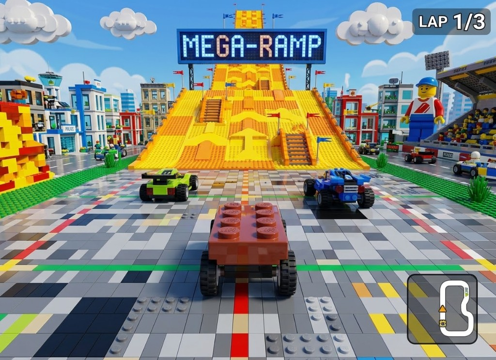
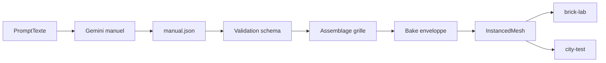

# Plan : rendu monde brick (hub)

Technique pour un hub / city **studdé** réaliste sans une entité GPROC par brique.  
Sprint : [BRICK-BW1](../sprints/BRICK-BW1.md).  
Design : [test-slice.md](../design/test-slice.md), [test-slice-plans.md](../design/test-slice-plans.md).  
Blockout actuel : [test-slice-blockout.md](test-slice-blockout.md) · [BRICK-BO1](../sprints/BRICK-BO1.md).  
Réfs moteur : [w3dts-demos.md](../references/w3dts-demos.md) (Medieval Village / LSR / Lego tile floor).  
**Réf. visuelle rendu** (cible matière / densité, pas le layout slice) : [ref-brick-world-chase.jpg](../design/art/ref-brick-world-chase.jpg).  
**Authoring** : v1 [brick-manual-prompt.md](../design/brick-manual-prompt.md) (Gemini → JSON coordonnées — peu fidèle). **v2** : [brick-decor-pipeline.md](brick-decor-pipeline.md) · [BRICK-DC1](../sprints/BRICK-DC1.md) (couches ASCII → brickify → même manuel runtime).

Branche prévue : `feature/brick-world-hub` depuis `develop`. PR cible : `develop`.

## Référentiel produit (chase)

Ce shot (référentiel antérieur) fixe le **north star** du rendu brick, distinct des canons layout A1/A2/B* du slice :

| Signal | Implication technique |
| ------ | --------------------- |
| Sol = mosaïque de **tiles** studdés (gris / blanc / accents) | Shader studs ou instances plate — pas une box asphalt unie |
| Briques avec **biseaux**, studs lisibles, plastique spéculaire | Catalogue pièces + matériau PBR plastique (pas voxel cube dur) |
| Façades / rampes / tribunes en **assemblage** dense | Instancing par `(part × couleur)` ; colliders grossiers séparés |
| Silhouettes lointaines encore « brick » | LOD / billboards plus tard — studs mesh seulement au near |
| Véhicules brick + UI course | Hors BW1 (déjà kart / HUD) ; le monde suit le même langage |

Le layout `city-test` reste celui de [test-slice-plans](../design/test-slice-plans.md) ; on **transcrit** ce feeling sur fontaine → pad → landmarks.

## Objectif

Remplacer **un par un** les AABB `spawnStaticBox` de `city-test` par des landmarks brick selon le level design, avec une technique **réutilisable** (city produit, puis biomes / piste), en visant la densité / matière du référentiel ci-dessus.

## Problème

| Approche naïve | Échec |
| -------------- | ----- |
| 1× `LegoBrick` GPROC / stud | Bake CPU + entity count explosent |
| Boxes unies (`BO_*`) | Lisibles en blockout, pas le feeling stud / pastel du moodboard |
| Mesh voxel fusionné type Minecraft | Perd joints / tailles de pièces / look LEGO |

W3DTS (mono) fournit déjà : `InstancedMeshComponent` + batching, `MeshLOD`, static merge (LSR), pattern Medieval (instances + impostors), shader stud floor (`LegoTileFloorProceduralPBR`). Brick-Racer a l’échelle canon **1S = 0,33 m** ([test-slice-plans](../design/test-slice-plans.md)).

## Technique retenue : mode d’emploi → assemblage → enveloppe → batch

Gemini n’écrit **pas** de code : il rend un JSON au format imposé (collé à la main dans le repo). Le runtime ne voit que des batches `InstancedMesh` de pièces catalogue — **pas** un mesh Minecraft fusionné.

### Couches

| Distance / rôle | Technique |
| --------------- | --------- |
| Sol / dalles | Shader studs (look Lego tile / pad) — **0 mesh stud** |
| Masse landmarks | Manuel JSON → assemble (plein) → **bake shell** (drop intérieur occlus) → `InstancedMesh` par `(partId × colorId)` |
| Héros proches | Manuels denses (fontaine, arche) ; MeshLOD seulement si un mesh unique est lourd |
| Lointain | Billboard façade / skyline (pattern Medieval) — **après** BW1 |

### Règles dures

- Grille **0,33 / 0,11** (1S / 1P). Coordonnées manuelles = **studs / plates entiers**.
- Collisions = **AABB blockout** actuelles (collider invisible) ; le rendu brick est décoratif jusqu’à preuve contraire.
- **Pas** d’entité ECS par brique : listes de transforms → buffers d’instances au load.
- Shell = cull des briques à **6 voisins remplis** ; on garde l’identité des pièces (pas de merge voxel).
- Shadows : héros limités ; clutter studs `castShadow: false`.
- IDs stables `CITY_TEST_STABLE_IDS` inchangés.

## Authoring

| Fichier | Rôle |
| ------- | ---- |
| [`brick-manual-prompt.md`](../design/brick-manual-prompt.md) | Template prompt Gemini (pièces, étapes, macros, enveloppe) |
| `src/racer/hub/brick/manuals/<id>.manual.json` | Mode d’emploi versionné |
| `manual/manualSchema.ts` | Types + `validateManual` |
| `manual/assembleManual.ts` | Expand macros → `BrickPose[]` + grille d’occupation |
| `manual/bakeShell.ts` | Cull intérieur → rapport `{ total, kept, culled }` |
| `manual/manualToLandmark.ts` | `BrickLandmarkSpec` pour `spawnBrickLandmark` |
| `spawnBrickLandmark.ts` | Batches GPU `InstancedMesh` |
| Niveau `brick-lab` | Orbit + hot-swap manuels + stats shell |

Macros v1 : `brick`, `ring`, `disc`, `wall`, `box` (plein — le bake creuse).

## Ordre de remplacement (aligné LD)

1. **`landmark.fountain`** — premier manuel + pipeline (valide authoring)  
2. **`landmark.pad`** — dalle jaune/noir studs + panneau  
3. **`landmark.gate`** — silhouette coquillage + chaînes  
4. **`landmark.tower`** — tour penchée ±5°  
5. **`landmark.garage` / `vinyle` / `billboard` / `mairie`** — façades modules  

À chaque étape : HUD `brick-lab` puis `city-test`, FPS/`dc`/`tri`, collisions inchangées.

## Infra runtime

- `spawnCityTest` charge `fountain.manual.json` → assemble → shell → `spawnBrickLandmark`.
- EngineBuilder active déjà le batching ; pas de système host supplémentaire pour BW1.
- Qualité : `BrickRacerFast` par défaut ([build.md](../build.md)).

## Hors scope (premier passage / BW1)

- CLI / clé API Gemini (prompt manuel uniquement)  
- Fusion 1×1 → 2×4 au bake  
- Impostors skyline, merge GLB uniques  
- Remplacement `race-test`  
- Enseignes texturées moodboard  

## Critères de succès (plan)

- Fontaine (puis pad) **lisibles** à 10–30 m, palette A1 / chase ; lecture « même famille » que [ref-brick-world-chase](../design/art/ref-brick-world-chase.jpg)  
- `dc` / FPS stables vs boxes (cible ≥60 `BrickRacerFast`)  
- Colliders / IDs stables  
- Un nouveau landmark = nouveau `.manual.json` + validation, sans invention engine  

## Historique

| Date | Note |
| ---- | ---- |
| 2026-10-25 | Consignation technique + ouverture sprint BW1 |
| 2026-10-25 | Ajout réf. visuelle chase `ref-brick-world-chase.jpg` |
| 2026-10-25 | Authoring : prompt → manuel JSON → assemble → bake enveloppe → batch |
| 2026-10-30 | Authoring v2 délégué à [brick-decor-pipeline.md](brick-decor-pipeline.md) (couches + brickify) ; runtime assemble/bake inchangé |
