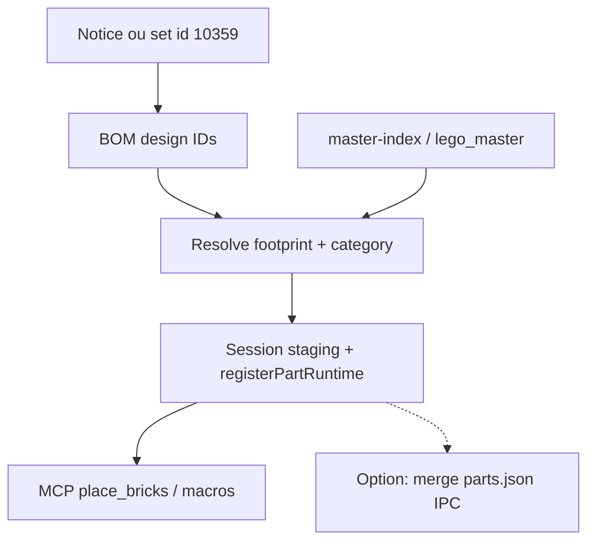
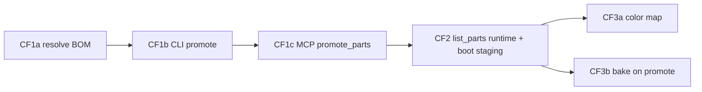

# Plan : couvrir le catalogue LEGO (master → brick-lab)

Contexte : [catalog-lab.md](catalog-lab.md) (CL1–CL5 déjà en place) · [brick-part-catalog.md](brick-part-catalog.md) · agent MCP [brick-lab-agent.md](brick-lab-agent.md).  
Problème déclencheur : set **10359** (~279 design IDs) vs BC1 runtime (~84) + palette éditeur ~12 couleurs.

## Décision

**Ne pas** faire lire le dump master entier par brick-lab / MCP au runtime (mémoire, validation, collisions AABB douteuses, UX).

**Oui** à une chaîne en 3 phases :

| Phase | Objectif | Livrable |
| ----- | ------- | -------- |
| **CF1** | Promo **BOM set** → BC1 (session + optionnel `parts.json`) | Script + outil MCP `promote_set` / `promote_parts` |
| **CF2** | brick-lab / MCP utilisent le **catalogue runtime mutable** (BC1 + staging session) | `list_parts` = runtime ; pas seulement le JSON seed |
| **CF3** | Couleurs + meshes | Palette éditeur étendue ; bake LDraw à la demande pour pièces promo |

Le master (~33k dans `public/catalog/master-index.json`, ~65k full) reste la **source** ; BC1(+staging) reste le **whitelist** pour poser.

## Pourquoi pas « brick-lab = master »

| Risque | Effet |
| ------ | ----- |
| 33k+ pièces dans `isBrickPartId` | Validation / listes MCP énormes |
| Footprints heuristiques | Collisions fausses (plantes, prints, flexible) |
| Pas de couleur set | Pose grise sans mapping BL → slug |
| Meshes absents | Tout en boîte → illisible pour agent vision |

Promo ciblée (BOM) garde un catalogue **petit et intentionnel**, comme CL1 « Add to BC1 ».

---

## CF1 — Promo BOM set → runtime

### Entrées

- `setId` Rebrickable (ex. `10359-1`) **ou** liste d’ids collée / CSV **ou** inventaire extrait notice.
- Source dims : entrée `master-index` si `has_3d` ; sinon skip + rapport « unresolved ».

### Sortie

Pour chaque id résolu : `BrickPartDef` (`mesh.status: "box"`, `ldrawId`, footprint master, catégorie heuristique existante dans [`bc1Staging.ts`](../../src/racer/hub/brick/catalog/bc1Staging.ts)).

1. `registerPartRuntime` (immédiat pour la session).
2. `upsertStaging` (persistance localStorage).
3. Option `--write` / MCP `promote_parts { persist: true }` → IPC merge `parts.json` (déjà CL1e).

### Outils

| Couche | Artefact |
| ------ | -------- |
| CLI | `pnpm catalog:promote-set -- 10359` (ou script `scripts/catalog/promote_set_bom.mjs`) |
| MCP brick-lab | `promote_parts { ids: string[], persist?: boolean }` + `promote_status` (combien runtime / staging / seed) |
| Rapport | `{ promoted, alreadyBc1, unresolved, noFootprint }[]` |

### Hors CF1

- Télécharger inventaire Rebrickable si pas en cache (réutiliser `fetch_sources` / CSV sets) — OK si token/env déjà documenté.
- Poser automatiquement le set (ça reste l’agent / manuel).

### Critères

- `promote 10359` → N≥150 ids runtime (ordre de grandeur inventaire unique) ou rapport clair des manques master.
- Immédiatement après : `place_bricks` accepte un id promu (ex. pièce plant / tile absente du seed).
- `pnpm test` + `pnpm check`.

---

## CF2 — MCP / éditeur = catalogue runtime

Aujourd’hui : seed JSON + `registerPartRuntime` existent, mais MCP `list_parts` / brush peuvent encore raisonner « BC1 seed only ».

### Changements

- `list_parts` MCP → `getRuntimeParts()` (seed ∪ runtime).
- Brick-lab palette / recherche : badge « staging » vs seed (comme catalog-lab).
- Doc skill brick-builder : avant un set, appeler `promote_parts` / CLI, puis construire.

### Critères

- Après promo session (sans write disque), nouvel Electron froid **perd** les pièces sauf staging rechargé au boot brick-lab (charger `readStaging` + `registerPartRuntime` au mount panel — si pas déjà).
- Avec `persist: true`, reboot garde les ids dans `parts.json`.

---

## CF3 — Couleurs set + meshes utiles

### Couleurs

- Mapping BrickLink / LDraw color id → slug runtime (étendre au-delà des ~12 matériaux `BRICK_*`).
- Court terme : table « set 10359 colors → nearest BC1 » dans le rapport de promo.
- Moyen terme : matériaux dynamiques (albedo from `colors.json` large) pour preview + manuels.

### Meshes

- Pour ids promu avec `ldraw_id` : déclencher bake cache (CL5) en arrière-plan ; `mesh.status: ready` quand dispo.
- Agent : après promo, `analyze` / capture restent valides même en box.

### Critères

- Au moins couleurs 10359 fréquentes (white, tan, dark orange, green, trans-light blue) posables sans substitution silencieuse.
- 10 pièces promo du set avec mesh ready en lab.

---

## Ordre d’implémentation recommandé

Sprint ticket suggéré : **BRICK-CF** (Catalog Full / coverage) découpé CF1a–c, CF2, CF3a–b.

## Pilote validation

1. `promote` set **10359**.
2. Agent brick-builder : reconstruire **uniquement la fontaine** avec ids réels du BOM (dishes, rounds, tiles) là où le master a un footprint.
3. Comparer `analyze` BOM vs inventaire notice ; liste `unresolved` = backlog mesh/master.

## Hors scope

- Commit du master JSON 24 Mo / LDraw complet.
- Reproduction pixel-perfect 10359 (prints, flexible, animals).
- MCP packagé hors localhost.

## Historique

| Date | Note |
| ---- | ---- |
| 2026-10-31 | Plan après blocage agent sur 10359 vs BC1 seed |
