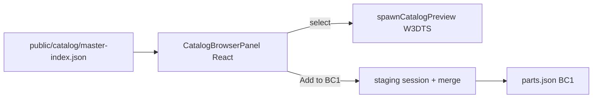
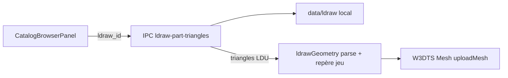
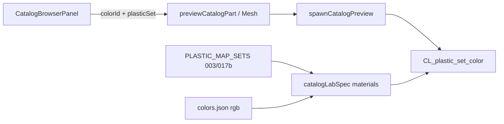
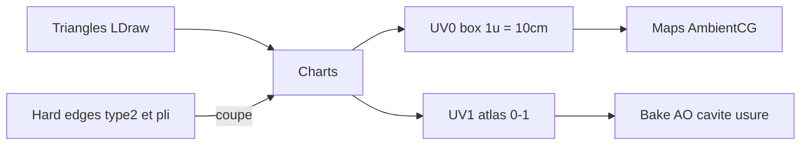
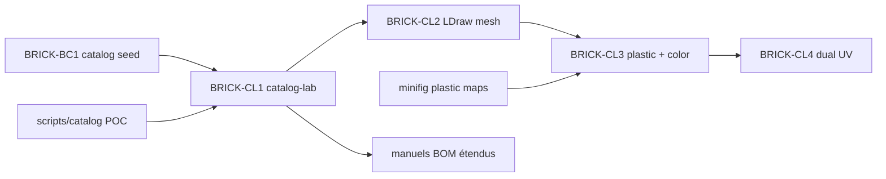

# Plan : Catalog Lab (master Rebrickable×LDraw → BC1)

Sprints : [BRICK-CL1](../sprints/BRICK-CL1.md) · [BRICK-CL2](../sprints/BRICK-CL2.md) · [BRICK-CL3](../sprints/BRICK-CL3.md) · [BRICK-CL4](../sprints/BRICK-CL4.md).  
Contexte : [brick-part-catalog.md](brick-part-catalog.md) (BC1) · pipeline [scripts/catalog/](../../scripts/catalog/) · lab [brick-lab](../sprints/BRICK-BW1.md) (BW1c) · plastique minifig [`plasticMapSets.ts`](../../src/racer/minifig/plasticMapSets.ts).

## Problème

BC1 seed un sous-ensemble de design IDs dans [`parts.json`](../../src/racer/hub/brick/catalog/data/parts.json).  
Le pipeline POC a produit un **master** Rebrickable×LDraw (~65k pièces, ~52 % avec AABB 3D) dans `data/out/` (gitignoré).  
Il manque un **écran in-app** pour consulter ce master, prévisualiser en proxy, et promouvoir une pièce vers BC1 — **sans** autre moteur que W3DTS.

## Décisions

| Choix | Décision |
| ----- | -------- |
| Sources | Master Rebrickable×LDraw **et** pont vers BC1 runtime |
| Surface | Niveau dédié `catalog-lab` + overlay React (pas page HTML hors app) |
| Aperçu 3D | Proxy **`bo_cube`** W3DTS, scale = dims master → mètres (`S` / `P`) |
| Moteur | **W3DTS uniquement** — pas Three.js, pas viewer LDraw externe |
| Données UI | Index léger `public/catalog/master-index.json` (pièces `has_3d` seulement) |
| Persist BC1 | Staging session + merge IPC → `parts.json` (dev) |

## Pipeline données

1. `python scripts/catalog/fetch_sources.py` — Rebrickable CSVs + LDraw complete (local, gitignoré).
2. `python scripts/catalog/build_master_catalog.py` — JSON riche `data/out/lego_master_catalog.json` **+** index navigable `public/catalog/master-index.json`.
3. Index : uniquement `has_3d_model` ; champs `id`, `name`, `category_id`, `ldraw_id`, `footprint` proposé `[sx, py, sz]` (hauteur corps ≈ `round(height_plates - 0.5)` pour retirer le stud AABB).
4. Script npm `catalog:build` documenté dans [build.md](../build.md) / README catalog.

Matching master : `part_mappings.csv` (système `LD`) + `{part_num}.dat` + fallback suffixes print.  
Pas de commit du dump LDraw ni du JSON 24 Mo.

## Niveau `catalog-lab`

- Spec calquée sur brick-lab : sol + soleil + caméra orbitale + matériaux `BRICK_*`.
- **Pas** de manuel fontaine au spawn.
- Registry + SceneDirector + bouton « Catalogue » dans la barre Revue slice.
- URL / storage : `?level=catalog-lab`.

## Preview W3DTS

Module `spawnCatalogPreview` :

- Teardown preview précédent.
- Une boîte `bo_cube` + matériau catalogue (défaut `gray`).
- Taille monde depuis footprint / dims master — **sans** exiger que l’id soit déjà dans BC1 (`partSizeMeters` actuel lève sinon).
- Centre Y = demi-hauteur (posé au sol) pour l’orbite.

API host : `previewCatalogPart({ footprint, colorId? })` · `clearCatalogPreview()`.

## Overlay React

Quand `levelId === 'catalog-lab'` :

- Panneau latéral tokens UI (`--br-paper`, `--br-ink`) — pas glass violet.
- Recherche, filtre catégorie, badge « déjà BC1 ».
- Liste virtualisée (~33k).
- Détail : id, nom, footprint éditable, dims, `mesh.status: box`.
- Clic ligne → preview ; **Ajouter / retirer staging**.
- Pointer-events : panneau capture UI ; canvas reste orbitable à côté.

## Pont BC1

- Staging mémoire + `localStorage` (`brick-racer.bc1-staging`).
- `registerPartRuntime(def)` — index catalogue mutable pour la session.
- **Écrire parts.json** : IPC Electron (preload + main), merge ids uniques, `mesh.status: "box"`, `notes` avec `ldraw_id`. No-op si IPC absent.
- Catégorie BC1 : heuristique nom / cat Rebrickable + override panneau.

## CL2 — Vraie géométrie (conversion à la demande)

Sprint : [BRICK-CL2](../sprints/BRICK-CL2.md).

Le proxy boîte de CL1 ne montre pas la forme des pièces. CL2 convertit à la demande le `.dat` LDraw de la pièce sélectionnée en `Mesh` W3DTS :

Décisions : lecture dans le process main (accès disque), conversion repère dans le renderer, rendu double face, mesh mis en cache par pièce, fallback boîte si la bibliothèque est absente (build packagée) ou si la pièce dépasse le plafond de triangles. Rien d’exporté dans le repo. Normales lissées avec arêtes dures (lignes type 2 + seuil de pli).

## CL3 — Plastique AmbientCG + couleur diffuse

Sprint : [BRICK-CL3](../sprints/BRICK-CL3.md).

Le preview CL2 reste en `BRICK_gray` (PBR plat). CL3 réutilise les **matériaux plastique déjà fournis** pour le minifig-lab (`003` / `017b` : normal + roughness) **sans** leur texture de diffuse (`*-color.webp` non utilisés) ; l’albedo est une **couleur diffuse choisie** dans le catalogue BC1 (`colors.json`).

Décisions :

| Choix | Décision |
| ----- | -------- |
| Scope | `catalog-lab` seulement |
| Sets | `003` \| `017b` \| `off` (`off` = teinte ABS sans maps AmbientCG) |
| Couleurs | ids BC1 (`white`, `gray`, `cyan`, …) |
| Diffuse | `baseColor` = rgb catalogue ; **pas** de `plastic*-color.webp` |
| Prints | `usePrint: 0` (pas de décal minifig sur les pièces catalogue) |
| Ids matériau | `CL_plastic_{set}_{colorId}` pré-enregistrés (combos set × couleur) |
| UV LDraw | Provisoire CL3 : planaires `u = gx * 10`, `v = gy * 10`. Remplacées par [CL4](../sprints/BRICK-CL4.md) |

## CL4 — UV homogènes (plastique + atlas pièce)

Sprint : [BRICK-CL4](../sprints/BRICK-CL4.md).

LDraw ne fournit pas d’UV. La projection CL3 (`u = gx * 10`, `v = gy * 10`) écrase les faces horizontales (bandes) et stocke une UV par groupe de lissage, donc interpole deux axes au même sommet. CL4 écrit **deux canaux** dans le stride W3DTS (UV0 offsets 3–4, UV1 offsets 5–6).

Décisions :

| Choix | Décision |
| ----- | -------- |
| Charts | Triangles connexes par une arête **lisse** et de **même axe** de projection |
| Coutures | Uniquement sur une arête dure (ligne type 2 ou pli > `LDRAW_CREASE_DEG`), ou sur un changement d’axe sans arête dure (dôme) |
| UV0 | Projection box ortho, densité fixe 1 unité = 10 cm (`MINIFIG_UV_METERS_PER_CELL`). Plastique répétable. Tangentes alignées sur U/V |
| UV1 | Même charts, packés dans `[0,1]²` sans recouvrement. Support des effets par pièce (AO, cavité, usure) — pas tuilé |
| Shader | `GetUV` lit UV0. UV1 est écrit ; le bake vieillissement viendra après |
| Grille | Le bouton Grille UV prévisualise UV0 |

## Hors scope

- Export préalable des meshes LDraw / disponibilité en build packagée (CL2 = dev uniquement).
- Remplacement manuels / fontaine ; `mesh.status: ready` dans les landmarks.
- Commit `data/ldraw` ou dump master complet.
- Coque UI produit (title / hub) — catalog-lab = outil lab / authoring.
- Brancher les mats plastic sur `spawnBrickLandmark` / mondes / minifigs / véhicules.
- Utiliser les `plastic*-color.webp` comme albedo.
- Édition runtime des propriétés matériau W3DTS.
- Bibliothèque de dépliage type xatlas.
- Bake AO / taches / usure d’arêtes (lit UV1, sprint suivant).
- Lecture shader du second canal UV si `GetUV` n’expose pas de set.

## Critères de succès

| Boucle | Succès |
| ------ | ------ |
| Index | `master-index.json` généré ; fetchable depuis l’app |
| Lab | `catalog-lab` charge ; orbit OK |
| Preview | Recherche `3001` / `85080` → boîte / mesh aux bonnes proportions |
| Plastique | Set `003`/`017b` : grain + normal visibles ; albedo = couleur choisie (pas la map color AmbientCG) |
| Couleur | Changer `cyan` / `yellow` / … recolorie la preview sans recharger le niveau |
| UV | Grille UV : densité homogène sur le dessus comme sur les côtés ; coutures dans les plis, pas au milieu des faces |
| BC1 | Add staging → badge ; write merge → entrée dans `parts.json` |
| Moteur | Aucune dépendance 3D hors W3DTS |
| Régression | `brick-lab`, `city-test`, H1, minifig-lab inchangés |

## Dépendances

