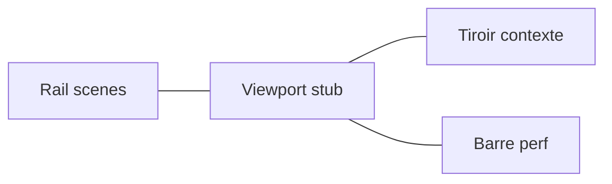

# Plan : Atelier dev (maquette HTML hors application)

Sprint : [BRICK-UIM2](../sprints/BRICK-UIM2.md).  
Contexte : HUD « Revue slice » dans [`src/renderer/main.tsx`](../../src/renderer/main.tsx) (`.br-review`) · slices dans [`src/racer/levels/registry.ts`](../../src/racer/levels/registry.ts) · écrans joueur [ui-ux.md](../design/ui-ux.md) · maquettes [../mocup/](../mocup/) ([BRICK-UIM1](../sprints/BRICK-UIM1.md)).

**Brick Racer n’est pas affilié à The LEGO Group ni à Nintendo.**

## Problème

La revue blockout est une colonne de boutons en haut à gauche : les six ids (`race-test`, `city-test`, `sandbox-kart`, `brick-lab`, `catalog-lab`, `minifig-lab`), plus véhicule, cylindrée, texture debug et une seule ligne de perf. Ça ne scale pas, et ce n’est pas le ton des maquettes joueur.

Le shell produit (title, hub, course, garage) reste celui de [ui-ux.md](../design/ui-ux.md). L’atelier est une **coque de développement**, pas un écran MVP.

## Décisions

| Choix | Décision |
| ----- | -------- |
| Premier livrable | Page HTML autonome, **zéro fichier sous `src/`** |
| Emplacement | [`docs/mocup/atelier.html`](../mocup/atelier.html), CSS et JS dans le fichier (`file://` suffit) |
| Routeur joueur | Pas d’écran `#atelier` dans [`nav.js`](../mocup/js/nav.js). Lien classique depuis l’index |
| Visuel | Tokens [ui-ux.md](../design/ui-ux.md) §2 (plaque paper, encre, stud yellow, orange garage, mint, Fredoka / Nunito, radius 4–8 px). Pas de glass violet |
| Viewport | Dégradé stub, pas de WebGPU |
| Données | Locales à la page. Pas de query string, pas de `localStorage` |
| Catalogue | Cadre vide : le browser React n’est pas redessiné |
| Port Electron | Après validation visuelle. Hors [BRICK-UI1](../sprints/BRICK-UI1.md) (coque joueur) |

## Layout

- **Rail gauche** (~280 px). Groupes **Pistes** (`race-test`, `city-test`, `sandbox-kart`) et **Labs** (`brick-lab`, `catalog-lab`, `minifig-lab`). Carte = bande d’accent, titre, une ligne de rôle, touche `1`–`6`. Active = filet stud yellow. Repli en colonne d’icônes (~56 px) via bouton et touche `` ` ``.
- **Viewport** : dégradé selon la famille (asphalte course, plaza ville, studio lab). Nom de la slice en display, coin haut. Le centre reste vide.
- **Tiroir droit** (~320 px), selon la scène :
  - Pistes : véhicule, 50/100/150 cc, vitesse et drift fictifs, rappel WASD.
  - `brick-lab` : manuel Fontaine, enveloppe / plein, compteur de briques fictif.
  - `catalog-lab` : le tiroir est le catalogue (recherche, liste, fiche, actions épinglées). Plastique par défaut `017B`.
  - `minifig-lab` : orbit, aucun contrôle dédié (comme le HUD actuel).
  - Rangée commune : texture grille / unis, qualité `fast` / `showcase`, avec la mention que ces deux réglages rechargent la page dans l’app.
- **Barre basse** : chips séparés (fps, ms, résolution, draw calls, tris visibles/total, qualité), chiffres tabulaires fictifs.

Accents : jaune piste, mint ville, orange lab.

## Fichiers de la maquette

- [`docs/mocup/atelier.html`](../mocup/atelier.html) — la page.
- [`docs/mocup/index.html`](../mocup/index.html) — carte « Atelier dev » (lien vers `atelier.html`, pas une ancre du routeur).
- [`docs/mocup/README.md`](../mocup/README.md) — une ligne pour ouvrir `atelier.html`.

## Port React (fait)

- [`src/renderer/atelier/AtelierShell.tsx`](../../src/renderer/atelier/AtelierShell.tsx) remplace la barre « Revue slice ».
- Métadonnées rail : `levelGroup` / `levelShortTitle` / `levelRole` / `levelAccent` dans [`registry.ts`](../../src/racer/levels/registry.ts).
- `CatalogBrowserPanel` en `embedded` dans le tiroir catalogue, widgets design system (`br-atelier-input` / `select` / `chip` / `meta` / `empty`).

## Hors de ce plan

- Écrans joueur (`#title`, `#hub`, `#race-hud`), [`nav.js`](../mocup/js/nav.js), HUD de course produit ([BRICK-UI1](../sprints/BRICK-UI1.md)).
