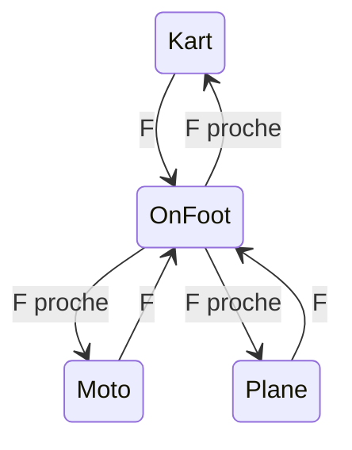

# Plan : hub blockout — descendre, marcher, changer de véhicule

Sprint : [BRICK-H1](../sprints/BRICK-H1.md).  
Blockout ville : [test-slice-blockout.md](test-slice-blockout.md) · [BRICK-BO1](../sprints/BRICK-BO1.md).  
Minifig : [minifig-gproc.md](minifig-gproc.md) · [BRICK-MF1](../sprints/BRICK-MF1.md).  
Circulation GDD (pied + scooter, plus tard) : [gdd.md](../design/gdd.md) § Circulation hub · [vehicle-prototypes.md](vehicle-prototypes.md) VP1.

Branche : `feature/hub-on-foot` depuis `develop`. PR cible : `develop`.

## Objectif

Sur `city-test` seulement : commencer assis dans le kart, descendre, marcher avec la minifig Bolt, monter dans le kart, la moto ou l’avion garés sur la place. `race-test` garde une possession unique via `?vehicle=`.

Pas d’animation de pas : pose debout, yaw avec le déplacement. Pas de scooter (VP1 / `BRICK-V1`).

## Comportement

- Spawn : kart au sud de la fontaine, moto à l’ouest, avion à l’est (ailes ~4 m, hors garage `x≥28` et boutique `x≤10`). Les trois sont jouables. `?vehicle=` ne choisit pas le véhicule de départ du hub (toujours le kart).
- **F** au volant : descente à droite du châssis (~1,6 m). WASD marche (~3,5 m/s), gravité, chase sur l’avatar. Les trois véhicules ne prennent plus les gaz ; celui quitté garde son élan.
- **F** à pied : le châssis le plus proche sous ~2,2 m est pris. Sinon rien.
- **X** : reset du véhicule conduit (comportement actuel). À pied, retour à côté du kart, sans y remonter.
- Capsules conducteur (`KartDriver`, `MotoDriver`, `PlaneCockpit`) masquées dans le hub. La minifig debout les remplace, pieds au niveau du siège.

## Possession

Module `src/racer/hub/hubPossession.ts` : état `foot | kart | moto | plane`, actif seulement quand `SceneDirector` charge `city-test`. Fonctions pures : choix de la cible (distance) et « ce châssis a le droit aux gaz ».

Les trois kits sont spawnés `playable: true` (physique + script `kart_drive_arcade`). Le graphe applique WASD à chaque entité liée, et il tourne après la physique (`createScriptsSystem` en `addSystem` dans [`bootEngine.ts`](../../src/racer/host/bootEngine.ts)). Un gate, enregistré après les scripts, remet `throttle` et `steer` à 0 sur les véhicules non possédés. Au frame suivant, `createVehicleSystem` ne les entraîne plus.

`createArcadeKartSystem` ne fige plus le châssis du boot : un getter renvoie le châssis possédé, ou `null` à pied. `createArcadePlaneSystem` est toujours enregistré et ne simule que si l’avion est possédé (aujourd’hui il n’existe que si `?vehicle=plane` au boot). Sur `race-test`, le getter retombe sur `?vehicle=`.

## Avatar

- Entité `HubAvatar` : rigid body dynamique, boîte ~0,45 × 1,7 × 0,35, groupe `0x0020`, masque sol + murs + châssis ([`collisionGroups.ts`](../../src/racer/levels/shared/collisionGroups.ts)). Le masque châssis inclut ce groupe (bit inutilisé en course).
- `assembleMinifigEntities(BOLT_RECIPE)` : root `minifig.c01-bolt` enfant de `HubAvatar`. Graphes `MINIFIG_GPROC_GRAPHS` et matériaux de teinte mergés dans la spec, comme `minifigLabSpec`.
- `createGProcSystem` ne tourne aujourd’hui que pour `sandbox-kart`. L’activer aussi pour `city-test`.
- Assis : avatar kinématique, masque de collision à 0, position copiée sur le siège après la physique et avant la chase cam. À pied : dynamique, masque restauré.
- Caméra `FootChaseCamera` (plus proche que le kart). `rebindChaseCamera` la prend à pied, sinon la chase du véhicule possédé.

## Entrée

La map `gameplay` ne peut pas gagner d’action nouvelle ([`arcadeMkDriveInput.ts`](../../src/racer/host/arcadeMkDriveInput.ts)). **F** est lu comme C/V pour le couteau de l’avion : touche clavier, plus bouton pad Y (index 3). E reste libre pour les prompts hub.

`data-possession` sur le canvas (`kart` / `moto` / `plane` / `foot`) et la ligne de log du `SceneDirector` indiquent le mode.

## Hors scope

Marche animée, scooter, prompts React, interaction garage, changement de véhicule sur `race-test`, texture de grille (`?debugTex=` reste opt-in).

## Historique

| Version | Date | Note |
| ------- | ---- | ---- |
| 1.0 | 2026-10-25 | Création : pied + échange kart / moto / avion sur `city-test` |
