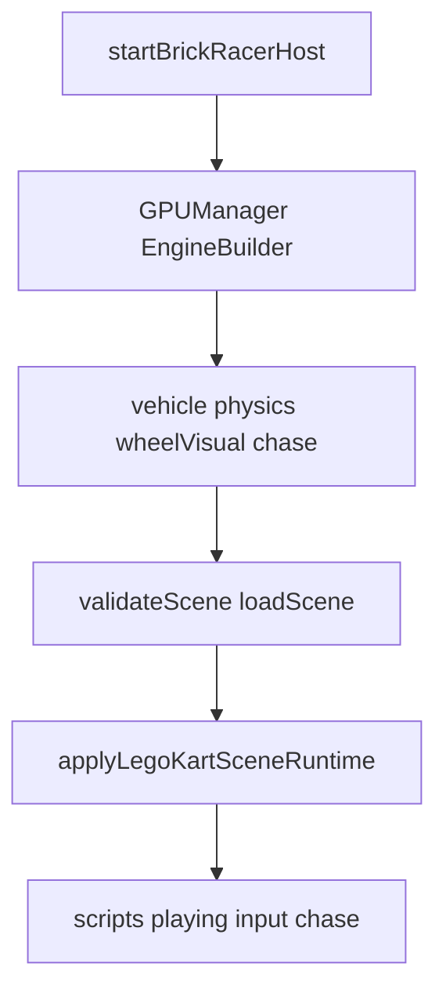

# Plan : host Lego Kart (Brick Racer)

Porter la démo **Lego Kart** du monorepo w3dts dans la coque Electron Brick Racer. Références détaillées : [w3dts-demos.md](../references/w3dts-demos.md). Sprint : [BRICK-B2](../sprints/BRICK-B2.md).

## Objectif

Remplacer le stub [`src/racer/host/startBrickRacerHost.ts`](../../src/racer/host/startBrickRacerHost.ts) par un boot moteur jouable : SceneDD `lego-kart.json`, conduite WASD, reset X, caméra chase.

Motocross Madness reste **hors scope** (référence secondaire pour un sprint ultérieur).

## Approche

Extraire la logique viewer (`LegoKartProject` + `legoKartSceneRuntime` + looks) vers `src/racer/`, copier les assets publics kart dans `public/`, ajouter les paquets npm SceneDD / loaders / scripts. Ne pas dépendre du package `@naanouff/w3dts-viewer` (non publié pour ce client) : copier le code nécessaire.

## Ordre d’extraction

1. **Boot moteur** — `GPUManager`, `EngineBuilder`, stack `createVehicleSystem` → physics `KART_PHYSICS_PRESET` → `createVehicleWheelVisualSystem` → `createChaseCameraSystem` (miroir scene-viewer).
2. **Deps npm** — `w3dts-scenedd`, `w3dts-loaders` (et/ou `loader-scenedd`), `w3dts-scripts` ; `character` si strip moteurs.
3. **Assets** — copier sous `public/` : `scenes/lego-kart.json`, `script-graphs/kart-drive.json`, `graphs/StandardLitGraphKart.json`, `shader-graphs/LegoTileFloorProceduralPBR.json`, gproc kart (4 fichiers).
4. **Load SceneDD** — `validateScene` + équivalent `loadSceneIntoEngine` (pattern `SceneIO` viewer).
5. **Runtime** — porter `applyLegoKartSceneRuntime` / `pinLegoKartLitGraph` / looks sol et roues dans `src/racer/`.
6. **Chase + input** — rebind `KartChaseCamera`, `setGameViewCameraPreference('chase')`, gameplay map, reset session (X).
7. **Validation** — `pnpm check`, `pnpm test`, `pnpm dev` (conduite).

## Hors scope

- Motocross / `w3dts-terrain` / FastNoiseLite / gproc moto.
- Build web / Vercel.
- HUD vitesse editor, Play Mode Stop→restore complet, multiplayer.
- Tag release (bump version au moment de la livraison host, pas dans la doc seule).
