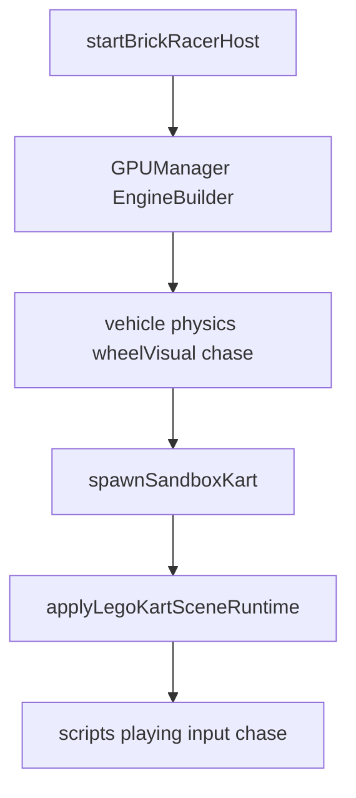

# Plan : host Lego Kart (Brick Racer)

Porter la démo **Lego Kart** du monorepo w3dts dans la coque Electron Brick Racer. Références détaillées : [w3dts-demos.md](../references/w3dts-demos.md). Sprint : [BRICK-B2](../sprints/BRICK-B2.md). Ladder véhicules (VP0) : [vehicle-prototypes.md](vehicle-prototypes.md). Bible tech : [architecture.md](architecture.md) (état `SandboxKart`, SceneDirector minimal).

## Objectif

Remplacer le stub [`src/racer/host/startBrickRacerHost.ts`](../../src/racer/host/startBrickRacerHost.ts) par un boot moteur jouable : **level TypeScript** `sandboxKart` (spawn ECS, **pas de SceneDD**), conduite WASD, reset X, caméra chase.

Motocross Madness reste **hors scope** (référence secondaire pour un sprint ultérieur).

## Approche

Extraire la logique viewer (`LegoKartProject` + `legoKartSceneRuntime` + looks) vers `src/racer/`, copier les assets publics kart (gproc / shaders / lit / script) dans `public/`, dépendre de `w3dts-scripts` (+ gproc déjà npm). **Pas** `@naanouff/w3dts-scenedd` ni `@naanouff/w3dts-viewer`.

## Ordre d’extraction

1. **Boot moteur** — `GPUManager`, `EngineBuilder`, stack `createVehicleSystem` → physics `KART_PHYSICS_PRESET` → `createVehicleWheelVisualSystem` → `createChaseCameraSystem`.
2. **Deps** — `w3dts-scripts` via mono alias ; gproc / physics / core déjà npm. **Pas de SceneDD.**
3. **Assets** — `script-graphs/kart-drive.json`, `graphs/BrickRacerFast.json` (défaut : opaques + ciel + transparents + tonemap, sans ombres / AO / SSR / bloom / FXAA ; `?render=showcase` → `graphs/StandardLitGraphKart.json`, voir `src/racer/host/renderQuality.ts`), shader-graphs, gproc kart ×4 sous `public/`.
4. **Level TS** — [`src/racer/levels/sandboxKart/`](../../src/racer/levels/sandboxKart/) : spec + `spawnSandboxKart` (materials, graphs, ECS).
5. **Runtime** — `applyLegoKartSceneRuntime` / looks sol et roues.
6. **Chase + input** — rebind `KartChaseCamera`, script play state, reset session (X).
7. **Hooks architecture** — `SceneDirector` minimal + host `flow.getState() === 'SandboxKart'`.
8. **Validation** — `pnpm check`, `pnpm test`, `pnpm dev` (conduite).

## Hors scope

- Motocross / `w3dts-terrain` / FastNoiseLite / gproc moto.
- Pack JSON maison courses/hub (éventuel plus tard).
- Build web / Vercel.
- HUD vitesse editor, Play Mode Stop→restore complet, multiplayer.
- Boucle course (tours, items, IA) → [BRICK-B3](../sprints/BRICK-B3.md).
- Tag release (bump version au moment de la livraison host, pas dans la doc seule).

