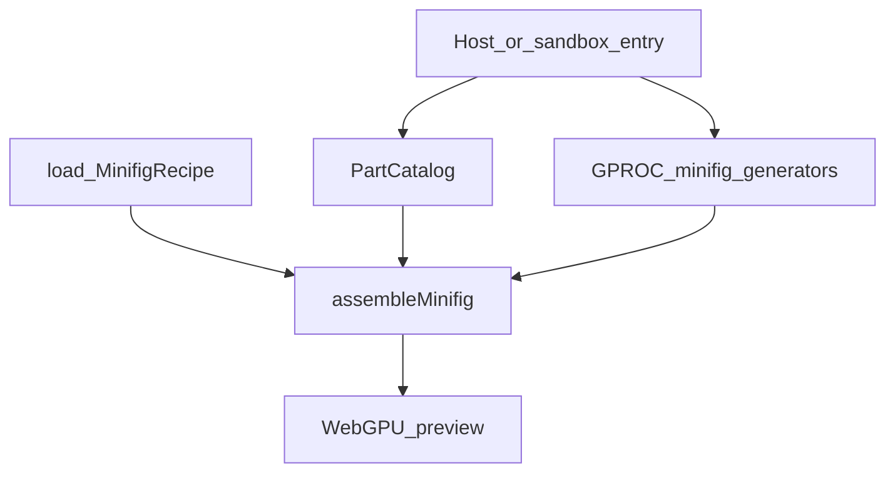

# Plan : fondation minifig GPROC (Brick Racer)

Porter un **pipeline minifig procédural** (GPROC + recettes) dans la coque Electron, en amont de la boutique P3.  
Design : [../design/minifig-gproc.md](../design/minifig-gproc.md). Sprint : [../sprints/BRICK-MF1.md](../sprints/BRICK-MF1.md).  
Réfs GPROC kart : [../references/w3dts-demos.md](../references/w3dts-demos.md).

## Objectif

Livrer un **sandbox minifig** jouable en preview : assembler tête + torso + jambes (+ coiffe / accessoire si ready) via GPROC, charger une **recipe** (ex. preset Bolt), swap de pièces depuis un panneau debug / stub UI. **Pas** la boutique hub Vinyle complète (P3).

## Approche

1. **Schéma recipe** — TypeScript + JSON schema / types (`MinifigRecipe`, slots).  
2. **Catalogue** — ids pièces v0 (basic head / torso / legs / cap / wrench).  
3. **Generators GPROC** — JSON sous `public/gproc/minifig-*` (miroir pattern kart).  
4. **Assembleur** — `assembleMinifig(recipe)` → entités / meshes dans le moteur.  
5. **Sandbox host** — entrée debug (flag / écran) : load recipe Bolt, boutons swap.  
6. **Docs** — chemins assets, comment ajouter une pièce / recipe.

## Hors scope

- Boutique hub / POI Vinyle (P3).  
- 40 recettes complètes (1–2 presets suffisent pour MF1).  
- Chargement `*.glb` Meshy en runtime.  
- Animation lokomotric / course (sockets OK ; anim full plus tard).  
- Atlas face prints final (1–2 prints stub OK).

## Ordre d’implémentation

Voir tickets [BRICK-MF1](../sprints/BRICK-MF1.md) : MF1a → … → MF1f.
