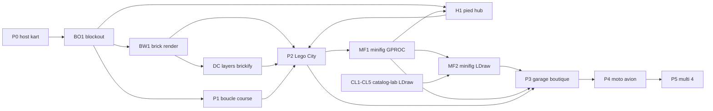

# Roadmap produit — Brick Racer

Vision : [../design/vision.md](../design/vision.md). Ton : [../design/tone.md](../design/tone.md).

Séquence : **course jouable d’abord**, puis **Lego City hub**, puis **custom** (garage + boutique), puis **autres véhicules**, puis **multi**.

| Phase | Contenu | Doc / sprint |
| ----- | ------- | ------------ |
| **P0** | Host kart jouable (SceneDD + raycast) | [lego-kart-host.md](lego-kart-host.md) · [BRICK-B2](../sprints/BRICK-B2.md) |
| **UI** | Maquettes HTML puis coque React (tokens, HUD) — parallèle P0/P1. Atelier dev = maquette HTML à part | [ui-ux.md](../design/ui-ux.md) · [dev-atelier.md](dev-atelier.md) · [mocup/](../mocup/) · [BRICK-UIM1](../sprints/BRICK-UIM1.md) → [BRICK-UI1](../sprints/BRICK-UI1.md) · [BRICK-UIM2](../sprints/BRICK-UIM2.md) |
| **BO1** | Blockout `race-test` + `city-test` (TS levels) | [test-slice-blockout.md](test-slice-blockout.md) · [BRICK-BO1](../sprints/BRICK-BO1.md) |
| **P1** | Boucle course solo minimale (1 piste, règles de base) + binding HUD | [BRICK-B3](../sprints/BRICK-B3.md) · consomme UI1c · après BO1 |
| **H1** | Hub blockout : descendre, marcher (minifig), changer kart / moto / avion sur `city-test` | [hub-on-foot.md](hub-on-foot.md) · [BRICK-H1](../sprints/BRICK-H1.md) · après BO1 + MF1 |
| **BW1** | Rendu brick hub : manuel JSON → enveloppe → batch ; fontaine + brick-lab + pad | [brick-world-rendering.md](brick-world-rendering.md) · [BRICK-BW1](../sprints/BRICK-BW1.md) · [brick-manual-prompt.md](../design/brick-manual-prompt.md) · après BO1 |
| **DC** | Authoring décors : couches ASCII → brickify déterministe → manuels ; ortho + overlay brick-lab | [brick-decor-pipeline.md](brick-decor-pipeline.md) · [BRICK-DC1](../sprints/BRICK-DC1.md) · après BW1 ; débloque pad / gate / façades pour P2 |
| **P2** | **Lego City hub** explorabile + pads courses / défis | Sprint ultérieur · overlays UI1d · s’appuie sur H1 + BW + DC |
| **MF1** | Fondation minifig GPROC (generators + recipe + sandbox preview) | [minifig-gproc.md](minifig-gproc.md) · [BRICK-MF1](../sprints/BRICK-MF1.md) · avant / amont P3 |
| **MF2** | Bolt en pièces LDraw (canon mesh catalogue, scale 2,1 m) | [minifig-ldraw.md](minifig-ldraw.md) · [BRICK-MF2](../sprints/BRICK-MF2.md) · après MF1 + CL2 |
| **P3** | **Garage** + **boutique** (custom véhicule + minifig) dans la ville | Sprint ultérieur · consomme UI1e + MF1 / MF2 |
| **P4** | Moto (Motocross) + avion (nouveau) | Réfs [w3dts-demos.md](../references/w3dts-demos.md) |
| **P5** | Multi lobby + course 2–4 (P2P) | Pattern ChessMaster |

## Notes

- P0 ne livre pas le hub : la fondation w3dts (conduite) débloque tout le reste.
- **BO1** livre le géométrie blockout `race-test` / `city-test` (TS) avant la boucle P1 ; le hub gameplay reste P2.
- **H1** ajoute la marche et l’échange kart / moto / avion sur `city-test`. Pads, POI et scooter restent P2 / VP1.
- **BW1** prouve le rendu brick (instances) sur le blockout hub ; P2 étend la city avec le même kit.
- **DC** remplace l’authoring Gemini→JSON coordonnées (peu fidèle) par couches ASCII + brickify ; DC1 = mesure + convertisseur ; DC2+ = prompts et production pad / gate / façades.
- **UIM1** (HTML `docs/mocup`) valide le visuel joueur ; **UI1** (React) porte ensuite ; les deux peuvent coexister en parallèle de P0. Binding data : P1–P3.
- **UIM2** valide la coque dev (lanceur de slices) en HTML hors app ([dev-atelier.md](dev-atelier.md)). Le port dans la barre Revue slice vient après, hors UI1.
- P2 livre la **ville** ; P3 branche les intérieurs / UI custom sur les POI.
- **MF1** pose le pipeline minifig GPROC (sandbox) ; **MF2** remplace le mesh Bolt par LDraw (après CL). P3 branche la boutique Vinyle dessus. MF1 peut démarrer dès B2 sans attendre P2.
- Motocross et avion ne bloquent pas le hub ; ils enrichissent garage + pads.
- Les sprints concrets (BRICK-Bn / BRICK-UI*) se découpent à l’ouverture de chaque phase.
