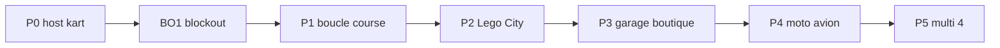

# Roadmap produit — Brick Racer

Vision : [../design/vision.md](../design/vision.md). Ton : [../design/tone.md](../design/tone.md).

Séquence : **course jouable d’abord**, puis **Lego City hub**, puis **custom** (garage + boutique), puis **autres véhicules**, puis **multi**.

| Phase | Contenu | Doc / sprint |
| ----- | ------- | ------------ |
| **P0** | Host kart jouable (SceneDD + raycast) | [lego-kart-host.md](lego-kart-host.md) · [BRICK-B2](../sprints/BRICK-B2.md) |
| **UI** | Maquettes HTML puis coque React (tokens, HUD) — parallèle P0/P1 | [ui-ux.md](../design/ui-ux.md) · [mocup/](../mocup/) · [BRICK-UIM1](../sprints/BRICK-UIM1.md) → [BRICK-UI1](../sprints/BRICK-UI1.md) |
| **BO1** | Blockout `race-test` + `city-test` (TS levels) | [test-slice-blockout.md](test-slice-blockout.md) · [BRICK-BO1](../sprints/BRICK-BO1.md) |
| **P1** | Boucle course solo minimale (1 piste, règles de base) + binding HUD | [BRICK-B3](../sprints/BRICK-B3.md) · consomme UI1c · après BO1 |
| **P2** | **Lego City hub** explorabile + pads courses / défis | Sprint ultérieur · overlays UI1d |
| **P3** | **Garage** + **boutique** (custom véhicule + minifig) dans la ville | Sprint ultérieur · consomme UI1e |
| **P4** | Moto (Motocross) + avion (nouveau) | Réfs [w3dts-demos.md](../references/w3dts-demos.md) |
| **P5** | Multi lobby + course 2–4 (P2P) | Pattern ChessMaster |

## Notes

- P0 ne livre pas le hub : la fondation w3dts (conduite) débloque tout le reste.
- **BO1** livre le géométrie blockout `race-test` / `city-test` (TS) avant la boucle P1 ; le hub gameplay reste P2.
- **UIM1** (HTML `docs/mocup`) valide le visuel ; **UI1** (React) porte ensuite ; les deux peuvent coexister en parallèle de P0. Binding data : P1–P3.
- P2 livre la **ville** ; P3 branche les intérieurs / UI custom sur les POI.
- Motocross et avion ne bloquent pas le hub ; ils enrichissent garage + pads.
- Les sprints concrets (BRICK-Bn / BRICK-UI*) se découpent à l’ouverture de chaque phase.
