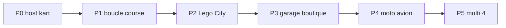

# Roadmap produit — Brick Racer

Vision : [../design/vision.md](../design/vision.md). Ton : [../design/tone.md](../design/tone.md).

Séquence : **course jouable d’abord**, puis **Lego City hub**, puis **custom** (garage + boutique), puis **autres véhicules**, puis **multi**.

| Phase | Contenu | Doc / sprint |
| ----- | ------- | ------------ |
| **P0** | Host kart jouable (SceneDD + raycast) | [lego-kart-host.md](lego-kart-host.md) · [BRICK-B2](../sprints/BRICK-B2.md) |
| **P1** | Boucle course solo minimale (1 piste, règles de base) | Sprint ultérieur |
| **P2** | **Lego City hub** explorabile + pads courses / défis | Sprint ultérieur |
| **P3** | **Garage** + **boutique** (custom véhicule + minifig) dans la ville | Sprint ultérieur |
| **P4** | Moto (Motocross) + avion (nouveau) | Réfs [w3dts-demos.md](../references/w3dts-demos.md) |
| **P5** | Multi lobby + course 2–4 (P2P) | Pattern ChessMaster |

## Notes

- P0 ne livre pas le hub : la fondation w3dts (conduite) débloque tout le reste.
- P2 livre la **ville** ; P3 branche les intérieurs / UI custom sur les POI.
- Motocross et avion ne bloquent pas le hub ; ils enrichissent garage + pads.
- Les sprints concrets (BRICK-Bn) se découpent à l’ouverture de chaque phase.
