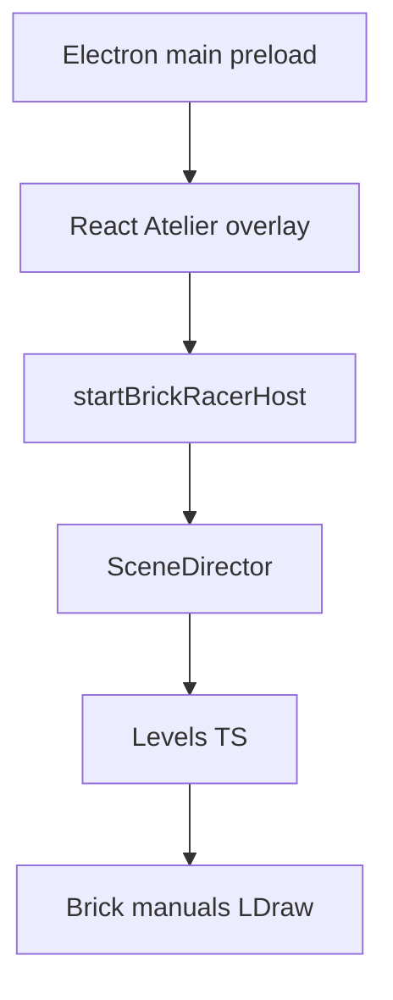

# État des lieux — Brick Racer

Snapshot **2026-10-31**. Complète [roadmap.md](roadmap.md) et [architecture.md](architecture.md) (ces docs peuvent être en retard sur le code — voir § Docs en retard).

Course / aventure **full brick**, non officielle (pas affiliée à LEGO ni Nintendo). Hub Lego City, custom kart / minifig, courses solo puis multi jusqu’à 4. Ton 16+. Auteur : Cyril TARRIET. Version package : **0.1.0** (note de release = amorçage seulement ; le code a largement dépassé ça).

Vision : [../design/vision.md](../design/vision.md). Roadmap : [roadmap.md](roadmap.md). Index docs : [../README.md](../README.md).

## Stack et layout

- **Electron 35 + React 19 + TypeScript**, bundlé par electron-vite. WebGPU obligatoire (D3D12 sous Windows). Pas de build web.
- Moteur **W3DTS** (`@naanouff/w3dts-*`). Plusieurs paquets (scripts, gproc, physics, input) sont aliasés vers un checkout sibling du monorepo — voir [../build.md](../build.md).
- **Pas de SceneDD.** Un level = un module TypeScript sous [`src/racer/levels/`](../../src/racer/levels/). UI React = overlay sur le canvas.
- pnpm 10. Scripts : `dev`, `check`, `test` (Vitest, ~47 fichiers), `dist` (NSIS Windows). CI : [`.github/workflows/ci.yml`](../../.github/workflows/ci.yml) (`pnpm check` + `pnpm test` + politique semver).
- Données locales gitignorées : `data/ldraw/`, `data/ldraw-cache/`, `data/rebrickable/`.

Couches code :

| Chemin | Rôle |
| ------ | ---- |
| [`src/main/`](../../src/main/) | Fenêtre, IPC LDraw, cache bake, écriture manuels, miniatures |
| [`src/preload/`](../../src/preload/) | Pont IPC |
| [`src/renderer/`](../../src/renderer/) | Atelier (HUD dev), catalogue, panneau Construire |
| [`src/racer/host/`](../../src/racer/host/) | Boot moteur, input arcade, qualité rendu |
| [`src/racer/levels/`](../../src/racer/levels/) | 6 slices |
| [`src/racer/hub/brick/`](../../src/racer/hub/brick/) | Catalogue, manuels, couches, landmarks |
| [`src/racer/minifig/`](../../src/racer/minifig/) | Recipe + assemblage LDraw |
| [`src/racer/vehicles/`](../../src/racer/vehicles/) | Kart arcade, avion |
| [`docs/`](../) | GDD, plans, sprints, maquettes HTML [`docs/mocup/`](../mocup/) |

Lancer : `pnpm install` puis `pnpm dev`. Boot par défaut : `race-test`. WASD, Espace drift, X reset, gamepad style MK.

## Ce qui tourne aujourd’hui

Six levels dans [`src/racer/levels/registry.ts`](../../src/racer/levels/registry.ts). Défaut : `race-test`. Choix HUD persisté (`brick-racer.levelId`).

- **Pistes** : `race-test` (ovale blockout), `city-test` (hub blockout, pied + échange kart / moto / avion), `sandbox-kart`
- **Labs** : `brick-lab` (manuels + éditeur), `catalog-lab` (catalogue maître LDraw), `minifig-lab` (Bolt)

`SessionFlow` ne fait qu’étiqueter le level chargé (`SandboxKart` | `CityTest` | `RaceActive`). Pas de boucle tours. Il n’y a pas de dossier `src/racer/race/`.

Manuels brick présents : fontaine, pad, gate, tower. Pipeline couches ASCII → brickify (DC1–DC4, tickets cochés) pour les formes en grille. Construction pièce à pièce pour les landmarks ronds.

## Où en est la roadmap

La séquence produit reste : course jouable, puis ville, puis garage / boutique, puis moto+avion produit, puis multi.

Déjà dans le code (au-delà de la note 0.1.0) :

| Zone | État |
| ---- | ---- |
| **P0 / B1–B2** | Coque + host kart. B2 largement coché. |
| **BO1** | Blockout `race-test` / `city-test`, physique, kart arcade. Code présent ; le sprint n’a pas toutes les coches. |
| **H1** | Possession et marche sur `city-test` (`hubPossession`, `hubLocomotionSystem`). Code + tests ; sprint non coché. |
| **BW1 + BC1 + CL1–CL5** | Rendu brick, catalogue curated (~79 pièces dans `parts.json`), catalog-lab, géométrie LDraw, plastique, UV, cache disque. CL documentés comme implémentés. |
| **MF1 + MF2** | Minifig GPROC puis Bolt en pièces LDraw. Modules et tests présents ; sprints non cochés. |
| **DC1–DC4** | Couches, brickify, pad, gate, tour. Cochés. |
| **UIM1 / UIM2** | Maquettes HTML joueur et Atelier. Cochées. L’Atelier React est dans l’app ; la coque joueur React (UI1) n’existe pas (`src/renderer/` n’a pas de dossier `ui/`). |

Frontière actuelle : **[BRICK-FC](../sprints/BRICK-FC.md)** façades livrées (garage / vinyle / mairie manuels + overlays). **[BRICK-LT](../sprints/BRICK-LT.md)** outils OK. Suite volets brick-lab : **[BRICK-HV](../sprints/BRICK-HV.md)** ([brick-lab-hierarchy.md](brick-lab-hierarchy.md)). Suite agent : **[BRICK-BA](../sprints/BRICK-BA.md)** ([brick-lab-agent.md](brick-lab-agent.md)). Suite rendu matière : **[BRICK-MT](../sprints/BRICK-MT.md)** ([brick-materials.md](brick-materials.md)) — palette LDConfig, presets, stickers decals. Autre suite contenu : playtest overlay ±1 stud ; spawn mesh sur `city-test` ; ED7 fontaine.

Pas commencé :

- **[HV](../sprints/BRICK-HV.md)** — volets hiérarchie BOM + catalogue repliable ; schéma `substeps` (plan [brick-lab-hierarchy.md](brick-lab-hierarchy.md)).
- **[MT](../sprints/BRICK-MT.md)** — matériaux / palette officielle / stickers (plan [brick-materials.md](brick-materials.md)).
- **[BA](../sprints/BRICK-BA.md)** — agent constructeur MCP lot 2 + skill/subagent (plan [brick-lab-agent.md](brick-lab-agent.md)).
- **P1 / [BRICK-B3](../sprints/BRICK-B3.md)** — 3 tours, checkpoints, 3 IA, items, finish. `SessionFlow` le dit explicitement.
- **[UI1](../sprints/BRICK-UI1.md)** — écrans joueur React (titre, HUD course, hub, garage). Seulement les maquettes HTML.
- **P2** — vraie Lego City (pads, POI, PNJ). `city-test` reste un blockout.
- **P3–P5** — garage, boutique, moto/avion comme véhicules produit, multi 2–4. Docs seulement.

## Docs en retard sur le code

- [architecture.md](architecture.md) décrit encore un host stub et un gameplay « docs-only ».
- [../releases/0.1.0.md](../releases/0.1.0.md) s’arrête à la coque, sans kart.
- [`src/racer/hub/brick/catalog/README.md`](../../src/racer/hub/brick/catalog/README.md) dit encore que le spawn est toujours une boîte ; le chemin LDraw existe.
- Plusieurs sprints (BO1, H1, BW1 hors BW1a, MF1, MF2, ED) ont le code sans coches dans le markdown.

## Lecture courte

Le workspace est un **atelier de prototypage jouable**, pas encore le jeu de la roadmap. On conduit sur un ovale et un hub blockout, on prévisualise le catalogue et la minifig, on author des décors brick. La prochaine marche produit côté gameplay serait P1 (boucle course). Côté rendu matière : [BRICK-MT](../sprints/BRICK-MT.md) (palette officielle + stickers). Côté agent : [BRICK-BA](../sprints/BRICK-BA.md).
