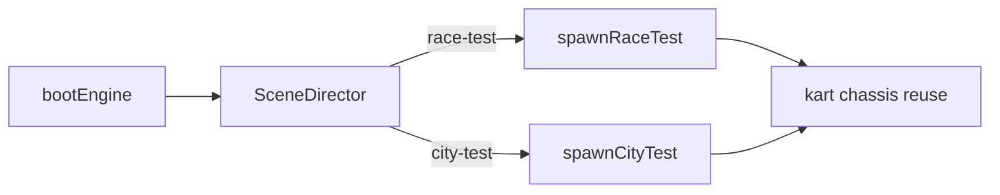

# Plan : blockout city-test + race-test

Authoring **blockout jouable** des scènes de validation Brick Proving Grounds. Sprint : [BRICK-BO1](../sprints/BRICK-BO1.md). Design coté : [test-slice-plans.md](../design/test-slice-plans.md). Intention : [test-slice.md](../design/test-slice.md). Contrat levels : [architecture.md](architecture.md).

## Objectif

Livrer deux modules TypeScript `raceTest` et `cityTest` (primitives + colliders, matériaux unis) aux cotes plans, branchés via SceneDirector / SessionFlow minimal. Pas d’art final, pas de scoring course.

## Pipeline figé

**Levels TS** — pas SceneDD / `public/scenes/`. Pattern : [`src/racer/levels/sandboxKart/`](../../src/racer/levels/sandboxKart/) (`*Spec.ts` + `spawn*.ts`).

Branche : `feature/test-slice-blockout` depuis `develop`. PR cible : `develop`.

## 1. Factoriser le spawn shared

Extraire de [`spawnSandboxKart.ts`](../../src/racer/levels/sandboxKart/spawnSandboxKart.ts) vers `src/racer/levels/shared/` :

- `fetchJson`, `applyTransform`, `createPrimitiveMesh`, material/graph bootstrap
- Types communs → `shared/levelTypes.ts`
- Helper `spawnStaticBox({ name, center, size, materialId, collider })`

`sandboxKart` reste fonctionnel (refactor no-behavior-change).

## 2. `race-test` blockout (priorité — driveable)

Module `src/racer/levels/raceTest/` : `raceTestSpec.ts`, `spawnRaceTest.ts`, `index.ts`.

| Élément | Spec |
| ------- | ---- |
| Sol piste | Largeur **12** wu ; médiane **~420** wu ; ovale asymétrique antihoraire ; origine grille `(0,0,0)` +X |
| Bordures | Murs h **0,66**, ép. 0,4, collider |
| Chicane | Largeur **8** wu |
| Whoops ×3 | h **0,45**, espacement 4 |
| Boost sol ×2 | Plaques 4×2×0,05 (visuel ; pas de logic) |
| Anneaux air ×2 | Stub Ø 3,5 @ Y **4** (visuel) |
| Items | Cubes 0,8 @ Y 0,6 (visuel) |
| CP ×5 | Volumes Y 0→8 ; IDs `cp.*` |
| Grille | 4 slots ; kart joueur **slot 0** `(0,0,-4.5)` face +X |
| Arche PROVING | 14×6×2 |
| Dune shortcut | Rampe 10×4 @ ~18° |

Kart + `kart_drive` + chase : réemploi sandbox (pas re-author gproc).

## 3. `city-test` blockout

Module `src/racer/levels/cityTest/` — AABB [test-slice-plans.md](../design/test-slice-plans.md) :

- Sol **40×40**, origine SW `(0,0,0)`
- Plaza + fontaine ; boxes landmarks (tour, garage, Vinyle, billboard, mairie)
- Pad tutoriel 8×6×0,22 ; gate Riviera **non traversable**
- Capsules PNJ stub Hex / Bolt
- Spawn kart `(20,0,20)` yaw 0 (scooter reporté)
- Triggers `poi.garage` / `pad.race_test` **visuels** (pas de load race encore)

## 4. Brancher le host

| Fichier | Changement |
| ------- | ---------- |
| `SceneDirector.ts` | `load` / `unload` : `sandbox-kart` \| `race-test` \| `city-test` |
| `SessionFlow.ts` | `SandboxKart` \| `CityTest` \| `RaceActive` ; stubs transition |
| Boot / `LegoKartBootProject` | Default **`race-test`** ; `?level=city-test\|sandbox-kart` |
| `startBrickRacerHost.ts` | Exposer `scene.load` |

## 5. Validation

- `pnpm check` / `pnpm test`
- `pnpm dev` : ovale driveable ; `?level=city-test` : hub 40×40, gate impassable
- IDs stables en tête de chaque `*Spec.ts`

## Hors scope

Art final, items/boosts fonctionnels, CP scoring / laps, IA, multi, scooter hub, SceneDD. Suite gameplay course → [BRICK-B3](../sprints/BRICK-B3.md) (B3c+).
