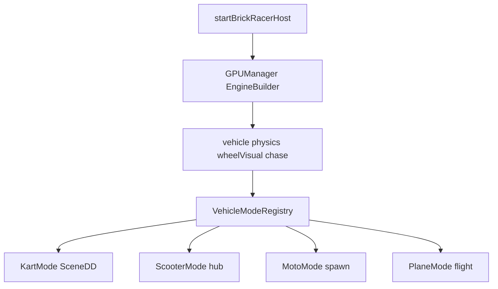
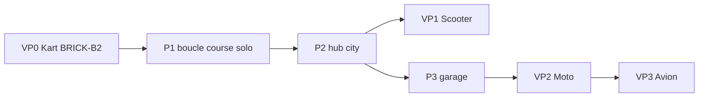

# Plan — prototypes fonctionnels des véhicules

Ladder d’implémentation gameplay : **kart → scooter hub → moto → avion**. Aligné [roadmap.md](roadmap.md), [architecture.md](architecture.md), [gdd.md](../design/gdd.md) § 10, [levels.md](../design/levels.md) (parité triple corridor), [test-slice-plans.md](../design/test-slice-plans.md) (échelle).

Références techniques w3dts : [w3dts-demos.md](../references/w3dts-demos.md).  
Kart P0 (détail tickets) : [lego-kart-host.md](lego-kart-host.md) · [BRICK-B2](../sprints/BRICK-B2.md).  
Boucle course P1 : [BRICK-B3](../sprints/BRICK-B3.md).

**Brick Racer n’est pas affilié à The LEGO Group ni à Nintendo.**

## Décisions figées

| Décision | Choix |
| -------- | ----- |
| Périmètre | Ladder complète **kart → scooter hub → moto → avion** (séquencée) |
| Source port | Monorepo local `w3dts_repos/w3dts` (pas le clone plus ancien `~/w3dts`) — chemins relatifs ci-dessous = racine de ce mono |
| Principe | Chaque classe = **prototype jouable isolé** (sandbox) avant intégration piste / hub |
| Hors prototypes | Boucle course (tours, items, IA) → P1+ ; pas de réécriture du GDD |
| Sprints | `BRICK-B2` (kart) ; `BRICK-V1` scooter ; `BRICK-V2` moto ; `BRICK-V3` avion (à découper à l’ouverture de phase) |

## État actuel (repo Brick Racer)

| Élément | État |
| ------- | ---- |
| Host | Stub [`src/racer/host/startBrickRacerHost.ts`](../../src/racer/host/startBrickRacerHost.ts) |
| Physique npm | `@naanouff/w3dts-physics` présent, **non branché** |
| SceneDD / scripts | **Absents** du `package.json` |
| Plan kart | [lego-kart-host.md](lego-kart-host.md) · [BRICK-B2](../sprints/BRICK-B2.md) |

## Architecture cible (gameplay)

Couches host / SessionFlow / SceneDirector : [architecture.md](architecture.md).  
Une seule entrée host, plusieurs **modes véhicule** plugables :

**Contrat commun** (sous `src/racer/vehicles/`, à introduire au plus tard à VP1) :

- `mount(engine, canvas)` / `unmount()`
- `bindInput(gameplayMap)` — WASD + **gamepad HID** (w3dts `INP-G`, [w3dts-input.md](../references/w3dts-input.md)) ; reset session (X clavier — pad à étendre)
- `getChaseTarget()` — entité châssis pour `createChaseCameraSystem`
- `resetSession()` — respawn + clear vélocité
- Échelle bible : **1 wu = 1 m** ; kart L 2,00 × l 1,20 × h 0,90 ([test-slice-plans.md](../design/test-slice-plans.md))

Pas d’abstraction sur-ingéniée au jour 1 : le kart peut vivre inline dans le host (BRICK-B2) ; extraction du contrat quand le 2ᵉ véhicule (scooter) est porté.

---

## Phase VP0 — Kart (P0 / BRICK-B2) — maintenant

Exécuter le sprint existant sans le diluer. Branche : `feature/lego-kart-host` depuis `develop`.

| Ticket | Travail | Critère done |
| ------ | ------- | ------------ |
| **B2a** | Boot `GPUManager` + `EngineBuilder` ; prepend `createVehicleSystem` → physics `KART_PHYSICS_PRESET` → `createVehicleWheelVisualSystem` → `createChaseCameraSystem` | Moteur sur canvas, pas d’erreur (scène vide OK) |
| **B2b** | Mono alias `w3dts-scripts` (+ gproc/physics npm). **Pas de SceneDD** | `pnpm install` / alias OK |
| **B2c** | Copier : `script-graphs/kart-drive.json`, lit / shader, 4 gproc kart → `public/` | Assets servis Electron |
| **B2d** | Level TS `sandboxKart` (`spawnSandboxKart`) + runtime looks ; pas de `@naanouff/w3dts-viewer` / scenedd | Spawn + sol Lego |
| **B2e** | Chase `KartChassis`, scripts `playing`, WASD, X reset | Conduite manuelle |
| **B2f** | `pnpm check` / `test` / `build` + note README / [build.md](../build.md) | Smoke vert |

### Sources mono (relatif à `w3dts_repos/w3dts/`)

| Chemin | Rôle |
| ------ | ---- |
| `packages/viewer/src/projects/LegoKartProject.ts` | Référence viewer (historique SceneDD) |
| `packages/viewer/src/projects/legoKartSceneRuntime.ts` | Post-spawn runtime |
| `packages/viewer/src/projects/legoTileFloorLook.ts` | Sol / lit |
| `packages/viewer/src/projects/kartWheelLook.ts` | Pneus |
| `src/racer/levels/sandboxKart/` (Brick Racer) | Level TS + spawn |
| `packages/viewer-editor/public/script-graphs/kart-drive.json` | WASD + X |
| `packages/physics` (`VehicleComponent`, `KART_PHYSICS_PRESET`, `applyKartPhysicsCollisionTuning`) | Raycast 4 roues |

**Hors VP0** : moto, terrain, multi, HUD course, assets Brick Racer custom.

**Feeling playtest** (dès B2e) : accroche sol arcade, drift lisible, caméra ne perd jamais le châssis, reset fiable — [gdd.md](../design/gdd.md) § 14.

---

## Phase VP1 — Scooter hub (avec P2 / après hub blockout)

Prototype **locomotion hub**, pas classe course ([gdd.md](../design/gdd.md) § 5 : pied + scooter city).

| Travail | Approche |
| ------- | -------- |
| Sandbox | Scène plate 40×40 (ou `city-test` blockout) + spawn plaza |
| Physique | Variante **légère** du kart 4 roues (même stack) : vitesse max basse, frein fort, pas de drift course ; cotes L 1,40 × l 0,55 × h 1,10 |
| Input | Même map WASD ; pas d’items ; chase plus haute / moins agressive |
| Intégration | Focus circulation allées 4 wu — pad ne charge pas encore la course |

Livrable : flag host / query `?vehicle=scooter` (ou menu debug) pour basculer kart sandbox ↔ scooter. Sprint `BRICK-V1` à découper à l’ouverture P2.

---

## Phase VP2 — Moto (P4)

Porter patterns Motocross **sans** dépendre du heightfield procédural pour le premier prototype (piste SceneDD plate + whoops suffit). Réfs : [w3dts-demos.md](../references/w3dts-demos.md) § Motocross.

| Travail | Source mono |
| ------- | ----------- |
| Spawn 2 roues | `packages/physics/src/kart/motocrossBike.ts` (`spawnMotocrossLegoBike`, lean / anti-wheelie) |
| Visuel GPROC | `buildLegoMotocrossBikeVisual` + gproc `lego-moto-*` |
| Chase | `motocrossChaseCamera.ts` (`MotoChassis`, `MotoWheel-*`) |
| Deps | `w3dts-terrain` + `fastnoise-lite` **seulement** si le sandbox exige heightfield ; sinon différer |

**Feeling** : lean sur whoops, anti-wheelie stable ; biais shortcuts moto du slice ([test-slice.md](../design/test-slice.md) whoops / dune) jouables aussi en kart (pas de lock).

Sandbox : `race-test` stub ou ovale court (3 whoops + rampe) — pas le `MotocrossTrackConfig` complet au premier jet. Sprint `BRICK-V2`.

---

## Phase VP3 — Avion (P4) — nouveau mode

Pas de démo w3dts à porter : flight mode maison sur la stack W3DTS.

| Bloc | Spec prototype |
| ---- | -------------- |
| Contrôle | Pitch / yaw / roll simplifiés (WASD + souris ou stick) ; pas de sim full |
| Contrainte | Couloirs air **annoncés** (anneaux Ø 3,50 @ Y = 4,00) — pas « perdre le sol » sans feedback |
| Physique | Mode distinct du raycast sol : thrust + lift soft + clamp altitude plafond CP Y = 8 ; transition sol→air via rampe / gap |
| Caméra | Chase 3/4 arrière un peu plus large ; silhouette toujours lisible |
| Parité | Même timing boosts air / pads sol jumelés ([levels.md](../design/levels.md) § boosts) — pads stub OK |

Premier done : 2 anneaux sur droite mer du slice + atterrissage soft, sans items. Sprint `BRICK-V3`.

---

## Ordre d’exécution & dépendances roadmap

- **VP0 bloque tout** : aucun autre véhicule avant kart jouable.
- **VP1** s’ouvre avec le hub (P2), pas avant.
- **VP2 / VP3** après garage (P3) selon roadmap ; moto / avion **ne bloquent pas** le hub.
- Slice test : playtest kart ignore l’air ; avion valide la couche plus tard.

## Fichiers / modules (cible progressive)

| Chemin | Rôle |
| ------ | ---- |
| `src/racer/host/startBrickRacerHost.ts` | Boot réel (remplace stub) |
| `src/racer/vehicles/kart/` | Runtime + looks portés du viewer |
| `src/racer/vehicles/scooter/` | Preset hub (VP1) |
| `src/racer/vehicles/moto/` | Spawn + chase (VP2) |
| `src/racer/vehicles/plane/` | Flight mode (VP3) |
| `public/scenes/`, `script-graphs/`, `gproc/` | Assets copiés du mono |
| `docs/sprints/BRICK-V1.md` … | Sprints ultérieurs |

## Hors scope de cette ladder

- Boucle course (tours, checkpoints scoring, items, IA) → P1
- Authoring SceneDD `city-test` / `race-test` complet → level / art
- Custom stats garage hard → P3 (cosmétiques d’abord)
- Multi → P5

## Critères de succès (playtest)

| Prototype | Succès |
| --------- | ------ |
| Kart | WASD + chase + X reset sur level `sandboxKart` ; 5 min sans softlock |
| Scooter | Traverser plaza 40×40, allées 4 m, caméra lisible |
| Moto | Whoops ×3 + lean sans flip ; même reset X |
| Avion | 2 anneaux air + atterrissage ; checkpoint vertical sol→plafond OK |

## Historique

| Version | Date | Note |
| ------- | ---- | ---- |
| 1.0 | 2026-10-23 | Création : ladder VP0–VP3, source mono `w3dts_repos/w3dts`, liens B2 / roadmap |
| 1.1 | 2026-10-23 | Renvois architecture.md + BRICK-B3 (P1) |
| 1.2 | 2026-10-25 | Gamepad HID w3dts `INP-G` disponible — [w3dts-input.md](../references/w3dts-input.md) |
