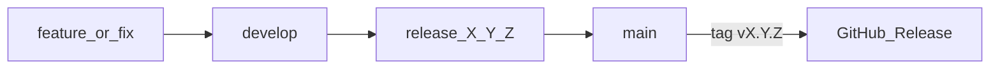

# Plan : workspace Brick Racer

Amorcer le dépôt GitHub [Brick-Racer](https://github.com/naanouff/Brick-Racer) comme app Electron desktop sur la même stack que [w3dts-chessmaster](https://github.com/naanouff/w3dts-chessmaster), avec gitflow (`main` / `develop` protégées) et une coque WebGPU minimale — sans porter encore le gameplay kart.

Sprint d’exécution : [BRICK-B1](../sprints/BRICK-B1.md).

## Contexte

- Repo local vide au départ (git + remote uniquement).
- Référence stack : ChessMaster — Electron 35, electron-vite 3, Vite 5, React 19, TypeScript 5.8, pnpm, Vitest, packages npm `@naanouff/w3dts-*`.
- Gameplay kart déjà présent dans le monorepo w3dts (`LegoKartProject.ts`) — **hors scope de cette phase** ; le workspace prépare la coque pour y greffer ensuite.

## Approche retenue

Créer un **squelette lean calqué sur ChessMaster** (pas une copie du domaine échecs) : mêmes configs / scripts / layout `main|preload|renderer`, dépendances w3dts alignées sur les pins ChessMaster, host WebGPU minimal (canvas + écran titre placeholder « Brick Racer »), disclaimer non officiel LEGO / Mario Kart.

## 1. Scaffold applicatif

| Élément | Rôle |
| -------- | ---- |
| `package.json` | `brick-racer` `0.1.0`, `appId` `com.naanouff.brickracer`, scripts `dev` / `build` / `dist` / `check` / `test` |
| `electron.vite.config.ts`, `tsconfig.json`, `vitest.config.ts` | Même pattern ChessMaster |
| `.npmrc`, `resources/icon.ico` | Tooling / packaging |
| `src/main` | Fenêtre Electron + protocole `app://` (sans IPC métier) |
| `src/preload` | `contextBridge` → `window.brickRacer` (API minimale : version) |
| `src/renderer` | React shell : canvas plein écran, check `navigator.gpu`, titre placeholder |
| `src/racer/host` | Stub `startBrickRacerHost` (pas de scene kart) |
| `public/brand/` | Placeholder logo |
| `docs/build.md`, `docs/semver.md`, `docs/releases/0.1.0.md` | Build + politique version |
| `.github/workflows/ci.yml` | `pnpm check` + `pnpm test` partout ; `pnpm dist` Windows sur `main` / `release/*` |
| `tests/smoke.test.ts` | Vitest minimal |

Dépendances runtime de départ (pins ChessMaster) : `w3dts-core`, `logger`, `input`, `physics`, `gproc`, `audio`, `animation`, `loader-hdr`, `gl-matrix`, `react` / `react-dom`. Pas de `chessops` ni assets d’échecs.

**Hors scope immédiat :** `build:web` / Vercel, port de `LegoKartProject`, assets piste/kart, multiplayer.

## 2. Gitflow et protection de branches

Aligné sur le CONTRIBUTING du monorepo w3dts et la politique semver ChessMaster. Détail opérationnel : [CONTRIBUTING.md](../../CONTRIBUTING.md).

Séquence d’amorçage (repo vide) :

1. Commit d’accueil minimal sur `main` (README, LICENSE, CONTRIBUTING, `.gitignore`).
2. Créer `develop` depuis `main`.
3. Travail du scaffold en `feature/workspace-bootstrap` → PR vers `develop`.
4. Appliquer les protections GitHub sur `main` et `develop`.
5. Définir `develop` comme branche par défaut.

## 3. Validation locale

`pnpm install`, puis `pnpm check`, `pnpm test`, `pnpm dev` (fenêtre Electron + WebGPU / titre Brick Racer).

## 4. Suite (après BRICK-B1)

Branche `feature/lego-kart-host` : adapter `LegoKartProject` + `legoKartSceneRuntime` du monorepo viewer vers `src/racer/`, avec deps `w3dts-scenedd` / `character` / `loaders` / `scripts` si besoin.
