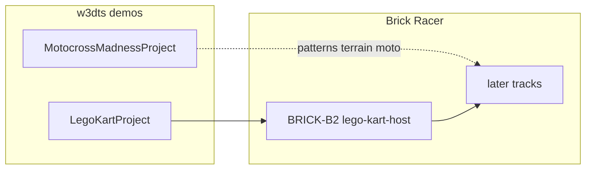

# Références w3dts — Lego Kart & Motocross Madness

Démos du monorepo [w3dts](https://github.com/naanouff/w3dts) qui servent de base technique à Brick Racer. Chemins relatifs au monorepo `w3dts/w3dts/` sauf mention contraire.

| Démo | Nature | Distribution | Rôle Brick Racer |
| ---- | ------ | ------------ | ---------------- |
| **Lego Kart** | Circuit SceneDD + kart 4 roues raycast | Website / scenepak CDN / `?project=` / `?scene=` | **Référence primaire** — VP0 / [BRICK-B2](../sprints/BRICK-B2.md) · [vehicle-prototypes.md](../plans/vehicle-prototypes.md) |
| **Motocross Madness** | Terrain procédural `plateStepped` + moto 2 roues | Editor only (`/?project=MotocrossMadnessProject`) | **Référence secondaire** — VP2 moto · [vehicle-prototypes.md](../plans/vehicle-prototypes.md) |



## Lego Kart (primaire)

### Sources

| Fichier | Rôle |
| ------- | ---- |
| `packages/viewer/src/projects/LegoKartProject.ts` | `LitAbstractProject` — `SCENE_URL = '/scenes/lego-kart.json'` |
| `packages/viewer/src/projects/legoKartSceneRuntime.ts` | Post-load : plate floor, pneus, lit graph, collision tuning |
| `packages/viewer/src/projects/legoTileFloorLook.ts` | `LEGO_KART_LIT_GRAPH`, IBL |
| `packages/viewer/src/projects/kartWheelLook.ts` | Matériau pneus |
| `packages/physics` (`VehicleComponent`, `createVehicleSystem`, `KART_PHYSICS_PRESET`, `applyKartPhysicsCollisionTuning`) | Kart raycast 4 roues |
| `packages/viewer-editor/public/scenes/lego-kart.json` | SceneDD source of truth |
| `packages/viewer-editor/public/scenes/LegoKartProject.scenepak` | Export CDN |
| `packages/viewer-editor/public/script-graphs/kart-drive.json` | WASD + X reset |

### Assets publics à reprendre

- Scène : `scenes/lego-kart.json` (ou scenepak)
- Script : `script-graphs/kart-drive.json`
- Lit / shader : `graphs/StandardLitGraphKart.json`, `shader-graphs/LegoTileFloorProceduralPBR.json`
- GPROC kart : `gproc/lego-brick-generator.json`, `lego-wheel-generator.json`, `lego-axle-bracket-generator.json`, `lego-handle-bar-generator.json`

### Entités stables

`KartChassis`, `KartWheel-fl|fr|rl|rr`, `KartChaseCamera`, `LK_Ground`, `LK_Ramp*`, `KartCircuitBox`.

### Lancement monorepo

```bash
pnpm dev   # viewer-editor :5173
# http://localhost:5173/?project=LegoKartProject
# http://localhost:5173/?scene=/scenes/lego-kart.json

pnpm dev:sceneviewer   # :5175 + scenepak CDN
```

Website featured : `https://assets.w3dts.com/scenes/LegoKartProject.scenepak`.

### Boucle runtime à reproduire (Electron)

Miroir scene-viewer / `EngineMain` :

1. `createVehicleSystem`
2. Physics avec `KART_PHYSICS_PRESET`
3. `createVehicleWheelVisualSystem`
4. `createChaseCameraSystem`
5. Scripts en état `playing`
6. `applyLegoKartSceneRuntime` après load SceneDD

## Motocross Madness (secondaire)

Doc monorepo : `documentation/domains/terrain/MOTOCROSS_DEMO.md`.

### Sources

| Fichier | Rôle |
| ------- | ---- |
| `packages/viewer/src/projects/MotocrossMadnessProject.ts` | Terrain + spawn moto async |
| `packages/physics/src/kart/motocrossBike.ts` | `spawnMotocrossLegoBike`, lean / anti-wheelie |
| `packages/viewer/src/projects/motocrossChaseCamera.ts` | Chase spawnée en code |
| `packages/viewer/src/projects/buildLegoMotocrossBikeVisual.ts` | Assemblage GPROC |
| `packages/viewer-editor/public/terrain-configs/MotocrossTrackConfig.json` | `meshMode: plateStepped` |
| `packages/viewer-editor/public/terrain-graphs/MotocrossTrackGraph.json` | Heightfield |

### Assets / noms

- Même `kart-drive.json` (reset patché au spawn).
- GPROC moto : `lego-moto-fork|fairing|windshield|seat-tail` (+ roues / guidon partagés).
- Physique : `MotoChassis`, `MotoWheel-front|rear`, `MotoChaseCamera`.
- Deps supplémentaires : `@naanouff/w3dts-terrain`, `fastnoise-lite`.

### Lancement

```text
http://localhost:5173/?project=MotocrossMadnessProject
```

Pas de SceneDD / scenepak public — code-first, editor-only.

### Patterns utiles plus tard

- Rayons de suspension ↔ `TerrainHeightService`
- Spawn sur heightmap (`findMotocrossSpawnPoint`)
- Caméra chase créée en code
- Véhicule 2 roues (`leanMax`, `antiWheelie`)

## Écarts kart vs moto

| Dimension | Lego Kart | Motocross |
| --------- | --------- | --------- |
| Monde | Circuit SceneDD (murs, ramps) | Heightfield procédural Lego |
| Véhicule | 4 roues raycast (JSON) | 2 roues raycast (code) |
| Visuels | Entièrement dans SceneDD | Physique + GPROC runtime |
| Caméra | `KartChaseCamera` dans la scène | `MotoChaseCamera` spawnée |
| Distribution | Website + scenepak | Deep link editor seulement |

## Deps npm Brick Racer

Déjà présentes : `core`, `physics`, `gproc`, `input`, `logger`, `loader-hdr`, …

Host kart Brick Racer : level TypeScript `sandboxKart` (pas de SceneDD) — [lego-kart-host.md](../plans/lego-kart-host.md). Mono : `w3dts-scripts` via alias.

Plus tard (motocross / pistes) : `w3dts-terrain`, `fastnoise-lite`.

## Input / Gamepad

**Gamepad HID** livré dans w3dts (`INP-G`, PR #285) — voir [w3dts-input.md](w3dts-input.md). Brick Racer (MK/DKR) : stick X braquer, A/B throttle, L1/R1 drift.
