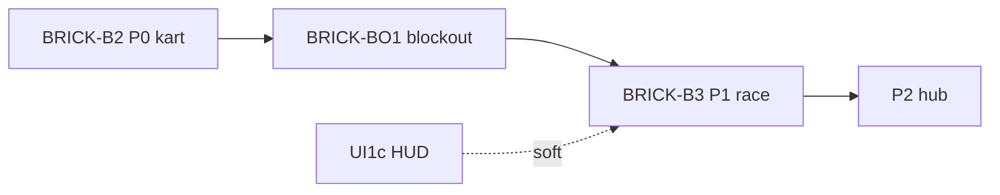

# Sprint BRICK-B3 — Boucle course solo (P1)

Découpage de [docs/plans/architecture.md](../plans/architecture.md) § RaceSystem / SessionFlow.  
Design : [test-slice.md](../design/test-slice.md), [test-slice-plans.md](../design/test-slice-plans.md), [levels.md](../design/levels.md) § Spec / items (catalogue réduit), [gdd.md](../design/gdd.md) §12.  
UI : binding HUD [BRICK-UI1](BRICK-UI1.md) ticket UI1c (mock → events host).

Objectif : première **boucle course jouable** — load `race-test` (module TS blockout), 3 tours, checkpoints verticaux, grille 1P + 3 IA soft, boosts sol (+ air stub), items 1-slot table soft, finish → retour sandbox / stub hub. Pose `SessionFlow` `RaceLoading` / `RaceActive` et le module `src/racer/race/`.

Ordre : B3a → B3b → B3c → B3d → B3e → B3f → B3g. Chaque ticket de code se termine par `pnpm test` et `pnpm check`. Aucun commit sans demande.

Branche prévue : `feature/race-loop-p1` depuis `develop`. PR cible : `develop`.

Prérequis : **BRICK-B2** merge ; **[BRICK-BO1](BRICK-BO1.md)** recommandé (blockout `race-test` + SceneDirector multi-level). Soft : UI1c pour HUD ; sinon HUD debug texte OK.

---

## BRICK-B3a — SessionFlow transitions course

Fichiers : `src/racer/session/SessionFlow.ts`, host.

Fait quand :

- États : `SandboxKart` | `RaceLoading` | `RaceActive` (Hub reporté P2).
- API : `requestTransition({ type: 'startRace', sceneId })` / `{ type: 'endRace', reason: 'finish' | 'quit' }`.
- `RaceLoading` : unload scène courante → load pack course → `RaceActive`.
- Fin / quit → retour `SandboxKart` (ou scène kart) tant que hub absent.
- Fade stub acceptable (clear + reload).

## BRICK-B3b — Pack level `race-test` (TS)

Fichiers : `src/racer/levels/raceTest/` (pas SceneDD / `public/scenes/`). Plan blockout : [test-slice-blockout.md](../plans/test-slice-blockout.md) · tickets [BRICK-BO1](BRICK-BO1.md) BO1b/d.

Fait quand :

- Level chargeable via SceneDirector avec **au minimum** : sol + murs, ligne start/finish, **≥3 checkpoints** verticaux (Y 0→8), grille 4 slots ([test-slice-plans.md](../design/test-slice-plans.md)).
- Blockout aux cotes plans (médiane ~420 wu ; ovale court OK si BO1 a livré un stub jouable).
- IDs stables documentés (`cp.*`, slots 0–3).
- **Si BO1 déjà merge** : ticket surtout validation + gaps (waypoints IA, etc.) pour B3e.

## BRICK-B3c — Lap / Checkpoint system

Fichiers : `src/racer/race/checkpoints.ts`, `laps.ts` (noms indicatifs).

Fait quand :

- Passage CP dans l’ordre ; tour incrémenté à `cp.start_finish` après tour complet.
- 3 tours → événement `race.finished` → SessionFlow `endRace`.
- Reset session (X) : respawn grille + compteurs tour/CP à zéro (ou soft reset documenté).
- Pas de miroir / hazards.

## BRICK-B3d — Boosts + items 1-slot (table soft)

Fichiers : `src/racer/race/boosts.ts`, `items/`, `public/data/` (tables JSON).

Fait quand :

- ≥1 ligne boost **sol** déclenchable ; boosts **air** présents en scène peuvent être stub (kart ignore).
- Clusters item boxes sol ; pickup → **1 slot** ; usage touche dédiée (ex. Space / gamepad face).
- Table soft 50 cc réduite : Stud Dash, Brique Rouge, Bouclier ABS ([test-slice.md](../design/test-slice.md)).
- Loot / comportements en data + code ; seed déterministe-friendly (doc courte dans architecture ou commentaire).

## BRICK-B3e — IA soft (3 opponents)

Fichiers : `src/racer/race/ai.ts`.

Fait quand :

- 3 karts IA sur waypoints sol (graph SceneDD ou chemin stub).
- Soft rubber-band minimal (pas de table 150 cc).
- Grille 4 = P1 + 3 IA ; classement basique (ordre / distance) pour HUD.

## BRICK-B3f — ui-bridge + HUD binding

Fichiers : `src/racer/ui-bridge/`, consommation renderer (UI1c ou debug).

Fait quand :

- Events host → UI : `race.countdown` (stub OK), position, tour courant / total, timer, slot item, `race.results`.
- Si UI1c pas prêt : overlay debug canvas / DOM minimal documenté.
- Quit / finish déclenchent transition SessionFlow.

## BRICK-B3g — Smoke playtest + docs

Fait quand :

- `pnpm check` / `pnpm test` / `pnpm build` OK.
- Playtest : startRace → 3 tours → résultats → retour sandbox sans softlock ; transition ressentie &lt; ~3 s ([test-slice.md](../design/test-slice.md)).
- Caméra chase ne perd jamais le véhicule brick.
- Note courte dans `docs/build.md` ou README (comment lancer / debug `?` flags si présents).
- Lien B3 dans [docs/README.md](../README.md) déjà présent.

---

## Hors de ce sprint

- Hub `city-test` / pads / gates gameplay → P2 (blockout géométrie : [BRICK-BO1](BRICK-BO1.md) BO1c).
- Miroir, 150 cc, catalogue items complet, boss 1v1.
- Moto / avion, multi P2P.
- Authoring art final Promenade Test (blockout jouable suffit).
- Save / progression / monnaie.

## Critères playtest P1 (slice)

| Boucle | Succès |
| ------ | ------ |
| Transition | Sandbox → race load sans softlock |
| Course | 3 tours, CP verticaux, 1P + 3 IA |
| Props | ≥1 boost sol + items 1-slot utilisables |
| Retour | Finish / Quit → sandbox (ou stub) |
| Lisibilité | Chase ne perd pas le kart |

## Dépendances

