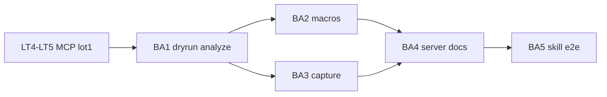

# Sprint BRICK-BA — Agent constructeur brick-lab

Découpage de [docs/plans/brick-lab-agent.md](../plans/brick-lab-agent.md).  
MCP lot 1 : [brick-lab-mcp.md](../plans/brick-lab-mcp.md) · suite de [BRICK-LT](BRICK-LT.md) (LT4/LT5).

Objectif : enrichir le MCP (dry-run, analyze, macros, capture) et livrer un **skill + subagent Cursor** capable de construire depuis une image ou une notice dans la session brick-lab ouverte.

Ordre : **BA1 → BA2 → BA3 → BA4 → BA5**. Chaque ticket de code : `pnpm test` + `pnpm check`. Aucun commit sans demande.

Branche prévue : `feature/brick-lab-agent` depuis `develop` (ou depuis la branche courante si le bus MCP y est déjà). PR cible : `develop`.

Prérequis : LT4–LT5 (bus + serveur stdio) ; brick-lab jouable sous `pnpm dev`.

---

## BRICK-BA1 — Dry-run, query, analyze, remove lot ✅

Fichiers : [`mcpCommands.ts`](../../src/racer/levels/brickLab/editor/mcpCommands.ts), [`editorState.ts`](../../src/racer/levels/brickLab/editor/editorState.ts) (`stackHeightUnder`), [`tests/mcpCommands.test.ts`](../../tests/mcpCommands.test.ts).

Fait quand :

- `place_bricks` accepte `dryRun?: boolean` — aucune mutation si true ; `rejected[]` inclut raison + détail collision (opId / cellule) quand pertinent.
- `query_region` `{ min: [sx,py,sz], max: [sx,py,sz] }` → cellules occupées + ops touchées.
- `analyze` → bbox studs/plates, BOM `{ part, color, qty }[]`, liste des ops **flottantes** (pas de support sous l’empreinte via `stackHeightUnder`, sauf `py === 0`).
- `remove_bricks` : lot par `opIds[]` et/ou région ; **un** undo.
- Types `McpCommand` / `mcpCommandNeedsSceneSync` à jour (`remove_bricks` sync ; `dryRun` / `query` / `analyze` non).
- Tests Vitest verts pour dry-run, flottante, remove lot.

## BRICK-BA2 — Macros fill / wall / ring / disc / column ✅

Fichiers : nouveau [`mcpMacros.ts`](../../src/racer/levels/brickLab/editor/mcpMacros.ts), branchement dans `mcpCommands.ts`, tests (nouveau ou étendu).

Fait quand :

- Macros pures → `McpBrickSpec[]` puis `place_bricks` (respectent `dryRun`).
- `fill_rect` : rectangle `[min,max]` + `part` préférée ou tuilage glouton catalogue (grandes plaques d’abord) + `color`.
- `wall` : segment horizontal/vertical, épaisseur 1, hauteur en plates, joints croisés.
- `ring` / `disc` : centre + rayon (studs), hauteur ; rasterisation puis tuilage ; documenter la limite AABB vs anneau « creux » (macaroni 4×4).
- `column` : pièce + `at` + `count` (couches empilées selon footprint Y).
- Aucune collision interne sur les fixtures de test ; couverture studs documentée (exacte ou ±1 sur le bord du ring).

## BRICK-BA3 — Vue + capture viewport ✅

Fichiers : [`brickLabMcpBus.ts`](../../src/main/brickLabMcpBus.ts), pont renderer (`set_view` → [`applyBrickLabView`](../../src/racer/levels/brickLab/brickLabCamera.ts) / panel), [`.gitignore`](../../.gitignore) → `data/brick-lab-captures/`.

Fait quand :

- Commande `set_view` `{ view: 'orbit'|'face'|'side'|'top' }` appliquée dans la session.
- `capture` `{ view? }` : vue optionnelle, `capturePage`, écriture `data/brick-lab-captures/<stem>-<view>-<ts>.png`, réponse `{ ok, path }` (absolu).
- `capture_set` : les 4 vues ; `{ ok, paths: { face, side, top, orbit } }`.
- Timeout bus éventuellement relevé pour capture (au-delà de 8 s si besoin).
- Playtest manuel : PNG lisible, assemblage visible.

## BRICK-BA4 — Serveur MCP + config Cursor + docs lot 2 ✅

Fichiers : [`brickLabServer.mjs`](../../src/mcp/brickLabServer.mjs), [`.cursor/mcp.json`](../../.cursor/mcp.json), [brick-lab-mcp.md](../plans/brick-lab-mcp.md), ce sprint.

Fait quand :

- Tous les outils BA1–BA3 enregistrés (schémas zod) sur le serveur stdio.
- Config Cursor Windows fiable (`status` connecté depuis le chat sans contournement HTTP) — ajuster `command`/`args` si `pnpm` ne démarre pas le serveur.
- [brick-lab-mcp.md](../plans/brick-lab-mcp.md) : section **lot 2** + lien vers [brick-lab-agent.md](../plans/brick-lab-agent.md).
- Checklist démarrage documentée (dev → brick-lab → reload MCP).

## BRICK-BA5 — Skill, subagent, E2E fontaine ✅
<!-- E2E playtest fontaine : à valider sous pnpm dev + MCP Cursor (captures). -->

Fichiers : `.cursor/skills/brick-builder/` (`SKILL.md`, `reference/coordinates.md`, `parts.md`, `recipes.md`), `.cursor/agents/brick-builder.md`.

Fait quand :

- Skill décrit le protocole (status → analyse → dryRun → pose → analyze → capture → itérer ≤3 → save sur demande).
- Références coords / parts / recipes (fontaine photo comme recette pilote).
- Subagent déclenchable sur « construire en LEGO / image / notice » ; impose la lecture du skill.
- E2E : subagent reconstruit la fontaine à partir de la photo de référence ; `capture_set` produit face / côté / dessus cohérents ; `analyze` sans flottante bloquante.
- Écarts catalogue (ex. feuilles absentes) listés dans le résumé agent, pas silencieux.

---

## Hors de ce sprint

- Agent CLI autonome (Cursor SDK / AI SDK hors chat).
- MCP hors localhost / build packagé.
- Promotion catalogue maître.
- Spawn mesh landmarks sur `city-test` (suite FC).

## Critères playtest BA

| Boucle | Succès |
| ------ | ------ |
| Dry-run | Lot en collision → 0 pose ; après correction → pose OK |
| Analyze | Pièce volontairement flottante listée |
| Macros | `ring` 8 studs + `column` visibles sans collision |
| Capture | 4 PNG ; agent lit et corrige une erreur volontaire |
| Skill | Subagent refuse de contourner si MCP down |
| E2E | Fontaine photo ; captures vs ref |
| Régression | LT place/undo/save ; manuels existants OK |

## Dépendances

## Suite

Contenu décors / ED7 fontaine canon si besoin · spawn city-test · gameplay P1 ([BRICK-B3](BRICK-B3.md)) reste orthogonal.
