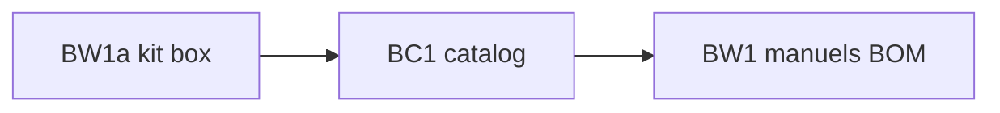

# Sprint BRICK-BC1 — Catalogue pièces LEGO (data-first)

Découpage de [docs/plans/brick-part-catalog.md](../plans/brick-part-catalog.md).  
Branche : `feature/brick-world-hub` (même train BW). PR cible : `develop`.

Objectif : **gestion de catalogue** avant d’étendre les meshes. Les manuels référencent des design IDs officiels ; le rendu peut rester proxy box.

Ordre : **BC1a → BC1b → BC1c**. Chaque ticket de code : `pnpm test` + `pnpm check`. Aucun commit sans demande.

---

## BRICK-BC1a — Schema + seed JSON

Fichiers : `src/racer/hub/brick/catalog/` (`types.ts`, `data/parts.json`, `data/colors.json`, `loadCatalog.ts`).

Fait quand :

- Couleurs seed (dont `gray`, `cyan`, translucides mappés) + `blId` doc.
- Parts seed : briques/plates/tiles courantes **+ BOM fontaine** (`3128`, `85080`, `3941`, `3960`, `3062`, `4740`, `6141`, `4589`, …).
- Chaque part : `id`, `name`, `category`, `footprint`, `aliases?`, `mesh.status`.
- Tests : lookup, alias → id, BOM ids présents.

## BRICK-BC1b — Brancher validate / footprint / materials

Fichiers : `brickCatalog.ts`, `partFootprint.ts`, `manualSchema.ts`, `brickMaterials.ts`.

Fait quand :

- `BrickPartId` / couleurs = ids catalogue (string) ; plus de union fermée à 6 pièces.
- `partSizeMeters` / footprint lisent le catalogue.
- `validateManual` refuse les ids absents du catalogue (message clair).
- Manuels legacy (`1x1`, `tile`, …) OK via aliases.

## BRICK-BC1c — Spawn proxy + doc authoring

Fichiers : `spawnBrickLandmark.ts`, [brick-manual-prompt.md](../design/brick-manual-prompt.md), index exports.

Fait quand :

- Spawn batch toujours sur mesh box tant que `mesh.status !== 'ready'` (doc).
- Prompt Gemini : catalogue = design IDs (+ aliases) ; interdiction d’inventer des pièces hors JSON.
- README catalogue / note « comment ajouter une pièce ».

---

## Hors sprint

- Meshes LDraw / GPROC courbes  
- Import bulk + UI lab → [BRICK-CL1](BRICK-CL1.md)  
- Remplacement fontaine pièce-à-pièce BOM (manuel suivant, après catalogue)

## Dépendances

