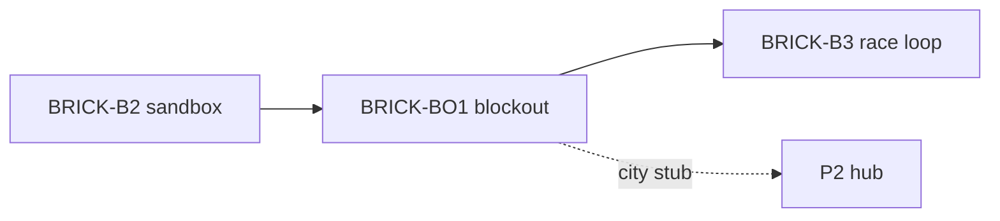

# Sprint BRICK-BO1 — Blockout Proving Grounds

Découpage de [docs/plans/test-slice-blockout.md](../plans/test-slice-blockout.md).  
Design : [test-slice.md](../design/test-slice.md), [test-slice-plans.md](../design/test-slice-plans.md).  
Contrat : [architecture.md](../plans/architecture.md) (levels TS, pas SceneDD).

Objectif : **blockout jouable** `race-test` + `city-test` (primitives + colliders aux cotes plans), SceneDirector multi-level, boot playtest. Pas de boucle tours / items / IA (→ [BRICK-B3](BRICK-B3.md) B3c+).

Ordre : BO1a → BO1b → BO1c → BO1d → BO1e. Chaque ticket de code se termine par `pnpm test` et `pnpm check`. Aucun commit sans demande.

Branche prévue : `feature/test-slice-blockout` depuis `develop`. PR cible : `develop`.

Prérequis : **BRICK-B2** merge (sandbox kart jouable).

---

## BRICK-BO1a — Levels shared (factor spawn)

Fichiers : `src/racer/levels/shared/` ; refactor [`sandboxKart/`](../../src/racer/levels/sandboxKart/).

Fait quand :

- Types communs (`LevelEntity`, `PrimitiveSpec`, …) + helpers (`fetchJson`, `applyTransform`, `createPrimitiveMesh`, bootstrap graphs/materials).
- Helper `spawnStaticBox` (ou équivalent) pour blockout.
- `spawnSandboxKart` utilise shared ; **comportement sandbox inchangé** (conduite WASD / X OK).

## BRICK-BO1b — Module `raceTest` blockout

Fichiers : `src/racer/levels/raceTest/` (`raceTestSpec.ts`, `spawnRaceTest.ts`, `index.ts`).

Fait quand :

- Sol + murs h 0,66, largeur 12 (chicane 8), médiane ~420 wu (ovale antihoraire).
- Whoops ×3, dune shortcut, arche PROVING, boosts sol + anneaux air + items **visuels**.
- **≥3** (cible 5) checkpoints volumes Y 0→8, IDs `cp.*` documentés.
- Grille 4 slots ; kart joueur slot 0 + chase + `kart_drive`.
- IDs stables en tête de spec.

## BRICK-BO1c — Module `cityTest` blockout

Fichiers : `src/racer/levels/cityTest/`.

Fait quand :

- Sol 40×40, AABB landmarks ([test-slice-plans.md](../design/test-slice-plans.md) § city-test).
- Pad tutoriel 8×6 ; Riviera Gate **collider bloquant** ; capsules Hex / Bolt stub.
- Spawn kart `(20,0,20)` ; volumes `poi.garage` / `pad.race_test` visibles (pas de transition load).

## BRICK-BO1d — SceneDirector + SessionFlow + boot

Fichiers : `SceneDirector.ts`, `SessionFlow.ts`, boot / `LegoKartBootProject.ts`, `startBrickRacerHost.ts`.

Fait quand :

- `scene.load('sandbox-kart' | 'race-test' | 'city-test')` + `unload` (clear entités level).
- États flow : `SandboxKart` | `CityTest` | `RaceActive` (stubs `startRace` / `endRace` / `gotoCity` OK).
- Boot default **`race-test`** ; query `?level=city-test|sandbox-kart` pour bascule.
- `pnpm check` / `pnpm test` OK.

## BRICK-BO1e — Smoke playtest + docs

Fait quand :

- Playtest : conduire ovale blockout ; `?level=city-test` hub 40×40, gate impassable, pad visible.
- Note courte dans [build.md](../build.md) ou README (`?level=`).
- [BRICK-B3](BRICK-B3.md) B3b pointe vers pack TS `raceTest` (plus SceneDD `public/scenes/`).
- Lien sprint dans [docs/README.md](../README.md).

---

## Hors de ce sprint

- Lap / CP scoring, boosts/items gameplay, IA → BRICK-B3 (B3c–B3e).
- Transition pad → race réelle, scooter hub → P2.
- Art final, SceneDD, multi.

## Critères playtest BO1

| Boucle | Succès |
| ------ | ------ |
| Race blockout | WASD sur ovale, murs collident, grille / CP visibles |
| City blockout | Rouler plaza, gate bloque, landmarks lisibles |
| Switch level | `?level=` change de scène sans crash |
| Sandbox | Toujours jouable via `?level=sandbox-kart` |

## Dépendances

