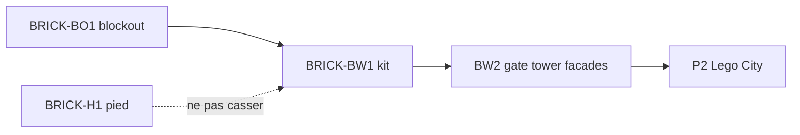

# Sprint BRICK-BW1 — Brick Module Kit sur `city-test`

Découpage de [docs/plans/brick-world-rendering.md](../plans/brick-world-rendering.md).  
Design : [test-slice.md](../design/test-slice.md), [test-slice-plans.md](../design/test-slice-plans.md).  
Prompt authoring : [brick-manual-prompt.md](../design/brick-manual-prompt.md).  
Blockout : [BRICK-BO1](BRICK-BO1.md). Hub pied : [BRICK-H1](BRICK-H1.md) (ne pas casser possession).

Objectif : catalogue + instancing + **pipeline mode d’emploi** ; remplacer **fontaine** puis **pad** ; prouver FPS/`dc` avant gate / tour / façades.  
North star matière : [ref-brick-world-chase.jpg](../design/art/ref-brick-world-chase.jpg) · silhouette A1 : [a1-hub-plaza.png](../design/art/a1-hub-plaza.png).

Ordre : **BW1a → BW1b → BW1c → BW1d**. Chaque ticket de code se termine par `pnpm test` et `pnpm check`. Aucun commit sans demande.

Branche prévue : `feature/brick-world-hub` depuis `develop`. PR cible : `develop`.

Prérequis : **BRICK-BO1** (`city-test` + AABB stables). Mono w3dts recommandé pour `InstancedMesh` / gproc à jour ([build.md](../build.md)).

---

## BRICK-BW1a — Units + catalogue + spawn instances ✅

Fichiers : `src/racer/hub/brick/` (`brickUnits.ts`, `brickCatalog.ts`, `spawnBrickLandmark.ts`), materials `BRICK_*`, tests.

Fait quand :

- Constantes `S = 0,33`, `P = 0,11`, `B = 0,33` + snap grille.
- Catalogue : `1x1`, `1x2`, `2x2`, `2x4`, `plate`, `tile` (+ couleurs hub dont `terracotta`).
- Helper `InstancedMesh` depuis poses — **pas** une entité par brique.
- Tests purs (snap, comptage instances) sans GPU.

## BRICK-BW1b — Pipeline manuel + `landmark.fountain`

Fichiers : `manual/*`, `manuals/fountain.manual.json`, [`spawnCityTest.ts`](../../src/racer/levels/cityTest/spawnCityTest.ts), prompt [brick-manual-prompt.md](../design/brick-manual-prompt.md).

Fait quand :

- Schema + `validateManual` / `assembleManual` / `bakeShell` / `manualToLandmark`.
- Fontaine = manuel JSON (Gemini ou stub) → assemble → shell → batches ; collider AABB **inchangé**.
- Playtest `city-test` : silhouette A1 (bassins terracotta + eau cyan) ; H1 / marche OK.

## BRICK-BW1c — Niveau `brick-lab`

Fichiers : `levels/brickLab/*`, registry, HUD Revue slice.

Fait quand :

- Sol + soleil + caméra orbit ; hot-swap manuels ; stats `total / kept / batches` ; toggle shell plein vs enveloppe.
- Accessible via HUD (build packagée sans barre d’URL).

## BRICK-BW1d — `landmark.pad`

Fichiers : `manuals/pad.manual.json` (+ shader studs si besoin), [`cityTestSpec.ts`](../../src/racer/levels/cityTest/cityTestSpec.ts).

Fait quand :

- Dalle 8×6 × 0,22 (2P) : look studs jaune / noir + bordure brick si besoin.
- Chamfers / collider ramp **conservés** ; ID `landmark.pad` stable.

---

## Hors de ce sprint

- `landmark.gate` / `tower` / façades (→ BW2).
- CLI / API Gemini (prompt collé à la main uniquement).
- Impostors skyline, merge GLB, art enseignes texturées.
- Remplacement murs / décor `race-test`.
- Changement des masks collision ou des triggers `poi.*` / `pad.race_test`.

## Critères playtest BW1

| Boucle | Succès |
| ------ | ------ |
| Catalogue | Au moins 5 types de pièces + 2 couleurs visibles en jeu |
| Manuel | Validation erreurs lisibles ; bake réduit le count vs plein |
| Fontaine | Plus une box unie ; silhouette circulaire terracotta/cyan ; collision identique |
| brick-lab | Orbit + switch manuel + stats shell |
| Pad | Look stud jaune/noir ; chamfers OK ; pas de softlock |
| Perf | ≥60 fps ressenti `BrickRacerFast` ; `dc` pas explosé vs blockout |
| Régression | H1 (F / marche / véhicules) et `race-test` inchangés |

## Dépendances

## Suite (hors BW1)

Authoring fidèle et production landmarks suivants : [brick-decor-pipeline.md](../plans/brick-decor-pipeline.md) · [BRICK-DC1](BRICK-DC1.md) (couches → brickify), puis pad / gate / façades (DC2–DC4).  
Billboards lointains : plan rendu § couches, après la vague landmarks.
