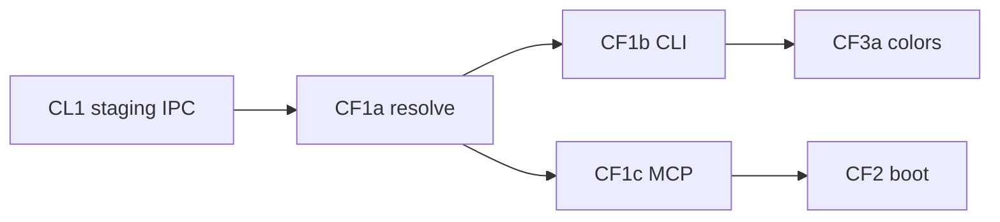

# Sprint BRICK-CF — Couverture catalogue (BOM → runtime)

Découpage de [docs/plans/catalog-full-coverage.md](../plans/catalog-full-coverage.md).  
Contexte : [catalog-lab.md](../plans/catalog-lab.md) (CL1–CL5) · [brick-lab-agent.md](../plans/brick-lab-agent.md) · [BRICK-BA](BRICK-BA.md).

Objectif : promouvoir un **BOM de set** (ex. 10359) depuis le master vers le catalogue **runtime** brick-lab / MCP, sans charger les 33k pièces en whitelist permanente.

Ordre : **CF1a → CF1b → CF1c → CF2 → CF3a** (CF3b bake = ticket soft / suite). Chaque ticket code : `pnpm test` + `pnpm check`. Aucun commit sans demande.

Branche : courante `feature/brick-decor-layers` (ou `feature/catalog-full`). PR cible : `develop`.

Prérequis : `public/catalog/master-index.json` ; CL1 staging / `registerPartRuntime` / IPC `bc1-merge-parts`.

---

## BRICK-CF1a — Resolve BOM ↔ master ✅

Fichiers : [`promoteParts.ts`](../../src/racer/hub/brick/catalog/promoteParts.ts), tests.

Fait quand :

- Entrée : liste d’ids design (+ optionnel setNum pour rapport).
- Lookup `master-index` → `BrickPartDef` (`mesh: box`, footprint, `ldrawId`, catégorie `guessPartCategory`).
- Rapport : `promoted` | `alreadyBc1` | `unresolved` | `noFootprint`.
- Pur / testable sans Electron.

## BRICK-CF1b — CLI `catalog:promote-set` ✅

Fichiers : [`scripts/catalog/promote_set_bom.mjs`](../../scripts/catalog/promote_set_bom.mjs), `package.json`, fetch inventaires Rebrickable si besoin.

Fait quand :

- `pnpm catalog:promote-set -- 10359` résout le BOM (CSV inventaires locaux ou téléchargés).
- Écrit `public/catalog/bom/10359.json` (ids + rapport).
- `--write-parts` merge dans `parts.json` (Node, hors IPC).
- Rapport console : counts promoted / unresolved.

## BRICK-CF1c — MCP `promote_parts` / `promote_status` ✅

Fichiers : [`mcpCommands.ts`](../../src/racer/levels/brickLab/editor/mcpCommands.ts), [`brickLabServer.mjs`](../../src/mcp/brickLabServer.mjs), panel (fetch master + register + staging).

Fait quand :

- `promote_parts { ids, persist? }` : resolve master in-renderer, `registerPartRuntime` + staging ; `persist` → IPC merge.
- `promote_status` : seedCount, runtimeCount, stagingCount.
- `promote_bom { setNum }` : charge `/catalog/bom/<setNum>.json` si présent puis promote_parts.
- Tests Vitest sur applyMcpCommand (mock master map).

## BRICK-CF2 — Runtime catalogue au boot brick-lab ✅

Fait quand :

- Au mount `BrickLabBuildPanel` : `readStaging()` → `registerPartRuntime` pour chaque entrée.
- MCP `list_parts` expose `BRICK_CATALOG.parts` (déjà runtime) + champ optionnel `source: seed|staging`.
- Skill brick-builder : étape promo avant set.

## BRICK-CF3a — Color nearest map ✅

Fichiers : [`colorNearest.ts`](../../src/racer/hub/brick/catalog/colorNearest.ts), rapport CLI.

Fait quand :

- Table LDraw / noms fréquents 10359 → slug éditeur (`tan`→`sand`, `dark_orange`→`terracotta`, `trans_light_blue`→`cyan`, …).
- `promote_set` / rapport inclut `colorHints[]`.
- Test unitaire mapping.

## BRICK-CF3b — Bake on promote (suite)

Hors lot minimal : déclencher bake LDraw pour ids promus. Ticket follow-up.

---

## Hors de ce sprint

- Whitelist master entier dans brick-lab.
- Reproduction fidèle 10359.
- CF3b bake automatique.

## Critères playtest CF

| Boucle | Succès |
| ------ | ------ |
| CLI 10359 | `bom/10359.json` + N unresolved documenté |
| MCP promote | `place_bricks` d’un id promu OK |
| Boot | staging rechargé → id toujours posable |
| Couleurs | hints dark_orange / tan dans rapport |

## Dépendances

