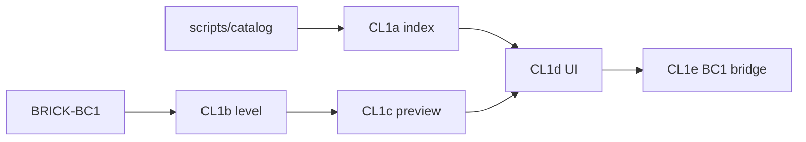

# Sprint BRICK-CL1 — Catalog Lab (master → BC1)

Découpage de [docs/plans/catalog-lab.md](../plans/catalog-lab.md).  
Réfs : [brick-part-catalog.md](../plans/brick-part-catalog.md) · [BRICK-BC1](BRICK-BC1.md) · [BRICK-BW1](BRICK-BW1.md) (brick-lab) · [scripts/catalog/](../../scripts/catalog/).

Objectif : niveau W3DTS **`catalog-lab`** + overlay React pour parcourir le master Rebrickable×LDraw, prévisualiser en **proxy `bo_cube`**, et promouvoir vers BC1 (`parts.json`). **Interdit** : autre moteur 3D que W3DTS.

Ordre : **CL1a → CL1b → CL1c → CL1d → CL1e**. Chaque ticket de code se termine par `pnpm test` et `pnpm check`. Aucun commit sans demande.

Statut implémentation (2026-10-27) : **CL1a–e en place** — `?level=catalog-lab` / bouton Revue « Catalogue » ; index `public/catalog/master-index.json` ; preview `bo_cube` ; staging + IPC `bc1-merge-parts`. Playtest manuel encore à valider.

Branche prévue : `feature/catalog-lab` depuis `develop` (ou train `feature/brick-world-hub` si déjà ouvert). PR cible : `develop`.

Prérequis : **BRICK-BC1** (catalogue runtime) ; POC `scripts/catalog` (sources téléchargeables via `fetch_sources.py`). Soft : brick-lab (BW1c) comme référence orbit / matériaux.

---

## BRICK-CL1a — Index master navigable

Fichiers : `scripts/catalog/build_master_catalog.py`, `scripts/catalog/fetch_sources.py`, `scripts/catalog/README.md`, `package.json` (`catalog:build`), sortie `public/catalog/master-index.json`.

Fait quand :

- Build écrit l’index **léger** (seulement `has_3d_model`) : `id`, `name`, `category_id`, `ldraw_id`, `footprint` `[sx,py,sz]` proposé.
- Heuristique hauteur : corps ≈ `round(height_plates - 0.5)` (stud AABB retiré).
- `pnpm catalog:build` documenté ; `data/` reste gitignoré ; pas de dump LDraw dans le repo.
- Test unitaire pur (ou script assert) sur `footprintFromMasterDims` (ex. 3001 → ~`[4,3,2]`).

## BRICK-CL1b — Niveau `catalog-lab`

Fichiers : `src/racer/levels/catalogLab/*`, [`registry.ts`](../../src/racer/levels/registry.ts), [`SceneDirector.ts`](../../src/racer/scene/SceneDirector.ts), barre Revue [`main.tsx`](../../src/renderer/main.tsx).

Fait quand :

- Spec : sol + soleil + caméra orbitale + matériaux `BRICK_*` (calque brick-lab).
- Spawn **sans** manuel fontaine ; label HUD « Catalogue ».
- `?level=catalog-lab` + persistance `LEVEL_STORAGE_KEY` OK en packagé.

## BRICK-CL1c — Preview W3DTS proxy

Fichiers : `src/racer/hub/brick/catalog/spawnCatalogPreview.ts` (+ exports), API host / SceneDirector.

Fait quand :

- `previewCatalogPart({ footprint, colorId? })` spawn `bo_cube` scaled ; `clearCatalogPreview` teardown.
- Preview **indépendante** de BC1 (pas d’appel `partSizeMeters` qui throw).
- Pièce posée au sol (centre Y = demi-hauteur) ; matériau défaut `BRICK_gray`.
- Changement de sélection remplace la preview précédente.

## BRICK-CL1d — Overlay React browser

Fichiers : `src/renderer/` (ex. `CatalogBrowserPanel.tsx` + CSS tokens), fetch `master-index.json`.

Fait quand :

- Panneau visible uniquement sur `catalog-lab` ; recherche + filtre catégorie ; liste virtualisée.
- Badge « déjà BC1 » via lookup catalogue runtime.
- Clic → preview ; détail footprint éditable ; staging Add / Remove (`localStorage` `brick-racer.bc1-staging`).
- Tokens alignés [ui-ux.md](../design/ui-ux.md) §2 (plaque paper/ink) ; pas glass violet.
- Orbit canvas reste utilisable (layout split / pointer-events).

## BRICK-CL1e — Pont BC1 + verif

Fichiers : `loadCatalog.ts` (`registerPartRuntime`), IPC `preload` + `main` (merge `parts.json`), tests.

Fait quand :

- Staging → `registerPartRuntime` immédiat (session).
- Bouton **Écrire parts.json** : merge ids uniques, `mesh.status: "box"`, `notes` avec `ldraw_id` ; no-op gracieux hors Electron IPC.
- Catégorie BC1 heuristique + override UI.
- Tests : footprint helper, merge sans doublon ; `pnpm check` vert.
- Smoke manuel : `3001` / `85080` preview + Add.

---

## Hors de ce sprint

- Mesh LDraw / GPROC courbe dans le viewer.
- Coque UI produit (title / hub / garage) — [BRICK-UI1](BRICK-UI1.md).
- Remplacement fontaine pièce-à-pièce.
- Commit `data/ldraw` ou `lego_master_catalog.json` complet.

## Critères playtest CL1

| Boucle | Succès |
| ------ | ------ |
| Build index | `public/catalog/master-index.json` présent après `catalog:build` |
| Navigation | Ouvrir Catalogue depuis Revue ; chercher une brique |
| Preview | Boîte proportionnée ; orbit OK |
| Staging | Add → badge BC1 ; Write → `parts.json` enrichi |
| Moteur | Stack = W3DTS only |
| Régression | brick-lab / city-test / course inchangés |

## Dépendances

## Suite (hors CL1)

Après validation lab : authoring manuels sur nouvelles pièces BC1 ; plus tard `mesh.status: ready` (GPROC / LDraw runtime) hors viewer catalogue.
