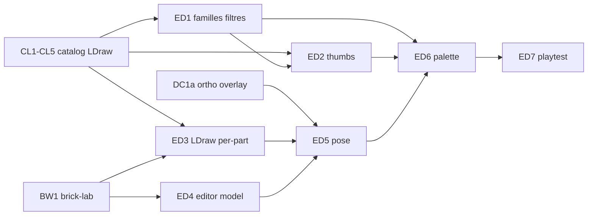

# Sprint BRICK-ED — Éditeur brick-lab + catalogue

Découpage de [docs/plans/brick-lab-editor.md](../plans/brick-lab-editor.md).  
Réfs : [catalog-lab.md](../plans/catalog-lab.md) · [BRICK-CL1](BRICK-CL1.md)–[CL5](BRICK-CL5.md) · [BRICK-BW1](BRICK-BW1.md) · [brick-decor-pipeline.md](../plans/brick-decor-pipeline.md) (DC, conservé).  
Checklist : [brick-decor-checklist.md](../design/brick-decor-checklist.md).

Objectif : **construire les décors à la main** dans `brick-lab` — catalogue avec familles, filtres et miniatures LDraw ; pose à la souris ; enregistrement direct du `.manual.json`. Preuve = fontaine 3 paliers refaite à la main, fidèle ±1 stud.

Ordre : **ED1 → ED2 → ED3 → ED4 → ED5 → ED6 → ED7**. Chaque ticket de code : `pnpm test` + `pnpm check`. Aucun commit sans demande.

Branche prévue : `feature/brick-lab-editor` depuis `develop`. PR cible : `develop`.

Prérequis : BW1 (manuel + brick-lab) ; CL1–CL5 (master-index, LDraw IPC, preview) ; DC1a (ortho + overlay + registre). Soft : orthoClipSystem (vues Face / Côté / Dessus lisibles).

---

## BRICK-ED1 — Catégories et filtres

Fichiers : [`build_master_catalog.py`](../../scripts/catalog/build_master_catalog.py), `public/catalog/categories.json`, [`types.ts`](../../src/racer/hub/brick/catalog/types.ts), [`parts.json`](../../src/racer/hub/brick/catalog/data/parts.json), [`CatalogBrowserPanel.tsx`](../../src/renderer/catalog/CatalogBrowserPanel.tsx), tests.

Fait quand :

- Build écrit `categories.json` : `{ id, name, family }` depuis `part_categories.csv` + mapping familles fixe (Briques, Plaques, Tuiles, Ronds et dômes, Pentes, Arches et courbes, Supports et charnières, Technic, Végétal et décor, Transparent et lumière, Minifig, Autres).
- Chaque entrée du maître gagne `family`.
- `BrickPartCategory` étendu : `arch`, `bracket`, `plant`, `technic` ; `BrickPartDef` gagne `tags?`, `ldrawId?` ; reclassement des pièces curated.
- Panneau catalogue : puces famille, sous-menu catégories nommées, filtres « dans parts.json », taille X×Z (1 / 2 / 4 / 6+), hauteur (plaque / brique / haut), tri id / nom / taille.
- Tests : mapping couvre les 75 catégories ; nouvelles catégories acceptées par le catalogue / `validateManual`.

## BRICK-ED2 — Miniatures LDraw

Fichiers : [`src/main/index.ts`](../../src/main/index.ts) + preload, bake helper catalogue / host, [`CatalogBrowserPanel.tsx`](../../src/renderer/catalog/CatalogBrowserPanel.tsx), `public/catalog/thumbs/`.

Fait quand :

- IPC `catalog-write-thumb(ldrawId, pngBytes)` → `public/catalog/thumbs/<id>.png` (128 px) + maj `thumbs/index.json`.
- Bouton « Générer miniatures » (filtre courant ou BC1) : preview mesh → caméra iso ortho → 2 frames → `readbackGameViewIntermediateToImageData` → crop / downscale → PNG. Séquentiel, progression, annulation ; skip si déjà présent sauf « forcer ».
- Vue grille `` + placeholder ; liste texte conservée.
- Priorité : 79 pièces `parts.json`, puis familles à la demande.
- Smoke : 3 pièces (ex. `3001`, `3062`, `3960`) miniatures correctes avant batch.

## BRICK-ED3 — LDraw pièce par pièce

Fichiers : [`spawnLandmarkLdraw.ts`](../../src/racer/hub/brick/spawnLandmarkLdraw.ts), [`parts.json`](../../src/racer/hub/brick/catalog/data/parts.json), spawn box proxy local.

Fait quand :

- Plus de `return null` global si une pièce échoue : chaque instance sans mesh → boîte locale ; les autres restent LDraw.
- `ldrawId` renseigné sur les pièces rondes / dish / cone / plate round (`3062`, `4589`, `6141`, `3960`, `4740`, …).
- brick-lab fontaine : paliers et dômes en vraie forme (plus de boîtes partout).

## BRICK-ED4 — Modèle éditeur + sauvegarde

Fichiers : `src/racer/levels/brickLab/editor/editorState.ts`, `editorIo.ts`, IPC `brick-manual-write`, [`registry.ts`](../../src/racer/hub/brick/manuals/registry.ts).

Fait quand :

- État : ops `brick`, carte occupation studs×plates, step courant, piles undo / redo.
- IO : ↔ `BrickManual` ; envelope + partsList recalculés ; `validateManual` avant écriture.
- IPC écrit `src/racer/hub/brick/manuals/<stem>.manual.json` ; stem `[a-z0-9-]+`.
- Actions UI : Nouveau, Ouvrir, Enregistrer, Enregistrer sous.
- Hot-reload : le registry ignore le stem en cours d’édition (évite respawn qui écrase l’éditeur).
- Tests unitaires état / IO / validation.

## BRICK-ED5 — Pose à la souris

Fichiers : `src/racer/levels/brickLab/editor/` (ray, ghost, occupancy, incremental spawn), branchement input brick-lab.

Fait quand :

- Rayon depuis inverse `viewProjectionMatrix` ; intersection plan `y = couche × 0.11` ; snap selon `rotatedFootprint`.
- Fantôme translucide vert (libre) / rouge (collision).
- Empilement auto sur le dessus sous l’empreinte ; couche manuelle verrouille Y.
- Contrôles : clic pose ; clic droit / Suppr retire ; R rot 90° ; PgUp/PgDn couche (±1P, Maj ±1B) ; Ctrl+Z/Y ; Alt+clic pipette.
- Rendu incrémental : map opId → entités (add / remove local).
- Grille de studs à la couche active ; overlay photo conservé.
- Playtest : pose en Orbit, Face et Dessus.

## BRICK-ED6 — Palette tiroir brick-lab

Fichiers : [`AtelierShell.tsx`](../../src/renderer/atelier/AtelierShell.tsx), [`atelier.css`](../../src/renderer/atelier/atelier.css), [`labPrefs.ts`](../../src/racer/hub/brick/manuals/labPrefs.ts) (ou équivalent).

Fait quand :

- Mode **Construire** dans le tiroir : grille miniatures BC1, puces famille, recherche, rangée récents, pastilles `colors.json` (translucides marquées), indicateur couche / rot, Enregistrer / Annuler.
- Lien « Ajouter depuis le catalogue maître » → staging / `bc1-merge-parts` existant.
- `labPrefs` : mode, pièce, couleur, couche.
- Tokens Atelier inchangés (plaque paper/ink).

## BRICK-ED7 — Docs + playtest fontaine

Fichiers : ce sprint · [brick-lab-editor.md](../plans/brick-lab-editor.md) · [brick-decor-checklist.md](../design/brick-decor-checklist.md) · [roadmap.md](../plans/roadmap.md).

Fait quand :

- Plan + sprint consignés ; checklist : voie principale = construction manuelle ; couches / Gemini = esquisse / grilles.
- Playtest : fontaine 3 paliers reconstruite dans l’éditeur ; vues Orbit / Face / Côté / Dessus + overlay ±1 stud ; FPS / `dc` notés.
- `pnpm test` + `pnpm check` verts sur la branche.

---

## Hors de ce sprint

- Macros `ring` / `disc` / `wall` / `box` dans l’éditeur.
- Façades garage / vinyle / mairie (contenu ; même outil après ED).
- Spawn / collider `city-test` pour nouveaux landmarks.
- Miniatures CDN tiers ; API Gemini auto.
- Remplacement du pipeline DC pour pad / gate rectangulaires.

## Critères playtest ED

| Boucle | Succès |
| ------ | ------ |
| Familles | Catalogue filtre par famille nommée ; « dans BC1 » réduit à ~79 |
| Miniatures | Grille affiche PNG ; génération 3 pièces smoke OK |
| LDraw mixte | Landmark avec 1 pièce manquante : le reste reste mesh |
| Enregistrer | Nouveau manuel écrit sur disque ; hot-reload n’écrase pas l’éditeur |
| Pose | Clic pose ; collision refusée ; undo restaure |
| Ortho | Face / Dessus : snap et fantôme corrects |
| Fontaine | 3 paliers gris + cyan ; silhouette vs photo ±1 stud |
| Régression | `catalog-lab`, `city-test`, manuels existants toujours chargeables |

## Dépendances

