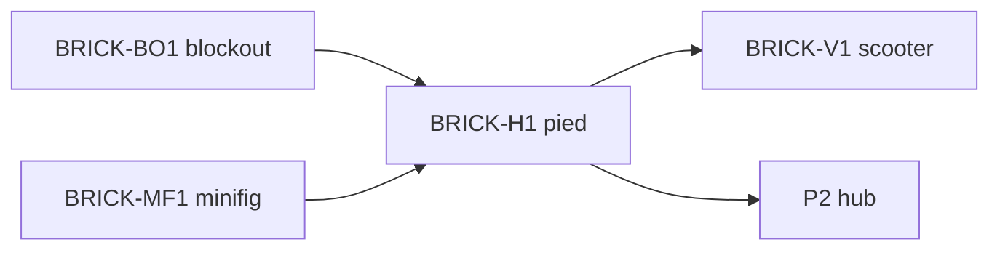

# Sprint BRICK-H1 — Hub blockout : pied et changement de véhicule

Découpage de [docs/plans/hub-on-foot.md](../plans/hub-on-foot.md).  
Blockout : [BRICK-BO1](BRICK-BO1.md). Minifig : [BRICK-MF1](BRICK-MF1.md).  
Contrat : [architecture.md](../plans/architecture.md) (HubSystem P2 ; ce sprint n’en livre que la locomotion).

Objectif : sur `city-test`, descendre du kart, marcher avec la minifig Bolt, monter dans le kart, la moto ou l’avion. `race-test` inchangé (`?vehicle=`).

Ordre : H1a → H1b → H1c. Chaque ticket de code se termine par `pnpm test` et `pnpm check`. Aucun commit sans demande.

Branche prévue : `feature/hub-on-foot` depuis `develop`. PR cible : `develop`.

Prérequis : **BRICK-BO1** (city-test + kits blockout kart / moto / avion) et **BRICK-MF1** (`assembleMinifigEntities`, recipe Bolt).

---

## BRICK-H1a — Possession

Fichiers : `src/racer/hub/hubPossession.ts`, `tests/hubPossession.test.ts`.

Fait quand :

- État `foot | kart | moto | plane`, actif seulement sur `city-test`.
- Pur : cible la plus proche sous ~2,2 m ; offset de descente ~1,6 m à droite du châssis ; « ce châssis a le droit aux gaz ».
- Tests sans moteur.

## BRICK-H1b — Spawn hub

Fichiers : [`cityTestSpec.ts`](../../src/racer/levels/cityTest/cityTestSpec.ts), kits blockout (flag conducteur masqué), [`collisionGroups.ts`](../../src/racer/levels/shared/collisionGroups.ts), [`bootEngine.ts`](../../src/racer/host/bootEngine.ts) (gproc si `city-test`).

Fait quand :

- Kart, moto et avion `playable: true`, garés sur la place (moto ouest, kart sud fontaine, avion est, ailes hors garage `x≥28` et boutique `x≤10`). Départ assis dans le kart. `?vehicle=` ignoré pour le départ.
- `HubAvatar` (boîte ~0,45 × 1,7 × 0,35, groupe `0x0020`) + minifig Bolt enfant (`MINIFIG_GPROC_GRAPHS` + teintes). `createGProcSystem` tourne sur `city-test`.
- Capsules `KartDriver` / `MotoDriver` / `PlaneCockpit` masquées dans le hub.
- `FootChaseCamera` plus proche que la chase kart.
- Masque châssis inclut le groupe avatar (course inchangée : bit inutilisé).

## BRICK-H1c — Marche, gate, caméra, touche F

Fichiers : système marche + gate des gaz, [`arcadeKartSystem.ts`](../../src/racer/vehicles/kart/arcade/arcadeKartSystem.ts), [`arcadePlaneSystem.ts`](../../src/racer/vehicles/plane/arcadePlaneSystem.ts), [`SceneDirector.ts`](../../src/racer/scene/SceneDirector.ts), lecture touche comme [`arcadeMkDriveInput.ts`](../../src/racer/host/arcadeMkDriveInput.ts).

Fait quand :

- **F** (pad Y, index 3) : descente, ou montée si un châssis est à portée. E non utilisé.
- À pied : WASD ~3,5 m/s, gravité, yaw de la pose, chase `FootChaseCamera`. Avatar dynamique. Gaz des trois véhicules à 0.
- Assis : avatar kinématique, collision off, snap siège après la physique et avant la chase. Caméra du véhicule possédé.
- Gate après les scripts : `throttle` / `steer` à 0 sur les non possédés. Le véhicule quitté garde son élan.
- Arcade kart suit le châssis possédé (ou ne fait rien à pied / en avion). Avion toujours enregistré, simulé seulement s’il est possédé. `race-test` : getter = `?vehicle=`.
- **X** : reset véhicule si conduit ; à pied, retour à côté du kart sans remonter.
- Canvas `data-possession` = `kart` | `moto` | `plane` | `foot`. Log `SceneDirector` à jour.

---

## Hors de ce sprint

- Animation de marche, scooter (`BRICK-V1` / VP1), prompts React, POI garage, pad → course.
- Échange de véhicule sur `race-test`.
- Texture debug (`?debugTex=` reste opt-in).

## Critères playtest H1

| Boucle | Succès |
| ------ | ------ |
| Départ | `?level=city-test` : assis dans le kart, minifig visible, moto et avion garés, capsules conducteur absentes |
| Descente | F pose le joueur à droite du kart ; WASD marche ; la chase suit la minifig ; les véhicules ne bougent plus aux gaz |
| Échange | F près de la moto, puis de l’avion, puis du kart : conduite de chacun, caméra du véhicule |
| Murs | La minifig ne traverse pas fontaine, bâtiments, gate, ni les châssis |
| Course | `race-test` + `?vehicle=` inchangé (un seul véhicule conduit, pas de marche) |
| Reset | X en véhicule = spawn de ce véhicule ; X à pied = à côté du kart, toujours à pied |

## Dépendances

