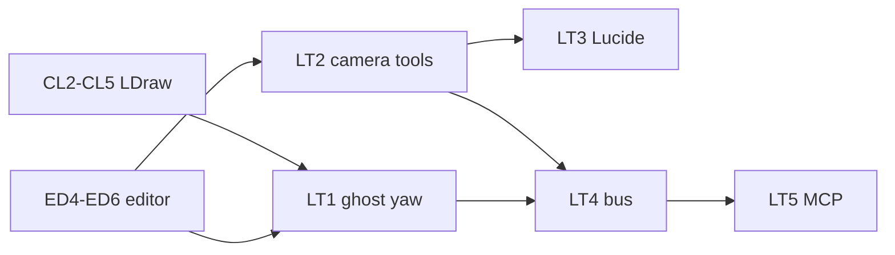

# Sprint BRICK-LT — Outils brick-lab (fantôme, caméra, Lucide, MCP)

Découpage de [docs/plans/brick-lab-tools.md](../plans/brick-lab-tools.md).  
MCP : [brick-lab-mcp.md](../plans/brick-lab-mcp.md).  
Suite de [BRICK-ED](BRICK-ED.md).

Objectif : fantôme pinceau **orienté** ; outils **Orbite / Pan** (vue verrouillée en édition) ; icônes **Lucide** ; MCP pour qu’un agent construise dans la session ouverte.

Ordre : **LT1 → LT2 → LT3 → LT4 → LT5**. Chaque ticket de code : `pnpm test` + `pnpm check`. Aucun commit sans demande.

Branche prévue : `feature/brick-lab-tools` depuis `develop`. PR cible : `develop`.

Prérequis : ED4–ED6 (état éditeur, pose, palette) ; preview catalogue / LDraw (CL2–CL5). Soft : playtest ED fantôme / caméra.

---

## BRICK-LT1 — Fantôme pinceau + yaw ✅

Fichiers : [`spawnCatalogPreview.ts`](../../src/racer/hub/brick/catalog/spawnCatalogPreview.ts), [`SceneDirector.ts`](../../src/racer/scene/SceneDirector.ts), [`BrickLabBuildPanel.tsx`](../../src/renderer/brickLab/BrickLabBuildPanel.tsx), packing [`brickInstanceData.ts`](../../src/racer/hub/brick/brickInstanceData.ts) / [`brickLdrawInstanceData.ts`](../../src/racer/hub/brick/brickLdrawInstanceData.ts), tests.

Fait quand :

- Fantôme = `BrickPose` (centre `gridMinToWorldCenter`, `yaw` via `rotToYawRad`).
- Mesh LDraw en cache : même packing landmark + `BRICK_ghost_*` ; sinon boîte yawée via `packBrickInstanceData`.
- Fetch LDraw **une fois par pièce** (pas à chaque `pointermove`).
- Preview autorisé sur `brick-lab` ; restauré après `syncBrickLabManual`.
- Test : 2×1 à 90° → étendues X/Z échangées ; 180° → yaw π. `rot` stocké à la pose inchangé.

## BRICK-LT2 — Outils Orbite / Pan + verrou édition ✅

Fichiers : [`editorState.ts`](../../src/racer/levels/brickLab/editor/editorState.ts) (`EditorTool`), [`BrickLabBuildPanel.tsx`](../../src/renderer/brickLab/BrickLabBuildPanel.tsx), [`brickLabCamera.ts`](../../src/racer/levels/brickLab/brickLabCamera.ts) (label Cadrer).

Fait quand :

- `EditorTool` : `'brush' | 'select' | 'orbit' | 'pan'`.
- **Orbite** (`C`) : clic gauche tourne ; pas de pose / effacement ; ne remet pas les angles.
- **Pan** (`H`) : clic gauche pan ; molette zoom.
- **Pinceau / Sélection** : `leftMouseMode = null` (vue verrouillée) ; clic droit efface ; molette OK.
- Chip **Orbit** renommé **Cadrer** (recadrage 3/4). Face / Côté / Dessus inchangés.
- Revenir au pinceau conserve l’angle courant.

## BRICK-LT3 — Lucide UI ✅

Fichiers : `package.json` (`lucide-react`), [`BrickLabBuildPanel.tsx`](../../src/renderer/brickLab/BrickLabBuildPanel.tsx), [`BrickLabMenuBar.tsx`](../../src/renderer/brickLab/BrickLabMenuBar.tsx), [`CatalogBrowserPanel.tsx`](../../src/renderer/catalog/CatalogBrowserPanel.tsx), [`sceneIcons.tsx`](../../src/renderer/atelier/sceneIcons.tsx), CSS Atelier si besoin.

Fait quand :

- Dépendance `lucide-react` ; icônes 16 px, `strokeWidth` 2, `aria-hidden`.
- Barre : Pinceau, Sélection, Orbite, Pan, Cadrer / Face / Côté / Dessus, Empile, Rot, Annuler.
- Menu Fichier : Nouveau / Sauver / Ouvrir avec icônes.
- Catalogue + rail Atelier : une famille Lucide (plus de SVG maison `Glyph` / `sceneIcons` hand-drawn).
- Tokens paper/ink inchangés ; pas de refonte layout.

## BRICK-LT4 — Bus local (dev) ✅

Fichiers : `src/main/` (HTTP `127.0.0.1`), preload / host, branchement [`BrickLabBuildPanel.tsx`](../../src/renderer/brickLab/BrickLabBuildPanel.tsx) → `editorState`, [`.gitignore`](../../.gitignore) → `data/brick-lab-mcp.token`.

Fait quand :

- Bus uniquement sous `pnpm dev` ; jeton fichier gitignoré ; header requis.
- Level ≠ `brick-lab` → réponse « non connecté ».
- Commandes : place (lot, undo unique, rejets partiels), remove, set_brush, undo/redo, save/load/new, status / get_assembly.
- Sync scène via `syncBrickLabManual` après mutation.

## BRICK-LT5 — Serveur MCP + docs ✅

Fichiers : `src/mcp/`, script `pnpm mcp:brick-lab`, [brick-lab-mcp.md](../plans/brick-lab-mcp.md) (exemple `mcp.json`), [build.md](../build.md) si besoin, ce sprint.

Fait quand :

- Serveur stdio `@modelcontextprotocol/sdk` expose les outils lot 1 ([brick-lab-mcp.md](../plans/brick-lab-mcp.md)).
- Exemple config Cursor documenté ; playtest : `place_bricks` visible dans brick-lab.
- `pnpm test` + `pnpm check` verts sur la branche.

---

## Hors de ce sprint

- Macros `ring` / `disc` / `wall` / `box`, dry-run, analyze, capture viewport, skill agent → **[BRICK-BA](BRICK-BA.md)** · [brick-lab-agent.md](../plans/brick-lab-agent.md).
- MCP packagé / hors localhost.
- Promotion catalogue maître via MCP.
- Façades garage / vinyle / mairie (contenu) → [BRICK-FC](BRICK-FC.md).

## Critères playtest LT

| Boucle | Succès |
| ------ | ------ |
| Fantôme | 1×4 à 90° et pente à 180° : fantôme = pose finale |
| Orbite | Tourne la vue sans poser ; angles conservés au retour pinceau |
| Verrou | Pinceau / Sélection : clic gauche n’orbite plus |
| Cadrer | Chip recadre 3/4 ; distinct de l’outil Orbite |
| Lucide | Barre / menu / catalogue / rail cohérents |
| MCP | `status` connecté ; `place_bricks` apparaît ; undo UI annule le lot |
| Régression | Manuels existants, catalog-lab, city-test OK |

## Dépendances

## Suite

Agent constructeur (MCP lot 2) : [BRICK-BA](BRICK-BA.md) · [brick-lab-agent.md](../plans/brick-lab-agent.md).  
Contenu façades : [BRICK-FC](BRICK-FC.md) · [brick-lab-facades.md](../plans/brick-lab-facades.md). Gameplay P1 ([BRICK-B3](BRICK-B3.md)) reste orthogonal.
