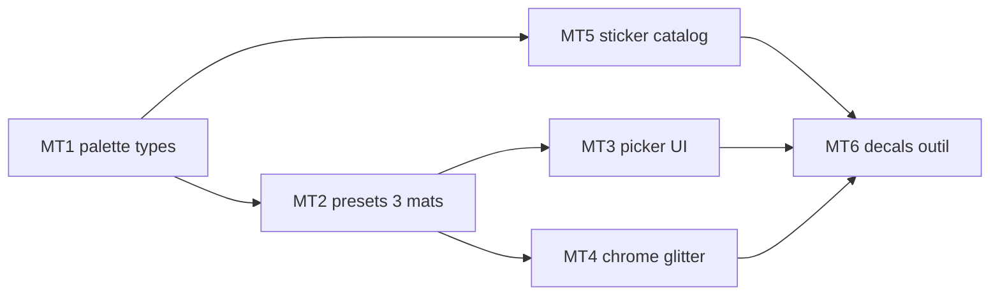

# Sprint BRICK-MT — Matériaux LEGO, palette officielle, stickers

Découpage de [docs/plans/brick-materials.md](../plans/brick-materials.md).  
Refs : [brick-part-catalog.md](../plans/brick-part-catalog.md) · [catalog-lab.md](../plans/catalog-lab.md) · [brick-manual-prompt.md](../design/brick-manual-prompt.md).  
Suite de BC1 / CL (plastique unique) ; orthogonal à [BRICK-BA](BRICK-BA.md) / [BRICK-FC](BRICK-FC.md).

Objectif : palette officielle LDraw (~355 couleurs avec finition), UI **matériau puis couleur**, presets PBR (caoutchouc, transparent, chrome, …), puis autocollants officiels en **decals**.

Ordre : **MT1 → MT2 → MT3 → MT4 → MT5 → MT6**. Chaque ticket de code : `pnpm test` + `pnpm check`. Aucun commit sans demande.

Branche prévue : `feature/brick-materials` depuis `develop`. PR cible : `develop`.

Prérequis : lib LDraw locale (`data/ldraw/ldraw/LDConfig.ldr` + `LDConfig_TLG.ldr`) ; catalog-lab / brick-lab jouables.

---

## BRICK-MT1 — Palette officielle + types + aliases ✅

Fichiers : [`build_lego_palette.mjs`](../../scripts/catalog/build_lego_palette.mjs), [`colors.json`](../../src/racer/hub/brick/catalog/data/colors.json), [`types.ts`](../../src/racer/hub/brick/catalog/types.ts), [`loadCatalog.ts`](../../src/racer/hub/brick/catalog/loadCatalog.ts) (`materialOf`), tests.

Fait quand :

- Script lit `LDConfig.ldr` → `colors.json` v2 (`ldrawCode`, `name`, `rgb`, `alpha?`, `material`, `glitter?`, `luminance?`, `common?`, `aliases?`). (`LDConfig_TLG.ldr` local = stub « Content removed » → noms LDraw humanisés.)
- `BrickMaterialKind` + mapping finition LDraw → kind (voir plan).
- Les 13 slugs legacy (`white`, `gray`, `cyan`, `clear`, …) résolvent vers des codes officiels ; manuels / layers existants valident sans changement.
- `materialOf(colorId)` et `BrickPartDef.allowedMaterials?` typés.
- Pregen plastique limitée aux couleurs `common` (interim MT2 lazy).
- Tests : comptes par matériau, alias, `materialOf` sur legacy.

## BRICK-MT2 — Presets plastic / transparent / rubber + ensure ✅

Fichiers : [`brickMaterialPresets.ts`](../../src/racer/hub/brick/materials/brickMaterialPresets.ts), [`landmarkPlasticMaterial.ts`](../../src/racer/hub/brick/landmarkPlasticMaterial.ts) (`ensureBrickMaterial`), [`catalogPlasticMaterials.ts`](../../src/racer/hub/brick/catalog/catalogPlasticMaterials.ts), [`spawnLandmarkLdraw.ts`](../../src/racer/hub/brick/spawnLandmarkLdraw.ts), [`brickMaterials.ts`](../../src/racer/hub/brick/brickMaterials.ts), [`kartWheelLook.ts`](../../src/racer/vehicles/kart/kartWheelLook.ts).

Fait quand :

- Presets `plastic`, `transparent`, `rubber` (+ chrome/metallic/pearl/glow/glitter/satin/speckle stubs) appliqués sur clone 017B.
- Template lazy via donor white/gray si couleur hors pregen common.
- Lots BLEND (transparent) : double face, pas d’ombre, spawn après opaques.
- Clé de lot reste `part|color`.
- Kart tire réutilise `RUBBER_PRESET`.
- Playtest catalog-lab : Trans-Clear / Rubber Black lisibles vs ABS.

## BRICK-MT3 — Picker matériau → couleur + contraintes pièce ✅

Fichiers : [`LegoColorPicker.tsx`](../../src/renderer/atelier/LegoColorPicker.tsx) (`LegoMaterialColorPicker`), [`BrickLabBuildPanel.tsx`](../../src/renderer/brickLab/BrickLabBuildPanel.tsx), [`parts.json`](../../src/racer/hub/brick/catalog/data/parts.json), [`manualSchema.ts`](../../src/racer/hub/brick/manual/manualSchema.ts).

Fait quand :

- UI : onglets matériau (compteurs) → grille couleurs filtrée ; « Courantes » / « Toutes » / recherche nom ou code.
- Onglets hors `allowedMaterials` grisés ; validation manuel = **warning** si couleur hors contrainte.
- MCP / `resolveColorId` acceptent slug, alias ou code LDraw numérique (`71`, `256`, …).
- Pièces pneu / vitre / jante / feux avec `allowedMaterials` ; CSS picker mis à jour.

## BRICK-MT4 — Chrome / metallic / pearl / glow + glitter shader

Fichiers : presets, [`CatalogPlasticPBR.json`](../../public/shader-graphs/CatalogPlasticPBR.json), `tests/catalogPlasticWgsl.test.ts`.

Fait quand :

- Presets `chrome`, `metallic`, `pearl`, `glow` branchés.
- Graph : `glitterAmount`, `glitterScale`, `glitterColor` (+ slot émissif dédié si besoin) ; presets `glitter`, `satin`, `speckle`.
- Planche visuelle catalog-lab : ≥ 1 swatch par kind sous HDR.
- Tests WGSL / propriétés graph verts.

## BRICK-MT5 — Catalogue stickers + bake PNG

Fichiers : script / IPC (voisin [`ldrawMain.ts`](../../src/main/ldrawMain.ts)), `public/catalog/stickers/index.json`, bake renderer (voisin [`thumbRaster.ts`](../../src/racer/hub/brick/catalog/thumbRaster.ts)), écriture IPC (voisin [`catalogThumbs.ts`](../../src/main/catalogThumbs.ts)).

Fait quand :

- Index des pièces `0 Sticker` : id, nom, AABB 2D LDU, `hostParts` / `sets` depuis `!KEYWORDS`, flag TEXMAP.
- Bake PNG à la demande (Canvas2D, ~512 px), cache disque, polygones colorés via palette v2 ; TEXMAP compose le PNG source.
- Fixture parse : `003238a.dat` (hostParts / sets / taille).
- `.gitignore` si cache sous `data/` ou `public/catalog/stickers/png/`.

## BRICK-MT6 — Decals runtime + outil Sticker + MCP

Fichiers : [`manualSchema.ts`](../../src/racer/hub/brick/manual/manualSchema.ts) (`stickers[]`), spawn landmark / brick-lab, render graph (`BrickRacerFast.json` + réf. DecalTest), UI Brick Lab, [`mcpCommands.ts`](../../src/racer/levels/brickLab/editor/mcpCommands.ts), [brick-manual-prompt.md](../design/brick-manual-prompt.md).

Fait quand :

- Schéma `stickers[]` : `{ id, face, offset?, rotation?, scale? }` ; validation.
- Spawn : une entité `DecalComponent` par sticker (profondeur ~1,5 mm, fade normal serré).
- Passe decal active dans le graph Brick-Racer.
- Outil « Sticker » : navigateur filtré (hôte / set / recherche) → clic face → pose ; MCP `sticker.place` / `sticker.remove`.
- Doc prompt manuel : palette officielle, matériaux dérivés, `stickers`.
- Playtest : sticker officiel visible sur une pièce brick-lab / catalog.

---

## Hors de ce sprint

- Pièces pattern / prints LDraw (`pXXX`).
- Stickers wrap multi-faces.
- `blId` BrickLink exhaustif.
- Spawn mesh façades sur `city-test` (suite FC).
- Agent BA (orthogonal).

## Critères playtest MT

| Boucle | Succès |
| ------ | ------ |
| Alias | Manuels pad / gate / garage / vinyle / mairie inchangés |
| Transparent | Vitre Trans-Clear : transmission lisible, pas d’ombre |
| Rubber | Pneu Rubber Black mat vs ABS brillant |
| Picker | Matériau → couleurs filtrées ; pneu refuse plastic |
| Chrome / glow | Swatch catalog-lab OK |
| Sticker | Bake + decal sur face front d’une plaque |
| Régression | `pnpm test` + `pnpm check` ; brick-lab / catalog-lab OK |

## Dépendances

## Suite

Contenu décors (stickers sur façades FC) · prints pièces · gameplay P1 ([BRICK-B3](BRICK-B3.md)) orthogonal.
